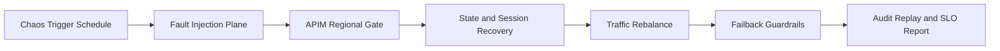

# Agentic 混沌演练与多区域 RPO/RTO 治理基础设施 FAQ（Cycle 2429）

## 1) 执行摘要
本轮聚焦企业级 Agent 平台在多区域故障与级联退化中的可恢复性：以 APIM AI Gateway 的区域熔断与回切治理为入口，结合 Event Hubs 重放、Redis 会话热态、跨区状态副本与演练编排，实现“可测量、可回放、可审计”的 RPO/RTO 工程闭环。

## 2) Q1 / Q2 / Q3
Q1：为何 Agent 平台需要“持续混沌演练”而不是一次性 DR 文档？  
A1：只有持续注入故障并量化恢复指标，才能验证策略在真实负载下仍满足 RPO/RTO 与租户公平性。  
Q2：如何避免故障切换时策略漂移导致越权或数据外溢？  
A2：故障域切换必须由同一策略版本门禁控制，禁止以紧急绕过破坏主权/权限边界。  
Q3：如何平衡低 RTO 与成本？  
A3：采用分层热备（网关热备 + 状态暖池 + 延迟容忍异步补偿），将高成本资源绑定到关键路径。

## 3) 混沌演练闭环流程（注入-检测-切换-回切-审计）

## 4) 决策矩阵：主动多活 vs 温热备 + 回放 vs 冷备重建
| 方案 | RTO | RPO | 成本 | 运维复杂度 | 适配场景 |
|---|---:|---:|---:|---:|---|
| 主动多活 | 最低 | 最低 | 最高 | 高 | 金融与强实时控制面 |
| 温热备 + 回放 | 低 | 低 | 中 | 中 | 大多数企业 Agent 平台 |
| 冷备重建 | 高 | 中高 | 低 | 低 | 非关键离线场景 |

## 5) 生产上线清单（含当日热点）
- 混沌演练必须覆盖：区域故障、网关退化、状态延迟、令牌校验异常。  
- 故障切换与回切都需策略同源，禁止应急绕过造成权限漂移。  
- 演练报告必须输出：RTO/RPO 分位、失败原因、回切稳定窗口。  
- 成本模型需区分关键路径资源与异步补偿资源。  
- 当日热点（抓取日：2026-11-16，官方/Release 优先）：  
  - APIM AI Gateway 区域治理与策略控制能力（`measured`）。  
  - Azure Container Apps Dynamic Sessions 在恢复路径弹性中的工程实践（`anonymized_reported`）。  
  - Firecracker/Kata/Wasm 版本演进对沙箱恢复抖动边界影响（`synthetic`）。

## 6) Good fit vs Not for 与百分比合约绑定
Good fit：  
1. 对 RPO/RTO 有硬约束、且需持续演练证明的企业级 Agent 控制面。  
2. 需要跨租户公平与合规边界共存的多区域 SaaS Agent 平台。

Not for：  
1. 没有统一策略版本治理、仅依赖人工应急操作的团队。  
2. 无法持续运行演练和审计回放的组织。

百分比合约绑定：
- `percentage_contract.rto_within_slo_recovery_rate`
- `percentage_contract.rpo_within_budget_rate`
- `percentage_contract.policy_drift_block_rate`
- `percentage_contract.failback_stability_window_pass_rate`

以上键绑定 `cycle-2429-benchmark.json`，并标注 `production_validation=not_measured`。
