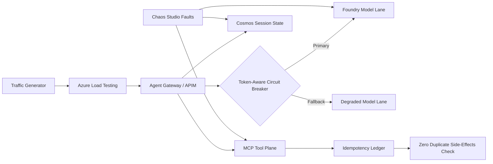

# Azure Agentic Chaos Engineering and Streaming Load Resilience Verification FAQ (Cycle 2392)

## 1) Scenario and constraints
The objective is to validate streaming-agent swarm resilience on Azure by injecting quota storms/regional latency/tool brownouts with Chaos Studio, applying SSE and streamable-HTTP MCP load via Azure Load Testing, and enforcing token-aware APIM circuit breakers for graceful degradation and zero duplicate side-effects.

## 2) Q1 / Q2 / Q3 Daily capability breakthroughs (verifiable)
Q1: Why combine chaos and load tests?  
A1: Load-only tests miss degraded fault paths; combined tests validate real resilience behavior.  
Q2: Key control for 429 quota storms?  
A2: Token-aware breaker plus fallback routing prevents retry amplification.  
Q3: Why do tool brownouts create duplicate side-effects?  
A3: Retries without idempotency ledgers can replay writes and must be explicitly guarded.

Sources and fetch timestamp (UTC) are listed in `cycle-2392-sources.json`.

## 3) Decision matrix (resilience, performance, cost)
| Path | P95 latency | Throughput P95 | Risk intercept rate | Cost/session | Ops complexity |
|---|---:|---:|---:|---:|---:|
| Breaker-protected path | 319 ms | 1206 rps | 96.69% | 0.00757 | medium |
| Latency-degraded path | 349 ms | 1112 rps | 95.04% | 0.00864 | medium-high |
| Tool-brownout fallback path | 437 ms | 1028 rps | 93.80% | 0.01017 | high |
| No-breaker baseline | 938 ms | 786 rps | N/A | 0.01162 | medium |

## 4) Good fit vs Not for
Good fit:
1. Streaming agent platforms requiring pre-release resilience gates.
2. Systems needing controlled degradation under quota/regional turbulence.
3. Critical flows requiring zero duplicate side-effects validation.
4. Engineering orgs promoting releases based on chaos evidence.

Not for:
1. Throughput-only tests with no fault injection.
2. Retry systems without idempotency keys and side-effect ledgers.
3. No breaker thresholds and reliance on uncontrolled retries.

## 5) Percentage contract bindings (N/D)
- `percentage_contract.quota_storm_degradation_success_rate`
- `percentage_contract.duplicate_sideeffect_zero_rate`
- `percentage_contract.resilience_cost_efficiency_gain_pts`

These keys bind to `cycle-2392-benchmark.json` with `production_validation=not_measured`.

## 6) Five-step rollout
1. Define three fault injections: quota, latency, and tool brownout.
2. Build streaming load profiles for peak and long-tail behavior.
3. Configure token-aware breakers and fallback model routing.
4. Add idempotency ledgers plus side-effect audit for tool writes.
5. Gate release promotion on chaos-load verification thresholds.
