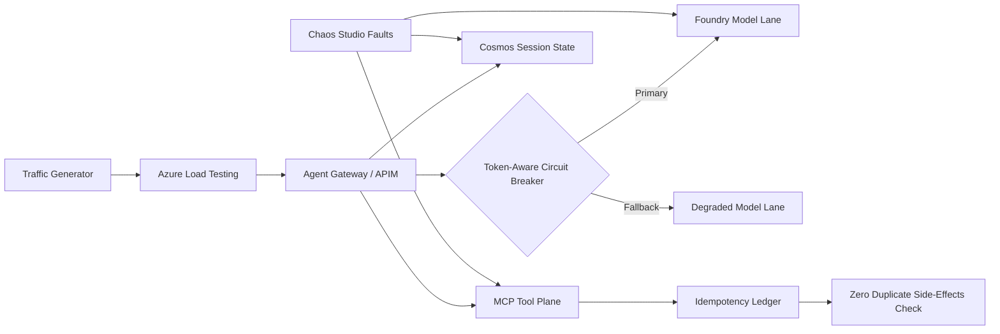

# Azure Agentic 混沌工程与流式压测韧性验证 FAQ（Cycle 2392）

## 1) 场景与约束
目标是在 Azure 上验证流式 Agent 群体韧性：用 Chaos Studio 注入配额风暴/区域时延/工具棕断，用 Azure Load Testing 施加 SSE 与 streamable HTTP MCP 负载，并结合 APIM token 感知熔断验证退化策略与零重复副作用。

## 2) Q1 / Q2 / Q3 当日能力突破（可验证）
Q1：为什么要把混沌与压测联动？  
A1：单独压测无法覆盖故障态退化路径，联动才能验证真实韧性。  
Q2：429 配额风暴下最关键控制点？  
A2：token 感知熔断与降级模型切换，避免重试风暴。  
Q3：工具棕断为何容易产生重复副作用？  
A3：重试若无幂等台账，会重复执行写操作，需要强校验。

来源与抓取时间（UTC）见 `cycle-2392-sources.json`。

## 3) 决策矩阵（韧性、性能、成本）
| 路径 | P95 延迟 | 吞吐 P95 | 风险拦截率 | 单会话成本 | 运维复杂度 |
|---|---:|---:|---:|---:|---:|
| 熔断保护路径 | 319 ms | 1206 rps | 96.69% | 0.00757 | 中 |
| 时延退化路径 | 349 ms | 1112 rps | 95.04% | 0.00864 | 中高 |
| 工具棕断回退路径 | 437 ms | 1028 rps | 93.80% | 0.01017 | 高 |
| 无熔断基线 | 938 ms | 786 rps | N/A | 0.01162 | 中 |

## 4) Good fit vs Not for
Good fit：
1. 需要发布前韧性门禁的流式 Agent 平台。  
2. 需要在配额与区域故障下保持服务降级可控的系统。  
3. 需要验证工具调用零重复副作用的关键业务流程。  
4. 需要把混沌证据纳入发布决策的工程组织。

Not for：
1. 只做吞吐压测，不做故障注入。  
2. 缺失幂等键与副作用台账的重试机制。  
3. 不配置熔断阈值直接依赖无限重试。

## 5) Percentage contract bindings (N/D)
- `percentage_contract.quota_storm_degradation_success_rate`
- `percentage_contract.duplicate_sideeffect_zero_rate`
- `percentage_contract.resilience_cost_efficiency_gain_pts`

以上键绑定 `cycle-2392-benchmark.json`，并标记 `production_validation=not_measured`。

## 6) 五步落地指南
1. 定义三类故障注入实验（配额、时延、工具）。  
2. 设计流式压测场景并覆盖峰值与长尾。  
3. 配置 token 感知熔断与降级模型路由。  
4. 为工具写操作引入幂等台账与副作用审计。  
5. 将混沌压测结果纳入发布门禁阈值。
