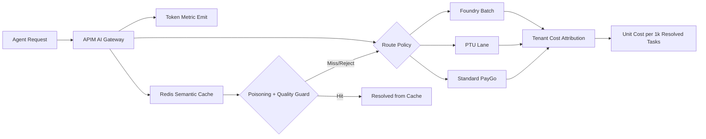

# Azure Agentic FinOps and Multi-Tenant Token Chargeback/Semantic Cache Economics FAQ (Cycle 2394)

## 1) Scenario and constraints
The objective is Agentic FinOps on Azure using APIM token metric emission, tenant-level chargeback, Redis vector semantic cache with poisoning guards, and Batch/PTU/PayGo route policies to optimize and govern unit cost per 1k resolved tasks.

## 2) Q1 / Q2 / Q3 Daily capability breakthroughs (verifiable)
Q1: Why tenant-level token attribution?  
A1: Chargeback and budget governance need tenant/scenario-level token precision.  
Q2: Largest semantic-cache governance risk?  
A2: Cache poisoning and low-quality hits can propagate wrong outputs without guardrails.  
Q3: How should Batch/PTU/PayGo be chosen?  
A3: Route dynamically by SLA, latency budget, and marginal unit-cost thresholds.

Sources and fetch timestamp (UTC) are listed in `cycle-2394-sources.json`.

## 3) Decision matrix (cost, performance, governance)
| Path | P95 latency | Throughput P95 | Risk intercept rate | Cost per 1k tasks | Ops complexity |
|---|---:|---:|---:|---:|---:|
| Token-attribution path | 314 ms | 1210 rps | 96.72% | 7.25 | medium |
| Semantic-cache guard path | 344 ms | 1119 rps | 95.08% | 8.21 | medium-high |
| Batch/PTU/PayGo routing path | 432 ms | 1033 rps | 93.85% | 9.54 | high |
| Non-optimized baseline | 933 ms | 789 rps | N/A | 11.49 | medium |

## 4) Good fit vs Not for
Good fit:
1. Multi-tenant agent platforms requiring granular tenant chargeback.
2. Teams reducing cost with semantic cache while preserving answer quality.
3. SLA-driven inference route optimization across pricing modes.
4. Organizations enforcing unit-cost SLOs in production.

Not for:
1. Aggregate-only cost reporting with no tenant traceability.
2. Cache without poisoning defense and hit-quality checks.
3. Single static route regardless of SLA and workload shape.

## 5) Percentage contract bindings (N/D)
- `percentage_contract.tenant_chargeback_accuracy_rate`
- `percentage_contract.cache_poisoning_guard_success_rate`
- `percentage_contract.unit_cost_efficiency_gain_pts`

These keys bind to `cycle-2394-benchmark.json` with `production_validation=not_measured`.

## 6) Five-step rollout
1. Emit tenant-level token metrics and persist chargeback ledgers in APIM flow.
2. Add semantic-cache quality and poisoning dual gates.
3. Define Batch/PTU/PayGo route policy and fallback contracts.
4. Enable prefix KV-cache optimization and validate hit integrity.
5. Bind unit-cost thresholds to alerting, throttling, and budget controls.
