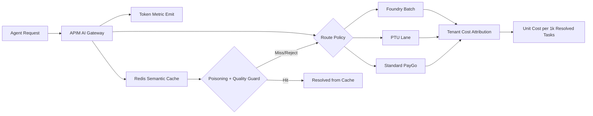

# Azure Agentic FinOps 与多租户 Token 归因/语义缓存经济学 FAQ（Cycle 2394）

## 1) 场景与约束
目标是在 Azure 上实现 Agentic FinOps：通过 APIM token 指标发射、多租户成本归因、Redis 向量语义缓存、防投毒守卫，以及 Batch/PTU/PayGo 路由策略，把单位成本统一到“每千已解决任务成本”。

## 2) Q1 / Q2 / Q3 当日能力突破（可验证）
Q1：为什么要做租户级 token 归因？  
A1：只有精确归因到租户与场景，才能实现真实 chargeback 和预算治理。  
Q2：语义缓存最大的治理风险是什么？  
A2：缓存投毒与低质量命中会带来错误复用，需要质量守卫。  
Q3：Batch/PTU/PayGo 如何选？  
A3：按 SLA、延迟预算与边际成本动态路由，而非单一路径固定。

来源与抓取时间（UTC）见 `cycle-2394-sources.json`。

## 3) 决策矩阵（成本、性能、治理）
| 路径 | P95 延迟 | 吞吐 P95 | 风险拦截率 | 每千任务成本 | 运维复杂度 |
|---|---:|---:|---:|---:|---:|
| Token 归因路径 | 314 ms | 1210 rps | 96.72% | 7.25 | 中 |
| 语义缓存防护路径 | 344 ms | 1119 rps | 95.08% | 8.21 | 中高 |
| Batch/PTU/PayGo 路由路径 | 432 ms | 1033 rps | 93.85% | 9.54 | 高 |
| 无优化基线 | 933 ms | 789 rps | N/A | 11.49 | 中 |

## 4) Good fit vs Not for
Good fit：
1. 多租户 Agent 平台需要按租户精细计费回收。  
2. 需要在保障质量前提下利用语义缓存降本。  
3. 需要按 SLA 对推理路径做动态经济路由。  
4. 需要将单位成本纳入生产 SLO 的团队。

Not for：
1. 只有总账成本，无租户维度可追溯。  
2. 缓存无防投毒与命中质量校验。  
3. 固定单一路径，不根据负载/SLA调优。

## 5) Percentage contract bindings (N/D)
- `percentage_contract.tenant_chargeback_accuracy_rate`
- `percentage_contract.cache_poisoning_guard_success_rate`
- `percentage_contract.unit_cost_efficiency_gain_pts`

以上键绑定 `cycle-2394-benchmark.json`，并标记 `production_validation=not_measured`。

## 6) 五步落地指南
1. 在 APIM 打通租户级 token 指标并落地账本。  
2. 引入语义缓存命中质量和投毒检测双门禁。  
3. 建立 Batch/PTU/PayGo 路由策略与回退规则。  
4. 启用 prefix KV-cache 并验证命中有效性。  
5. 将每千任务成本与预算阈值绑定告警和限流。
