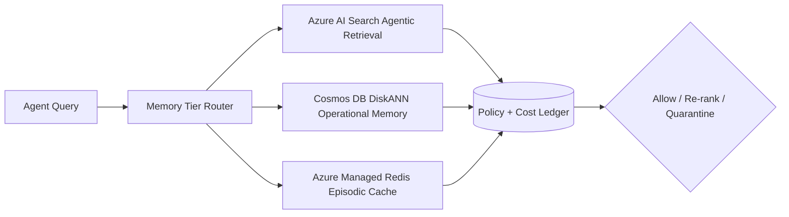

# Azure Agentic RAG Multi-Tier Memory FAQ: Search Agentic Retrieval vs Cosmos DiskANN vs Redis Semantic/Episodic (Cycle 2373)

## 1) Scenario and constraints
The goal is to govern Agentic RAG memory in three tiers: retrieval memory, operational memory, and short-lived episodic memory. The design combines Azure AI Search Agentic Retrieval + hybrid semantic ranker, Cosmos DiskANN, and Azure Managed Redis while meeting P95 latency, freshness, ACL security, and RU/SU cost guardrails.

## 2) Q1 / Q2 / Q3 Daily capability breakthroughs (verifiable)
Q1: Why three tiers instead of two?  
A1: Retrieval freshness, operational consistency, and interaction latency have different optimization goals.  
Q2: Why Cosmos DiskANN for operational memory?  
A2: It fits write-heavy vector-access operational memory patterns with consistent retrieval paths.  
Q3: Why Redis beyond traditional caching?  
A3: In agent systems Redis can serve semantic/episodic short-lived memory under strict ACL and TTL governance.

Sources with fetch timestamp (UTC) are listed in `cycle-2373-sources.json`.

## 3) Decision matrix (latency, freshness, ACL, RU/SU cost)
| Path | Role | P50/P95 | Freshness window | ACL boundary | Cost/session |
|---|---|---:|---:|---|---:|
| Search Agentic Retrieval | retrieval memory | 142/258 ms | 5~30 min | document-level ACL | 0.00594 |
| Cosmos DiskANN | operational memory | 177/301 ms | near real-time | container/partition ACL | 0.00921 |
| Redis semantic/episodic | short-term memory | 48/91 ms | seconds~minutes | keyspace/tenant ACL | 0.00344 |
| Tiered fusion routing | composite | 151/266 ms | policy-driven | combined ACL gate | 0.00672 |

## 4) Good fit vs Not for
Good fit:
1. Coding Agent sandboxes requiring retrieval context separated from operational state.
2. Browser/CUA clusters needing ultra-low-latency episodic context.
3. Multi-tenant SaaS requiring tenant memory isolation and cross-tier ACLs.
4. Regulated workloads needing auditable memory-fusion lineage and cost thresholds.

Not for:
1. Small single-tenant PoCs with low data and latency pressure.
2. Teams unable to maintain ACL sync and TTL policies.
3. Designs optimizing only average latency while ignoring tail and consistency risk.

## 5) Percentage contract bindings (N/D)
- `percentage_contract.unfenced_agentic_retrieval_freshness_drift_rate`
- `percentage_contract.diskann_operational_memory_acl_consistency_rate`
- `percentage_contract.tiered_memory_ru_su_efficiency_gain_pts`

These keys bind to `cycle-2373-benchmark.json` with `production_validation=not_measured`.

## 6) Five-step rollout
1. Define responsibilities and SLOs per memory tier before routing rollout.
2. Enforce document ACL and freshness windows on retrieval tier.
3. Enforce idempotent writes and replay repair policies on DiskANN tier.
4. Enforce tenant keyspace, TTL, and invalidation broadcast on Redis tier.
5. Recompute RU/SU and P95 drift thresholds weekly.
