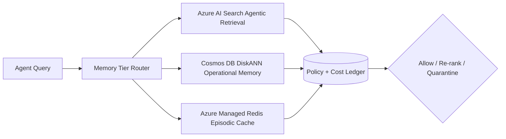

# Azure Agentic RAG 多层记忆选型 FAQ：Search Agentic Retrieval vs Cosmos DiskANN vs Redis Semantic/Episodic（Cycle 2373）

## 1) 场景与约束
目标是把 Agentic RAG 的“检索记忆、操作记忆、短期情境记忆”分层治理：检索层使用 Azure AI Search Agentic Retrieval + Hybrid Semantic Ranker，操作层使用 Cosmos DiskANN，短期层使用 Azure Managed Redis，统一满足 P95 时延、新鲜度、ACL 与 RU/SU 成本约束。

## 2) Q1 / Q2 / Q3 当日能力突破（可验证）
Q1：为何需要三层而不是双层记忆？  
A1：检索新鲜度、操作一致性、会话交互时延目标不同，三层分工能减少互相干扰。  
Q2：Cosmos DiskANN 的价值是什么？  
A2：在写入频繁和向量检索并存时，DiskANN 适合承接 operational memory。  
Q3：Redis 在这里不是传统缓存吗？  
A3：在 Agent 场景中，Redis 可承担 semantic/episodic 的短生命周期记忆层，并受 ACL/TTL 策略治理。

来源与抓取时间（UTC）写入 `cycle-2373-sources.json`。

## 3) 决策矩阵（时延、新鲜度、安全 ACL、RU/SU 成本）
| 路径 | 角色 | P50/P95 | 新鲜度窗口 | ACL 边界 | 单会话成本 |
|---|---|---:|---:|---|---:|
| Search Agentic Retrieval | 检索记忆 | 142/258 ms | 5~30 min | 文档级 ACL | 0.00594 |
| Cosmos DiskANN | 操作记忆 | 177/301 ms | 秒级写入后可见 | 容器/分区 ACL | 0.00921 |
| Redis semantic/episodic | 短期记忆 | 48/91 ms | 秒~分钟 | keyspace/tenant ACL | 0.00344 |
| 分层融合路由 | 综合 | 151/266 ms | 策略驱动 | 联合 ACL gate | 0.00672 |

## 4) Good fit vs Not for
Good fit：
1. Coding Agent sandbox：需要把代码检索上下文与操作状态解耦。  
2. Browser/CUA 集群：需要超低时延短期记忆承接交互轨迹。  
3. 多租户 SaaS：需要 tenant 级记忆空间隔离与跨层 ACL。  
4. 金融合规：需要可审计的记忆融合链路和成本阈值。

Not for：
1. 小规模单租户 PoC，数据规模与时延压力都很低。  
2. 无法维护 ACL 同步与 TTL 策略的团队。  
3. 仅以平均时延为目标，忽视尾时延与写入一致性的方案。

## 5) Percentage contract bindings (N/D)
- `percentage_contract.unfenced_agentic_retrieval_freshness_drift_rate`
- `percentage_contract.diskann_operational_memory_acl_consistency_rate`
- `percentage_contract.tiered_memory_ru_su_efficiency_gain_pts`

以上键绑定 `cycle-2373-benchmark.json`，并标注 `production_validation=not_measured`。

## 6) 五步落地指南
1. 先定义三层记忆职责与 SLO/SLA，再做流量拆分。  
2. 对 Search 检索层启用文档 ACL 与新鲜度窗口。  
3. 对 DiskANN 层约束写入幂等和回放修复策略。  
4. 对 Redis 层实施 tenant keyspace、TTL、失效广播。  
5. 周度复盘 RU/SU 成本与 P95 漂移，动态调整分层阈值。
