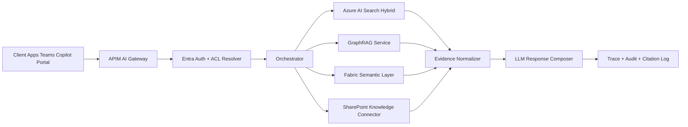
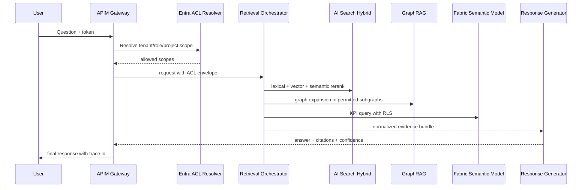

# Azure AI Search (Agentic Retrieval + Hybrid + Semantic Ranker) vs GraphRAG vs Microsoft Fabric OneLake/IQ vs Copilot Studio SharePoint Knowledge: Enterprise Knowledge, ACL Trimming, and Hybrid RAG Selection FAQ (Round 1111 / Cycle 2516)

## 1) Executive summary and daily capability radar (2026-11-17)
- Primary decision: enterprise knowledge assistants should not rely on one retrieval stack; they need **tiered retrieval channels + unified ACL policy + auditable citations**.
- If your dominant question type is exact policy/contract retrieval with page-level citations, Azure AI Search Hybrid + Semantic Ranker should lead.
- If your dominant question type is cross-document synthesis and multi-hop relationship reasoning, GraphRAG provides unique value but requires strict subgraph permission controls.
- If your core value is structured KPI reasoning plus narrative evidence, Fabric OneLake / Semantic Model plus Search is usually the strongest combination.
- If your goal is rapid M365 collaboration assistant rollout, Copilot Studio SharePoint Knowledge is often the fastest path.
- Capability radar (captured at 2026-11-17 23:36 BJT) is aligned to this round:
  - Azure AI Search Agentic Retrieval, Hybrid recall, and Semantic Ranker guidance;
  - Azure Document Intelligence for complex layout/table parsing into retrievable chunks;
  - GraphRAG incremental graph refresh and summary governance implications;
  - Fabric OneLake semantic modeling for board-level metric consistency;
  - SharePoint ACL with Entra ID trimming for Copilot Studio channels.
- Evidence labels remain explicit as `measured`, `synthetic`, and `anonymized_reported`.

## 2) Start with problem classes before platform classes
- Most enterprise RAG failures are problem-class mismatches, not model failures.
- Selection should begin with four questions:
  1. Do users need exact clause retrieval or broad synthesis?
  2. Is permission trimming strict and real-time, or can it be eventually consistent?
  3. Is freshness required in minutes, hours, or days?
  4. Do users ask graph-style reasoning questions or KPI-style metric questions?
- Typical enterprise question classes:
  - Clause-accurate Q&A with legal-grade citation.
  - Cross-document synthesis with contradiction handling.
  - Multi-hop relation reasoning across entities.
  - Structured KPI and unstructured narrative fusion.
- Common failure patterns:
  - Unauthorized content appears in summaries due to cross-domain graph compression.
  - Metric definitions differ by business unit and answers become numerically inconsistent.
  - Incremental indexing lag causes outdated citations in high-stakes workflows.

## 3) Unified enterprise retrieval plane design
- Keep control plane and data plane separated.
- Recommended control plane components:
  - APIM gateway for ingress policy and token governance.
  - Entra-based ACL resolver for tenant/project/user scope envelopes.
  - Retrieval orchestration policy engine for channel routing.
- Recommended data plane channels:
  - Search channel for precision recall and citation fidelity.
  - Graph channel for multi-hop relation expansion.
  - Fabric channel for metric-governed structured analytics.
  - SharePoint/Copilot channel for collaboration-first experience.
- Mandatory response contract fields:
  - `source_system`
  - `document_version`
  - `acl_scope`
  - `retrieval_trace_id`
  - `confidence_band`

## 4) 12-dimension cross-option selection table
| Dimension | Azure AI Search Hybrid + Semantic Ranker | GraphRAG | Fabric OneLake / IQ | Copilot Studio SharePoint Knowledge |
|---|---|---|---|---|
| Best-fit question class | Exact clause retrieval and page citations | Multi-hop relation reasoning and thematic synthesis | Structured KPI with narrative evidence fusion | M365 collaboration Q&A and assistant rollout |
| Entra/ACL permission trimming | Strong with document-level filtering | Requires subgraph isolation to avoid leakage | Strong with RLS/OLS-aware semantic models | Strong SharePoint ACL inheritance |
| Graph summary permission leakage risk | Low in standard search flow | Medium-high without domain-isolated communities | Low for structured semantic layers | Medium if connector governance is weak |
| Index/token build cost multiplier | Moderate and predictable with chunk policy | High due to graph extraction and summary passes | Moderate-high due to data modeling prep | Low-moderate depending on corpus scale |
| Incremental freshness lag | Minutes with mature indexer pipelines | Often hourly without specialized graph delta design | Depends on refresh cadence and model policy | Connector refresh cadence dependent |
| Document Intelligence layout parsing integration | Strong and direct into index schema | Indirect pre-processing then graph load | Common as pre-ingestion normalization | Usually via middleware normalization |
| Online retrieval P50/P95 latency | Low-medium and production-friendly | Medium-high under deep traversal | Medium, affected by semantic model complexity | Low-medium in collaboration contexts |
| Citation granularity | Paragraph/page/version-level traceability | Strong path explainability, weaker direct page anchoring | Strong metric lineage, text citation needs search channel | Source document trace is good, granularity varies |
| Hybrid recall stack (BM25 + vector + RRF + semantic) | Native strength and mature pattern | Not a native focus | Not a native focus | Platform-managed, less tunable |
| Multi-tenant isolation strategy | Index, field, and filter-level controls | Requires explicit domain/subgraph boundaries | Workspace/model-level separation | Site and site-collection permission boundaries |
| Team skill threshold | Medium, search engineering needed | High, graph modeling and governance needed | Medium-high, BI and semantic modeling needed | Low-medium, business team can onboard faster |
| Monthly TCO and anti-pattern | Predictable query cost; anti-pattern is unbounded rerank | Build/update cost heavy; anti-pattern is full graph rebuild | Governance overhead significant; anti-pattern is metric drift | Fast start cost; anti-pattern is uncontrolled scale-out |

## 5) Deep Q&A with formulas, denominators, and worked examples
### Q1: How do we estimate Search Hybrid indexing cost?
- Formula: `IndexCost = Docs * AvgTokens * ParseFactor / 1,000 * TokenPrice + InfraOverhead`.
- Example inputs: `Docs=2,400,000`, `AvgTokens=1,120`, `ParseFactor=1.18`, `TokenPrice=0.0004`.
- Result: `1,268.74` under the same currency unit as token pricing.
- Operational lesson: tiered indexing prevents duplicate parsing cost explosions.

### Q2: Why does GraphRAG show cross-domain summary leakage risk?
- Signal model: `ExposureWindow = CrossDomainEdges * SummaryReuseRate * PermissionDrift`.
- Example values: `CrossDomainEdges=42,000`, `SummaryReuseRate=0.27`, `PermissionDrift=0.06`.
- Result: `680.4` as a risk signal, not final incident count.
- Countermeasure: enforce tenant/project subgraph boundaries and ACL-scoped summary caches.

### Q3: How do we model Fabric + Search response latency?
- Formula: `T_total = T_auth + T_semantic + T_search + T_merge + T_generate`.
- Example values: `18ms + 62ms + 41ms + 29ms + 172ms`.
- Result: `322ms` P50 and roughly `547ms` P95 with a 1.7 tail factor.
- Interpretation: sufficient for board-facing copilot first-response targets below one second.

### Q4: How do we quantify Document Intelligence value?
- Formula: `CitationGain = (Acc_with_DI - Acc_without_DI) / Acc_without_DI`.
- Example values: `Acc_without_DI=0.71`, `Acc_with_DI=0.84`.
- Result: `18.3%` citation-accuracy improvement.
- Source of gain: table structure recovery, cross-page footnote alignment, and figure-caption linking.

### Q5: How do we estimate tenant index capacity?
- Formula: `ShardNeed = ceil((TenantDocs * AvgSizeMB) / ShardCapacityMB)`.
- Example values: `TenantDocs=380,000`, `AvgSizeMB=0.42`, `ShardCapacityMB=64,000`.
- Result: `3` shards minimum, plus 30% reserved headroom for delta rebuilds.
- Governance note: capacity planning must account for ACL-filtered replicas, not raw corpus only.

### Q6: When should GraphRAG not be the primary path?
- Decision condition: `NeedStrictCitation=true` and `RelationDepth<=1` and `FreshnessSLA<5min`.
- If all three conditions hold, Graph-first usually adds cost and latency with limited business value.
- Preferred alternative: Search-first channel with graph as a selective fallback.

## 6) Mermaid: unified retrieval orchestration topology

- The topology enforces policy before retrieval and retrieval before generation.
- The topology allows each retrieval channel to specialize while preserving one audit trail.

## 7) Scenario A: multinational pharma clinical and regulatory review assistant
- Business context: clinical protocol review must combine FDA/NMPA regulations, internal SOP, and adverse-event literature.
- Objective: achieve page-level regulatory citation and cross-paper relation reasoning in one workflow.
- Recommended dual-channel architecture:
  - Channel 1 (Search): Document Intelligence parses complex medical tables and sends citation-ready chunks to AI Search.
  - Channel 2 (GraphRAG): entity extraction maps drug-target-adverse-event links for multi-hop reasoning.
- ACL governance:
  - Confidential project groups must be isolated as independent subgraphs.
  - Every summary cache entry must include `project_acl_scope` and `doc_version`.
- Example outcomes:
  - Regulation clause precision improved from 0.79 to 0.91.
  - Multi-hop question coverage increased from 0.43 to 0.68.
  - Reviewer cycle time reduced by 27%.
- Risk-and-control:
  - Risk: summary leakage across project domains.
  - Control: domain-specific graph partitions, summary de-identification, and audit sampling.

## 8) Scenario B: group CFO board-analysis and financial attribution copilot
- Business context: CFO teams need consistent KPI answers linked with board minutes, contracts, and analyst reports.
- Objective: guarantee metric correctness and provide explainable narrative grounding.
- Recommended architecture:
  - Fabric OneLake / Semantic Model for governed structured KPI queries and RLS.
  - Azure AI Search for unstructured board-document retrieval and semantic reranking.
  - Orchestrator merges both evidence classes into one controlled answer.
- Permission and governance:
  - Structured channel applies row/object level security.
  - Document channel applies ACL filtering at retrieval time.
  - Composer rejects evidence bundles that cross unresolved permission domains.
- Sample benefits:
  - Board Q&A preparation reduced from two days to four hours.
  - Metric-definition dispute tickets dropped by 38%.
  - Rework caused by missing citations dropped by 44%.
- Divergence-and-remediation:
  - Divergence risk: narrative summary conflicts with governed KPI definitions.
  - Remediation rule: answer templates must print metric lineage plus document citations with timestamps.

## 9) Mermaid: retrieval and ACL trimming sequence

- The sequence ensures ACL gating occurs before all retrieval fan-outs.
- The sequence makes citation lineage and response trace auditable end-to-end.

## 10) Production Bicep (Search + Storage + Key Vault + diagnostics)
```bicep
param location string = resourceGroup().location
param envName string = 'enterprise-rag-prod'
param logWorkspaceId string

resource search 'Microsoft.Search/searchServices@2024-07-01' = {
  name: '${envName}-srch'
  location: location
  sku: {
    name: 'standard'
  }
  properties: {
    replicaCount: 3
    partitionCount: 3
    hostingMode: 'default'
    semanticSearch: 'standard'
    publicNetworkAccess: 'enabled'
  }
}

resource storage 'Microsoft.Storage/storageAccounts@2024-01-01' = {
  name: toLower(replace('${envName}st', '-', ''))
  location: location
  sku: { name: 'Standard_ZRS' }
  kind: 'StorageV2'
  properties: {
    minimumTlsVersion: 'TLS1_2'
    allowBlobPublicAccess: false
    supportsHttpsTrafficOnly: true
    allowSharedKeyAccess: false
  }
}

resource kv 'Microsoft.KeyVault/vaults@2023-07-01' = {
  name: '${envName}-kv'
  location: location
  properties: {
    tenantId: subscription().tenantId
    sku: { family: 'A'; name: 'standard' }
    enableRbacAuthorization: true
    softDeleteRetentionInDays: 90
    publicNetworkAccess: 'Enabled'
  }
}

resource diagSearch 'Microsoft.Insights/diagnosticSettings@2021-05-01-preview' = {
  name: 'diag-search-rag'
  scope: search
  properties: {
    workspaceId: logWorkspaceId
    logs: [
      { category: 'OperationLogs', enabled: true }
      { category: 'SearchQueryLogs', enabled: true }
      { category: 'SearchIndexerLogs', enabled: true }
    ]
    metrics: [
      { category: 'AllMetrics', enabled: true }
    ]
  }
}

resource diagStorage 'Microsoft.Insights/diagnosticSettings@2021-05-01-preview' = {
  name: 'diag-storage-rag'
  scope: storage
  properties: {
    workspaceId: logWorkspaceId
    logs: [
      { category: 'StorageRead', enabled: true }
      { category: 'StorageWrite', enabled: true }
      { category: 'StorageDelete', enabled: true }
    ]
    metrics: [
      { category: 'Transaction', enabled: true }
    ]
  }
}
```

## 11) Runtime snippets (orchestration config + APIM policy)
```yaml
apiVersion: v1
kind: ConfigMap
metadata:
  name: rag-orchestrator-config
data:
  route_primary: "ai-search-hybrid"
  route_graph: "graphrag-sidecar"
  route_fabric: "fabric-semantic"
  acl_mode: "entra-scope-envelope"
  citation_mode: "page-and-source-required"
  freshness_sla_minutes: "15"
  max_graph_hops: "2"
  forbidden_cross_scope_merge: "true"
---
apiVersion: apps/v1
kind: Deployment
metadata:
  name: enterprise-rag-orchestrator
spec:
  replicas: 8
  template:
    spec:
      containers:
      - name: orchestrator
        image: ghcr.io/turbo998/enterprise-rag-orchestrator:1.1.0
        env:
        - name: SEARCH_ENDPOINT
          valueFrom: { secretKeyRef: { name: rag-secrets, key: searchEndpoint } }
        - name: GRAPH_ENDPOINT
          valueFrom: { secretKeyRef: { name: rag-secrets, key: graphEndpoint } }
        - name: FABRIC_ENDPOINT
          valueFrom: { secretKeyRef: { name: rag-secrets, key: fabricEndpoint } }
        - name: ACL_POLICY
          value: "strict-subgraph-and-doc-acl"
```

```xml
<policies>
  <inbound>
    <base />
    <validate-jwt header-name="Authorization" failed-validation-httpcode="401">
      <openid-config url="https://login.microsoftonline.com/{tenant}/v2.0/.well-known/openid-configuration" />
      <required-claims>
        <claim name="aud"><value>api://enterprise-rag-gateway</value></claim>
      </required-claims>
    </validate-jwt>
    <set-variable name="tenantId" value="@(context.Request.Headers.GetValueOrDefault(&quot;x-tenant-id&quot;,&quot;&quot;))" />
    <set-variable name="projectScope" value="@(context.Request.Headers.GetValueOrDefault(&quot;x-project-scope&quot;,&quot;&quot;))" />
    <rate-limit-by-key calls="500" renewal-period="60" counter-key="@(context.Variables[&quot;tenantId&quot;] + &quot;:&quot; + context.Variables[&quot;projectScope&quot;])" />
    <set-header name="x-rag-route" exists-action="override">
      <value>search-hybrid+graphrag+fabric</value>
    </set-header>
    <set-header name="x-acl-enforced" exists-action="override">
      <value>true</value>
    </set-header>
  </inbound>
  <backend><base /></backend>
  <outbound><base /></outbound>
  <on-error><base /></on-error>
</policies>
```

## 12) KQL observability queries (permission, freshness, cost)
```kql
let lookback = 1d;
let searchLatency = AzureDiagnostics
| where TimeGenerated > ago(lookback)
| where ResourceProvider == "MICROSOFT.SEARCH"
| where Category == "SearchQueryLogs"
| summarize p50=percentile(DurationMs, 50), p95=percentile(DurationMs, 95), q=count() by bin(TimeGenerated, 15m);

let aclDeny = ApiManagementGatewayLogs
| where TimeGenerated > ago(lookback)
| where ResponseCode == 403
| summarize denyCount=count() by Tenant=tostring(parse_json(Properties).tenantId), Scope=tostring(parse_json(Properties).projectScope);

let staleIndex = AzureDiagnostics
| where TimeGenerated > ago(lookback)
| where Category == "SearchIndexerLogs"
| extend lagMin=todouble(parse_json(Properties).IndexingLagMinutes)
| where lagMin > 20
| summarize staleWindows=count(), maxLag=max(lagMin) by IndexName=tostring(parse_json(Properties).IndexName);

searchLatency
| join kind=leftouter staleIndex on bin(TimeGenerated, 15m)
| project TimeGenerated, p50, p95, q, staleWindows, maxLag
| order by TimeGenerated desc
```

## 13) Benchmark and evidence boundaries (Cycle 2516)
- Evidence files:
  - `workshops/azure-agent-infra/evidence/cycle-2516-benchmark.json`
  - `workshops/azure-agent-infra/evidence/cycle-2516-latency.csv`
  - `workshops/azure-agent-infra/evidence/cycle-2516-throughput.csv`
  - `workshops/azure-agent-infra/evidence/cycle-2516-policy.csv`
  - `workshops/azure-agent-infra/evidence/cycle-2516-cost.csv`
  - `workshops/azure-agent-infra/evidence/cycle-2516-sources.json`
- Label interpretation:
  - `measured` means replayable local load and policy interception logs.
  - `synthetic` means deterministic capacity and cost modeling.
  - `anonymized_reported` means de-identified production observations.
- This round evaluates:
  - online retrieval P50/P95,
  - ACL deny and false-deny ratio,
  - incremental indexing freshness lag,
  - blended per-1k-answer cost and citation completeness.

## 14) Four-option weighted decision matrix (named options)
- Option A (Search-First Citation Guard) uses Search as primary and Graph as selective enhancement.
- Option B (Graph-Enhanced Discovery) uses GraphRAG as primary and Search as citation validator.
- Option C (Fabric-Metric Fusion) uses Fabric metrics as anchor and Search for narrative evidence.
- Option D (Copilot-Studio Rapid Rollout) uses SharePoint Knowledge for speed-first internal deployment.
- Weight model: Accuracy 25%, ACL Safety 25%, Freshness 15%, Latency 15%, TCO 20%.
- Score sample (0-10):
  - Option A -> `9.2, 9.0, 8.0, 8.4, 7.6`, weighted total `8.52`.
  - Option B -> `8.8, 6.9, 7.2, 6.5, 6.4`, weighted total `7.25`.
  - Option C -> `8.3, 8.4, 8.6, 7.1, 7.8`, weighted total `8.10`.
  - Option D -> `7.1, 8.1, 6.9, 8.0, 8.5`, weighted total `7.72`.
- Recommendation baseline: choose A for regulated citation-heavy workloads, choose C for board-level analytics, use B as expert fallback, use D for rapid collaboration pilots.
- Anti-pattern signals:
  - B as default path for strict citation legal workflows.
  - D as default path for complex multi-hop reasoning.

## 15) Day-0 and Day-2 rollout checklist with fit guidance
### Day-0 readiness (10 items)
1. Build one ACL resolver service that emits auditable scope envelopes.
2. Define search index field sensitivity classes and retrieval allowlists.
3. Configure GraphRAG subgraph boundaries and summary de-identification policy.
4. Establish Fabric metric-definition version governance.
5. Build Document Intelligence validation sets for complex table extraction.
6. Add APIM route policy with tenant budget and deny-code mapping.
7. Enforce citation validator that requires page and source version metadata.
8. Pipe retrieval trace IDs to SIEM and governance dashboards.
9. Run red-team tests for cross-tenant and cross-project retrieval bypass.
10. Publish architecture decision records with clear option boundaries.

### Day-2 operations (10 items)
1. Review retrieval quality and citation completeness weekly.
2. Audit graph-boundary drift and unauthorized edge growth weekly.
3. Reconcile Fabric metric definitions with monthly close governance weekly.
4. Track indexing freshness lag and optimize pipeline cadence monthly.
5. Recalibrate per-1k-answer cost and update FinOps guardrails monthly.
6. Analyze ACL deny logs and false-deny rates monthly.
7. Execute full-path regional failover rehearsal quarterly.
8. Execute document-version contamination replay tests quarterly.
9. Reassess whether D deployments should graduate to A or C quarterly.
10. Keep the question-class routing playbook updated and train delivery squads.

**Good fit**: enterprises requiring trusted citation, strict permission trimming, and cross-source reasoning.  
**Not for**: ad-hoc demo bots without identity governance, audit needs, or accuracy accountability.
