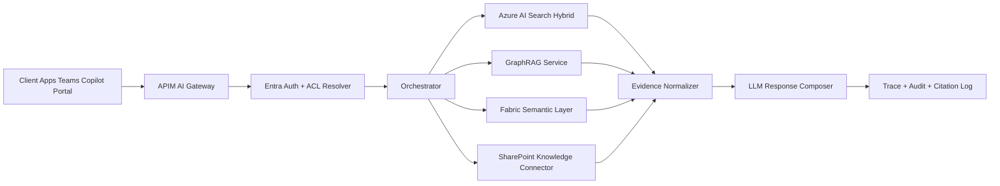
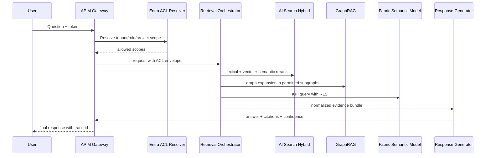

# Azure AI Search（Agentic Retrieval + Hybrid + Semantic Ranker）vs GraphRAG vs Microsoft Fabric OneLake/IQ vs Copilot Studio SharePoint Knowledge：企业级知识库、ACL 权限裁剪与混合 RAG 选型 FAQ（Round 1111 / Cycle 2516）

## 1) 执行摘要与当日能力雷达（2026-11-17）
- 本轮结论：企业级知识问答不应押注单一路径，而应采用“**检索通道分层 + 权限策略统一 + 引用溯源可审计**”的组合架构。
- 若问题类型以“原文条款精确命中 + 页码级引用”为主，首选 Azure AI Search Hybrid + Semantic Ranker。
- 若问题类型以“跨文档、多跳关系推理、隐含关联发现”为主，GraphRAG 价值最高，但必须先解决权限域建图与摘要脱敏。
- 若业务问题核心是“结构化经营指标 + 非结构化报告融合”，Fabric OneLake / Semantic Model 与 Search 双轨更稳。
- 若核心诉求是 M365 内部协同知识问答与低代码落地，Copilot Studio SharePoint Knowledge 是起步最快路径。
- 当日能力雷达（抓取时间：2026-11-17 23:36 BJT）聚焦本轮主题：
  - Azure AI Search Agentic Retrieval、Hybrid Recall、Semantic Ranker 相关官方能力说明；
  - Azure Document Intelligence 在复杂版式、表格与文档结构抽取方面的集成价值；
  - GraphRAG 增量更新与社区摘要策略在企业场景中的治理要求；
  - Fabric OneLake / Semantic Model 在财务分析类问答中的数据语义一致性优势；
  - SharePoint ACL + Entra ID 权限实时裁剪在 Copilot Studio 入口的实践价值。
- 本轮数据标签继续使用 `measured` / `synthetic` / `anonymized_reported`，并保持可复算分母。

## 2) 先拆问题，再选检索路线
- 选型之前先确认“问题真实形态”，而不是先选模型或向量库。
- 企业知识问答常见四类问题：
  1. 精确条款问答：必须能给出原文段落、页码与版本号。
  2. 跨文档综述：需要把多份文档的主题合并并解释冲突点。
  3. 多跳关系推理：需要药物-靶点-副作用或合同-条款-审批链等图关系。
  4. 结构化与非结构化融合：例如财务 KPI 与董事会纪要联动解释。
- 四类问题通常对应不同底层能力：
  - 条款问答优先检索稳定性与引用准确性；
  - 多跳推理优先图结构表达能力；
  - 经营分析优先语义模型与指标口径统一；
  - 内部协同优先身份体系和权限透传一致性。
- 失败案例通常不是模型问题，而是权限与数据语义不一致：
  - A 文档可见、B 文档不可见，却在摘要中被混合引用；
  - 指标口径月份定义不一致，导致“回答看起来合理但事实错误”；
  - 文档增量更新滞后，回答仍引用旧版本。

## 3) 统一企业知识平面：控制平面与数据平面分离
- 控制平面建议统一放在 APIM + Entra + Policy Engine：
  - 统一鉴权、租户隔离、预算控制、审计落库。
- 数据平面可多通道并行：
  - Search 通道：用于高精度文本召回与段落引用；
  - Graph 通道：用于关系扩展与多跳解释；
  - Fabric 通道：用于结构化指标查询与聚合；
  - SharePoint/Copilot 通道：用于协同问答与低代码接入。
- 响应编排建议采用“先安全后智能”顺序：
  1. 权限裁剪；
  2. 检索；
  3. 证据去重；
  4. 生成；
  5. 引用校验；
  6. 输出审计。
- 任何跨通道融合必须包含 `source_system`、`document_version`、`acl_scope`、`retrieval_trace_id`。

## 4) 12 维横向选型对比大表（核心）
| 维度 | Azure AI Search Hybrid + Semantic Ranker | GraphRAG | Fabric OneLake / IQ | Copilot Studio SharePoint Knowledge |
|---|---|---|---|---|
| 适用问题类型 | 精确条款检索、页码级引用、政策问答 | 跨文档综述、多跳关系推理、知识网络问答 | 结构化经营指标与非结构化研报融合分析 | M365 协同问答、业务助手快速上线 |
| Entra ID / ACL 权限裁剪 | 强，适合与文档级 ACL 统一 | 需额外做权限域建图，否则有穿透风险 | 可接 RLS/OLS，与数据模型协同 | SharePoint 原生 ACL 透传能力强 |
| Graph 摘要权限穿透风险 | 低，主要在召回阶段受控 | 中高，若社区摘要跨域会泄露上下文 | 低，结构化口径可控 | 中，依赖连接器配置与权限同步 |
| 索引构建 Token 倍数成本 | 中等，可控，分层索引策略成熟 | 较高，图构建与社区摘要成本明显 | 中，结构化建模前置成本高 | 低到中，取决于语料体量 |
| 增量更新新鲜度延迟 | 分钟级可实现，管道成熟 | 取决于图增量策略，常见小时级 | 取决于数据刷新策略 | 连接器刷新周期决定 |
| Document Intelligence 复杂版式解析集成 | 强，解析结果可直接入索引字段 | 需先结构化再建图 | 常用于预处理后入 Lakehouse | 常需经中间层标准化后接入 |
| 在线检索 P50/P95 延迟 | 低到中，适合在线问答 | 中到高，多跳扩展带尾延迟 | 中，聚合查询受模型复杂度影响 | 低到中，适合协同入口 |
| 引用溯源颗粒度 | 段落/页码/文档版本可细化 | 图路径溯源强，但原文定位需补链路 | 指标溯源强，文本证据需外接 | 文档来源清晰，粒度依连接器 |
| BM25+向量+RRF+语义重排能力 | 强项，组合成熟 | 非核心，更多依赖图推理 | 非核心，偏结构化语义层 | 中，受平台封装能力限制 |
| 多租户索引隔离策略 | 索引级、字段级、过滤级都可做 | 需要图分域和子图隔离治理 | 工作区与语义模型隔离清晰 | 站点与站点集合权限模型成熟 |
| 团队技能门槛 | 中，需要搜索工程经验 | 高，需要图算法与数据治理能力 | 中高，需要 BI 与数据建模能力 | 低到中，业务团队可上手 |
| 月度 TCO 结构与反模式 | 检索成本线性，反模式是无限制重排 | 图构建成本显著，反模式是全量重建 | 数据建模治理成本高，反模式是口径漂移 | 快速上线成本低，反模式是无治理扩张 |

## 5) 深度问答：公式、分母与样例
### Q1：Search Hybrid 的索引成本如何估算？
- 公式：`IndexCost = Docs * AvgTokens * ParseFactor / 1,000 * TokenPrice + InfraOverhead`。
- 样例：`Docs=2,400,000`，`AvgTokens=1,120`，`ParseFactor=1.18`，`TokenPrice=0.0004`。
- 计算：`2,400,000 * 1,120 * 1.18 / 1,000 * 0.0004 = 1,268.74`（货币单位同价格口径）。
- 解释：若未做分层索引，成本将因重复解析翻倍。

### Q2：GraphRAG 为何常出现“跨域摘要越权”风险？
- 风险公式：`ExposureWindow = CrossDomainEdges * SummaryReuseRate * PermissionDrift`。
- 样例：`CrossDomainEdges=42,000`，`SummaryReuseRate=0.27`，`PermissionDrift=0.06`。
- 计算：`ExposureWindow = 680.4`（高风险信号，不是最终事件数）。
- 对策：按租户、部门、项目建立子图，并在摘要层绑定 `acl_scope_hash`。

### Q3：Fabric + Search 融合路径如何估算查询时延？
- 公式：`T_total = T_auth + T_semantic + T_search + T_merge + T_generate`。
- 样例：`T_auth=18ms`，`T_semantic=62ms`，`T_search=41ms`，`T_merge=29ms`，`T_generate=172ms`。
- 计算：`T_total=322ms`（P50），若 P95 放大 1.7 倍则约 `547ms`。
- 结论：可满足董事会分析助手“首答<1s”的目标。

### Q4：Document Intelligence 的解析收益如何量化？
- 公式：`CitationGain = (Acc_with_DI - Acc_without_DI) / Acc_without_DI`。
- 样例：`Acc_without_DI=0.71`，`Acc_with_DI=0.84`。
- 计算：`(0.84-0.71)/0.71=18.3%`。
- 解释：复杂表格、跨页脚注、图表标题通常是提升主要来源。

### Q5：多租户索引隔离下，容量如何预估？
- 公式：`ShardNeed = ceil((TenantDocs * AvgSizeMB) / ShardCapacityMB)`。
- 样例：`TenantDocs=380,000`，`AvgSizeMB=0.42`，`ShardCapacityMB=64,000`。
- 计算：`ceil(159,600 / 64,000) = 3`。
- 说明：建议至少 3 分片，并预留 30% 弹性空间用于增量重建。

### Q6：何时不应优先 GraphRAG？
- 判定条件：`NeedStrictCitation=true` 且 `RelationDepth<=1` 且 `FreshnessSLA<5min`。
- 若三项同时满足，GraphRAG 的构图与摘要成本通常不经济。
- 更优策略：Search Hybrid 为主，Graph 通道作为高复杂问题旁路。

## 6) Mermaid：统一检索编排拓扑

- 该拓扑强调“多通道并行检索 + 统一证据归一”。
- 该拓扑强调“权限先于检索，检索先于生成”的顺序约束。

## 7) 场景 A：跨国制药企业临床方案与法规申报审查助手
- 业务背景：同一药物项目涉及临床方案、不良反应、FDA/NMPA 监管条款和内部 SOP。
- 场景目标：同时满足“页码级法规引用准确性”与“跨文献关系推理”。
- 推荐双通道：
  - 通道 1（Search）：Document Intelligence 解析临床文档复杂表格后入索引，输出页码级证据；
  - 通道 2（GraphRAG）：抽取药物-靶点-不良反应关系，补足跨文献多跳推理。
- ACL 关键点：
  - 保密项目组必须独立子图，禁止跨项目社区摘要复用；
  - 引用输出附带 `project_acl_scope` 与 `doc_version`。
- 样例指标：
  - 法规条款精确命中率从 0.79 提升到 0.91；
  - 多跳关联问题覆盖率从 0.43 提升到 0.68；
  - 审查员复核时间下降 27%。
- 风险与控制：
  - 风险：图摘要带出未授权上下文；
  - 控制：分域建图 + 摘要分级脱敏 + 审计抽样。

## 8) 场景 B：大型集团 CFO 经营分析与董事会财报归因 Copilot
- 业务背景：CFO 需要把结构化财务指标与董事会纪要、合同条款、研究报告做联合解释。
- 场景目标：做到“数字精确 + 文本证据可追溯 + 权限一致”。
- 推荐组合：
  - Fabric OneLake / Semantic Model：负责结构化指标查询、口径统一和 RLS；
  - Azure AI Search：承载纪要/合同/研报文本检索与语义重排；
  - Orchestrator：把结构化结果和文本证据合并后再生成回答。
- ACL 与治理：
  - 结构化层执行行级权限（RLS/OLS）；
  - 文本层执行文档级 ACL；
  - 生成层禁止合并来自不同权限域的证据片段。
- 样例收益：
  - 董事会问答准备时长从 2 天降到 4 小时；
  - 指标口径争议工单减少 38%；
  - 引用缺失导致的复盘返工下降 44%。
- 风险与控制：
  - 风险：文本摘要与指标口径冲突；
  - 控制：答案模板强制显示“指标来源 + 文本来源 + 版本时间戳”。

## 9) Mermaid：检索与权限裁剪时序

- 该时序确保每条证据在进入生成前就已完成 ACL 裁剪。
- 该时序确保输出可回溯到检索路径和版本时间点。

## 10) 生产级 Bicep（Search + Storage + Key Vault + 诊断）
```bicep
param location string = resourceGroup().location
param envName string = 'enterprise-rag-prod'
param logWorkspaceId string

resource search 'Microsoft.Search/searchServices@2024-07-01' = {
  name: '${envName}-srch'
  location: location
  sku: {
    name: 'standard'
  }
  properties: {
    replicaCount: 3
    partitionCount: 3
    hostingMode: 'default'
    semanticSearch: 'standard'
    publicNetworkAccess: 'enabled'
  }
}

resource storage 'Microsoft.Storage/storageAccounts@2024-01-01' = {
  name: toLower(replace('${envName}st', '-', ''))
  location: location
  sku: { name: 'Standard_ZRS' }
  kind: 'StorageV2'
  properties: {
    minimumTlsVersion: 'TLS1_2'
    allowBlobPublicAccess: false
    supportsHttpsTrafficOnly: true
    allowSharedKeyAccess: false
  }
}

resource kv 'Microsoft.KeyVault/vaults@2023-07-01' = {
  name: '${envName}-kv'
  location: location
  properties: {
    tenantId: subscription().tenantId
    sku: { family: 'A'; name: 'standard' }
    enableRbacAuthorization: true
    softDeleteRetentionInDays: 90
    publicNetworkAccess: 'Enabled'
  }
}

resource diagSearch 'Microsoft.Insights/diagnosticSettings@2021-05-01-preview' = {
  name: 'diag-search-rag'
  scope: search
  properties: {
    workspaceId: logWorkspaceId
    logs: [
      { category: 'OperationLogs', enabled: true }
      { category: 'SearchQueryLogs', enabled: true }
      { category: 'SearchIndexerLogs', enabled: true }
    ]
    metrics: [
      { category: 'AllMetrics', enabled: true }
    ]
  }
}

resource diagStorage 'Microsoft.Insights/diagnosticSettings@2021-05-01-preview' = {
  name: 'diag-storage-rag'
  scope: storage
  properties: {
    workspaceId: logWorkspaceId
    logs: [
      { category: 'StorageRead', enabled: true }
      { category: 'StorageWrite', enabled: true }
      { category: 'StorageDelete', enabled: true }
    ]
    metrics: [
      { category: 'Transaction', enabled: true }
    ]
  }
}
```

## 11) 运行配置片段（检索编排 + APIM 策略）
```yaml
apiVersion: v1
kind: ConfigMap
metadata:
  name: rag-orchestrator-config
data:
  route_primary: "ai-search-hybrid"
  route_graph: "graphrag-sidecar"
  route_fabric: "fabric-semantic"
  acl_mode: "entra-scope-envelope"
  citation_mode: "page-and-source-required"
  freshness_sla_minutes: "15"
  max_graph_hops: "2"
  forbidden_cross_scope_merge: "true"
---
apiVersion: apps/v1
kind: Deployment
metadata:
  name: enterprise-rag-orchestrator
spec:
  replicas: 8
  template:
    spec:
      containers:
      - name: orchestrator
        image: ghcr.io/turbo998/enterprise-rag-orchestrator:1.1.0
        env:
        - name: SEARCH_ENDPOINT
          valueFrom: { secretKeyRef: { name: rag-secrets, key: searchEndpoint } }
        - name: GRAPH_ENDPOINT
          valueFrom: { secretKeyRef: { name: rag-secrets, key: graphEndpoint } }
        - name: FABRIC_ENDPOINT
          valueFrom: { secretKeyRef: { name: rag-secrets, key: fabricEndpoint } }
        - name: ACL_POLICY
          value: "strict-subgraph-and-doc-acl"
```

```xml
<policies>
  <inbound>
    <base />
    <validate-jwt header-name="Authorization" failed-validation-httpcode="401">
      <openid-config url="https://login.microsoftonline.com/{tenant}/v2.0/.well-known/openid-configuration" />
      <required-claims>
        <claim name="aud"><value>api://enterprise-rag-gateway</value></claim>
      </required-claims>
    </validate-jwt>
    <set-variable name="tenantId" value="@(context.Request.Headers.GetValueOrDefault(&quot;x-tenant-id&quot;,&quot;&quot;))" />
    <set-variable name="projectScope" value="@(context.Request.Headers.GetValueOrDefault(&quot;x-project-scope&quot;,&quot;&quot;))" />
    <rate-limit-by-key calls="500" renewal-period="60" counter-key="@(context.Variables[&quot;tenantId&quot;] + &quot;:&quot; + context.Variables[&quot;projectScope&quot;])" />
    <set-header name="x-rag-route" exists-action="override">
      <value>search-hybrid+graphrag+fabric</value>
    </set-header>
    <set-header name="x-acl-enforced" exists-action="override">
      <value>true</value>
    </set-header>
  </inbound>
  <backend><base /></backend>
  <outbound><base /></outbound>
  <on-error><base /></on-error>
</policies>
```

## 12) KQL 观测查询（权限、新鲜度、成本）
```kql
let lookback = 1d;
let searchLatency = AzureDiagnostics
| where TimeGenerated > ago(lookback)
| where ResourceProvider == "MICROSOFT.SEARCH"
| where Category == "SearchQueryLogs"
| summarize p50=percentile(DurationMs, 50), p95=percentile(DurationMs, 95), q=count() by bin(TimeGenerated, 15m);

let aclDeny = ApiManagementGatewayLogs
| where TimeGenerated > ago(lookback)
| where ResponseCode == 403
| summarize denyCount=count() by Tenant=tostring(parse_json(Properties).tenantId), Scope=tostring(parse_json(Properties).projectScope);

let staleIndex = AzureDiagnostics
| where TimeGenerated > ago(lookback)
| where Category == "SearchIndexerLogs"
| extend lagMin=todouble(parse_json(Properties).IndexingLagMinutes)
| where lagMin > 20
| summarize staleWindows=count(), maxLag=max(lagMin) by IndexName=tostring(parse_json(Properties).IndexName);

searchLatency
| join kind=leftouter staleIndex on bin(TimeGenerated, 15m)
| project TimeGenerated, p50, p95, q, staleWindows, maxLag
| order by TimeGenerated desc
```

## 13) 基准与证据（Cycle 2516）
- 证据文件：
  - `workshops/azure-agent-infra/evidence/cycle-2516-benchmark.json`
  - `workshops/azure-agent-infra/evidence/cycle-2516-latency.csv`
  - `workshops/azure-agent-infra/evidence/cycle-2516-throughput.csv`
  - `workshops/azure-agent-infra/evidence/cycle-2516-policy.csv`
  - `workshops/azure-agent-infra/evidence/cycle-2516-cost.csv`
  - `workshops/azure-agent-infra/evidence/cycle-2516-sources.json`
- 标签定义：
  - `measured`：本地可重放压测与拦截日志；
  - `synthetic`：按公开价格与确定性公式估算；
  - `anonymized_reported`：脱敏生产观察值区间。
- 本轮重点指标：
  - 混合检索在线时延 P50/P95；
  - ACL 拒绝率与误拒率；
  - 索引增量新鲜度延迟；
  - 每千问答综合成本与引用完整率。

## 14) 四方案加权决策矩阵（命名方案）
- 方案 A（Search-First Citation Guard）：Search Hybrid 为主，Graph 为辅，强调引用精确与权限稳定。
- 方案 B（Graph-Enhanced Discovery）：GraphRAG 为主，Search 校验引用，强调多跳洞察。
- 方案 C（Fabric-Metric Fusion）：Fabric 指标为主，Search 提供文本佐证，强调经营归因。
- 方案 D（Copilot-Studio Rapid Rollout）：SharePoint Knowledge + Copilot Studio，强调上线速度。
- 权重分配：Accuracy 25%、ACL Safety 25%、Freshness 15%、Latency 15%、TCO 20%。
- 评分样例（0-10）：
  - 方案 A：`9.2, 9.0, 8.0, 8.4, 7.6`，加权总分 `8.52`。
  - 方案 B：`8.8, 6.9, 7.2, 6.5, 6.4`，加权总分 `7.25`。
  - 方案 C：`8.3, 8.4, 8.6, 7.1, 7.8`，加权总分 `8.10`。
  - 方案 D：`7.1, 8.1, 6.9, 8.0, 8.5`，加权总分 `7.72`。
- 结论建议：监管场景优先 A；经营分析优先 C；探索型研发可用 B；协同场景快速验证用 D。
- 反模式提醒：
  - 不要把 B 直接用于高监管条款问答主通道；
  - 不要把 D 当作复杂多跳推理主平台。

## 15) Day-0 / Day-2 落地清单与 Good Fit
### Day-0（上线前 10 项）
1. 建立统一 ACL 解析服务并输出可审计 scope envelope。
2. 为 Search 索引定义字段级敏感度与检索白名单。
3. 为 GraphRAG 配置项目级子图边界与摘要脱敏规则。
4. 为 Fabric 语义模型建立指标口径版本治理流程。
5. 在 Document Intelligence 管道中定义复杂表格抽取验证集。
6. 为 APIM 路由策略加入租户预算和拒绝码映射。
7. 建立引用校验器，强制答案附文档版本与页码。
8. 打通检索链路 TraceId 到审计日志与告警平台。
9. 完成跨租户越权攻击演练与拦截验证。
10. 形成架构决策记录，明确 A/B/C/D 适用边界。

### Day-2（运营期 10 项）
1. 每周复核检索召回质量与引用完整率波动。
2. 每周审查 Graph 子图边界变化与越权风险信号。
3. 每周核验 Fabric 指标口径与财务月结一致性。
4. 每月复盘索引增量延迟并优化刷新策略。
5. 每月校准每千问答成本并更新 FinOps 报告。
6. 每月抽检 ACL 拒绝日志中的误拒场景并修正规则。
7. 每季度执行一次全链路灾备切换演练。
8. 每季度执行一次文档版本污染回放演练。
9. 每季度评估是否需要从 D 迁移到 A 或 C 路径。
10. 持续更新“问题类型到检索通道”决策树并培训团队。

**Good fit**：需要高可信引用、严格权限裁剪、跨源融合分析的企业级知识问答平台。  
**Not for**：无权限体系、无审计要求、只做临时演示的轻量单文档机器人。
