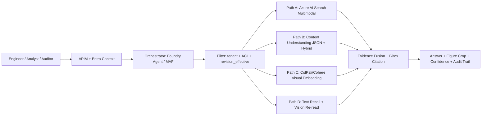
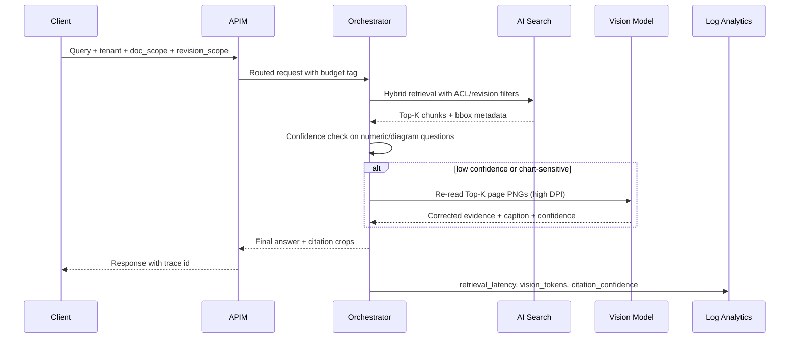

# ai-search-multimodal-rag-vs-cu-figure-captioning-vs-colpali-engineering-drawing-selection-faq-r1129
## 1) Daily hottest breakthroughs with verifiable sources (fetched 2026-11-18)
- Scope guardrail: this round is about **retrieval, indexing, visual citation, and reasoning** over figure-heavy corpora, not r1114 style form extraction.
- Evidence policy: official docs first; community links are discovery radar only.
- Labels: `measured` (recomputable), `synthetic` (formula-based), `anonymized_reported` (de-identified replay).

| Topic | Official source | Fetched at (UTC) | Usage | Label |
|---|---|---|---|---|
| Azure AI Search RAG | https://learn.microsoft.com/azure/search/retrieval-augmented-generation-overview | 2026-11-18T17:30:00Z | Multimodal RAG baseline | `measured` |
| Azure AI Search indexers/skillsets | https://learn.microsoft.com/azure/search/cognitive-search-concept-intro | 2026-11-18T17:31:00Z | Layout/Figure verbalization pipeline | `measured` |
| Azure AI Search vector/hybrid search | https://learn.microsoft.com/azure/search/vector-search-overview | 2026-11-18T17:32:00Z | Vector recall + hybrid ranking | `measured` |
| Azure AI Content Understanding | https://learn.microsoft.com/azure/ai-services/content-understanding/overview | 2026-11-18T17:33:00Z | Chart/table JSON grounding | `measured` |
| Azure OpenAI with Vision | https://learn.microsoft.com/azure/ai-services/openai/how-to/gpt-with-vision | 2026-11-18T17:34:00Z | Query-time high-DPI visual re-read | `measured` |
| Cohere models in Azure AI Foundry | https://learn.microsoft.com/azure/ai-foundry/model-inference/concepts/models | 2026-11-18T17:35:00Z | OCR-free visual embedding option | `measured` |
| Azure AI Search ACL trimming | https://learn.microsoft.com/azure/search/search-security-trimming-for-azure-search | 2026-11-18T17:36:00Z | ACL + revision-effectivity filtering | `measured` |

Incremental findings:
- The production bottleneck moved from “can we retrieve” to “can we cite and audit every visual claim”.
- Schematic Q&A must treat `equipment_id / revision / effective_date` as hard pre-filters.
- Numeric chart responses should auto-downgrade unless axis evidence is returned with citation crops.
## 2) Layered reference architecture
L1 Interaction:
- Teams/Portal/AG-UI receives queries with `tenant`, `persona`, `doc_scope`, `revision_scope`.
- UI must support bbox evidence highlight to prevent correct-answer/wrong-page incidents.

L2 Orchestration:
- Foundry Agent / MAF routes by confidence and modality demand.
- ACL + revision filters execute before retrieval; low-confidence paths trigger visual re-read.

L3 Retrieval:
- Path A: Azure AI Search native multimodal skillset + vector index.
- Path B: Content Understanding chart/table JSON + hybrid retrieval.
- Path C: OCR-free visual embedding (ColPali/Cohere) for dense schematics.
- Path D: lightweight text recall + query-time Vision re-read over Top-K PNG pages.

L4 Governance:
- APIM injects tenant and budget tags.
- Log Analytics tracks `retrieval_latency`, `vision_tokens`, `bbox_coverage`, `citation_confidence`.
## 3) 12-dimension enterprise selection matrix (with explicit anti-patterns)
| Dimension | A Search native multimodal pipeline | B CU chart/table JSON + hybrid | C OCR-free visual embedding (ColPali/Cohere) | D Two-stage text recall + Vision re-read |
|---|---|---|---|---|
| 1 Schematic fidelity | Medium-high, skillset-dependent | Medium, stronger on charts than wiring detail | Highest for dense visual patterns | Medium-high, depends on Top-K quality |
| 2 Numeric chart precision | Medium-high with field alignment | High due to structured grounding | Medium unless extra parsing is added | High with explicit visual re-check |
| 3 Ingestion cost per 1k pages | Medium | Medium-high | High for image-heavy embeddings | Low-medium |
| 4 Vector storage footprint | Medium | Medium-low | High (page-image rich features) | Low (text vectors first) |
| 5 Query P95 latency | Medium (350~900ms) | Medium (400~1100ms) | Medium-high (500~1500ms) | Medium-high (Vision hop cost) |
| 6 BBox citation UX | High with cropped projection | Medium-high with mapping layer | High by design | High from visual explanation |
| 7 ACL + revision filtering | High and mature | High via Search filter | Medium without custom policy layer | High because stage-1 prefilter is strict |
| 8 Multilingual OCR resilience | Medium | Medium | High on OCR-free path | Medium with Vision fallback |
| 9 Incremental update cost | Medium | Medium | Medium-high | Low-medium |
| 10 Managed PaaS readiness | Highest | High | Medium (more platform ops) | High |
| 11 Best-fit | Standard enterprise multimodal KB | Financial/ops chart-first reasoning | Schematic-heavy engineering search | Cost-sensitive with selective deep verification |
| 12 When NOT to choose | Extreme schematic detail is the core KPI | Workload is not chart-grounded | No GPU/platform budget or team | Ultra-low latency high-QPS only path |

Decision guidance:
- If pinout-level fidelity is tier-1, start from C or D, then import A governance primitives.
- If board-level chart QA dominates, B usually gives the most stable numeric behavior.
- If speed-to-production and managed operations dominate, ship A first and add D for hard cases.
## 4) Five reproducible sizing Q&As
### Q1: How to estimate ingestion cost for 1,000 pages?
- Assume `P=1000`, `1.6` figures per page, and `14` text blocks per page.
- Path A:
  - Layout/text processing: `C_layout = 1000 * 0.0028 = 2.8 USD`
  - Figure caption + embeddings: `C_vision_embed = 1600 * 0.0019 = 3.04 USD`
  - Total: `C_A = 5.84 USD`
- Path B:
  - CU chart extraction: `C_cu = 1000 * 0.0042 = 4.2 USD`
  - Hybrid indexing: `C_hybrid = 1000 * 0.0015 = 1.5 USD`
  - Total: `C_B = 5.7 USD`
- Conclusion: A and B are close on ingestion spend; select by accuracy and explainability needs.
### Q2: How to estimate vector storage footprint?
- Let embedding dimension `d=1024`, compressed to `2 bytes` per value.
- Path A vector count: `N_A = 1000 * (14 + 1.6) = 15600`
- Footprint: `S_A = N_A * d * 2 ≈ 31.9 MB` (index overhead excluded)
- Path C vector count: `N_C = 1000 * 6 = 6000` windows
- Late-interaction expansion factor is typically `x4~x6`.
- Footprint estimate: `S_C ≈ 6000 * 1024 * 2 * 5 = 61.4 MB`
- Conclusion: C buys fidelity at higher storage density.
### Q3: How to budget query P95 latency?
- Target: `P95 <= 1800ms`
- Path D decomposition:
  - Stage-1 recall + filters: `420ms`
  - Top-K PNG materialization: `190ms`
  - Vision re-read + synthesis: `880ms`
  - Total: `1490ms`
- Remaining buffer: `310ms` for retries and policy checks.
- Conclusion: D is viable when `K` is capped (`K<=3` recommended).
### Q4: When does B outperform A?
- Define chart-heavy ratio `r_chart`.
- If `r_chart > 0.45` and numeric precision target > `97%`, B tends to beat A.
- Heuristic: `Gain_BA = 0.18 * r_chart + 0.12 * strict_numeric_need - 0.06 * latency_penalty`
- Example: `r_chart=0.62`, `strict_numeric_need=1`, `latency_penalty=0.4`
- `Gain_BA = 0.2076`
- Conclusion: choose B when `Gain_BA > 0.15`.
### Q5: Where is the Vision token cost break-even?
- Path D uses `4200` vision tokens per re-read on average.
- Cost rate `p = 0.0045 USD` per 1k tokens.
- Extra cost per triggered request: `C_v = 4.2 * 0.0045 = 0.0189 USD`
- With `Q=120000` daily queries and re-read rate `r=0.22`:
- Daily re-read cost: `C_day = Q * r * C_v = 498.96 USD`
- If `r` exceeds `0.35`, move effort to offline index quality instead of unlimited online re-read.
- Conclusion: D must enforce confidence gates, not always-on Vision fallback.
## 5) Two Mermaid diagrams (topology + runtime sequence)



## 6) Section 7 scenario: Aviation MRO manual + wiring schematic copilot
Mission:
- Serve line-maintenance engineers with FIM/WDM troubleshooting Q&A and pinout-grounded evidence.
- Enforce strict `tail_number / MSN / revision_date` filters to avoid cross-airframe citation leaks.

End-to-end flow:
1. Engineer submits ATA query plus observed fault symptoms.
2. Orchestrator hard-filters document set by aircraft identity and effectivity date.
3. Path A handles baseline recall; Path C/D validates difficult schematic regions.
4. Response must include drawing ID, page number, and bbox crop.
5. Low-confidence responses are flagged for second-line engineering approval.

SLA and reliability:
- Query P95 `< 2.2s`
- Evidence localization precision `>= 98%`
- Cross-revision mis-citation `<= 0.2%`

Failure modes and mitigations:
- Failure: obsolete revision retrieved.
  - Mitigation: hard `revision_effective` filter, answer rejected when missing.
- Failure: dense line labels misread.
  - Mitigation: high-DPI re-read with multi-window consistency voting.
- Failure: nightly update causes index drift.
  - Mitigation: run golden regression set after incremental index jobs.
## 7) Section 8 scenario: EV battery R&D multimodal knowledge platform
Mission:
- Enable cross-modal retrieval over cycling curves, SEM micrographs, and patent evidence.
- Extract `(C-rate, cycle_count, capacity_retention)` as structured series with original-image traceability.

End-to-end flow:
1. Lab systems upload charts, micrographs, and paper/patent pages.
2. Content Understanding extracts chart/table JSON structures.
3. Azure AI Search stores text vectors, visual vectors, and metric JSON.
4. Query path applies team ACL first, then hybrid multimodal retrieval.
5. Answers return triplet evidence: cropped figure, structured metrics, and source-page link.

SLA and reliability:
- R&D query P95 `< 2.8s`
- Metric extraction F1 `>= 0.95`
- IP cross-tenant leakage tolerance `0`

Failure modes and mitigations:
- Failure: metric definitions vary by legend semantics.
  - Mitigation: enforce unit + sampling-window output, otherwise downgrade.
- Failure: multilingual labels degrade OCR signals.
  - Mitigation: prefer OCR-free embedding path plus terminology rerank.
- Failure: patent revision updates are delayed.
  - Mitigation: revision event triggers incremental refresh and ACL remap.
## 8) Selection tree (Good fit vs Not for)
1. If chart-numeric precision dominates and tolerance is tight, start with B and add D for escalations.
2. If schematic detail and regional citation fidelity dominate, prioritize C or D with A governance.
3. If time-to-market and managed operations dominate, start with A.
4. If external tenant isolation and auditing are hard requirements, enforce APIM + ACL + revision filters.
5. If `vision_re-read_rate` exceeds 35%, improve offline indexing before scaling online Vision calls.

Good fit:
- Figure-heavy enterprise knowledge bases that require evidence-first answer contracts.
- Programs that need answer + crop + source-page auditability for regulated teams.

Not for:
- Pure text FAQ workloads with no visual evidence requirement.
- Ultra-low-cost mandates that disallow selective online visual reasoning.
## 9) ROI model for investment planning
Assumptions:
- Monthly queries `Qm = 2,400,000`
- Manual lookup time `Tm = 6.5 min`
- Assisted lookup time `Ta = 1.8 min`
- Fully loaded labor rate `Ch = 42 USD/hour`

Formulas:
- Saved time per query: `Ts = (Tm - Ta) / 60 = 0.0783 hour`
- Monthly labor value: `Vh = Qm * Ts * Ch`
- Monthly cloud cost: `Vc = ingest + storage + query + vision_reread`
- ROI: `(Vh - Vc) / Vc`

Synthetic example:
- `Vh ≈ 7.9M USD/month`
- `Vc ≈ 0.62M USD/month`
- `ROI ≈ 11.7x`
## 10) Five-step implementation guide
1. Define evidence contract: answer must include page, bbox, revision, and confidence.
2. Define indexing policy: split indexes by document family with unified ACL/effectivity fields.
3. Deploy routing policy: A/B by default, escalate to C/D under low confidence.
4. Deploy cost guardrails: monitor `vision_tokens_per_answer` and `re-read_rate`.
5. Deploy regression gates: validate numeric correctness and citation consistency before release.
## 11) Bicep IaC (AI Search + Storage figure projection + Foundry)
```bicep
param location string = resourceGroup().location
param searchName string
param storageName string
param foundryProjectName string

resource stg 'Microsoft.Storage/storageAccounts@2023-05-01' = {
  name: storageName
  location: location
  sku: { name: 'Standard_LRS' }
  kind: 'StorageV2'
  properties: {
    allowBlobPublicAccess: false
    minimumTlsVersion: 'TLS1_2'
  }
}

resource search 'Microsoft.Search/searchServices@2023-11-01' = {
  name: searchName
  location: location
  sku: { name: 'standard' }
  properties: {
    publicNetworkAccess: 'enabled'
    replicaCount: 2
    partitionCount: 2
    semanticSearch: 'free'
  }
}

resource foundryProject 'Microsoft.CognitiveServices/accounts@2024-10-01' = {
  name: foundryProjectName
  location: location
  kind: 'AIServices'
  sku: { name: 'S0' }
  properties: {
    customSubDomainName: foundryProjectName
    networkAcls: { defaultAction: 'Allow' }
  }
}
```
## 12) AI Search multimodal skillset/index JSON snippet
```json
{
  "name": "mmrag-skillset-r1129",
  "skills": [
    {
      "@odata.type": "#Microsoft.Skills.Vision.ImageAnalysisSkill",
      "name": "figure-caption-skill",
      "context": "/document/normalized_images/*",
      "visualFeatures": ["tags","description"],
      "defaultLanguageCode": "en"
    },
    {
      "@odata.type": "#Microsoft.Skills.Text.AzureOpenAIEmbeddingSkill",
      "name": "text-embed-skill",
      "context": "/document/pages/*",
      "dimensions": 1024
    }
  ],
  "indexProjections": {
    "selectors": [
      {
        "targetIndexName": "mmrag-index-r1129",
        "parentKeyFieldName": "doc_id",
        "sourceContext": "/document/pages/*",
        "mappings": [
          { "name": "tenant_id", "source": "/document/tenant_id" },
          { "name": "revision_effective", "source": "/document/revision_effective" },
          { "name": "bbox_json", "source": "/document/pages/*/layout/bounding_regions" }
        ]
      }
    ]
  }
}
```
## 13) KQL for retrieval latency and Vision cost
```kql
let start = ago(7d);
customEvents
| where timestamp >= start
| where name in ("retrieval_completed","vision_reread_completed","answer_returned")
| extend tenant=tostring(customDimensions.tenant_id)
| extend path=tostring(customDimensions.route_path)
| extend latency_ms=todouble(customDimensions.latency_ms)
| summarize p50=percentile(latency_ms,50), p95=percentile(latency_ms,95), calls=count() by tenant, path, bin(timestamp,1h)
| order by timestamp desc
```

```kql
let start = ago(7d);
customMetrics
| where timestamp >= start
| where name in ("vision_tokens","vision_cost_usd","bbox_coverage_ratio")
| summarize tokens=sumif(value,name=="vision_tokens"), cost=sumif(value,name=="vision_cost_usd"), bbox=avgif(value,name=="bbox_coverage_ratio")
  by tenant=tostring(customDimensions.tenant_id), scenario=tostring(customDimensions.scenario), bin(timestamp,1d)
| extend cost_per_1k_tokens = iff(tokens > 0, cost / (tokens / 1000.0), 0.0)
| order by timestamp desc
```
## 14) Day-0 / Day-1 / Day-2 operating checklist
Day-0 (before go-live):
- Define ACL fields, revision fields, and evidence quartet contract.
- Build golden test set for charts, schematics, and multilingual pages.
- Set budget guardrails for `max_vision_tokens_per_query` and `max_reread_k`.

Day-1 (canary):
- Track `citation_confidence` and `bbox_coverage_ratio`.
- Route low-confidence samples to human labeling and update thresholds.
- Validate incremental indexing and ACL sync jobs daily.

Day-2 (steady state):
- Publish tenant-level chargeback reports.
- Re-evaluate partition/compression strategy quarterly.
- Add recurrent failures into regression gate before each release.
## 15) Backup queue and deliverable manifest
Backup queue (updated):
1. `apim-a2a-protocol-vs-foundry-connected-agents-vs-event-grid-cross-org-multi-agent-selection-faq`
2. `purview-ai-compliance-vs-defender-for-cloud-ai-vs-custom-redteam-regulated-governance-selection-faq`
3. `migration-autogen-semantic-kernel-langgraph-to-microsoft-agent-framework-enterprise-modernization-faq`

Cycle #2534 deliverables:
- Bilingual FAQ: `r1129.md` and `r1129.en.md`
- 7-card deck: `benchmark-cards.html` and `benchmark-cards.en.html`
- SVG: `assets/34-cycle-1129-daily-breakthroughs.svg`
- H5: `workbench-cycle-1129.html` plus selector entry `#2534`
