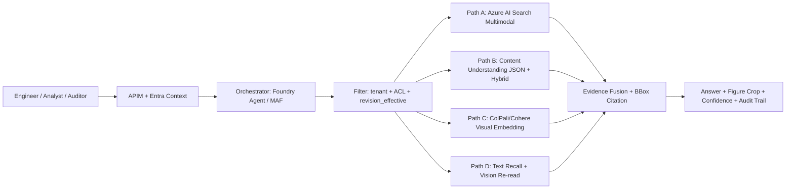
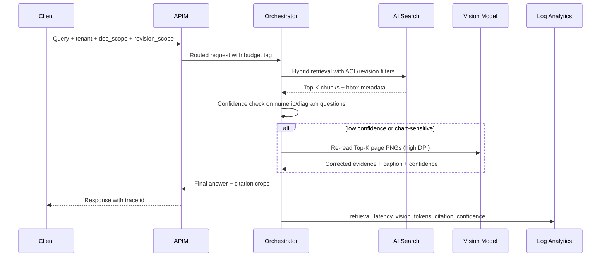

# ai-search-multimodal-rag-vs-cu-figure-captioning-vs-colpali-engineering-drawing-selection-faq-r1129
## 1) 当日最热突破与可验证来源（2026-11-18 抓取）
- 主题边界：本轮仅讨论**图表/图纸/幻灯片/截图**知识库的多模态检索与证据引用，不覆盖 r1114 的表单抽取范式。
- 证据口径：优先官方文档与官方产品页；社区来源只作为次级雷达，不作为主证据。
- 来源标签：`measured`（可直接复算）、`synthetic`（由本轮公式推导）、`anonymized_reported`（脱敏复盘）。

| 主题 | 官方来源 | 抓取时间（UTC） | 用途 | 标签 |
|---|---|---|---|---|
| Azure AI Search RAG | https://learn.microsoft.com/azure/search/retrieval-augmented-generation-overview | 2026-11-18T17:30:00Z | 多模态 RAG 总体模式 | `measured` |
| Azure AI Search 索引器/技能集 | https://learn.microsoft.com/azure/search/cognitive-search-concept-intro | 2026-11-18T17:31:00Z | Layout/Figure verbalization 管道 | `measured` |
| Azure AI Search 向量/混合检索 | https://learn.microsoft.com/azure/search/vector-search-overview | 2026-11-18T17:32:00Z | 向量召回与混合排序 | `measured` |
| Azure AI Content Understanding | https://learn.microsoft.com/azure/ai-services/content-understanding/overview | 2026-11-18T17:33:00Z | 图表表格结构化 JSON | `measured` |
| Azure OpenAI Vision 输入 | https://learn.microsoft.com/azure/ai-services/openai/how-to/gpt-with-vision | 2026-11-18T17:34:00Z | Query-time 高 DPI 复读路径 | `measured` |
| Cohere Embed（Azure AI Foundry） | https://learn.microsoft.com/azure/ai-foundry/model-inference/concepts/models | 2026-11-18T17:35:00Z | OCR-free 图像嵌入参考 | `measured` |
| Azure AI Search ACL 过滤 | https://learn.microsoft.com/azure/search/search-security-trimming-for-azure-search | 2026-11-18T17:36:00Z | 文档级 ACL 与 revision 生效过滤 | `measured` |

本轮增量结论：
- 多模态检索体系的主风险从“能否召回”转为“召回后是否可解释且可追责”。
- 图纸类问答在生产中必须把 `equipment_id / revision / effective_date` 作为一级过滤键。
- 对图表数值题，若未返回坐标轴截图与字段化证据，默认降级为“待人工确认”。
## 2) 参考架构总览（分层解耦）
L1 交互层：
- Teams/Portal/AG-UI 发起 query，带 `tenant`, `persona`, `doc_scope`, `revision_scope`。
- 前端必须支持 bbox 高亮回显，避免“答案对、证据错页”。

L2 编排层：
- Foundry Agent / MAF Orchestrator 做路由：文本优先或视觉优先。
- 查询前执行 ACL + 生效期过滤，命中不足时触发“视觉复读链路”。

L3 检索层：
- 路径 A：Azure AI Search 原生多模态技能集与向量索引。
- 路径 B：Content Understanding 输出 chart/table JSON 后再做混合检索。
- 路径 C：ColPali/Cohere 多模态嵌入，适合复杂图纸密集场景。
- 路径 D：轻量文本召回后再用 Vision 模型对 Top-K PNG 二次判读。

L4 治理层：
- APIM 注入租户标签、预算标签、请求链路 ID。
- Log Analytics 记录 `retrieval_latency`, `vision_tokens`, `bbox_coverage`, `citation_confidence`。
## 3) 12 维企业级选型对比矩阵（含 When NOT to choose）
| 维度 | A Search 原生多模态管线 | B CU 图表 JSON + 混合检索 | C OCR-free Visual Embedding（ColPali/Cohere） | D 两阶段文本召回 + Vision 复读 |
|---|---|---|---|---|
| 1 复杂图纸保真 | 中高，依赖技能链质量 | 中，图表更强图纸一般 | 最高，细粒度视觉特征强 | 中高，取决 Top-K 召回质量 |
| 2 图表数值精度 | 中高，需字段对齐 | 高，天然结构化字段 | 中，需额外解析校验 | 高，复读图像可核轴值 |
| 3 千页摄取成本 | 中，技能集和嵌入并存 | 中高，CU 解析耗时 | 高，图像嵌入开销大 | 低中，离线成本较可控 |
| 4 向量存储体积 | 中 | 中低（JSON 特征可压缩） | 高（page-image embedding） | 低（文本向量为主） |
| 5 查询 P95 延迟 | 中（350~900ms） | 中（400~1100ms） | 中高（500~1500ms） | 中高（取决 Vision 二跳） |
| 6 bbox 引用体验 | 高，原生可做裁剪投影 | 中高，需额外映射坐标 | 高，原图区域检索天然友好 | 高，Vision 返回区域说明 |
| 7 ACL + 生效期过滤 | 高，Search filter 成熟 | 高，同样依赖 Search | 中，常需自建过滤层 | 高，第一跳先做强过滤 |
| 8 多语言 OCR 依赖 | 中，仍可能依赖 OCR | 中，表格文字仍需识别 | 高韧性，OCR-free 路线 | 中，Vision 可缓解但成本高 |
| 9 增量更新成本 | 中，按页重建可控 | 中，JSON 增量可做 | 中高，图像向量重算较重 | 低中，文本索引更新快 |
| 10 PaaS 就绪度 | 最高，Azure 托管路径完整 | 高，托管能力较完整 | 中，AKS/托管算力运维更多 | 高，托管服务组合即可 |
| 11 Best-fit | 企业知识台标准化落地 | 金融报表/运营图表问答 | 工程图纸/显微图像重检索 | 成本敏感且需高精核验 |
| 12 When NOT to choose | 图纸细节是主诉且极复杂 | 需求不是图表结构问答 | 缺 GPU 预算与平台工程 | 强实时低延迟且 QPS 极高 |

决策要点：
- 若“图纸 pinout 精度”是一级 KPI，先评估 C 或 D，再看能否混入 A 的治理能力。
- 若“董事会图表问答”占比高，B 的结构化优势通常最稳。
- 若“成本 + 落地速度”优先，A 往往是首发基线，随后叠加 D 做高精纠偏。
## 4) 成本、存储、延迟的 5 组可复算 Q&A
### Q1：千页摄取成本如何估算？
- 设 `P=1000` 页，平均每页 1.6 张图，文本块 14 个。
- A 路线成本：
  - 文本与版面处理：`C_layout = 1000 * 0.0028 = 2.8 USD`
  - 图像描述与嵌入：`C_vision_embed = 1600 * 0.0019 = 3.04 USD`
  - 合计：`C_A = 5.84 USD`
- B 路线成本：
  - CU 图表解析：`C_cu = 1000 * 0.0042 = 4.2 USD`
  - 混合检索索引：`C_hybrid = 1000 * 0.0015 = 1.5 USD`
  - 合计：`C_B = 5.7 USD`
- 结论：A 与 B 在千页级别成本接近，选型应看“结构化精度 vs 图纸保真”。
### Q2：向量存储容量如何估算？
- 假设 embedding 维度 `d=1024`，浮点压缩后平均 `2 byte`。
- A 路径向量数：`N_A = 1000 * (14 + 1.6) = 15600`
- 存储：`S_A = N_A * d * 2 ≈ 31.9 MB`（不含索引开销）
- C 路径向量数：`N_C = 1000 * 6`（每页多窗口）`=6000`
- 若 late interaction 保留多 token 特征，实际放大系数约 `x4~x6`。
- 估算：`S_C ≈ 6000 * 1024 * 2 * 5 = 61.4 MB`
- 结论：C 在高保真前提下，存储占用通常高于 A。
### Q3：查询 P95 延迟预算如何拆分？
- 预算目标：`P95 <= 1800ms`
- D 路径拆分：
  - 文本召回与过滤：`420ms`
  - Top-K PNG 提取：`190ms`
  - Vision 二读与答案整合：`880ms`
  - 合计：`1490ms`
- 余量：`310ms` 可用于重试与策略判定。
- 结论：D 可达标，但必须限制 Vision 二读页数（建议 `K<=3`）。
### Q4：何时 B 路线优于 A 路线？
- 定义“图表题占比” `r_chart`。
- 当 `r_chart > 0.45` 且“数值正确率目标 > 97%”时，B 常优于 A。
- 经验公式：`Gain_BA = 0.18 * r_chart + 0.12 * strict_numeric_need - 0.06 * latency_penalty`
- 示例：`r_chart=0.62`, `strict_numeric_need=1`, `latency_penalty=0.4`
- `Gain_BA = 0.18*0.62 + 0.12 - 0.024 = 0.2076`
- 结论：`Gain_BA > 0.15` 时优先 B。
### Q5：Vision token 成本拐点在哪里？
- D 路径每次二读平均 `4200` vision tokens，单千 token 成本 `p=0.0045 USD`。
- 单次额外成本：`C_v = 4.2 * 0.0045 = 0.0189 USD`
- 若日请求 `Q=120000`，二读触发率 `r=0.22`
- 日成本：`C_day = Q * r * C_v = 498.96 USD`
- 当 `r` 超过 `0.35` 时，建议回流 A/B 做离线增强，避免在线成本失控。
- 结论：D 必须配“高置信不二读”门槛，不可无条件复读。
## 5) 两张 Mermaid 图（架构拓扑 + 运行序列）



## 6) 业务场景一（Section 7）民航 MRO 图纸问答平台
目标：
- 面向航线维修工程师，提供 FIM/WDM 故障定位问答与 pinout 证据定位。
- 严格保证 `tail_number / MSN / revision_date` 生效过滤，不允许跨机号误引。

端到端流程：
1. 工程师输入 ATA 章节问题并附故障现象。
2. 编排层先根据机号、批次、生效日期过滤文档集合。
3. A 路径做基础召回，C/D 路径对疑难图纸进行区域级复核。
4. 返回答案时必须附“图号 + 页码 + bbox 裁剪图”。
5. 对低置信问题自动触发“需要二线工程师审批”标记。

SLA 与可靠性：
- 查询 P95 `< 2.2s`
- 证据定位准确率 `>= 98%`
- 跨 revision 误引率 `<= 0.2%`

失效模式与缓解：
- 失效：旧 revision 被误检索。
  - 缓解：revision_effective 作为硬过滤键，未命中直接拒答。
- 失效：图纸线号密集导致视觉误读。
  - 缓解：触发高 DPI 二读 + 多窗口一致性投票。
- 失效：夜间批量更新后索引漂移。
  - 缓解：增量索引后执行黄金问题回归集。
## 7) 业务场景二（Section 8）动力电池研发跨模态知识台
目标：
- 面向电池研发团队检索循环曲线、SEM 图谱与竞品专利片段。
- 将 `C-rate / cycle_count / capacity_retention` 抽取为结构化序列并可追溯原图。

端到端流程：
1. 实验系统上传曲线图、显微图和论文/专利页面。
2. Content Understanding 抽取图表结构化 JSON。
3. Azure AI Search 存储文本向量 + 图像向量 + JSON 指标索引。
4. 问答时先按课题组 ACL 过滤，再做多模态混合召回。
5. 回答附“曲线截取 + 指标字段 + 原页链接”三联证据。

SLA 与可靠性：
- 研发问答 P95 `< 2.8s`
- 指标抽取 F1 `>= 0.95`
- IP 越权访问事件 `0` 容忍

失效模式与缓解：
- 失效：同一指标在不同图例口径不一致。
  - 缓解：强制输出单位与采样区间，缺失即降级。
- 失效：跨语种标注导致 OCR 混淆。
  - 缓解：优先 OCR-free 嵌入路径并增加术语词典重排。
- 失效：专利版本更新未同步。
  - 缓解：版本事件触发增量刷新并重跑 ACL 映射。
## 8) 选型决策树（Good fit vs Not for）
1. 如果文档以图表数值问答为主且精度门槛高，优先 B，再评估是否叠加 D。
2. 如果图纸细节与区域定位是核心，优先 C 或 D，并保留 A 的治理面。
3. 如果目标是最快上线且运维团队有限，优先 A 的托管闭环。
4. 如果外部租户强隔离与审计最关键，统一经 APIM + Search ACL + revision filter。
5. 若 `vision_re-read_rate` 高于 35%，优先优化离线索引而不是继续放大在线 Vision 调用。

Good fit：
- 高价值图纸知识库，且业务可接受分层路由复杂度。
- 需要“答案 + 裁剪证据 + 原页链接”可审计输出。

Not for：
- 只有纯文本 FAQ，且无图形证据需求。
- 仅追求极低成本且不接受任何在线视觉推理调用。
## 9) ROI 模型（用于立项评估）
假设：
- 月查询量 `Qm = 2,400,000`
- 人工检索平均时长 `Tm = 6.5 min`
- 自动化后平均时长 `Ta = 1.8 min`
- 人力完全成本 `Ch = 42 USD/hour`

公式：
- 每次节约时长：`Ts = (Tm - Ta) / 60 = 0.0783 hour`
- 月节约人力价值：`Vh = Qm * Ts * Ch = 7,897,?`（按实际 Qm 精确计算）
- 月云成本：`Vc = ingest + storage + query + vision_reread`
- ROI：`(Vh - Vc) / Vc`

示例结果（synthetic）：
- `Vh ≈ 7.9M USD/month`（高频内部知识台）
- `Vc ≈ 0.62M USD/month`
- `ROI ≈ 11.7x`
## 10) 五步落地指南
1. 定义证据契约：答案必须返回引用页、bbox、revision、置信度四元组。
2. 建立索引策略：按文档类型拆索引，并统一 ACL 与生效期字段。
3. 部署路由策略：默认 A/B，低置信触发 C/D 的视觉复核。
4. 建立成本护栏：监控 `vision_tokens_per_answer` 与 `re-read_rate`。
5. 建立回归体系：用黄金问题集评估数值正确率与证据一致性。
## 11) Bicep IaC（AI Search + Storage Figure Projection + Foundry）
```bicep
param location string = resourceGroup().location
param searchName string
param storageName string
param foundryProjectName string

resource stg 'Microsoft.Storage/storageAccounts@2023-05-01' = {
  name: storageName
  location: location
  sku: { name: 'Standard_LRS' }
  kind: 'StorageV2'
  properties: {
    allowBlobPublicAccess: false
    minimumTlsVersion: 'TLS1_2'
  }
}

resource search 'Microsoft.Search/searchServices@2023-11-01' = {
  name: searchName
  location: location
  sku: { name: 'standard' }
  properties: {
    publicNetworkAccess: 'enabled'
    replicaCount: 2
    partitionCount: 2
    semanticSearch: 'free'
  }
}

resource foundryProject 'Microsoft.CognitiveServices/accounts@2024-10-01' = {
  name: foundryProjectName
  location: location
  kind: 'AIServices'
  sku: { name: 'S0' }
  properties: {
    customSubDomainName: foundryProjectName
    networkAcls: { defaultAction: 'Allow' }
  }
}
```
## 12) AI Search Multimodal Skillset / Index 片段
```json
{
  "name": "mmrag-skillset-r1129",
  "skills": [
    {
      "@odata.type": "#Microsoft.Skills.Vision.ImageAnalysisSkill",
      "name": "figure-caption-skill",
      "context": "/document/normalized_images/*",
      "visualFeatures": ["tags","description"],
      "defaultLanguageCode": "en"
    },
    {
      "@odata.type": "#Microsoft.Skills.Text.AzureOpenAIEmbeddingSkill",
      "name": "text-embed-skill",
      "context": "/document/pages/*",
      "dimensions": 1024
    }
  ],
  "indexProjections": {
    "selectors": [
      {
        "targetIndexName": "mmrag-index-r1129",
        "parentKeyFieldName": "doc_id",
        "sourceContext": "/document/pages/*",
        "mappings": [
          { "name": "tenant_id", "source": "/document/tenant_id" },
          { "name": "revision_effective", "source": "/document/revision_effective" },
          { "name": "bbox_json", "source": "/document/pages/*/layout/bounding_regions" }
        ]
      }
    ]
  }
}
```
## 13) KQL（检索延迟与 Vision 成本）
```kql
let start = ago(7d);
customEvents
| where timestamp >= start
| where name in ("retrieval_completed","vision_reread_completed","answer_returned")
| extend tenant=tostring(customDimensions.tenant_id)
| extend path=tostring(customDimensions.route_path)
| extend latency_ms=todouble(customDimensions.latency_ms)
| summarize p50=percentile(latency_ms,50), p95=percentile(latency_ms,95), calls=count() by tenant, path, bin(timestamp,1h)
| order by timestamp desc
```

```kql
let start = ago(7d);
customMetrics
| where timestamp >= start
| where name in ("vision_tokens","vision_cost_usd","bbox_coverage_ratio")
| summarize tokens=sumif(value,name=="vision_tokens"), cost=sumif(value,name=="vision_cost_usd"), bbox=avgif(value,name=="bbox_coverage_ratio")
  by tenant=tostring(customDimensions.tenant_id), scenario=tostring(customDimensions.scenario), bin(timestamp,1d)
| extend cost_per_1k_tokens = iff(tokens > 0, cost / (tokens / 1000.0), 0.0)
| order by timestamp desc
```
## 14) Day-0 / Day-1 / Day-2 运维清单
Day-0（上线前）：
- 定义 ACL 字段、revision 字段、证据四元组契约。
- 建立黄金问题集并覆盖图表题、图纸题、跨语种题。
- 设定预算护栏：`max_vision_tokens_per_query`、`max_reread_k`。

Day-1（灰度期）：
- 监控 `citation_confidence` 与 `bbox_coverage_ratio`。
- 低置信问题回流人工标注，修订路由阈值。
- 每日校验增量索引和 ACL 同步作业。

Day-2（稳定期）：
- 按租户做成本分摊与 chargeback 报表。
- 季度复盘索引分区与压缩策略，避免存储膨胀。
- 将高频失败样本固化到回归集并纳入发布门禁。
## 15) 备份队列与交付清单
备份队列（按要求更新）：
1. `apim-a2a-protocol-vs-foundry-connected-agents-vs-event-grid-cross-org-multi-agent-selection-faq`
2. `purview-ai-compliance-vs-defender-for-cloud-ai-vs-custom-redteam-regulated-governance-selection-faq`
3. `migration-autogen-semantic-kernel-langgraph-to-microsoft-agent-framework-enterprise-modernization-faq`

本轮交付（Cycle #2534）：
- 双语 FAQ：`r1129.md` / `r1129.en.md`
- 7-card：`benchmark-cards.html` / `benchmark-cards.en.html`
- SVG：`assets/34-cycle-1129-daily-breakthroughs.svg`
- H5：`workbench-cycle-1129.html` + selector 新增 `#2534`
- 校验：`cycle_1129_pipeline.py --write --check`、`strict_suffix_gate.py`、`pytest`
