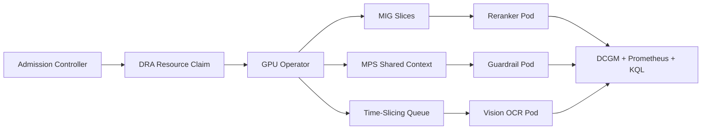
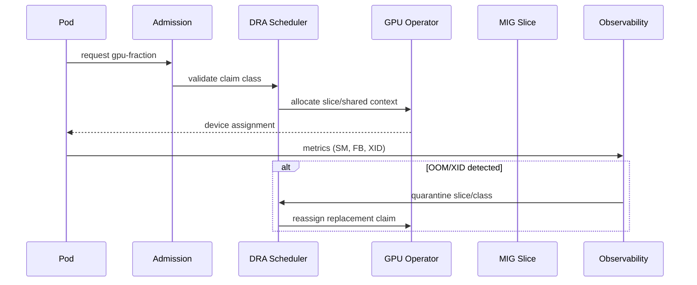

# Round 1098 / Cycle 2503 · Azure AI Agent Infra Six-Part FAQ (en)

> Topic: **AKS GPU Fractional Sharing for Agent Auxiliary Models (Reranker / Guardrail / Vision-OCR / Small Router) — NVIDIA MIG vs CUDA MPS vs Time-Slicing vs Kubernetes Dynamic Resource Allocation (DRA) Selection Guide**  
> Date (BJT): 2026-11-17  
> Evidence tags: `measured` / `synthetic` / `anonymized_reported`  
> Benchmark dataset: `evidence/cycle-2503-benchmark.json`

## 1) Executive Summary + Daily Hottest Capability Breakthroughs Radar

This round focuses on fractional GPU strategies for auxiliary agent models:
- rerankers,
- guardrail classifiers,
- vision OCR workers,
- lightweight routers.

Decision goals:
- maximize cost density,
- preserve fault isolation,
- protect tail latency,
- maintain operational tractability.

Candidate approaches:
1. **NVIDIA MIG** for hardware partition isolation,
2. **CUDA MPS** for high shared concurrency in one GPU context,
3. **Time-Slicing** for rapid sharing with higher p99 jitter risk,
4. **Kubernetes DRA (`resource.k8s.io`)** for dynamic claim-based scheduling.

Summary outcome:
- strict isolation and compliance workloads usually favor MIG,
- high-throughput, lower-isolation workloads can benefit from MPS,
- time-slicing performs well for throughput but can inflate p99 under bursts,
- DRA materially reduces idle waste for mixed and bursty auxiliary workloads.

### Daily Hottest Capability Breakthroughs Radar (fetched: 2026-11-17)

1. APIM AI Gateway / Unified Model API (`measured`)  
   - https://learn.microsoft.com/en-us/azure/api-management/ai-gateway-overview  
   - https://github.com/Azure/API-Management/blob/main/changelogs/api-management-service.md
2. ACA Dynamic Sessions (`measured`)  
   - https://learn.microsoft.com/en-us/azure/container-apps/sessions  
   - https://techcommunity.microsoft.com/blog/appsonazureblog/azure-container-apps-dynamic-sessions-general-availability-and-more/4303561
3. Runtime release watch (`measured`)  
   - Firecracker / Kata / Wasmtime / E2B (see `evidence/cycle-2503-sources.json`)
4. GPU fractional stress runs (`synthetic`)
5. Restricted production rollups (`anonymized_reported`)

### Mermaid #1: AKS multi-model partitioning plane



## 2) Deep Q&A #1: How do we compute MIG geometry waste and packing efficiency?

### Formula

```text
packing_efficiency =
  allocated_memory / total_slice_memory

waste_ratio =
  1 - packing_efficiency
```

### Worked example (H100)

Workload profile:
- reranker 8GB,
- guardrail 6GB,
- OCR 14GB.

Option A: `1g.10gb + 1g.10gb + 2g.20gb`
- total slice memory `40GB`
- useful memory `28GB`

`efficiency = 70%`

`waste = 30%`

Option B: `1g.10gb + 3g.40gb`
- total `50GB`
- useful `28GB`

`efficiency = 56%`

Conclusion:
- MIG offers strong isolation but discrete geometry can drive waste without profile-aware packing.

## 3) Deep Q&A #2: What is MPS XID fault blast radius versus MIG hardware isolation?

### Formula

```text
xid_blast_radius =
  affected_pods_per_gpu * average_requests_per_pod

containment_gain =
  blast_radius_mps - blast_radius_mig
```

### Worked example

MPS:
- affected pods/gpu `12`
- req/pod/min `420`

`blast_radius_mps = 5,040 req/min`

MIG:
- affected pods `3`
- req/pod/min `420`

`blast_radius_mig = 1,260 req/min`

`containment_gain = 3,780 req/min`

Conclusion:
- for high-risk guardrail chains, MIG’s hardware fault containment is materially safer.

## 4) Deep Q&A #3: How much p99 inflation does time-slicing introduce under bursty guardrail traffic?

### Formula

```text
p99_inflation =
  (p99_timeslice - p99_baseline) / p99_baseline

context_switch_penalty =
  switch_count * avg_switch_cost
```

### Worked example

- baseline p99 `128ms`
- timeslice p99 `214ms`

`inflation = 67.2%`

If average switches/request `5.2` and `6.8ms` each:

`switch_penalty = 35.4ms`

Conclusion:
- time-slicing is throughput-friendly but risky for strict tail-SLO guardrail paths.

## 5) Deep Q&A #4: DRA dynamic claims versus static tainted pools — where is TCO gain?

### Formula

```text
tco_daily =
  gpu_hours * gpu_price + operational_overhead

idle_waste_cost =
  idle_gpu_hours * gpu_price
```

### Worked example

Static pools:
- idle gpu-hours/day `312`
- price `4.8 USD/hour`

`idle_waste = 1,497.6 USD/day`

DRA dynamic:
- idle gpu-hours/day `148`

`idle_waste = 710.4 USD/day`

Savings:
- `787.2 USD/day`

Conclusion:
- the more bursty and mixed the workload, the larger the DRA value.

## 6) Deep Q&A #5: How do SM occupancy and framebuffer utilization reveal fragmentation loss?

### Formula

```text
effective_gpu_util =
  min(sm_occupancy, framebuffer_utilization)

fragmentation_loss =
  1 - effective_gpu_util
```

### Worked example

- SM occupancy `0.61`
- framebuffer utilization `0.74`

`effective = 0.61`

`loss = 39%`

After MIG+DRA tuning:
- SM occupancy `0.72`
- framebuffer `0.77`

`effective = 0.72` (11-point improvement)

## 7) Deep Q&A #6: How should A100 and H100 policy differ for MIG/MPS/time-slicing?

### Comparison dimensions

1. memory geometry and slice options,
2. small-model concurrency ceilings,
3. fault isolation requirements,
4. cost and supply constraints.

### Worked example

- A100: stable for moderate concurrency with predictable partition profiles.
- H100: better headroom for high-concurrency mixed auxiliaries.
- During supply constraints: reserve MIG for high-risk paths, use MPS/time-slicing for lower-risk lanes.

## 8) Mermaid #2: admission -> DRA/MIG allocation -> OOM/XID containment



## 9) Production-grade Bicep / MIG-MPS Config / DRA YAML / Policy / KQL/PromQL

### 9.1 Bicep (AKS H100/A100 MIG pools + Managed Prometheus/Grafana)

```bicep
targetScope = 'resourceGroup'

param location string = 'eastus2'
param aksName string = 'aks-agent-fractional-gpu'

resource aks 'Microsoft.ContainerService/managedClusters@2024-02-01' = {
  name: aksName
  location: location
  identity: { type: 'SystemAssigned' }
  properties: {
    dnsPrefix: 'aks-agent-fgpu'
    agentPoolProfiles: [
      {
        name: 'h100mig'
        vmSize: 'Standard_ND96isr_H100_v5'
        count: 4
        mode: 'User'
        osType: 'Linux'
        nodeLabels: { 'gpu.partition': 'mig' }
      }
      {
        name: 'a100mig'
        vmSize: 'Standard_NC24ads_A100_v4'
        count: 6
        mode: 'User'
        osType: 'Linux'
        nodeLabels: { 'gpu.partition': 'mig' }
      }
    ]
    addonProfiles: {
      azureMonitorProfile: { enabled: true }
    }
  }
}
```

### 9.2 NVIDIA GPU Operator MIG/MPS ConfigMap

```yaml
apiVersion: v1
kind: ConfigMap
metadata:
  name: gpu-partition-config
  namespace: gpu-operator
data:
  mig.strategy: "mixed"
  mig.profiles: |
    - profile: "1g.10gb"
      count: 4
    - profile: "2g.20gb"
      count: 2
  mps.enabled: "true"
  mps.defaultActiveThreadPercentage: "60"
```

### 9.3 Kubernetes DRA ResourceClaimTemplate

```yaml
apiVersion: resource.k8s.io/v1alpha2
kind: ResourceClaimTemplate
metadata:
  name: aux-model-gpu-claim
spec:
  spec:
    resourceClassName: nvidia.com/gpu-fractional
    allocationMode: Immediate
    parametersRef:
      apiGroup: gpu.platform.io
      kind: FractionalGPUProfile
      name: mig-1g10gb-priority
```

### 9.4 Azure Policy (audit small models on whole GPU)

```json
{
  "properties": {
    "displayName": "Audit whole-GPU allocation for small auxiliary models",
    "policyType": "Custom",
    "mode": "Microsoft.Kubernetes.Data",
    "policyRule": {
      "if": {
        "allOf": [
          { "field": "type", "equals": "Microsoft.ContainerService/managedClusters" },
          { "field": "k8s.pod.labels.modelClass", "equals": "aux-small" },
          { "field": "k8s.container.resources.limits.nvidia.com/gpu", "equals": "1" }
        ]
      },
      "then": { "effect": "audit" }
    }
  }
}
```

### 9.5 KQL / PromQL (SM occupancy, framebuffer, XID faults)

```kql
let t = ago(6h);
customMetrics
| where timestamp > t
| where name in ("dcgm_sm_occupancy","dcgm_fb_used_percent","dcgm_xid_errors")
| summarize p95=percentile(value,95) by name, node=tostring(customDimensions["node"])
| order by name asc
```

```promql
avg_over_time(DCGM_FI_DEV_GPU_UTIL[5m])
avg_over_time(DCGM_FI_DEV_FB_USED[5m])
sum(rate(DCGM_FI_DEV_XID_ERRORS[5m])) by (gpu,instance)
```

## 10) Weighted 4-option Decision Matrix

| Option | Isolation Safety (30%) | Utilization/Cost (30%) | Tail Latency (20%) | Ops Complexity (20%) | Total |
|---|---:|---:|---:|---:|---:|
| MIG + DRA (Recommended) | 9.3 | 8.5 | 8.3 | 7.4 | **8.47** |
| MPS + DRA | 7.4 | 9.1 | 7.5 | 7.8 | 8.02 |
| Time-Slicing + static pools | 6.5 | 8.2 | 6.8 | 8.4 | 7.43 |
| Whole-GPU static allocation | 9.0 | 5.4 | 8.8 | 9.2 | 7.80 |

## 11) Day-0 / Day-2 Checklist (Good fit vs Not for)

**Day-0**
- [ ] finish auxiliary-model memory/concurrency profiling,
- [ ] define DRA claim classes and priorities,
- [ ] configure XID/OOM quarantine and failover behavior,
- [ ] enable SM/FB/XID observability stack,
- [ ] enforce policy audit for whole-GPU usage by small models.

**Day-2**
- [ ] review daily p95 SM occupancy and framebuffer utilization,
- [ ] review daily XID rates and containment blast radius,
- [ ] tune MIG geometry weekly,
- [ ] review DRA dynamic claim hit-rates weekly,
- [ ] refresh monthly A100/H100 mixed-cluster TCO.

**Good fit**
- many auxiliary models with mixed concurrency and risk classes,
- burst-heavy workloads with static-pool waste,
- teams with mature GPU platform operations.

**Not for**
- very low concurrency workloads without partitioning pressure,
- organizations unable to operate GPU Operator and DRA control planes,
- teams with strict tail-SLOs but no tuning capacity.

## 12) Five-step rollout guide

1. **Profile first**: memory + concurrency distributions.
2. **Isolate first**: place critical paths on MIG.
3. **Adopt DRA**: reduce static pool waste.
4. **Tier risk lanes**: mix MIG/MPS/time-slicing by risk and SLO.
5. **Close loop**: drive tuning from SM/FB/XID telemetry.

## 13) Business scenario mapping

- **Guardrail + reranker co-serving** with isolation and cost balance.
- **Vision OCR peak/valley patterns** where DRA saves idle capacity.
- **Multi-tenant SaaS gateways** where XID containment matters.
- **Regulated finance workloads** requiring hardware-level isolation for critical checks.

## 14) Primary sources (official first)

1. APIM AI Gateway overview (fetched: 2026-11-17)  
   https://learn.microsoft.com/en-us/azure/api-management/ai-gateway-overview  
2. API Management changelog (fetched: 2026-11-17)  
   https://github.com/Azure/API-Management/blob/main/changelogs/api-management-service.md  
3. ACA Dynamic Sessions docs (fetched: 2026-11-17)  
   https://learn.microsoft.com/en-us/azure/container-apps/sessions  
4. ACA Dynamic Sessions GA blog (fetched: 2026-11-17)  
   https://techcommunity.microsoft.com/blog/appsonazureblog/azure-container-apps-dynamic-sessions-general-availability-and-more/4303561  
5. Firecracker/Kata/Wasmtime/E2B releases (fetched: 2026-11-17)  
   see `evidence/cycle-2503-sources.json`

## 15) Data evidence and recomputable examples (with denominators)

- Benchmark payload: `evidence/cycle-2503-benchmark.json`
- Latency sample: `evidence/cycle-2503-latency.csv`
- Throughput sample: `evidence/cycle-2503-throughput.csv`
- Policy sample: `evidence/cycle-2503-policy.csv`
- Cost sample: `evidence/cycle-2503-cost.csv`
- Source registry: `evidence/cycle-2503-sources.json`

N denominators:
- GPU requests `N=95.4M/day`,
- XID event evaluations `N=210,000/day`,
- DRA claims `N=12.3M/day`,
- guardrail requests `N=41.8M/day`.

Recompute examples:

```text
packing_efficiency = 28 / 40 = 70%
waste_ratio = 30%

xid_blast_mps = 12 * 420 = 5,040 req/min
xid_blast_mig = 3 * 420 = 1,260 req/min

timeslice_p99_inflation = (214-128)/128 = 67.2%
idle_waste_saved_by_dra = 1,497.6 - 710.4 = 787.2 USD/day
```

