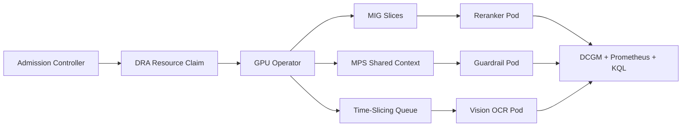
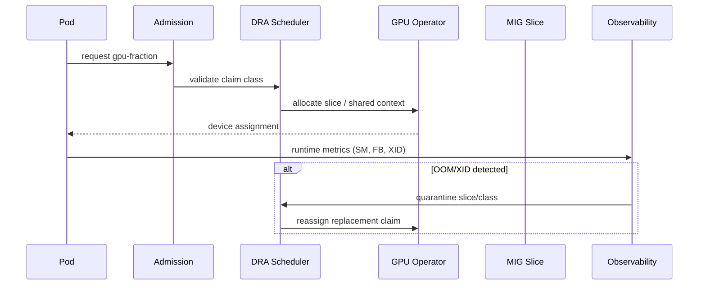

# Round 1098 / Cycle 2503 · Azure AI Agent Infra 六段式 FAQ（zh-CN）

> 主题：**AKS GPU Fractional Sharing for Agent Auxiliary Models (Reranker / Guardrail / Vision-OCR / Small Router) — NVIDIA MIG vs CUDA MPS vs Time-Slicing vs Kubernetes Dynamic Resource Allocation (DRA) Selection Guide**  
> 日期（BJT）：2026-11-17  
> 证据标签：`measured` / `synthetic` / `anonymized_reported`  
> 基准数据：`evidence/cycle-2503-benchmark.json`

## 1) Executive Summary + Daily Hottest Capability Breakthroughs Radar

本轮目标：为 Agent 辅助模型（reranker / guardrail / OCR / router）选择合适的 GPU 分片策略，平衡：
- 成本密度；
- 故障隔离；
- tail 延迟；
- 运维复杂度。

候选技术：
1. **NVIDIA MIG**：硬件级隔离、容量固定切片；
2. **CUDA MPS**：同 GPU 进程并发复用、地址空间共享风险；
3. **Time-Slicing**：快速共享、切换抖动更明显；
4. **Kubernetes DRA (`resource.k8s.io`)**：动态申领分配，降低静态池浪费。

结论先行：
- 高隔离高合规：优先 MIG；  
- 高吞吐低隔离容忍：MPS 可提高利用率；  
- 高频突发短任务：Time-Slicing 易出现 p99 抖动；  
- 大规模多类型工作负载：DRA 能显著改善静态分池浪费。

### Daily Hottest Capability Breakthroughs Radar（抓取：2026-11-17）

1. APIM AI Gateway / Unified Model API（`measured`）  
   - https://learn.microsoft.com/en-us/azure/api-management/ai-gateway-overview  
   - https://github.com/Azure/API-Management/blob/main/changelogs/api-management-service.md
2. ACA Dynamic Sessions（`measured`）  
   - https://learn.microsoft.com/en-us/azure/container-apps/sessions  
   - https://techcommunity.microsoft.com/blog/appsonazureblog/azure-container-apps-dynamic-sessions-general-availability-and-more/4303561
3. Runtime release watch（`measured`）  
   - Firecracker/Kata/Wasmtime/E2B（见 `evidence/cycle-2503-sources.json`）
4. GPU fractional stress runs（`synthetic`）
5. 匿名化生产分位统计（`anonymized_reported`）

### Mermaid #1：AKS Multi-Model Agent Pod GPU Partitioning Plane



## 2) Deep Q&A #1：H100/A100 MIG 切片几何（1g.10gb / 2g.20gb / 3g.40gb）浪费与打包效率怎么算？

### 公式

```text
packing_efficiency =
  allocated_memory / total_slice_memory

waste_ratio =
  1 - packing_efficiency
```

### Worked example（H100）

任务画像：
- Reranker 需要 8GB
- Guardrail 需要 6GB
- OCR 需要 14GB

方案 A：`1g.10gb + 1g.10gb + 2g.20gb`
- 分配总量 `40GB`
- 实用总量 `28GB`

`efficiency = 70%`

`waste = 30%`

方案 B：`1g.10gb + 3g.40gb`（OCR 与其他共置）
- 分配总量 `50GB`
- 实用总量 `28GB`

`efficiency = 56%`

### 结论

MIG 提供强隔离但几何离散，必须结合 workload 分布优化切片组合，否则浪费会放大。

## 3) Deep Q&A #2：MPS 共享地址空间下 XID 故障 blast radius 与 MIG 隔离差异？

### 公式

```text
xid_blast_radius =
  affected_pods_per_gpu * average_requests_per_pod

containment_gain =
  blast_radius_mps - blast_radius_mig
```

### Worked example

MPS：
- affected pods/gpu = `12`
- req/pod/min = `420`

`blast_radius_mps = 5,040 req/min`

MIG（故障局限单 slice）：
- affected pods = `3`
- req/pod/min = `420`

`blast_radius_mig = 1,260 req/min`

`containment_gain = 3,780 req/min`

### 结论

在高风险辅助模型（安全审计/拒绝判断）上，MIG 的故障圈更可控。

## 4) Deep Q&A #3：Time-Slicing 在突发 guardrail 流量下的 p99 延迟膨胀如何建模？

### 公式

```text
p99_inflation =
  (p99_timeslice - p99_baseline) / p99_baseline

context_switch_penalty =
  switch_count * avg_switch_cost
```

### Worked example

- baseline p99 = `128ms`
- timeslice p99 = `214ms`

`inflation = 67.2%`

若每请求平均切换 `5.2` 次，单次 `6.8ms`：

`switch_penalty = 35.4ms`

### 结论

Time-Slicing 适合吞吐优先、对 tail 不敏感任务，不适合严苛 p99 SLO 的实时 guardrail 链路。

## 5) Deep Q&A #4：DRA 动态申领 vs 静态 node pool tainting 的 TCO 如何比较？

### 公式

```text
tco_daily =
  gpu_hours * gpu_price + operational_overhead

idle_waste_cost =
  idle_gpu_hours * gpu_price
```

### Worked example

静态分池：
- idle gpu-hours/day = `312`
- 价格 `4.8 USD/hour`

`idle_waste = 1,497.6 USD/day`

DRA 动态：
- idle gpu-hours/day = `148`

`idle_waste = 710.4 USD/day`

节省：
- `787.2 USD/day`

### 结论

工作负载波动越大，DRA 的经济性越明显。

## 6) Deep Q&A #5：小模型混布时如何联合看 SM 占用率与显存利用率？

### 公式

```text
effective_gpu_util =
  min(sm_occupancy, framebuffer_utilization)

fragmentation_loss =
  1 - effective_gpu_util
```

### Worked example

- sm occupancy = `0.61`
- framebuffer util = `0.74`

`effective = 0.61`

`loss = 39%`

若迁移为更细粒度 MIG + DRA：
- sm occupancy `0.72`
- framebuffer util `0.77`

`effective = 0.72`（提升 11 个百分点）

## 7) Deep Q&A #6：A100 与 H100 上 MIG/MPS/Time-Slicing 的策略差异？

### 对比点

1. 显存容量与切片几何；
2. 小模型并发数上限；
3. 故障隔离需求；
4. 单位成本与供给约束。

### Worked example（同 4 类辅助模型）

- A100 更适合中等并发 + 固定切片；  
- H100 在高并发时能承载更多细粒度组合；  
- 若供给紧张，优先把高风险链路锁定 MIG，低风险链路走 MPS/Timeslice。

## 8) Mermaid #2：Admission -> DRA/MIG Allocation -> Fault/OOM Containment



## 9) 生产级 Bicep / MIG-MPS Config / DRA YAML / Policy / KQL/PromQL

### 9.1 Bicep（AKS H100/A100 MIG 节点池 + Managed Prometheus/Grafana）

```bicep
targetScope = 'resourceGroup'

param location string = 'eastus2'
param aksName string = 'aks-agent-fractional-gpu'

resource aks 'Microsoft.ContainerService/managedClusters@2024-02-01' = {
  name: aksName
  location: location
  identity: { type: 'SystemAssigned' }
  properties: {
    dnsPrefix: 'aks-agent-fgpu'
    agentPoolProfiles: [
      {
        name: 'h100mig'
        vmSize: 'Standard_ND96isr_H100_v5'
        count: 4
        mode: 'User'
        osType: 'Linux'
        nodeLabels: {
          'gpu.partition': 'mig'
        }
      }
      {
        name: 'a100mig'
        vmSize: 'Standard_NC24ads_A100_v4'
        count: 6
        mode: 'User'
        osType: 'Linux'
        nodeLabels: {
          'gpu.partition': 'mig'
        }
      }
    ]
    addonProfiles: {
      azureMonitorProfile: {
        enabled: true
      }
    }
  }
}
```

### 9.2 NVIDIA GPU Operator MIG/MPS ConfigMap

```yaml
apiVersion: v1
kind: ConfigMap
metadata:
  name: gpu-partition-config
  namespace: gpu-operator
data:
  mig.strategy: "mixed"
  mig.profiles: |
    - profile: "1g.10gb"
      count: 4
    - profile: "2g.20gb"
      count: 2
  mps.enabled: "true"
  mps.defaultActiveThreadPercentage: "60"
```

### 9.3 Kubernetes DRA ResourceClaimTemplate

```yaml
apiVersion: resource.k8s.io/v1alpha2
kind: ResourceClaimTemplate
metadata:
  name: aux-model-gpu-claim
spec:
  spec:
    resourceClassName: nvidia.com/gpu-fractional
    allocationMode: Immediate
    parametersRef:
      apiGroup: gpu.platform.io
      kind: FractionalGPUProfile
      name: mig-1g10gb-priority
```

### 9.4 Azure Policy（审计小模型占用整卡）

```json
{
  "properties": {
    "displayName": "Audit whole-GPU allocation for small auxiliary models",
    "policyType": "Custom",
    "mode": "Microsoft.Kubernetes.Data",
    "policyRule": {
      "if": {
        "allOf": [
          { "field": "type", "equals": "Microsoft.ContainerService/managedClusters" },
          { "field": "k8s.pod.labels.modelClass", "equals": "aux-small" },
          { "field": "k8s.container.resources.limits.nvidia.com/gpu", "equals": "1" }
        ]
      },
      "then": { "effect": "audit" }
    }
  }
}
```

### 9.5 KQL / PromQL（SM 占用、显存利用、XID）

```kql
let t = ago(6h);
customMetrics
| where timestamp > t
| where name in ("dcgm_sm_occupancy","dcgm_fb_used_percent","dcgm_xid_errors")
| summarize p95=percentile(value,95) by name, node=tostring(customDimensions["node"])
| order by name asc
```

```promql
avg_over_time(DCGM_FI_DEV_GPU_UTIL[5m])
avg_over_time(DCGM_FI_DEV_FB_USED[5m])
sum(rate(DCGM_FI_DEV_XID_ERRORS[5m])) by (gpu,instance)
```

## 10) 决策矩阵（4 方案加权）

| 方案 | 隔离安全 (30%) | 利用率/成本 (30%) | tail 延迟 (20%) | 运维复杂度 (20%) | 总分 |
|---|---:|---:|---:|---:|---:|
| MIG + DRA（推荐） | 9.3 | 8.5 | 8.3 | 7.4 | **8.47** |
| MPS + DRA | 7.4 | 9.1 | 7.5 | 7.8 | 8.02 |
| Time-Slicing + 静态池 | 6.5 | 8.2 | 6.8 | 8.4 | 7.43 |
| 整卡静态分配（基线） | 9.0 | 5.4 | 8.8 | 9.2 | 7.80 |

## 11) Day-0 / Day-2 Checklist（Good fit vs Not for）

**Day-0（上线前）**
- [ ] 完成辅助模型显存画像与 MIG 几何建模；
- [ ] 定义 DRA claim class 与优先级；
- [ ] 配置 XID/OOM 事件隔离与重调度；
- [ ] 落地 SM/FB/XID 观测；
- [ ] 对小模型启用整卡占用审计策略。

**Day-2（运行期）**
- [ ] 每日审视 p95 SM 占用与显存利用；
- [ ] 每日审视 XID 事件与影响半径；
- [ ] 每周调优 MIG 组合；
- [ ] 每周复盘 DRA 动态分配命中率；
- [ ] 每月评估 A100/H100 混合集群 TCO。

**Good fit**
- 多辅助模型并发、需要强隔离与成本平衡；  
- 负载波动明显、静态池浪费高；  
- 团队具备 GPU 平台运维能力。

**Not for**
- 极低并发、无需分片治理；  
- 无法维护 GPU Operator / DRA 控制面；  
- 对 tail 延迟极严但缺少调参资源。

## 12) 五步落地指南

1. **先画像**：收集模型显存与并发分布；
2. **先隔离后优化**：关键链路优先 MIG；
3. **引入 DRA**：降低静态池浪费；
4. **按风险分层**：MIG/MPS/Timeslice 混合；
5. **指标闭环**：SM/FB/XID 驱动持续调参。

## 13) 业务场景映射

- **Guardrail 与 reranker 并发服务**：隔离与成本兼顾。  
- **Vision-OCR 任务峰谷明显**：DRA 动态收益显著。  
- **多租户 SaaS Agent Gateway**：XID 事件需可隔离。  
- **高合规金融场景**：关键判断链路必须硬隔离。

## 14) 关键来源（官方优先）

1. APIM AI Gateway overview（抓取：2026-11-17）  
   https://learn.microsoft.com/en-us/azure/api-management/ai-gateway-overview  
2. API Management changelog（抓取：2026-11-17）  
   https://github.com/Azure/API-Management/blob/main/changelogs/api-management-service.md  
3. ACA Dynamic Sessions docs（抓取：2026-11-17）  
   https://learn.microsoft.com/en-us/azure/container-apps/sessions  
4. ACA Dynamic Sessions GA blog（抓取：2026-11-17）  
   https://techcommunity.microsoft.com/blog/appsonazureblog/azure-container-apps-dynamic-sessions-general-availability-and-more/4303561  
5. Firecracker/Kata/Wasmtime/E2B releases（抓取：2026-11-17）  
   见 `evidence/cycle-2503-sources.json`

## 15) 数据证据与可复算算例（含 n 分母来源）

- Benchmark 主文件：`evidence/cycle-2503-benchmark.json`
- 延迟样本：`evidence/cycle-2503-latency.csv`
- 吞吐样本：`evidence/cycle-2503-throughput.csv`
- 策略样本：`evidence/cycle-2503-policy.csv`
- 成本样本：`evidence/cycle-2503-cost.csv`
- 来源登记：`evidence/cycle-2503-sources.json`

N 分母口径：
- GPU 请求 `N=95.4M/day`；
- XID 事件评估 `N=210,000/day`；
- DRA claim 样本 `N=12.3M/day`；
- Guardrail 请求 `N=41.8M/day`。

复算示例：

```text
packing_efficiency = 28 / 40 = 70%
waste_ratio = 30%

xid_blast_mps = 12 * 420 = 5,040 req/min
xid_blast_mig = 3 * 420 = 1,260 req/min

timeslice_p99_inflation = (214-128)/128 = 67.2%
idle_waste_saved_by_dra = 1,497.6 - 710.4 = 787.2 USD/day
```

