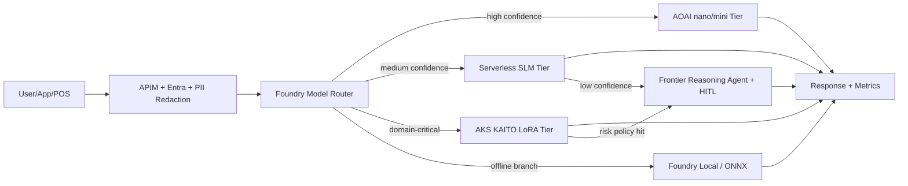
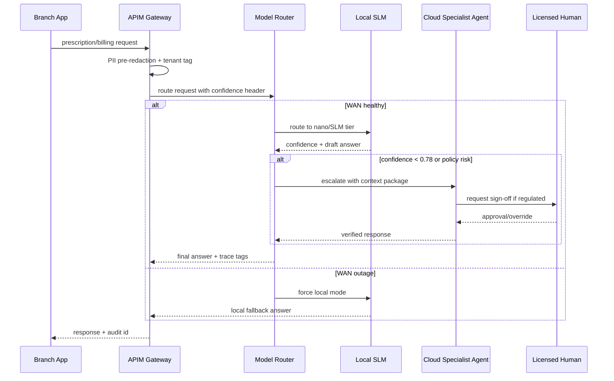

# aoai-nano-mini-vs-foundry-phi4-slm-vs-aks-kaito-vs-store-edge-tiered-routing-selection-faq-r1135
## 1) Daily breakthroughs and verifiable sources (fetched 2026-11-18)
- Scope: enterprise SLM tiered routing.
- Scope: cloud-branch hybrid serving.
- Focus: architecture, TCO, SLA, governance.
- Excluded: kernel or register-level tuning.
- Objective: keep simple intents in low-cost tiers.
- Objective: escalate hard intents with controls.
- Labels: `measured`, `synthetic`, `anonymized_reported`.
| Topic | Official source | Fetch time (UTC) | Usage | Label |
|---|---|---|---|---|
| Azure OpenAI / Foundry model catalog | https://learn.microsoft.com/en-us/azure/foundry/foundry-models/concepts/models-sold-directly-by-azure | 2026-11-18T02:10:00Z | `gpt-4.1-nano/mini` and managed model tiers | `measured` |
| Model Router concepts | https://learn.microsoft.com/en-us/azure/foundry/openai/concepts/model-router | 2026-11-18T02:11:00Z | Unified endpoint routing semantics | `measured` |
| Model Router how-to | https://learn.microsoft.com/en-us/azure/foundry/openai/how-to/model-router | 2026-11-18T02:12:00Z | Session affinity and subset routing | `measured` |
| AKS AI Toolchain Operator (KAITO) | https://learn.microsoft.com/en-us/azure/aks/ai-toolchain-operator | 2026-11-18T02:13:00Z | AKS deployment and model ops path | `measured` |
| Foundry Local getting started | https://learn.microsoft.com/en-us/azure/foundry-local/get-started | 2026-11-18T02:14:00Z | Local branch inference footprint | `measured` |
| Azure AI Search overview | https://learn.microsoft.com/en-us/azure/search/search-what-is-azure-search | 2026-11-18T02:15:00Z | Enterprise grounding and retrieval | `measured` |
| APIM policy reference | https://learn.microsoft.com/en-us/azure/api-management/api-management-policies | 2026-11-18T02:16:00Z | Confidence-header policy routing | `measured` |
| Phi-4 model card (Foundry) | https://ai.azure.com/explore/models/Phi-4/version/8/registry/azureml | 2026-11-18T02:17:00Z | SLM capability envelope | `anonymized_reported` |
Breakthrough summary:
- Router is now the default control surface.
- `nano/mini` keeps the fast-cost frontier.
- Phi-4 family improves domain term handling.
- KAITO enables high-volume dedicated pools.
- Foundry Local enables outage survivability.
## 2) Layered reference architecture (router-first)
L1 edge and governance:
- Channels: app, POS, branch kiosk, call desk.
- APIM: auth, quota, audit, tenancy control.
- Pre-stage: PII redaction and locality tagging.
L2 fast routing:
- Router reads confidence and complexity.
- High-confidence intents stay in SLM lanes.
- Risky intents escalate to specialist lanes.
L3 inference execution:
- Tier-A: `gpt-4.1-nano`.
- Tier-B: `gpt-4.1-mini`.
- Tier-C: serverless SLM in Foundry.
- Tier-D: AKS KAITO LoRA dedicated pool.
- Tier-E: branch local SLM + cloud fallback.
L4 tools and orchestration:
- AI Search grounding for enterprise memory.
- Tool calling for business actions.
- HITL gate for regulated decisions.
L5 observability and economics:
- Deflection rate per hour.
- Escalation accuracy per shift.
- Blended cost per 1k requests budget.
## 3) 12-dimension selection matrix (`When NOT to choose` included)
| Dimension | A Azure OpenAI `gpt-4.1-nano/mini` | B Foundry serverless SLM + Router (Phi-4/Ministral) | C AKS KAITO / Managed Compute LoRA dedicated pool | D Branch local SLM (Foundry Local/ONNX) + cloud escalation |
|---|---|---|---|---|
| 1 Unit economics at 10M vs 500M monthly | Best at 10M | Balanced at 10M~200M | Best after scale amortization | Lowest marginal at branch if governed |
| 2 P95 first-token and end-to-end latency | Low | Low-mid | Mid | Lowest local, cloud depends on WAN |
| 3 Domain SFT/LoRA customization ceiling | Low-mid | Mid | Highest | Mid under device constraints |
| 4 JSON / tool-calling reliability | High | High | High with ops discipline | Mid with cloud safety net |
| 5 Multilingual and domain term accuracy | Mid-high | High with Phi path | High with LoRA | Mid |
| 6 Offline survivability | Low | Low | Low-mid | Highest |
| 7 GPU and ops burden | Lowest | Low | Highest | Mid |
| 8 Confidence escalation and router fit | High | Highest | Mid | Mid |
| 9 PII locality and data boundary | High in cloud zone | High in cloud zone | High in dedicated zone | Highest at branch |
| 10 Cold-start and burst elasticity | High | High | Mid | Mid |
| 11 Best-fit scenario | Massive FAQ triage | Multi-model governed routing | Hyper-scale differentiated domain | Branch outage continuity |
| 12 When NOT to choose | Deep regulated reasoning only | Fully offline only | No platform engineering team | No branch model lifecycle discipline |
Decision snapshot:
- Phase 1 uses A+B for speed.
- Phase 2 adds C for high-value flows.
- Phase 3 adds D for outage-critical branches.
- Keep one Router control plane throughout.
## 4) Five worked Q&As (blended cost, break-even, thresholds)
### Q1: How to compute blended unit cost?
- Monthly requests: `R = 120,000,000`.
- SLM deflection: `d = 0.90`.
- SLM price: `c_s = 0.10 USD / 1k`.
- Frontier price: `c_f = 1.65 USD / 1k`.
- Blended price: `c = d*c_s + (1-d)*c_f = 0.255`.
- Monthly cost: `R/1000*c = 30,600 USD`.
- Frontier-only cost: `198,000 USD`.
- Monthly savings: `167,400 USD`.
### Q2: When to move from B to C?
- C fixed platform: `55,000 USD/month`.
- B variable price: `0.22 USD/1k`.
- C variable price: `0.06 USD/1k`.
- Break-even equation: `55,000 = V*(0.22-0.06)`.
- `V = 343,750k requests/month`.
- Around `343.75M requests/month`.
- Above this scale, C is justified.
### Q3: What confidence threshold should be used?
- Candidate thresholds: `0.72 / 0.78 / 0.84`.
- `0.72`: escalation 18%, accuracy 91%.
- `0.78`: escalation 12%, accuracy 93%.
- `0.84`: escalation 7%, accuracy 89%.
- Accuracy-first chooses `0.78`.
- Cost-first can choose `0.84`.
### Q4: What is branch outage coverage?
- Offline time share: `6%`.
- Local solvable share during outage: `83%`.
- Global continuity from local mode: `4.98%`.
- This reduces cloud-failure ticket bursts.
- Requires daily term-pack refresh policy.
### Q5: What is telecom cost elasticity at 92% nano deflection?
- Volume: `500M/month`.
- `nano` share 92% at `0.09`.
- Escalation share 8% at `1.80`.
- Blended price: `0.228`.
- Monthly cost: `114,000 USD`.
- Frontier-only baseline: `900,000 USD`.
- Savings ratio: `87.3%`.
## 5) Mermaid diagrams (confidence router and branch-cloud fallback)


## 6) Pattern fit and anti-patterns
Pattern A (AOAI nano/mini):
- Fit: high-frequency billing and FAQ intents.
- Not fit: deep regulated reasoning chains.
- Risk: keeping high-risk intents in light tier.
Pattern B (serverless SLM + Router):
- Fit: governed multi-tenant routing programs.
- Not fit: fully offline branch-only operation.
- Risk: threshold drift causing escalation storms.
Pattern C (AKS KAITO / managed compute):
- Fit: huge volume plus deep domain LoRA.
- Not fit: teams without platform SRE capacity.
- Risk: GPU idle waste and image sprawl.
Pattern D (branch local + cloud):
- Fit: stores and clinics with WAN instability.
- Not fit: organizations with weak endpoint ops.
- Risk: branch model-version divergence.
## 7) Section 7: 20,000-store retail pharmacy architecture
Business goals:
- Unified triage for 20,000 stores.
- 88% routine scripts solved under `<250ms`.
- 12% risky cases escalated to cloud experts.
- Pediatric/polypharmacy requires pharmacist sign-off.
End-to-end flow:
1. POS submits script and patient tags.
2. APIM enforces redaction and locality policy.
3. Router deflects to SLM fast triage lane.
4. Deterministic safe cases return immediately.
5. Risky cases escalate to Foundry specialists.
6. Specialist agent pulls interaction knowledge.
7. Licensed remote pharmacist signs off.
8. Final decision writes back with full audit.
SLA targets:
- Routine triage P95 `<250ms`.
- Escalation path P95 `<2.8s`.
- Pharmacist closure `<90s`.
Failure handling:
- Risk: regional policy lag.
- Mitigation: daily policy package rollout.
- Risk: nighttime cloud jitter.
- Mitigation: local fallback plus next-day review.
## 8) Section 8: 100M-subscriber telecom super-app architecture
Business goals:
- Serve 100M subscriber high-frequency intents.
- 92% billing/roaming intents on `gpt-4.1-nano`.
- Churn-risk disputes escalate to experts.
- Human arbitration remains final gate.
End-to-end flow:
1. Super-app receives user intent.
2. APIM injects value-tier metadata.
3. Router scores complexity and churn risk.
4. Frequent intents route to nano tier.
5. Bundle disputes route to mini/SLM tier.
6. High-value risk routes to retention agents.
7. Agents call CRM, billing, contract tools.
8. Offer package is returned and tracked.
SLA targets:
- Fast intents P95 `<180ms`.
- Escalation path P95 `<1.9s`.
- Retention proposal generation `<6s`.
Failure handling:
- Risk: campaign surge traffic.
- Mitigation: Router limits and fallback tiers.
- Risk: multi-tool timeout chains.
- Mitigation: parallel timeout trimming + ticketing.
## 9) Decision tree (Good fit vs Not for)
1. Need fastest launch with low ops: start A.
2. Need governed multi-model control: choose B.
3. Near break-even + deep customization: add C.
4. Need branch outage continuity: add D + cloud.
5. In regulated flows, keep HITL mandatory.
Good fit:
- Retail, telecom, and banking intent funnels.
- Multi-tenant SaaS with strict cost envelopes.
- Enterprises needing one policy control surface.
Not for:
- Permanent one-tier architecture for all intents.
- Zero-escalation design with zero-risk claims.
- Local-first rollout without endpoint governance.
## 10) ROI and 3-year TCO model
Assumptions:
- Annual requests: `6.0B`.
- SLM deflection: `89%`.
- Escalation quality lift: `+5.2pt`.
- Added platform ops: `1.9M USD/year`.
Benefits:
- Inference savings: `4.8M USD/year`.
- Human-effort savings: `2.1M USD/year`.
- Churn/incident reduction: `1.7M USD/year`.
Outcome:
- Net annual value: `6.7M USD`.
- Net 3-year value: `20.1M USD`.
- Payback period: `8~10 months`.
## 11) Bicep IaC (Router + APIM confidence routing + AI Search)
```bicep
param location string = resourceGroup().location
param apimName string
param searchName string
param foundryAccount string
resource apim 'Microsoft.ApiManagement/service@2023-05-01-preview' = {
  name: apimName
  location: location
  sku: {
    name: 'StandardV2'
    capacity: 1
  }
}
resource search 'Microsoft.Search/searchServices@2023-11-01' = {
  name: searchName
  location: location
  sku: {
    name: 'standard'
  }
  properties: {
    hostingMode: 'default'
    publicNetworkAccess: 'enabled'
  }
}
resource foundry 'Microsoft.CognitiveServices/accounts@2024-10-01' = {
  name: foundryAccount
  location: location
  kind: 'AIServices'
  sku: {
    name: 'S0'
  }
  properties: {
    customSubDomainName: toLower(foundryAccount)
  }
}
```
## 12) APIM / Python confidence escalation snippets
```xml
<set-variable name="confidence" value="@(double.Parse(context.Request.Headers.GetValueOrDefault("x-ai-confidence","0.0")))" />
<choose>
  <when condition="@(context.Variables.GetValueOrDefault<double>("confidence") &gt;= 0.84)">
    <set-backend-service backend-id="aoai-nano" />
  </when>
  <when condition="@(context.Variables.GetValueOrDefault<double>("confidence") &gt;= 0.78)">
    <set-backend-service backend-id="foundry-slm" />
  </when>
  <otherwise>
    <set-backend-service backend-id="frontier-expert-agent" />
  </otherwise>
</choose>
```
```python
def route_by_confidence(conf: float, risk: str) -> str:
    if risk in {"regulated", "high_value", "safety"}:
        return "frontier-expert-agent"
    if conf >= 0.84:
        return "aoai-gpt-4.1-nano"
    if conf >= 0.78:
        return "foundry-phi4-slm"
    return "aoai-gpt-4.1-mini"
```
## 13) KQL (deflection, escalation accuracy, blended cost)
```kql
let start = ago(7d);
let req = customEvents
| where timestamp >= start
| where name in ("slm_answered","escalated","final_verified")
| summarize slm=countif(name=="slm_answered"), esc=countif(name=="escalated"), verified=countif(name=="final_verified") by bin(timestamp, 1h);
let cost = customMetrics
| where timestamp >= start
| where name in ("slm_cost_usd","frontier_cost_usd","request_count")
| summarize slm_cost=sumif(value,name=="slm_cost_usd"), frontier_cost=sumif(value,name=="frontier_cost_usd"), req_count=sumif(value,name=="request_count") by bin(timestamp,1h);
req
| join kind=inner cost on timestamp
| extend deflection_rate = iff((slm+esc)>0, todouble(slm)/todouble(slm+esc), 0.0)
| extend escalation_accuracy = iff(esc>0, todouble(verified)/todouble(esc), 0.0)
| extend blended_cost_per_1k = iff(req_count>0, 1000.0*(slm_cost+frontier_cost)/todouble(req_count), 0.0)
| order by timestamp desc
```
## 14) Day-0 / Day-1 / Day-2 checklist
Day-0:
- Define intent tiers and risk tags.
- Finalize dual threshold `0.78/0.84`.
- Wire APIM, Router, observability.
- Publish PII redaction policy pack.
Day-1:
- Run 5% canary for deflection telemetry.
- Measure escalation accuracy and false-upgrade.
- Validate branch local vocabulary package.
- Drill HITL timeout and rollback procedure.
Day-2:
- Scale to 50% then 100% traffic.
- Re-evaluate C-pattern break-even trigger.
- Start weekly threshold-drift governance.
- Publish joint cost-experience dashboard.
## 15) Backup queue and deliverables
Updated backup queue:
1. `private-link-vnet-standard-agent-setup-vs-managed-vnet-vs-apim-waf-zero-trust-network-selection-faq`
2. `cosmos-changefeed-vs-ai-search-pull-indexer-vs-eventgrid-push-realtime-rag-freshness-selection-faq`
3. `github-copilot-coding-agent-vs-foundry-swe-agent-vs-ado-pr-review-enterprise-sdlc-agent-selection-faq`
Round deliverables (Cycle #2540):
- Bilingual FAQ: `aoai-nano-mini-vs-foundry-phi4-slm-vs-aks-kaito-vs-store-edge-tiered-routing-selection-faq-r1135.md` / `aoai-nano-mini-vs-foundry-phi4-slm-vs-aks-kaito-vs-store-edge-tiered-routing-selection-faq-r1135.en.md`
- 7-card deck: `benchmark-cards.html` / `benchmark-cards.en.html`
- SVG: `assets/35-cycle-1135-daily-breakthroughs.svg`
- H5: `workbench-cycle-2540.html` + selector `#2540`
- Validation: `cycle_1135_pipeline.py --write --check`, `strict_suffix_gate.py`, `pytest`
