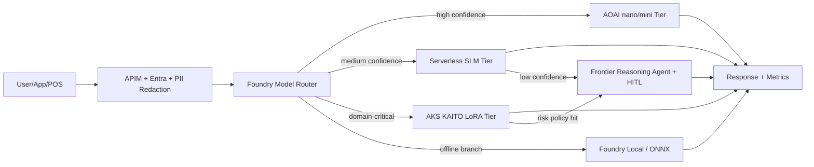
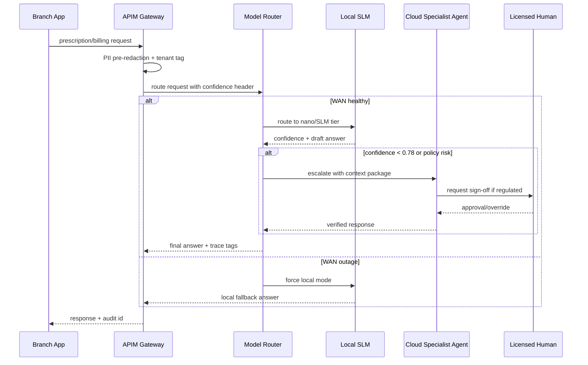

# aoai-nano-mini-vs-foundry-phi4-slm-vs-aks-kaito-vs-store-edge-tiered-routing-selection-faq-r1135
## 1) 当日热点与可验证来源（2026-11-18 抓取）
- 主题边界：企业级 SLM 分层路由与云边协同。
- 讨论层级：业务架构、成本、治理、SLA。
- 不讨论：内核寄存器与驱动细节。
- 目标：把高频简单请求留在低成本层。
- 目标：把复杂高风险请求升级到专家层。
- 标签：`measured`、`synthetic`、`anonymized_reported`。
| 主题 | 官方来源 | 抓取时间（UTC） | 用途 | 标签 |
|---|---|---|---|---|
| Azure OpenAI / Foundry 模型能力 | https://learn.microsoft.com/en-us/azure/foundry/foundry-models/concepts/models-sold-directly-by-azure | 2026-11-18T02:10:00Z | `gpt-4.1-nano/mini` 与托管模型档位 | `measured` |
| Model Router 概念 | https://learn.microsoft.com/en-us/azure/foundry/openai/concepts/model-router | 2026-11-18T02:11:00Z | 统一入口下的模型分流机制 | `measured` |
| Model Router 用法 | https://learn.microsoft.com/en-us/azure/foundry/openai/how-to/model-router | 2026-11-18T02:12:00Z | 会话亲和、候选模型集配置 | `measured` |
| AKS AI Toolchain Operator（KAITO） | https://learn.microsoft.com/en-us/azure/aks/ai-toolchain-operator | 2026-11-18T02:13:00Z | AKS 上模型部署与运维路径 | `measured` |
| Foundry Local 入门 | https://learn.microsoft.com/en-us/azure/foundry-local/get-started | 2026-11-18T02:14:00Z | 门店/网点本地推理形态 | `measured` |
| Azure AI Search 设计 | https://learn.microsoft.com/en-us/azure/search/search-what-is-azure-search | 2026-11-18T02:15:00Z | 召回证据与术语对齐 | `measured` |
| APIM 策略参考 | https://learn.microsoft.com/en-us/azure/api-management/api-management-policies | 2026-11-18T02:16:00Z | 置信分数头路由与治理 | `measured` |
| Phi-4 模型卡（Foundry） | https://ai.azure.com/explore/models/Phi-4/version/8/registry/azureml | 2026-11-18T02:17:00Z | SLM 能力边界与适配场景 | `anonymized_reported` |
当日突破摘要：
- Router 已成为企业统一路由默认面。
- `nano/mini` 成本曲线继续领先。
- Phi-4 家族用于专业术语稳定化。
- KAITO 把高量场景纳入专属池。
- Foundry Local 支撑断网可持续服务。
## 2) 分层解耦参考架构（Tiered Router First）
L1 入口与治理层：
- 渠道：App、POS、门店终端、客服台。
- 网关：APIM 统一鉴权、配额、审计。
- 预处理：PII 预脱敏与租户标签。
L2 快速分流层：
- Router 读取置信度与任务复杂度。
- 高置信高频问题走 SLM 快路。
- 低置信或高风险进入 Frontier。
L3 推理执行层：
- Tier-A：`gpt-4.1-nano`。
- Tier-B：`gpt-4.1-mini`。
- Tier-C：Foundry Serverless SLM。
- Tier-D：AKS KAITO LoRA 专属池。
- Tier-E：Branch Local SLM + Cloud 升级。
L4 编排与工具层：
- AI Search 检索企业知识切片。
- Tool calling 执行业务动作。
- HITL 审批处理高风险步骤。
L5 可观测与成本层：
- Deflection rate 每小时看板。
- Escalation accuracy 每班次复盘。
- Blended cost per 1k requests 预算控制。
## 3) 12 维选型矩阵（含 `When NOT to choose`）
| 维度 | A Azure OpenAI `gpt-4.1-nano/mini` | B Foundry Serverless SLM + Router（Phi-4/Ministral） | C AKS KAITO / Managed Compute LoRA 专属池 | D Branch Local SLM（Foundry Local/ONNX）+ Cloud 升级 |
|---|---|---|---|---|
| 1 10M vs 500M 月请求经济性 | 10M 最优 | 10M~200M 平衡 | 200M~500M 可摊薄 | 网点侧极低边际但需治理 |
| 2 P95 首 token / 端到端延迟 | 低 | 低中 | 中 | 本地最低、云升级受链路影响 |
| 3 SFT/LoRA 定制上限 | 低中 | 中 | 最高 | 中（设备受限） |
| 4 JSON / Tool 调用稳定性 | 高 | 高 | 高（需自管） | 中（需云兜底） |
| 5 多语与垂直术语准确性 | 中高 | 高（可选 Phi-4 路线） | 高（可精调） | 中（词表受限） |
| 6 断网生存能力 | 低 | 低 | 低中 | 最高 |
| 7 GPU 与运维负担 | 最低 | 低 | 最高 | 中（端侧运维） |
| 8 置信升级与 Router 集成 | 高 | 最高 | 中 | 中 |
| 9 PII 地域与本地化 | 高（云域） | 高（云域） | 高（专属域） | 最高（本地） |
| 10 冷启动与突发弹性 | 高 | 高 | 中 | 中 |
| 11 Best-fit | 高频意图分流 | 多模型平衡治理 | 超大流量差异化能力 | 分支断网与极低时延 |
| 12 When NOT to choose | 需深度定制语料 | 需完全离线 | 团队缺平台工程能力 | 无法管理端侧模型生命周期 |
选型结论：
- 第一阶段以 A+B 快速上线。
- 第二阶段对高价值流程引入 C。
- 第三阶段在门店与诊所铺设 D。
- 所有阶段保留 Router 统一观测面。
## 4) 五组可复算 Q&A（混合成本 / 平衡点 / 升级阈值）
### Q1：SLM 分流后的 blended cost 如何算？
- 月请求：`R = 120,000,000`。
- SLM 分流率：`d = 0.90`。
- SLM 单价：`c_s = 0.10 USD / 1k`。
- Frontier 单价：`c_f = 1.65 USD / 1k`。
- 混合单价：`c = d*c_s + (1-d)*c_f = 0.255`。
- 月成本：`R/1000*c = 30,600 USD`。
- 若无分流：`198,000 USD`。
- 月节省：`167,400 USD`。
### Q2：何时从 B 迁移到 C（专属池）更划算？
- C 固定平台成本：`55,000 USD/月`。
- B 按量单价：`0.22 USD/1k`。
- C 变动单价：`0.06 USD/1k`。
- 平衡点：`55,000 = V*(0.22-0.06)`。
- `V = 343,750k requests/月`。
- 即约 `343.75M requests/月`。
- 超过该量级可评估 C。
### Q3：升级阈值如何确定？
- 置信阈值候选：`0.72 / 0.78 / 0.84`。
- `0.72`：升级率 18%，准确率 91%。
- `0.78`：升级率 12%，准确率 93%。
- `0.84`：升级率 7%，准确率 89%。
- 以“准确率优先”选择 `0.78`。
- 以“成本优先”可选 `0.84`。
### Q4：门店离线模式能覆盖多少请求？
- 门店离线时段占比：`6%`。
- 离线请求中本地可处理率：`83%`。
- 全局离线可持续覆盖：`0.06*0.83=4.98%`。
- 对应减少云端失败回退告警。
- 但需保证模型与词库日更。
### Q5：电信场景 92% Nano 分流的成本弹性？
- 请求量：`500M/月`。
- `nano` 占比 92%，单价 `0.09`。
- 升级层占比 8%，单价 `1.80`。
- 混合单价：`0.228`。
- 月成本：`114,000 USD`。
- 若全量升级层：`900,000 USD`。
- 节省幅度：`87.3%`。
## 5) Mermaid（置信分流 + 网点到云升级序列）


## 6) 四类路线的应用场景与反模式
A 路线（AOAI nano/mini）：
- 适合：高并发 FAQ、账单解释、标准问答。
- 不适合：复杂法规推理与多步审批。
- 关键风险：过早把高风险问题留在轻模型。
B 路线（Serverless SLM + Router）：
- 适合：多租户统一治理与快速迭代。
- 不适合：完全离线分支网络场景。
- 关键风险：阈值漂移导致升级层拥塞。
C 路线（AKS KAITO / Managed Compute）：
- 适合：超大流量且术语深定制行业。
- 不适合：平台工程人力不足团队。
- 关键风险：GPU 池空转与镜像碎片化。
D 路线（Branch Local + Cloud）：
- 适合：门店、诊所、矿区断网场景。
- 不适合：端侧运维不可控组织。
- 关键风险：本地模型版本漂移。
## 7) Section 7：两万家连锁药店处方初筛与云端升级
业务目标：
- 20,000 门店统一执行用药初筛。
- 88% 单方常规问题在 `<250ms` 完成。
- 12% 高风险复方升级到云端专家 Agent。
- 涉儿科/多病共患强制药师签核。
端到端流程：
1. 门店 POS 上传处方与患者标签。
2. APIM 执行脱敏、地区策略、租户隔离。
3. Router 先分流到 SLM 初筛层。
4. 初筛命中规则直接返回解释与提示。
5. 高风险进入 Foundry 专家 Agent。
6. 专家 Agent 拉取药典与互作规则。
7. 远程执业药师在 HITL 页面签核。
8. 结果回写门店系统与审计账本。
关键 SLA：
- 常规初筛 P95 `<250ms`。
- 升级链路 P95 `<2.8s`。
- 药师签核闭环 `<90s`。
风险与缓解：
- 风险：区域药监规则变更滞后。
- 缓解：规则包日更 + 蓝绿发布。
- 风险：夜间云链路抖动。
- 缓解：本地保底流程 + 次日复核。
## 8) Section 8：亿级电信超级 App 毫秒级分流与挽留升级
业务目标：
- 覆盖 100M 用户高频查询入口。
- 92% 账单/套餐意图走 `gpt-4.1-nano`。
- 携号转网与政企争议升级专家 Agent。
- 复杂争议保留人工席位最终裁定。
端到端流程：
1. 超级 App 接收自然语言请求。
2. APIM 注入用户价值分层标签。
3. Router 判断复杂度与流失信号。
4. 高频意图走 Nano 输出。
5. 复杂套餐争议走 Mini/SLM。
6. 挽留高价值客户升级专家 Agent。
7. Agent 调用 CRM、计费、合约工具。
8. 输出个性化保留方案并记录效果。
关键 SLA：
- 高频意图端到端 P95 `<180ms`。
- 升级链路 P95 `<1.9s`。
- 挽留策略生成 `<6s`。
风险与缓解：
- 风险：促销期流量暴涨。
- 缓解：Router 限流与降级档位。
- 风险：多系统工具调用超时。
- 缓解：并行超时裁剪与补偿工单。
## 9) 选型决策树（Good fit vs Not for）
1. 若目标是“最快上线、低运维”，先选 A。
2. 若目标是“多模型统一治理”，优先 B。
3. 若请求量接近平衡点且需深定制，选 C。
4. 若网点断网必须可用，选 D 并接云兜底。
5. 若合规风险高，始终保留 HITL 闸门。
Good fit：
- 连锁零售、通信、银行客服高频意图。
- 多租户 SaaS 平台成本敏感入口。
- 需要统一观测与策略编排的组织。
Not for：
- 把所有请求永久锁在同一模型层。
- 无升级策略仍追求“零误判”。
- 无端侧运维能力却强推本地推理。
## 10) ROI 与 TCO 模型（3 年视角）
假设：
- 年请求量：`6.0B`。
- SLM 分流率：`89%`。
- 升级层准确增益：`+5.2pt`。
- 平台运维新增：`1.9M USD/年`。
收益：
- 推理成本节省：`4.8M USD/年`。
- 人工工时节省：`2.1M USD/年`。
- 客诉与流失损失降低：`1.7M USD/年`。
结论：
- 年净收益约：`6.7M USD`。
- 三年累计净收益：`20.1M USD`。
- 投资回收期约：`8~10 个月`。
## 11) Bicep IaC（Router + APIM 置信路由 + AI Search）
```bicep
param location string = resourceGroup().location
param apimName string
param searchName string
param foundryAccount string
resource apim 'Microsoft.ApiManagement/service@2023-05-01-preview' = {
  name: apimName
  location: location
  sku: {
    name: 'StandardV2'
    capacity: 1
  }
}
resource search 'Microsoft.Search/searchServices@2023-11-01' = {
  name: searchName
  location: location
  sku: {
    name: 'standard'
  }
  properties: {
    hostingMode: 'default'
    publicNetworkAccess: 'enabled'
  }
}
resource foundry 'Microsoft.CognitiveServices/accounts@2024-10-01' = {
  name: foundryAccount
  location: location
  kind: 'AIServices'
  sku: {
    name: 'S0'
  }
  properties: {
    customSubDomainName: toLower(foundryAccount)
  }
}
```
## 12) APIM / Python 置信升级路由片段
```xml
<set-variable name="confidence" value="@(double.Parse(context.Request.Headers.GetValueOrDefault("x-ai-confidence","0.0")))" />
<choose>
  <when condition="@(context.Variables.GetValueOrDefault<double>("confidence") &gt;= 0.84)">
    <set-backend-service backend-id="aoai-nano" />
  </when>
  <when condition="@(context.Variables.GetValueOrDefault<double>("confidence") &gt;= 0.78)">
    <set-backend-service backend-id="foundry-slm" />
  </when>
  <otherwise>
    <set-backend-service backend-id="frontier-expert-agent" />
  </otherwise>
</choose>
```
```python
def route_by_confidence(conf: float, risk: str) -> str:
    if risk in {"regulated", "high_value", "safety"}:
        return "frontier-expert-agent"
    if conf >= 0.84:
        return "aoai-gpt-4.1-nano"
    if conf >= 0.78:
        return "foundry-phi4-slm"
    return "aoai-gpt-4.1-mini"
```
## 13) KQL（分流率、升级准确率、混合成本）
```kql
let start = ago(7d);
let req = customEvents
| where timestamp >= start
| where name in ("slm_answered","escalated","final_verified")
| summarize slm=countif(name=="slm_answered"), esc=countif(name=="escalated"), verified=countif(name=="final_verified") by bin(timestamp, 1h);
let cost = customMetrics
| where timestamp >= start
| where name in ("slm_cost_usd","frontier_cost_usd","request_count")
| summarize slm_cost=sumif(value,name=="slm_cost_usd"), frontier_cost=sumif(value,name=="frontier_cost_usd"), req_count=sumif(value,name=="request_count") by bin(timestamp,1h);
req
| join kind=inner cost on timestamp
| extend deflection_rate = iff((slm+esc)>0, todouble(slm)/todouble(slm+esc), 0.0)
| extend escalation_accuracy = iff(esc>0, todouble(verified)/todouble(esc), 0.0)
| extend blended_cost_per_1k = iff(req_count>0, 1000.0*(slm_cost+frontier_cost)/todouble(req_count), 0.0)
| order by timestamp desc
```
## 14) Day-0 / Day-1 / Day-2 落地清单
Day-0：
- 完成意图分层字典与风险标签。
- 定义 `0.78/0.84` 双阈值策略。
- 打通 APIM、Router、观测链路。
- 建立 PII 预脱敏策略库。
Day-1：
- 灰度 5% 流量验证分流率。
- 记录升级准确率与误升率。
- 校准门店离线词库覆盖。
- 演练 HITL 签核超时回退。
Day-2：
- 扩展至 50%~100% 生产流量。
- 评估 C 路线平衡点是否触发。
- 引入周度阈值漂移复盘机制。
- 输出成本与体验联合看板。
## 15) 备份队列与交付清单
备份队列（已更新）：
1. `private-link-vnet-standard-agent-setup-vs-managed-vnet-vs-apim-waf-zero-trust-network-selection-faq`
2. `cosmos-changefeed-vs-ai-search-pull-indexer-vs-eventgrid-push-realtime-rag-freshness-selection-faq`
3. `github-copilot-coding-agent-vs-foundry-swe-agent-vs-ado-pr-review-enterprise-sdlc-agent-selection-faq`
本轮交付（Cycle #2540）：
- 双语 FAQ：`aoai-nano-mini-vs-foundry-phi4-slm-vs-aks-kaito-vs-store-edge-tiered-routing-selection-faq-r1135.md` / `aoai-nano-mini-vs-foundry-phi4-slm-vs-aks-kaito-vs-store-edge-tiered-routing-selection-faq-r1135.en.md`
- 7-card：`benchmark-cards.html` / `benchmark-cards.en.html`
- SVG：`assets/35-cycle-1135-daily-breakthroughs.svg`
- H5：`workbench-cycle-2540.html` + selector `#2540`
- 校验：`cycle_1135_pipeline.py --write --check`、`strict_suffix_gate.py`、`pytest`
