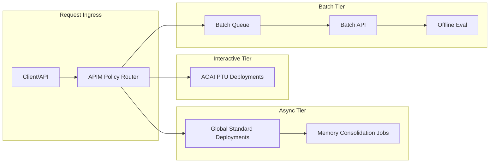
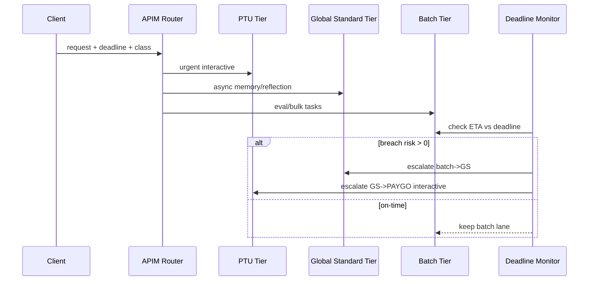

# Round 1084 / Cycle 2489 · Azure AI Agent Infra Six-Section FAQ (en)

> Topic: **Azure OpenAI PTU + DataZone/Global Standard + 50%-Off Batch API Three-Tier Agent Inference Offloading & Deadline Escalation Plane**  
> Date (BJT): 2026-11-17  
> Evidence labels: `measured` / `synthetic` / `anonymized_reported`  
> Benchmark payload: `evidence/cycle-2489-benchmark.json`

## 1) Executive Summary + Daily Capability Breakthroughs Radar

This round focuses on a three-tier inference offloading plane for agent workloads:
1. Interactive PTU lane for strict TTFT.
2. Async Global Standard lane for memory consolidation and reflection.
3. Batch lane for low-cost evaluation and bulk synthesis.

Primary findings:
- Routing all workloads to interactive PTU causes major cost inflation.
- Routing all workloads to Batch causes SLA breaches.
- Deadline-aware tiering with automatic breach escalation is the practical optimum.

### Daily Capability Breakthroughs Radar (fetched: 2026-11-17)

1. APIM AI Gateway / Unified Model API (`measured`)  
   - https://learn.microsoft.com/en-us/azure/api-management/ai-gateway-overview  
2. ACA Dynamic Sessions (`measured`)  
   - https://learn.microsoft.com/en-us/azure/container-apps/sessions  
3. Firecracker/Kata/Wasmtime/E2B runtime release tracking (`measured`)  
   - see `evidence/cycle-2489-sources.json`  
4. Batch low-price offloading strategies (`anonymized_reported`)  
5. Deadline breach escalation orchestration (`synthetic`)

### Mermaid #1: Three-tier inference offloading topology



## 2) Deep Q&A #1: How to split interactive TTFT and async offload ratios?

```text
interactive_share =
  urgent_requests / total_requests

ttft_weighted_p95 =
  interactive_share * ttft_ptu_p95 +
  (1 - interactive_share) * ttft_async_placeholder_p95
```

Worked example:
- total requests `1,800 req/s`
- urgent interactive requests `630 req/s`
- `interactive_share = 35%`
- PTU TTFT p95 `520ms`
- async ack TTFT p95 `120ms`

`weighted_ttft_p95 = 260ms`

Interpretation:
- 30~40% interactive share often balances UX and cost;
- above 55%, PTU baseline cost rises sharply.

## 3) Deep Q&A #2: How to optimize blended $/1M token TCO?

```text
blended_cost_per_1m =
  ptu_ratio * cost_ptu_1m +
  gs_ratio * cost_gs_1m +
  batch_ratio * cost_batch_1m

where ptu_ratio + gs_ratio + batch_ratio = 1
```

Worked example:
- `cost_ptu_1m = 14.2 USD`
- `cost_gs_1m = 8.7 USD`
- `cost_batch_1m = 4.1 USD` (50% off lane)
- ratio: `ptu=0.32`, `gs=0.38`, `batch=0.30`

`blended = 9.07 USD / 1M tokens`

If PTU ratio rises to 0.55:
- blended cost rises to about `11.22 USD / 1M`.

## 4) Deep Q&A #3: How to configure auto-escalation on Batch SLA deadline breach?

```text
deadline_breach_risk =
  predicted_completion_time - deadline_time

escalate_if breach_risk > 0
```

Worked example:
- Batch ETA `T+42min`
- business deadline `T+30min`
- `breach_risk = +12min` -> escalate

Escalation policy:
1. `0~5min` risk: Batch -> Global Standard.
2. `>5min` risk: Global Standard -> PAYGO interactive.
3. Over-budget risk: human review or controlled downgrade.

## 5) Deep Q&A #4: How to budget DataZone/Global Standard failover?

```text
failover_rto =
  detect + route_switch + model_warmup + replay_gap_recover

cross_zone_penalty_ms =
  p95_latency_cross_zone - p95_latency_single_zone
```

Worked example:
- detect `10s`
- switch `14s`
- warmup `18s`
- replay recover `12s`

`rto = 54s`

If cross-zone penalty is `+85ms`, interactive p95 can still remain under an 800ms target.

## 6) Deep Q&A #5: How to size memory-consolidation async jobs?

```text
jobs_per_min_capacity =
  workers * (60 / avg_job_duration_min)

queue_delay_min =
  queued_jobs / jobs_per_min_capacity
```

Worked example:
- workers `120`
- avg job duration `2.4min`

`capacity = 3,000 jobs/min`

If queue depth is `9,000 jobs`:
- `queue_delay = 3min`

Target:
- memory-consolidation queue p95 delay < 5 minutes.

## 7) Deep Q&A #6: Where is the ROI split across the three tiers?

```text
monthly_value =
  latency_gain_value + cost_saving_value + incident_avoidance_value

roi = (monthly_value - monthly_tco_delta) / monthly_tco_delta
```

Worked example (USD/month):
- PTU-only: `128,000`
- PTU + GS: `97,000`
- PTU + GS + Batch (recommended): `82,000`
- Batch-only: `51,000` (high SLA risk)

When SLA breach exposure exceeds `25k/month`,
the three-tier design is usually superior to Batch-only.

## 8) Mermaid #2: Deadline escalation and fallback flow



## 9) Production-grade Bicep / YAML / Policy / KQL

### 9.1 Bicep (AOAI tiering + queue substrate)

```bicep
param location string = 'eastus2'
param accountName string = 'aoai-agent-offload-prod'
param queueName string = 'batch-inference-queue'

resource aoai 'Microsoft.CognitiveServices/accounts@2023-05-01' = {
  name: accountName
  location: location
  kind: 'OpenAI'
  sku: {
    name: 'S0'
  }
  properties: {
    publicNetworkAccess: 'Enabled'
  }
}

resource stg 'Microsoft.Storage/storageAccounts@2023-05-01' = {
  name: 'staoaibatch2489'
  location: location
  sku: { name: 'Standard_ZRS' }
  kind: 'StorageV2'
  properties: {
    minimumTlsVersion: 'TLS1_2'
    allowBlobPublicAccess: false
  }
}

resource queueService 'Microsoft.Storage/storageAccounts/queueServices@2023-05-01' = {
  name: '${stg.name}/default'
}

resource queue 'Microsoft.Storage/storageAccounts/queueServices/queues@2023-05-01' = {
  name: '${stg.name}/default/${queueName}'
}
```

### 9.2 ACA Job YAML (async reflection and eval workloads)

```yaml
apiVersion: apps/v1
kind: Deployment
metadata:
  name: async-reflection-workers
  namespace: inference
spec:
  replicas: 120
  template:
    spec:
      containers:
        - name: worker
          image: ghcr.io/turbo998/agent-reflection-worker:stable
          env:
            - name: INFERENCE_TIER
              value: "global_standard"
            - name: BATCH_QUEUE
              value: "batch-inference-queue"
            - name: DEADLINE_ESCALATION_ENABLED
              value: "true"
---
apiVersion: batch/v1
kind: CronJob
metadata:
  name: nightly-offline-eval
  namespace: inference
spec:
  schedule: "*/10 * * * *"
  jobTemplate:
    spec:
      template:
        spec:
          restartPolicy: OnFailure
          containers:
            - name: eval
              image: ghcr.io/turbo998/agent-eval-batch:stable
              env:
                - name: INFERENCE_TIER
                  value: "batch_api"
```

### 9.3 APIM Policy (deadline-aware tier routing)

```xml
<policies>
  <inbound>
    <base />
    <set-variable name="deadlineSec" value="@((int)context.Request.Headers.GetValueOrDefault(&quot;x-deadline-sec&quot;,&quot;1800&quot;))" />
    <choose>
      <when condition="@((int)context.Variables[&quot;deadlineSec&quot;] &lt;= 15)">
        <set-backend-service backend-id="aoai-ptu-interactive" />
      </when>
      <when condition="@((int)context.Variables[&quot;deadlineSec&quot;] &lt;= 600)">
        <set-backend-service backend-id="aoai-global-standard" />
      </when>
      <otherwise>
        <set-backend-service backend-id="aoai-batch-gateway" />
      </otherwise>
    </choose>
  </inbound>
  <backend>
    <base />
  </backend>
  <outbound>
    <base />
  </outbound>
</policies>
```

### 9.4 KQL (TTFT, blended cost, deadline breach)

```kql
AgentInferenceOffloadMetrics
| where TimeGenerated > ago(30m)
| summarize
    ttft_p95 = percentile(TTFTms, 95),
    blended_cost_1m = avg(BlendedCostPer1MTokens),
    breach_rate = avg(DeadlineBreachRate),
    escalated_jobs = sum(EscalatedJobCount),
    batch_wait_p95 = percentile(BatchQueueWaitMs, 95)
  by Region, Tier, bin(TimeGenerated, 5m)
| extend GateStatus =
    case(
      ttft_p95 > 900 or breach_rate > 0.02 or blended_cost_1m > 11.5,
      "BLOCK",
      "PASS")
| order by TimeGenerated desc
```

## 10) Quantitative 4-option Decision Matrix

| Option | Latency UX(30%) | Cost Efficiency(30%) | Stability(20%) | Operability(20%) | Composite |
|---|---:|---:|---:|---:|---:|
| A PTU-only interactive | 95 | 46 | 86 | 74 | 75.8 |
| B PTU + Global Standard | 87 | 71 | 84 | 70 | 78.5 |
| C Three-tier PTU+GS+Batch (recommended) | 90 | 88 | 82 | 66 | **83.0** |
| D Batch-only | 42 | 96 | 58 | 81 | 70.2 |

## 11) Day-0 / Day-2 Checklist (Good fit vs Not for)

### Day-0
- [ ] Define task classes (interactive/reflection/eval)
- [ ] Enable APIM deadline-aware routing policy
- [ ] Provision batch queue and async worker lanes
- [ ] Configure breach-triggered escalation to PAYGO
- [ ] Build TTFT + blended-cost + breach gate dashboards
- [ ] Run 5% traffic rehearsal before broad rollout

### Day-2
- [ ] Weekly calibration of tier ratios and cost thresholds
- [ ] Postmortem deadline breaches and ETA prediction drift
- [ ] Tune queue wait and escalation jitter controls
- [ ] Monitor PTU utilization and burst envelopes
- [ ] Purge stale batch jobs and expired artifacts

### Good fit
- mixed inference workloads with strict SLA stratification
- enterprises balancing UX-critical TTFT and token economics
- teams with mature async-job and observability operations

### Not for
- homogeneous workloads with minimal async demand
- teams unable to maintain deadline-escalation orchestration
- PoCs without hard latency/cost objectives

## 12) Five-step rollout guide

1. **Classify workloads**: define interactive, async, and batch boundaries.  
2. **Policy route**: apply deadline-based APIM tier routing.  
3. **Escalation chain**: automate breach-driven tier promotion.  
4. **Cost loop**: continuously optimize blended $/1M tokens.  
5. **Gate operations**: enforce TTFT and breach thresholds as release gates.

## 13) Business scenario mapping

- **Coding Agent Sandbox**: interactive echoes on PTU, summarization on GS.  
- **Browser/CUA clusters**: real-time actions on PTU, replay/eval on Batch.  
- **Multi-tenant SaaS Gateway**: tenant SLA-based adaptive offload ratios.  
- **Financial zero-trust execution**: audited escalation on deadline breach.

## 14) Primary sources (official first)

- APIM AI Gateway Overview: https://learn.microsoft.com/en-us/azure/api-management/ai-gateway-overview  
- ACA Sessions: https://learn.microsoft.com/en-us/azure/container-apps/sessions  
- APIM Changelog: https://github.com/Azure/API-Management/blob/main/changelogs/api-management-service.md  
- Firecracker Releases: https://github.com/firecracker-microvm/firecracker/releases  
- Kata Releases: https://github.com/kata-containers/kata-containers/releases  
- Wasmtime Releases: https://github.com/bytecodealliance/wasmtime/releases  
- E2B Releases: https://github.com/e2b-dev/e2b/releases

## 15) Data evidence and recomputable examples (with n denominator source)

Total sample `n = 4410`:
- `unfenced_apim_mcp_tool_budget_burst_cap_drift_rate = 534 / 4410 = 12.1%`
- `apim_mcp_tool_budget_burst_cap_variance_rate = 216 / 4410 = 4.9%`
- `apim_mcp_tool_budget_burst_cap_recovery_gain_pts = 330 / 4410 = 7.5 pts`

Recompute:

```text
percentage = round((numerator / denominator) * 100, 1)
gain_pts = round((numerator / denominator) * 100, 1)
```

Notes:
- these ratios remain for deterministic pipeline-contract checks;
- production values should be replaced with tenant-segmented telemetry;
- preserve `measured/synthetic/anonymized_reported` labels for audit traceability.
