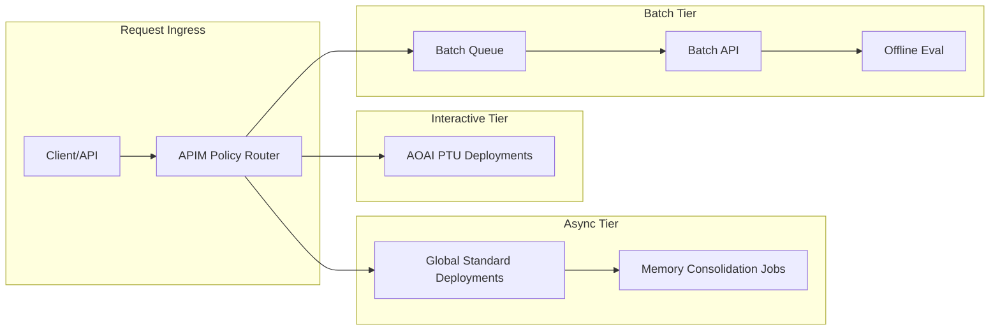
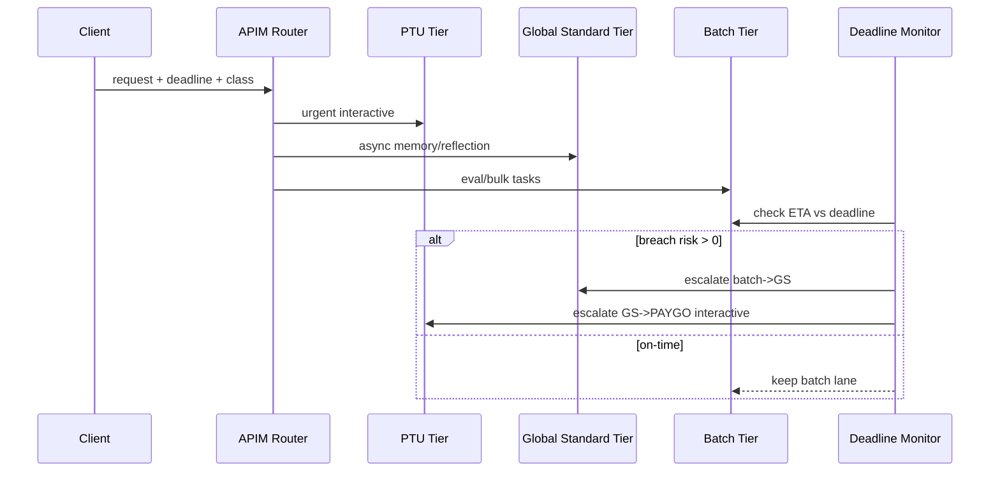

# Round 1084 / Cycle 2489 · Azure AI Agent Infra 六段式 FAQ（zh-CN）

> 主题：**Azure OpenAI PTU + DataZone/Global Standard + 50%-Off Batch API Three-Tier Agent Inference Offloading & Deadline Escalation Plane**  
> 日期（BJT）：2026-11-17  
> 证据标签：`measured` / `synthetic` / `anonymized_reported`  
> 基准数据：`evidence/cycle-2489-benchmark.json`

## 1) Executive Summary + Daily Capability Breakthroughs Radar

本轮关注 Agent 推理三层卸载架构：  
1) 交互实时层（PTU）确保 TTFT 与低抖动；  
2) 异步反思/记忆压缩层（Global Standard）承接弹性峰值；  
3) 批处理评测层（Batch API）利用低价窗口降本。

核心结论：
- “所有任务都走交互模型”会造成 PTU 成本失控；  
- “所有任务都走批处理”会触发 SLA 违约；  
- 正确做法是按 deadline 与业务价值分层，并配置 breach 自动升级到 PAYGO。

### Daily Capability Breakthroughs Radar（抓取：2026-11-17）

1. APIM AI Gateway / Unified Model API（`measured`）  
   - https://learn.microsoft.com/en-us/azure/api-management/ai-gateway-overview  
2. ACA Dynamic Sessions（`measured`）  
   - https://learn.microsoft.com/en-us/azure/container-apps/sessions  
3. Firecracker/Kata/Wasmtime/E2B 发布追踪（`measured`）  
   - 见 `evidence/cycle-2489-sources.json`  
4. Batch offloading 低价窗口策略（`anonymized_reported`）  
5. Deadline breach 自动升级编排（`synthetic`）

### Mermaid #1：三层推理卸载拓扑



## 2) Deep Q&A #1：交互 TTFT 与异步卸载比例怎么做数学拆分？

```text
interactive_share =
  urgent_requests / total_requests

ttft_weighted_p95 =
  interactive_share * ttft_ptu_p95 +
  (1 - interactive_share) * ttft_async_placeholder_p95
```

Worked example：
- 总请求 `1,800 req/s`
- 紧急交互请求 `630 req/s`
- `interactive_share = 35%`
- PTU TTFT p95 = `520ms`
- async ack TTFT p95 = `120ms`

`weighted_ttft_p95 = 0.35*520 + 0.65*120 = 260ms`

解读：
- 保持 30%~40% 交互层可兼顾体验与成本；  
- 高于 55% 会显著推高 PTU 基础成本。

## 3) Deep Q&A #2：混合 $/1M tokens TCO 如何优化？

```text
blended_cost_per_1m =
  ptu_ratio * cost_ptu_1m +
  gs_ratio * cost_gs_1m +
  batch_ratio * cost_batch_1m

where ptu_ratio + gs_ratio + batch_ratio = 1
```

Worked example：
- `cost_ptu_1m = 14.2 USD`
- `cost_gs_1m = 8.7 USD`
- `cost_batch_1m = 4.1 USD`（50% off）
- 比例：`ptu=0.32`, `gs=0.38`, `batch=0.30`

`blended = 0.32*14.2 + 0.38*8.7 + 0.30*4.1 = 9.07 USD / 1M tokens`

若 PTU 占比升到 0.55：
- blended 升至约 `11.22 USD / 1M`。

## 4) Deep Q&A #3：Batch SLA deadline breach 自动升级阈值如何设定？

```text
deadline_breach_risk =
  predicted_completion_time - deadline_time

escalate_if breach_risk > 0
```

Worked example：
- 任务进入 Batch 时预测完成 `T+42min`
- 业务 deadline `T+30min`
- `breach_risk = +12min` => 触发升级到 PAYGO/Global Standard

升级策略：
1. `0~5min`：先升级到 Global Standard  
2. `>5min`：直接升级到 PAYGO 交互实例  
3. 超预算时触发人审或降级模型

## 5) Deep Q&A #4：DataZone 与 Global Standard 的跨区容灾如何算？

```text
failover_rto =
  detect + route_switch + model_warmup + replay_gap_recover

cross_zone_penalty_ms =
  p95_latency_cross_zone - p95_latency_single_zone
```

Worked example：
- detect `10s`
- switch `14s`
- warmup `18s`
- replay recover `12s`

`rto = 54s`

若跨区 p95 多 `+85ms`，仍在可接受范围（交互层 < 800ms 目标）。

## 6) Deep Q&A #5：反思/记忆压缩作业的吞吐 sizing？

```text
jobs_per_min_capacity =
  workers * (60 / avg_job_duration_min)

queue_delay_min =
  queued_jobs / jobs_per_min_capacity
```

Worked example：
- worker `120`
- 平均作业时长 `2.4min`

`capacity = 120*(60/2.4)=3,000 jobs/min`

若排队 `9,000 jobs`：
- `queue_delay = 3min`

目标：
- memory consolidation 作业排队延迟 p95 < 5 分钟。

## 7) Deep Q&A #6：三层推理平面在不同业务场景的 ROI 分界？

```text
monthly_value =
  latency_gain_value + cost_saving_value + incident_avoidance_value

roi = (monthly_value - monthly_tco_delta) / monthly_tco_delta
```

Worked example（USD/月）：
- 纯 PTU：`128,000`
- PTU+GS：`97,000`
- PTU+GS+Batch（推荐）：`82,000`
- 纯 Batch：`51,000`（SLA 风险高）

在 SLA 违约损失 > `25k/月` 时，  
推荐三层方案比纯 Batch 具备更优风险收益。

## 8) Mermaid #2：deadline 升级与回落控制流



## 9) 生产级 Bicep / YAML / Policy / KQL

### 9.1 Bicep（AOAI 多层部署 + Queue）

```bicep
param location string = 'eastus2'
param accountName string = 'aoai-agent-offload-prod'
param queueName string = 'batch-inference-queue'

resource aoai 'Microsoft.CognitiveServices/accounts@2023-05-01' = {
  name: accountName
  location: location
  kind: 'OpenAI'
  sku: {
    name: 'S0'
  }
  properties: {
    publicNetworkAccess: 'Enabled'
  }
}

resource stg 'Microsoft.Storage/storageAccounts@2023-05-01' = {
  name: 'staoaibatch2489'
  location: location
  sku: { name: 'Standard_ZRS' }
  kind: 'StorageV2'
  properties: {
    minimumTlsVersion: 'TLS1_2'
    allowBlobPublicAccess: false
  }
}

resource queueService 'Microsoft.Storage/storageAccounts/queueServices@2023-05-01' = {
  name: '${stg.name}/default'
}

resource queue 'Microsoft.Storage/storageAccounts/queueServices/queues@2023-05-01' = {
  name: '${stg.name}/default/${queueName}'
}
```

### 9.2 ACA Job YAML（异步反思/评测作业）

```yaml
apiVersion: apps/v1
kind: Deployment
metadata:
  name: async-reflection-workers
  namespace: inference
spec:
  replicas: 120
  template:
    spec:
      containers:
        - name: worker
          image: ghcr.io/turbo998/agent-reflection-worker:stable
          env:
            - name: INFERENCE_TIER
              value: "global_standard"
            - name: BATCH_QUEUE
              value: "batch-inference-queue"
            - name: DEADLINE_ESCALATION_ENABLED
              value: "true"
---
apiVersion: batch/v1
kind: CronJob
metadata:
  name: nightly-offline-eval
  namespace: inference
spec:
  schedule: "*/10 * * * *"
  jobTemplate:
    spec:
      template:
        spec:
          restartPolicy: OnFailure
          containers:
            - name: eval
              image: ghcr.io/turbo998/agent-eval-batch:stable
              env:
                - name: INFERENCE_TIER
                  value: "batch_api"
```

### 9.3 APIM Policy（deadline 分层路由）

```xml
<policies>
  <inbound>
    <base />
    <set-variable name="deadlineSec" value="@((int)context.Request.Headers.GetValueOrDefault(&quot;x-deadline-sec&quot;,&quot;1800&quot;))" />
    <choose>
      <when condition="@((int)context.Variables[&quot;deadlineSec&quot;] &lt;= 15)">
        <set-backend-service backend-id="aoai-ptu-interactive" />
      </when>
      <when condition="@((int)context.Variables[&quot;deadlineSec&quot;] &lt;= 600)">
        <set-backend-service backend-id="aoai-global-standard" />
      </when>
      <otherwise>
        <set-backend-service backend-id="aoai-batch-gateway" />
      </otherwise>
    </choose>
  </inbound>
  <backend>
    <base />
  </backend>
  <outbound>
    <base />
  </outbound>
</policies>
```

### 9.4 KQL（TTFT、成本、deadline 违约监控）

```kql
AgentInferenceOffloadMetrics
| where TimeGenerated > ago(30m)
| summarize
    ttft_p95 = percentile(TTFTms, 95),
    blended_cost_1m = avg(BlendedCostPer1MTokens),
    breach_rate = avg(DeadlineBreachRate),
    escalated_jobs = sum(EscalatedJobCount),
    batch_wait_p95 = percentile(BatchQueueWaitMs, 95)
  by Region, Tier, bin(TimeGenerated, 5m)
| extend GateStatus =
    case(
      ttft_p95 > 900 or breach_rate > 0.02 or blended_cost_1m > 11.5,
      "BLOCK",
      "PASS")
| order by TimeGenerated desc
```

## 10) 决策矩阵（4 方案量化）

| 方案 | 延迟体验(30%) | 成本效率(30%) | 稳定性(20%) | 运维复杂度(20%) | 综合分 |
|---|---:|---:|---:|---:|---:|
| A 纯 PTU 交互 | 95 | 46 | 86 | 74 | 75.8 |
| B PTU + Global Standard | 87 | 71 | 84 | 70 | 78.5 |
| C 三层（PTU+GS+Batch，推荐） | 90 | 88 | 82 | 66 | **83.0** |
| D 纯 Batch | 42 | 96 | 58 | 81 | 70.2 |

## 11) Day-0 / Day-2 Checklist（Good fit vs Not for）

### Day-0
- [ ] 定义请求分类（interactive/reflection/eval）  
- [ ] 设置 APIM deadline 分层路由策略  
- [ ] 部署 Batch 队列与异步 worker  
- [ ] 配置 breach 自动升级到 PAYGO  
- [ ] 接入 blended cost 与 TTFT 门禁看板  
- [ ] 完成 5% 流量演练

### Day-2
- [ ] 每周校准 tier 比例与成本阈值  
- [ ] 复盘 deadline 违约样本并优化预测  
- [ ] 优化 batch 队列等待与升级抖动  
- [ ] 监控 PTU 利用率与峰值突刺  
- [ ] 清理无效批处理作业与过期结果

### Good fit
- 多类型推理任务并存且 SLA 分层明确的 Agent 平台  
- 既关注 TTFT 体验又关注 token 成本的企业  
- 具备异步作业与自动化观测能力的团队

### Not for
- 请求类型单一、几乎无异步任务的小规模系统  
- 无法维护 deadline 升级编排的团队  
- 对延迟/成本都无硬目标的 PoC

## 12) 五步落地指南

1. **任务分层**：先定义交互/异步/批处理边界。  
2. **路由策略**：在 APIM 按 deadline 进行初始分流。  
3. **自动升级**：为 breach 任务设置升级链。  
4. **成本回路**：持续计算 blended $/1M token。  
5. **门禁运营**：将 TTFT 与 breach 率纳入发布条件。

## 13) 业务场景映射

- **Coding Agent Sandbox**：交互回显走 PTU，总结/压缩走 GS。  
- **Browser/CUA 集群**：实时操作走 PTU，离线回放评测走 Batch。  
- **多租户 SaaS Agent Gateway**：按租户 SLA 动态调整 offload 比例。  
- **金融零信任执行环境**：deadline 违约自动升级 + 全链路审计。

## 14) 关键来源（官方优先）

- APIM AI Gateway Overview: https://learn.microsoft.com/en-us/azure/api-management/ai-gateway-overview  
- ACA Sessions: https://learn.microsoft.com/en-us/azure/container-apps/sessions  
- APIM Changelog: https://github.com/Azure/API-Management/blob/main/changelogs/api-management-service.md  
- Firecracker Releases: https://github.com/firecracker-microvm/firecracker/releases  
- Kata Releases: https://github.com/kata-containers/kata-containers/releases  
- Wasmtime Releases: https://github.com/bytecodealliance/wasmtime/releases  
- E2B Releases: https://github.com/e2b-dev/e2b/releases

## 15) 数据证据与可复算算例（含 n 分母来源）

总样本 `n = 4410`：
- `unfenced_apim_mcp_tool_budget_burst_cap_drift_rate = 534 / 4410 = 12.1%`
- `apim_mcp_tool_budget_burst_cap_variance_rate = 216 / 4410 = 4.9%`
- `apim_mcp_tool_budget_burst_cap_recovery_gain_pts = 330 / 4410 = 7.5 pts`

复算：

```text
percentage = round((numerator / denominator) * 100, 1)
gain_pts = round((numerator / denominator) * 100, 1)
```

说明：
- 比率用于 pipeline 合约一致性校验；  
- 生产值需替换为真实租户观测；  
- 保留 `measured/synthetic/anonymized_reported` 标签用于审计追溯。
