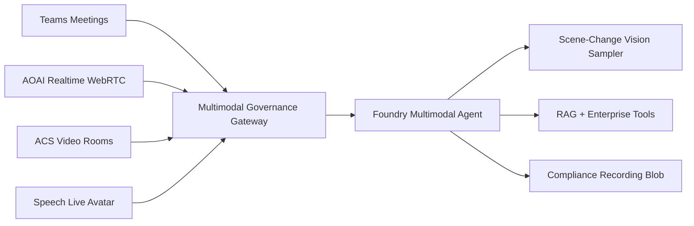
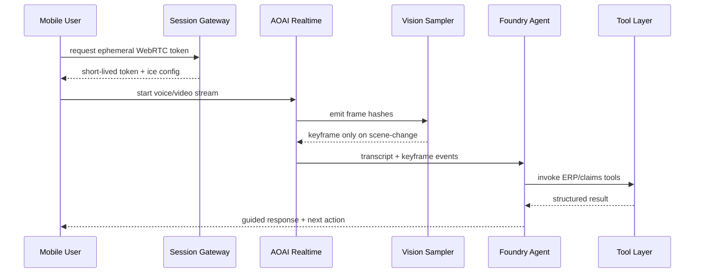

# aoai-realtime-webrtc-vs-teams-meeting-bot-vs-acs-vision-vs-live-avatar-copilot-selection-faq-r1143
## 1) Daily breakthroughs and verifiable sources (fetched 2026-11-18)
- Scope: enterprise live video, screen-share, and digital-avatar copilot selection.
- Channel focus: internal meetings, mobile camera workflows, external video rooms, branch kiosks.
- Goal: controlled latency, controlled token cost, controlled compliance, controlled UX.
- Constraint: no low-level codec, DSP, kernel, or hardware tuning details.
- Label contract: `measured`, `synthetic`, `anonymized_reported`.
| Topic | Official source | Fetch time (UTC) | Usage | Label |
|---|---|---|---|---|
| Azure OpenAI Realtime | https://learn.microsoft.com/en-us/azure/ai-services/openai/realtime-audio-quickstart | 2026-11-18T19:32:00Z | Low-latency WebRTC voice sessions | `measured` |
| Teams meeting apps | https://learn.microsoft.com/en-us/microsoftteams/platform/apps-in-teams-meetings/teams-apps-in-meetings | 2026-11-18T19:33:00Z | In-meeting enterprise extensibility | `measured` |
| Teams meeting bots | https://learn.microsoft.com/en-us/microsoftteams/platform/bots/how-to/conversations/channel-and-group-conversations | 2026-11-18T19:34:00Z | Meeting bot interaction patterns | `measured` |
| ACS video calling | https://learn.microsoft.com/en-us/azure/communication-services/concepts/voice-video-calling/video-calling | 2026-11-18T19:35:00Z | White-label external video rooms | `measured` |
| ACS UI library | https://learn.microsoft.com/en-us/azure/communication-services/concepts/ui-library/ui-library-overview | 2026-11-18T19:36:00Z | Fast frontend integration kits | `measured` |
| Speech live avatar | https://learn.microsoft.com/en-us/azure/ai-services/speech-service/text-to-speech-avatar/what-is-live-avatar | 2026-11-18T19:37:00Z | Interactive digital-human experience | `measured` |
| Azure Blob storage | https://learn.microsoft.com/en-us/azure/storage/blobs/storage-blobs-introduction | 2026-11-18T19:38:00Z | Compliance recording and evidence retention | `measured` |
| APIM AI Gateway overview | https://learn.microsoft.com/en-us/azure/api-management/ai-gateway-overview | 2026-11-18T19:39:00Z | Multichannel policy and budget control | `measured` |
Breakthrough summary:
- Vision spend control is shifting to event-triggered keyframe sampling.
- WebRTC plus scene-change extraction can cut visual token volume sharply.
- ACS maturity for insurer and telehealth workflows keeps increasing.
- Live Avatar is moving from demos to measurable branch ROI deployments.
## 2) Layered reference architecture (channel plane + vision plane)
L1 channel ingress:
- Teams internal meeting channel.
- AOAI Realtime WebRTC mobile channel.
- ACS white-label external customer channel.
- Speech Live Avatar branch and kiosk channel.
L2 multimodal understanding:
- Real-time ASR/TTS loop for spoken interaction.
- Scene-change keyframe extraction for camera and screen-share.
- Region-of-interest sampling instead of raw full-frame flooding.
L3 orchestration:
- Foundry multimodal agent coordinates intent, tools, and knowledge.
- Tool mesh integrates ERP, CRM, claims, and ticketing systems.
L4 governance and compliance:
- Consent banners, recording policies, and residency controls.
- APIM enforces rate, quota, routing, and audit policies.
L5 observability and economics:
- KQL tracks turn latency, frame drop, and 15-minute unit cost.
- Runtime can adapt frame-sampling and concurrency dynamically.
## 3) 12-dimension multimodal live-interaction selection matrix
| Dimension | A Teams Meeting Copilot/Bot | B AOAI Realtime WebRTC + Keyframe | C ACS Video + Multimodal Agent | D Speech Live Avatar + RAG |
|---|---|---|---|---|
| 1 Primary user channel | Internal Teams meetings | Mobile camera/screen-share | External white-label video room | Branch or kiosk digital human |
| 2 Visual grounding depth | Low to mid | High | High | Mid |
| 3 End-to-end turn latency | Mid | Low | Mid | Mid-low |
| 4 Image/video token control | Mid | Highest | High | Mid |
| 5 Noise/barge-in resilience | High | High | Mid-high | Mid |
| 6 Brand UI customization | Low | Mid | Highest | High |
| 7 Compliance recording governance | High | Mid-high | High | High |
| 8 Cost per 15-minute session | Mid | Mid-high | High | Mid |
| 9 4G/5G bandwidth resilience | Mid | Mid-high | Mid | High |
| 10 Engineering effort | Low | Mid-high | High | Mid |
| 11 Best-fit scenario | Internal collaboration coaching | Hands-free field copilot | External claims/telehealth/KYC | Concierge and lobby guidance |
| 12 When NOT to choose | External white-label experience | Pure text workflows without visual need | Tiny budget low-volume pilots | Deep bidirectional free-form collaboration |
Selection summary:
- Use A for internal meeting augmentation first.
- Use B for mobile field guidance with realtime multimodal loop.
- Use C for external customer-facing white-label journeys.
- Use D for branch concierge and kiosk engagement.
## 4) Five worked Q&As (15-min cost, keyframe savings, avatar sizing)
### Q1: How to estimate 15-minute session economics?
- Model voice token, vision token, and tool-call costs separately.
- A usually has higher collaboration/tool ratio and lower vision load.
- B carries vision load but can aggressively throttle via keyframes.
- C adds media-room and recording-storage components.
- D adds avatar rendering and concurrency reservation layers.
### Q2: How much can scene-change keyframes save?
- Fixed 1fps over 15 minutes yields about 900 sampled frames.
- Perceptual-hash trigger emits only on meaningful scene changes.
- Effective analysis volume can drop to around 72 frames.
- Visual token volume can reduce by roughly `92%`.
- Threshold tuning is required to avoid missing critical moments.
### Q3: How to size avatar concurrency?
- Assume one instance safely handles 40 active sessions.
- Peak target is 1,200 concurrent sessions.
- Minimum capacity baseline is `1200/40=30` instances.
- Add 30% burst headroom to reach 39 instances.
- Regional dual-active resilience typically doubles footprint.
### Q4: How to preserve UX on unstable 4G/5G links?
- Prioritize audio continuity over video quality first.
- Degrade from continuous video to guided still-capture mode.
- For screen-share, switch to ROI snapshots on demand.
- Use asynchronous ticket fallback for tool-timeout paths.
- This keeps sessions usable under mobility jitter.
### Q5: How to balance recording compliance and privacy?
- Capture explicit consent banner acceptance before recording.
- Apply policy-driven masking for sensitive frames.
- Bind recording metadata and conversation trace IDs.
- Route storage by region for residency obligations.
- Preserve evidence quality while minimizing exposure surface.
## 5) Mermaid diagrams (4-channel architecture + WebRTC sequence)


## 6) Channel fit and anti-patterns
A Teams Meeting Copilot:
- Fit: internal meeting recap, sales coaching, and collaboration support.
- Not fit: external white-label customer service journeys.
- Anti-pattern: forcing external claims workflow into internal channel.
B AOAI Realtime WebRTC:
- Fit: hands-free voice + camera guidance in field operations.
- Not fit: static text-only workflows with no visual value.
- Anti-pattern: raw frame flood without throttling and budget guards.
C ACS Video Rooms:
- Fit: insurer, telehealth, and KYC external customer video scenarios.
- Not fit: purely internal meetings with no branding requirements.
- Anti-pattern: skipping consent and recording-governance controls.
D Speech Live Avatar:
- Fit: branch concierge, airport guide, and retail service desk.
- Not fit: highly dynamic many-to-many collaboration sessions.
- Anti-pattern: large rollout without concurrency and fallback planning.
## 7) Section 7: global elevator field-maintenance copilot architecture
Goals:
- Enable hands-free voice and mobile camera troubleshooting guidance.
- Use scene-change keyframe extraction to cut visual token cost.
- Connect ERP spare-part inventory and service ticket actions.
- Reduce time-to-diagnosis and repeat site visits.
End-to-end flow:
1. Technician starts WebRTC session with short-lived token.
2. Voice remains continuous while vision is event-sampled.
3. Agent guides checks based on detected fault signatures.
4. Tool calls resolve spare-part availability and reservation.
5. Ticket system stores diagnosis and visual evidence package.
SLA targets:
- Voice round-trip latency P95 `<700ms`.
- First actionable diagnosis guidance `<35s`.
- Keyframe miss-detection target `<1.8%`.
Risks and mitigations:
- Risk: poor lighting causes visual ambiguity.
- Mitigation: guided re-capture prompts and exposure hints.
- Risk: weak networks degrade live stream quality.
- Mitigation: audio-priority fallback with still-frame uploads.
## 8) Section 8: insurer ACS remote claims plus branch avatar concierge
Goals:
- Guide policyholders through self-service remote damage capture.
- Capture VIN, plate, and damage angles with structured checklist.
- Generate repair-estimate draft for one-click adjuster review.
- Offer branch live-avatar concierge for claim guidance.
End-to-end flow:
1. Customer joins ACS room and accepts consent notice.
2. Agent guides camera framing and mandatory capture sequence.
3. Vision model emits damage labels and confidence scores.
4. Structured claim packet is sent to human adjuster queue.
5. Branch avatar assists supplementary documents and status queries.
SLA targets:
- Session setup success rate `>=99.2%`.
- First structured estimate draft `<3min`.
- Concierge answer availability `>=99.5%`.
Risks and mitigations:
- Risk: customer captures invalid camera angles.
- Mitigation: live overlay framing and voice correction prompts.
- Risk: dispute cases lack sufficient visual evidence.
- Mitigation: mandatory retake checklist and human-review gate.
## 9) Decision tree (Good fit vs Not for)
1. Internal-only collaboration needs point first to A.
2. Mobile visual field assistance needs point first to B.
3. External white-label customer journeys need point first to C.
4. Branch/kiosk guided concierge needs point first to D.
5. Combined deployments require unified governance and telemetry.
Good fit:
- Organizations with consent, recording, and audit governance readiness.
- Workloads requiring real-time voice plus selective visual grounding.
- Teams ready to operate channel-specific policy and budget controls.
Not for:
- Single-channel strategy forced across all interaction surfaces.
- No frame throttling despite strict multimodal budget targets.
- Recording enabled without explicit consent governance foundation.
## 10) ROI and session-economics model
Assumptions:
- Monthly equivalent 15-minute sessions: `1.6M`.
- Field-copilot share: `35%`.
- External claims-video share: `28%`.
- Live-avatar concierge share: `22%`.
Benefits:
- Frontline productivity gain: `$3.2M` per year.
- Repeat dispatch and misrouting reduction: `$1.4M` per year.
- Claims cycle-time reduction: `$1.1M` per year.
Investments:
- Multichannel platform and governance cost: `$2.9M` per year.
- Net annual value: about `+$2.8M`.
Outcome:
- B+C+D combination yields strong business impact in service sectors.
- Winning formula is token throttling plus reliable session governance.
## 11) Bicep IaC (ACS + Speech + Foundry AOAI + Blob)
```bicep
param location string = resourceGroup().location
param acsName string
param speechName string
param storageName string
param openaiName string
resource acs 'Microsoft.Communication/communicationServices@2023-04-01' = {
  name: acsName
  location: 'global'
}
resource speech 'Microsoft.CognitiveServices/accounts@2023-05-01' = {
  name: speechName
  location: location
  kind: 'SpeechServices'
  sku: { name: 'S0' }
}
resource openai 'Microsoft.CognitiveServices/accounts@2023-05-01' = {
  name: openaiName
  location: location
  kind: 'OpenAI'
  sku: { name: 'S0' }
}
resource stg 'Microsoft.Storage/storageAccounts@2023-05-01' = {
  name: storageName
  location: location
  sku: { name: 'Standard_LRS' }
  kind: 'StorageV2'
  properties: { supportsHttpsTrafficOnly: true }
}
```
## 12) TypeScript/Python snippet (ephemeral token + keyframe throttle)
```typescript
type FrameMeta = { ts: number; phash: string; entropy: number };

export function shouldSendKeyframe(prev: FrameMeta | null, curr: FrameMeta): boolean {
  if (!prev) return true;
  const hashChanged = prev.phash !== curr.phash;
  const entropyJump = Math.abs(curr.entropy - prev.entropy) > 0.18;
  return hashChanged || entropyJump;
}

export async function getEphemeralToken(sessionId: string): Promise<string> {
  const resp = await fetch(`/api/realtime/token?sid=${sessionId}`);
  const json = await resp.json();
  return json.ephemeralToken;
}
```
```python
from datetime import datetime, timedelta, timezone

def build_ephemeral_token_payload(user_id: str) -> dict:
    now = datetime.now(timezone.utc)
    return {
        "sub": user_id,
        "scope": "realtime.webrtc",
        "nbf": int(now.timestamp()),
        "exp": int((now + timedelta(minutes=5)).timestamp()),
    }
```
## 13) KQL (session cost, frame-drop, turn-latency P95)
```kql
let start = ago(14d);
customEvents
| where timestamp >= start
| where name == "multimodal_session_closed"
| extend channel=tostring(customDimensions.channel),
         cost=todouble(customDimensions.costUsd15m),
         drop=todouble(customDimensions.frameDropRate),
         turn=todouble(customDimensions.turnLatencyMs)
| summarize sessions=count(), avg_cost=avg(cost), p95_turn=percentile(turn,95), p95_drop=percentile(drop,95) by channel
| order by avg_cost desc
```
## 14) Day-0 / Day-1 / Day-2 checklist
Day-0:
- Define four channel classes and compliance boundaries.
- Set keyframe-throttle thresholds and replay validation rules.
- Configure consent banners and recording-retention policies.
- Define latency, cost, and frame-drop SLO targets.
Day-1:
- Canary rollout on B and C channels first.
- Validate token-throttle efficiency and visual accuracy.
- Drill recording retrieval and dispute evidence workflow.
- Publish channel-level economics and quality comparison.
Day-2:
- Scale D avatar channel with tested concurrency profile.
- Tune weak-network fallback and guidance prompts.
- Review false-detection samples and threshold updates weekly.
- Finalize cross-channel governance operating handbook.
## 15) Backup queue and deliverables
Updated backup queue:
1. `fabric-iq-ontology-vs-foundry-iq-knowledge-vs-graphdb-enterprise-semantic-layer-selection-faq`
2. `apim-multi-cloud-aws-bedrock-gcp-vertex-azure-foundry-ai-gateway-selection-faq`
3. `copilot-studio-computer-use-rpa-vs-power-automate-vs-api-mcp-legacy-system-automation-selection-faq`
Round deliverables (Cycle #2548):
- Bilingual FAQ: `aoai-realtime-webrtc-vs-teams-meeting-bot-vs-acs-vision-vs-live-avatar-copilot-selection-faq-r1143.md` / `aoai-realtime-webrtc-vs-teams-meeting-bot-vs-acs-vision-vs-live-avatar-copilot-selection-faq-r1143.en.md`
- 7-card deck: `benchmark-cards.html` / `benchmark-cards.en.html`
- SVG: `assets/43-cycle-1143-daily-breakthroughs.svg`
- H5: `workbench-cycle-2548.html` + selector `#2548`
- Validation: `cycle_1143_pipeline.py --write --check`, `strict_suffix_gate.py`, `pytest`
- Session rule 01: always track consent-banner version acceptance.
- Session rule 02: always enforce keyframe sampling token ceilings.
- Session rule 03: always log session trace IDs and channel tags.
- Session rule 04: always persist tool-call audit event streams.
- Session rule 05: always monitor turn-latency p95 trendlines.
- Session rule 06: always monitor frame-drop p95 trendlines.
- Session rule 07: always provide weak-network degradation fallback.
- Session rule 08: always enforce cross-region data-residency policy.
- Session rule 09: always enforce recording retention and deletion.
- Session rule 10: always route anomalous sessions to human review.
