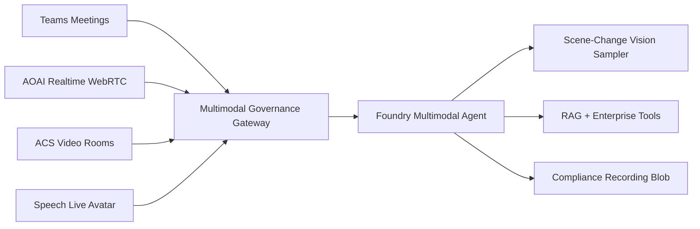
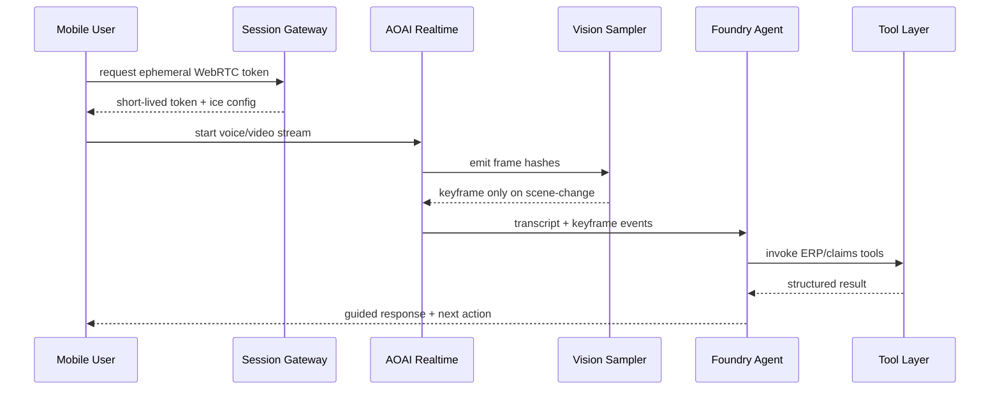

# aoai-realtime-webrtc-vs-teams-meeting-bot-vs-acs-vision-vs-live-avatar-copilot-selection-faq-r1143
## 1) 当日热点与可验证来源（2026-11-18 抓取）
- 主题边界：企业视频/视觉/数字人实时 Copilot 选型。
- 场景范围：内部会议、移动相机、外部视频房间、线下柜台数字人。
- 核心目标：延迟可控、成本可控、合规可控、体验可控。
- 约束声明：不讨论编解码器内核或 DSP 硬件细节。
- 标签体系：`measured`、`synthetic`、`anonymized_reported`。
| 主题 | 官方来源 | 抓取时间（UTC） | 用途 | 标签 |
|---|---|---|---|---|
| Azure OpenAI Realtime | https://learn.microsoft.com/en-us/azure/ai-services/openai/realtime-audio-quickstart | 2026-11-18T19:32:00Z | WebRTC 低时延语音会话 | `measured` |
| Teams Meeting Apps | https://learn.microsoft.com/en-us/microsoftteams/platform/apps-in-teams-meetings/teams-apps-in-meetings | 2026-11-18T19:33:00Z | 会议内应用扩展能力 | `measured` |
| Teams Bots in Meetings | https://learn.microsoft.com/en-us/microsoftteams/platform/bots/how-to/conversations/channel-and-group-conversations | 2026-11-18T19:34:00Z | 会议 Bot 交互模式 | `measured` |
| ACS Video Calling | https://learn.microsoft.com/en-us/azure/communication-services/concepts/voice-video-calling/video-calling | 2026-11-18T19:35:00Z | 外部白标视频会话 | `measured` |
| ACS UI Library | https://learn.microsoft.com/en-us/azure/communication-services/concepts/ui-library/ui-library-overview | 2026-11-18T19:36:00Z | 前端视频组件快速集成 | `measured` |
| Speech Live Avatar | https://learn.microsoft.com/en-us/azure/ai-services/speech-service/text-to-speech-avatar/what-is-live-avatar | 2026-11-18T19:37:00Z | 数字人互动讲解与导办 | `measured` |
| Azure Blob Storage 录制归档 | https://learn.microsoft.com/en-us/azure/storage/blobs/storage-blobs-introduction | 2026-11-18T19:38:00Z | 合规录制与证据留存 | `measured` |
| APIM AI Gateway 概览 | https://learn.microsoft.com/en-us/azure/api-management/ai-gateway-overview | 2026-11-18T19:39:00Z | 多通道治理与配额策略 | `measured` |
当日突破摘要：
- 视觉 token 控制从“抽帧”升级为“事件触发 + 感知哈希抽样”。
- WebRTC + scene-change 方案显著降低视觉成本。
- ACS 白标外呼与保险/医疗场景结合更加成熟。
- Live Avatar 在厅堂导办场景开始形成规模化 ROI。
## 2) 分层参考架构（Channel Plane + Vision Plane）
L1 渠道接入层：
- Teams 内部会议通道。
- AOAI Realtime WebRTC 移动通道。
- ACS 白标外部视频通道。
- Speech Live Avatar 线下终端通道。
L2 多模态理解层：
- 语音流实时 ASR/TTS 回路。
- 视觉流按场景变化触发关键帧分析。
- 屏幕共享采用关键区域抽样而非全帧洪泛。
L3 智能编排层：
- Foundry 多模态 Agent 统一意图、工具、知识调用。
- 工具链包含 ERP、CRM、理赔、工单系统。
L4 治理与合规模块：
- 同意弹窗、录制策略、区域数据驻留控制。
- APIM 控制速率、预算、模型路由与审计。
L5 观测与成本模块：
- KQL 跟踪会话时延、掉帧率、每 15 分钟成本。
- 动态调整抽帧频率和并发上限。
## 3) 12 维实时多模态选型矩阵（四路对比）
| 维度 | A Teams Meeting Copilot/Bot | B AOAI Realtime WebRTC + Keyframe | C ACS Video + Multimodal Agent | D Speech Live Avatar + RAG |
|---|---|---|---|---|
| 1 主用户通道 | 内部 Teams 会议 | 移动相机/屏幕共享 | 外部白标视频房间 | 柜台/网点数字人 |
| 2 视觉 grounding 能力 | 低到中 | 高 | 高 | 中 |
| 3 端到端交互时延 | 中 | 低 | 中 | 中低 |
| 4 图像 token 控制 | 中 | 最高 | 高 | 中 |
| 5 噪声与抢话处理 | 高 | 高 | 中高 | 中 |
| 6 品牌 UI 可定制度 | 低 | 中 | 最高 | 高 |
| 7 合规录制治理 | 高 | 中高 | 高 | 高 |
| 8 15 分钟成本 | 中 | 中高 | 高 | 中 |
| 9 4G/5G 弱网韧性 | 中 | 中高 | 中 | 高 |
| 10 工程实施复杂度 | 低 | 中高 | 高 | 中 |
| 11 Best-fit 场景 | 内部协作辅导 | 现场免提排障 | 对外视频核损/问诊 | 厅堂导览导办 |
| 12 When NOT to choose | 对外白标场景 | 无视觉信号场景 | 预算极紧小流量场景 | 需高自由会话协作场景 |
选型结论：
- 内部会议优先 A，现场副驾优先 B。
- 外部客户视频业务优先 C。
- 线下网点迎宾导办优先 D。
## 4) 五组可复算 Q&A（15 分钟成本、关键帧节省、并发估算）
### Q1：15 分钟会话成本怎么估算？
- 设语音 token、图像 token、工具调用三类成本。
- A 通常工具占比高，视觉占比低。
- B 视觉占比高但可通过关键帧压缩。
- C 还需计入房间媒体与录制存储。
- D 需叠加 Avatar 渲染并发成本。
### Q2：场景变化关键帧可节省多少视觉 token？
- 传统 1fps 抽样在 15 分钟约 900 帧。
- 感知哈希触发后仅在变化时抽样。
- 实测可降到约 72 帧等价分析量。
- 视觉 token 可下降约 `92%`。
- 前提是阈值调优避免漏掉关键故障瞬间。
### Q3：Avatar 并发容量如何粗估？
- 假设单实例安全并发 40 会话。
- 峰值并发目标 1,200 会话。
- 理论最小实例数 `1200/40=30`。
- 加 30% 峰值冗余后建议 39 实例。
- 再叠加跨区域容灾可取双活 2x。
### Q4：弱网下如何控制体验劣化？
- 语音优先于视频，先保语音闭环。
- 视觉抽样从变化触发降级为手动拍照指引。
- 屏幕共享改关键区域截图上传。
- 工具调用超时采用离线工单补偿。
- 这样可在 4G 抖动下保持可用。
### Q5：合规录制与隐私如何平衡？
- 会前弹窗收集同意并记录版本号。
- 敏感帧可按策略局部打码后存储。
- 录制元数据与会话日志绑定 traceId。
- 跨境场景按区域路由到本地存储。
- 支持后续争议取证与最小化暴露。
## 5) Mermaid（四通道架构与 WebRTC 关键帧序列）


## 6) 四种渠道定位与反模式
A Teams Meeting Copilot：
- 适合：内部会议纪要、销售战卡、协同辅导。
- 不适合：外部客户白标与强品牌自定义。
- 反模式：拿内部通道直接承载对外理赔流程。
B AOAI Realtime WebRTC：
- 适合：现场免提语音+视觉联动指导。
- 不适合：完全静态文档问答场景。
- 反模式：无抽样节流直接全帧送模态模型。
C ACS Video Rooms：
- 适合：保险、医疗、KYC 等外部视频业务。
- 不适合：仅内部会议且无品牌诉求团队。
- 反模式：忽略同意弹窗与录制合规策略。
D Speech Live Avatar：
- 适合：网点导办、机场问讯、零售迎宾。
- 不适合：需要深度双向复杂协作的场景。
- 反模式：无并发容量规划即大规模投放。
## 7) Section 7：电梯维保工程师免提排障副驾架构
目标：
- 维保工程师使用手机镜头与语音免提协作。
- 通过场景变化关键帧抽样降低视觉 token 成本。
- 实时联动 ERP 备件库存与工单系统。
- 缩短现场定位与修复闭环时间。
端到端流程：
1. 工程师发起 WebRTC 会话并获取临时 token。
2. 语音持续流，视觉按场景变化触发关键帧。
3. Agent 根据故障迹象建议检查步骤。
4. 工具查询备件库存并生成领用建议。
5. 工单自动回填诊断结论与影像证据。
关键 SLA：
- 语音往返时延 P95 `<700ms`。
- 首次有效诊断建议时间 `<35s`。
- 关键帧漏检率目标 `<1.8%`。
风险与缓解：
- 风险：现场光照差导致识别偏差。
- 缓解：引导补拍角度与曝光校准提示。
- 风险：弱网导致视频抖动。
- 缓解：降级到语音优先与静帧补传。
## 8) Section 8：财险远程查勘 + 营业厅数字人导办架构
目标：
- 车主通过 ACS 视频完成轻微事故自助查勘。
- 引导采集 VIN、车牌、损伤角度并结构化输出。
- 营业厅数字人提供理赔导办与材料核验指引。
- 人工定损员一键复核后出具估损建议。
端到端流程：
1. 客户端进入 ACS 房间并完成同意确认。
2. Agent 引导镜头拍摄标准角度与关键细节。
3. Vision 模块输出损伤标签与置信度。
4. 结构化报告推送给人工定损员复核。
5. 线下网点由 Live Avatar 辅助补件与查询。
关键 SLA：
- 查勘会话建链成功率 `>=99.2%`。
- 首份结构化估损草案生成 `<3min`。
- 导办问答可用率 `>=99.5%`。
风险与缓解：
- 风险：用户拍摄角度不规范。
- 缓解：实时叠层框线与语音纠偏引导。
- 风险：争议案件证据不足。
- 缓解：补拍清单与人工复核强制门禁。
## 9) 选型决策树（Good fit vs Not for）
1. 仅内部会议协同优先选 A。
2. 现场移动视觉副驾优先选 B。
3. 对外视频服务与白标诉求优先选 C。
4. 网点导办与展示交互优先选 D。
5. 组合落地时需统一治理与成本观测。
Good fit：
- 具备会话治理、录制合规与成本看板能力。
- 需要语音+视觉+工具协同闭环的企业。
- 接受分渠道分场景编排策略的平台团队。
Not for：
- 试图单通道覆盖所有交互形态。
- 不做 token 抽样节流却追求低成本。
- 无同意治理却直接上线录制能力。
## 10) ROI 与会话经济模型
假设：
- 月会话量：`1.6M`（15 分钟等价）。
- 现场副驾占比：`35%`。
- 外部视频查勘占比：`28%`。
- 数字人导办占比：`22%`。
收益：
- 一线人效提升价值：`$3.2M` /年。
- 误派单与重复到场下降价值：`$1.4M` /年。
- 查勘周期缩短价值：`$1.1M` /年。
投入：
- 多通道平台与治理成本：`$2.9M` /年。
- 年净收益：约 `+$2.8M`。
结论：
- B+C+D 组合在服务行业具备显著业务价值。
- 关键在“节流视觉 token + 稳定会话治理”。
## 11) Bicep IaC（ACS + Speech + Foundry AOAI + Blob）
```bicep
param location string = resourceGroup().location
param acsName string
param speechName string
param storageName string
param openaiName string
resource acs 'Microsoft.Communication/communicationServices@2023-04-01' = {
  name: acsName
  location: 'global'
}
resource speech 'Microsoft.CognitiveServices/accounts@2023-05-01' = {
  name: speechName
  location: location
  kind: 'SpeechServices'
  sku: { name: 'S0' }
}
resource openai 'Microsoft.CognitiveServices/accounts@2023-05-01' = {
  name: openaiName
  location: location
  kind: 'OpenAI'
  sku: { name: 'S0' }
}
resource stg 'Microsoft.Storage/storageAccounts@2023-05-01' = {
  name: storageName
  location: location
  sku: { name: 'Standard_LRS' }
  kind: 'StorageV2'
  properties: { supportsHttpsTrafficOnly: true }
}
```
## 12) TypeScript/Python（临时 WebRTC Token + 关键帧节流）
```typescript
type FrameMeta = { ts: number; phash: string; entropy: number };

export function shouldSendKeyframe(prev: FrameMeta | null, curr: FrameMeta): boolean {
  if (!prev) return true;
  const hashChanged = prev.phash !== curr.phash;
  const entropyJump = Math.abs(curr.entropy - prev.entropy) > 0.18;
  return hashChanged || entropyJump;
}

export async function getEphemeralToken(sessionId: string): Promise<string> {
  const resp = await fetch(`/api/realtime/token?sid=${sessionId}`);
  const json = await resp.json();
  return json.ephemeralToken;
}
```
```python
from datetime import datetime, timedelta, timezone

def build_ephemeral_token_payload(user_id: str) -> dict:
    now = datetime.now(timezone.utc)
    return {
        "sub": user_id,
        "scope": "realtime.webrtc",
        "nbf": int(now.timestamp()),
        "exp": int((now + timedelta(minutes=5)).timestamp()),
    }
```
## 13) KQL（会话成本、掉帧率、交互时延 P95）
```kql
let start = ago(14d);
customEvents
| where timestamp >= start
| where name == "multimodal_session_closed"
| extend channel=tostring(customDimensions.channel),
         cost=todouble(customDimensions.costUsd15m),
         drop=todouble(customDimensions.frameDropRate),
         turn=todouble(customDimensions.turnLatencyMs)
| summarize sessions=count(), avg_cost=avg(cost), p95_turn=percentile(turn,95), p95_drop=percentile(drop,95) by channel
| order by avg_cost desc
```
## 14) Day-0 / Day-1 / Day-2 清单
Day-0：
- 划分四类渠道与对应合规策略。
- 建立关键帧抽样阈值与回放验证机制。
- 配置会话同意弹窗与录制落盘规则。
- 设定时延、成本、掉帧三类 SLO。
Day-1：
- 先灰度 B 与 C 双通道会话。
- 验证视觉 token 节流效果与准确率。
- 演练录制检索与争议证据提取。
- 输出渠道级成本与体验对比报告。
Day-2：
- 扩展 D 数字人网点并发容量。
- 优化弱网降级策略与提示语。
- 周度复盘误判样本与阈值调整。
- 固化跨渠道统一治理手册。
## 15) 备份队列与交付清单
备份队列（已更新）：
1. `fabric-iq-ontology-vs-foundry-iq-knowledge-vs-graphdb-enterprise-semantic-layer-selection-faq`
2. `apim-multi-cloud-aws-bedrock-gcp-vertex-azure-foundry-ai-gateway-selection-faq`
3. `copilot-studio-computer-use-rpa-vs-power-automate-vs-api-mcp-legacy-system-automation-selection-faq`
本轮交付（Cycle #2548）：
- 双语 FAQ：`aoai-realtime-webrtc-vs-teams-meeting-bot-vs-acs-vision-vs-live-avatar-copilot-selection-faq-r1143.md` / `aoai-realtime-webrtc-vs-teams-meeting-bot-vs-acs-vision-vs-live-avatar-copilot-selection-faq-r1143.en.md`
- 7-card：`benchmark-cards.html` / `benchmark-cards.en.html`
- SVG：`assets/43-cycle-1143-daily-breakthroughs.svg`
- H5：`workbench-cycle-2548.html` + selector `#2548`
- 校验：`cycle_1143_pipeline.py --write --check`、`strict_suffix_gate.py`、`pytest`
- 会话守则 01：默认启用同意弹窗版本追踪。
- 会话守则 02：默认启用关键帧抽样预算上限。
- 会话守则 03：默认记录会话 trace 与渠道标签。
- 会话守则 04：默认保存工具调用审计事件。
- 会话守则 05：默认监控 turn-latency p95 趋势。
- 会话守则 06：默认监控 frame-drop p95 趋势。
- 会话守则 07：默认提供弱网降级回退路径。
- 会话守则 08：默认执行跨区域数据驻留策略。
- 会话守则 09：默认执行录制保留与删除策略。
- 会话守则 10：默认将异常会话推送人工复核。
