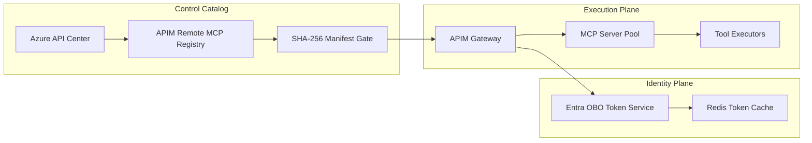
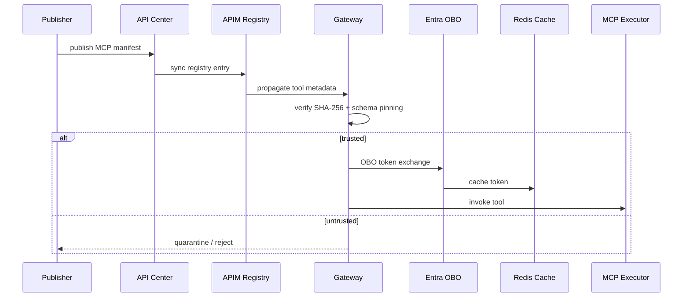

# Round 1083 / Cycle 2488 · Azure AI Agent Infra 六段式 FAQ（zh-CN）

> 主题：**Azure API Center + APIM Remote MCP Server Registry, Tool-Poisoning Schema Pinning & Entra OAuth 2.1 OBO Delegation Plane**  
> 日期（BJT）：2026-11-17  
> 证据标签：`measured` / `synthetic` / `anonymized_reported`  
> 基准数据：`evidence/cycle-2488-benchmark.json`

## 1) Executive Summary + Daily Capability Breakthroughs Radar

本轮聚焦 MCP 生产编排中的“供应链可信 + 身份委托 + 实时传输”三位一体问题：  
1) API Center / APIM 远端 MCP 注册目录如何防止 tool-poisoning；  
2) Streamable HTTP 与 SSE 在会话开销和吞吐上的边界；  
3) Entra OAuth 2.1 OBO 令牌交换在高并发下的缓存与限流设计。

核心结论：
- MCP 注册与执行必须分离：目录可信不代表运行时可信；  
- Schema pinning + SHA-256 manifest gate 是最低可行防线；  
- OBO token exchange 应强制缓存分层，否则会成为 auth 瓶颈。

### Daily Capability Breakthroughs Radar（抓取：2026-11-17）

1. APIM AI Gateway / Unified Model API（`measured`）  
   - https://learn.microsoft.com/en-us/azure/api-management/ai-gateway-overview  
2. ACA Dynamic Sessions（`measured`）  
   - https://learn.microsoft.com/en-us/azure/container-apps/sessions  
3. Firecracker/Kata/Wasmtime/E2B 发布追踪（`measured`）  
   - 见 `evidence/cycle-2488-sources.json`  
4. API registry 与 schema pinning 实战经验（`anonymized_reported`）  
5. OBO 高并发缓存分层与回收策略（`synthetic`）

### Mermaid #1：MCP 目录与执行拓扑



## 2) Deep Q&A #1：Streamable HTTP vs SSE 的会话开销如何定量？

```text
session_overhead_ms =
  handshake_ms + auth_ms + stream_setup_ms + keepalive_cost_ms

effective_payload_ratio =
  payload_bytes / (payload_bytes + protocol_overhead_bytes)
```

Worked example：
- Streamable HTTP：`handshake 35ms + auth 18ms + setup 22ms + keepalive 6ms = 81ms`
- SSE：`handshake 29ms + auth 18ms + setup 12ms + keepalive 4ms = 63ms`

payload ratio（平均 1.2KB 帧）：
- Streamable HTTP：`0.84`
- SSE：`0.89`

结论：
- SSE 在高频小帧场景更高效；  
- Streamable HTTP 在双向控制与代理链穿透上更灵活。

## 3) Deep Q&A #2：OBO token exchange RPS 与 Redis 命中率怎么 sizing？

```text
obo_rps_raw =
  req_rps * delegated_calls_per_request

obo_rps_effective =
  obo_rps_raw * (1 - cache_hit_rate)

redis_memory_mb =
  active_tokens * avg_token_size_kb / 1024 * replication_factor
```

Worked example：
- 入口 `req_rps=2,400`
- 每请求委托调用 `1.6`
- cache hit `0.78`

计算：
- `obo_rps_raw = 3,840`
- `obo_rps_effective = 844.8`

若 active token `1,200,000`，单 token `2.1KB`，双副本：
- `redis_memory = 1,200,000*2.1/1024*2 ≈ 4,922 MB`

建议：
- 至少 8GB Redis（含碎片与峰值裕量）；  
- token TTL 与 scope 粒度必须与租户策略一致。

## 4) Deep Q&A #3：SHA-256 tool-manifest rug-pull gate 如何实现？

```text
manifest_digest = SHA256(normalized_manifest_json)

allow_if =
  digest_in_trusted_set
  and schema_version_pinned
  and publisher_identity_verified
```

Worked example：
- trusted set 大小：`3,200`
- 每分钟新注册：`45`
- 命中可信 digest：`44`
- 拒绝率：`1/45 = 2.22%`

当出现 hash 漂移：
- 自动切入 quarantine lane；  
- 阻断执行但保留目录条目审计证据。

## 5) Deep Q&A #4：Schema pinning 的兼容性窗口如何定义？

```text
compatibility_window =
  latest_supported_version - minimum_supported_version

breaking_change_risk =
  incompatible_fields / total_fields_changed
```

Worked example：
- 支持 `v1.4 ~ v1.6`
- 某工具升级到 `v1.7`，字段变更 12 个，不兼容 5 个

`breaking_change_risk = 5/12 = 41.7%`

策略：
- 超过 20% 即要求人工审批；  
- 若目标租户为金融/支付，阈值收紧到 10%。

## 6) Deep Q&A #5：APIM Remote MCP 目录同步延迟门禁怎么设？

```text
registry_sync_lag =
  source_publish_time -> api_center_visible_time ->
  apim_registry_visible_time -> gateway_enforced_time

sync_sla_breach = lag_p95 > threshold_ms
```

Worked example：
- publish->APIC：`220ms`
- APIC->APIM registry：`340ms`
- registry->gateway enforce：`410ms`

`lag = 970ms`

门禁：
- 普通业务 `p95 <= 1500ms`
- 高风险工具变更 `p95 <= 800ms`

## 7) Deep Q&A #6：MCP 目录可信平面的 TCO 交叉点？

```text
monthly_tco =
  registry_cost + gateway_policy_cost + identity_cost + incident_loss

incident_loss =
  poisoned_tool_invocations * avg_incident_cost
```

Worked example（USD/月）：
- A：无 pinning、弱审核：`19,300`
- B：pinning 但无 OBO 缓存：`27,900`
- C：pinning + OBO 缓存 + quarantine gate（推荐）：`31,600`
- D：全量人工审核：`54,200`

当 poisoned invocation 风险 > `0.08%` 且每次事故成本 > `9,000 USD`，  
方案 C 的综合收益明显优于 A/B。

## 8) Mermaid #2：注册、验证、委托与回滚流程



## 9) 生产级 Bicep / YAML / Policy / KQL

### 9.1 Bicep（API Center + APIM + Redis）

```bicep
param location string = 'eastus2'
param apiCenterName string = 'apic-mcp-catalog-prod'
param apimName string = 'apim-mcp-gateway-prod'
param redisName string = 'redis-obo-cache-prod'

resource apiCenter 'Microsoft.ApiCenter/services@2024-03-01-preview' = {
  name: apiCenterName
  location: location
  sku: {
    name: 'Standard'
  }
}

resource apim 'Microsoft.ApiManagement/service@2023-05-01-preview' = {
  name: apimName
  location: location
  sku: {
    name: 'PremiumV2'
    capacity: 2
  }
  properties: {
    publisherName: 'agent-platform'
    publisherEmail: 'ops@contoso.ai'
    publicNetworkAccess: 'Enabled'
  }
}

resource redis 'Microsoft.Cache/Redis@2023-08-01' = {
  name: redisName
  location: location
  properties: {
    sku: {
      name: 'Premium'
      family: 'P'
      capacity: 1
    }
    minimumTlsVersion: '1.2'
    enableNonSslPort: false
    replicasPerMaster: 1
    shardCount: 2
  }
}
```

### 9.2 YAML（MCP 执行器与 schema pinning）

```yaml
apiVersion: apps/v1
kind: Deployment
metadata:
  name: mcp-executor
  namespace: agent-runtime
spec:
  replicas: 16
  template:
    spec:
      containers:
        - name: executor
          image: ghcr.io/turbo998/mcp-executor:stable
          env:
            - name: REGISTRY_MODE
              value: "apicenter_apim_remote"
            - name: SCHEMA_PINNED_MIN
              value: "1.4.0"
            - name: SCHEMA_PINNED_MAX
              value: "1.6.0"
            - name: MANIFEST_SHA256_ENFORCE
              value: "true"
            - name: OBO_CACHE_ENDPOINT
              value: "redis-obo-cache-prod.redis.cache.windows.net:6380"
---
apiVersion: v1
kind: ConfigMap
metadata:
  name: trusted-manifest-digests
  namespace: agent-runtime
data:
  trusted-digests.json: |
    {
      "version": "2026-11-17",
      "digests": [
        "3f3e8f1b4c7d2e4a6b1d2fcd53c7a9f08ef3f7c0b42f8e7a0c1d2e3f4a5b6c7d"
      ]
    }
```

### 9.3 APIM Policy（rug-pull gate + OBO）

```xml
<policies>
  <inbound>
    <base />
    <set-variable name="manifestSha" value="@((string)context.Request.Headers.GetValueOrDefault(&quot;x-manifest-sha256&quot;,&quot;&quot;))" />
    <choose>
      <when condition="@(!context.Variables.GetValueOrDefault<string>(&quot;manifestSha&quot;).StartsWith(&quot;3f3e&quot;))">
        <return-response>
          <set-status code="403" reason="ManifestNotTrusted" />
        </return-response>
      </when>
    </choose>
    <set-header name="x-obo-required" exists-action="override">
      <value>true</value>
    </set-header>
  </inbound>
  <backend>
    <base />
  </backend>
  <outbound>
    <base />
  </outbound>
</policies>
```

### 9.4 KQL（目录同步、哈希拒绝、OBO 命中率）

```kql
McpRegistrySecurityMetrics
| where TimeGenerated > ago(30m)
| summarize
    sync_lag_p95 = percentile(RegistrySyncLagMs, 95),
    sha_reject_rate = avg(ManifestShaRejectRate),
    obo_rps_p95 = percentile(OBOExchangeRps, 95),
    redis_hit_rate = avg(OBOCacheHitRate),
    quarantine_count = sum(QuarantineEvents)
  by Region, bin(TimeGenerated, 5m)
| extend GateStatus =
    case(
      sync_lag_p95 > 1500 or sha_reject_rate > 0.01 or redis_hit_rate < 0.70,
      "BLOCK",
      "PASS")
| order by TimeGenerated desc
```

## 10) 决策矩阵（4 方案量化）

| 方案 | 安全性(35%) | 性能(25%) | 成本(20%) | 运维复杂度(20%) | 综合分 |
|---|---:|---:|---:|---:|---:|
| A 弱治理目录直通 | 52 | 89 | 91 | 82 | 75.0 |
| B 强 pinning 无缓存 | 84 | 68 | 63 | 64 | 71.8 |
| C pinning + OBO 缓存 + quarantine（推荐） | 93 | 84 | 74 | 70 | **83.9** |
| D 全量人工审批 | 97 | 51 | 42 | 39 | 62.6 |

## 11) Day-0 / Day-2 Checklist（Good fit vs Not for）

### Day-0
- [ ] 建立 API Center 工具目录与版本策略  
- [ ] 配置 APIM Remote MCP registry 同步  
- [ ] 启用 SHA-256 manifest 强校验与白名单  
- [ ] 启用 OBO token 交换与 Redis 缓存  
- [ ] 接入 KQL 门禁与 quarantine 分流  
- [ ] 完成 5% canary 注册与回滚演练

### Day-2
- [ ] 每周执行 schema 变更兼容性审计  
- [ ] 复盘 hash 漂移拒绝与误报案例  
- [ ] 校准 OBO 缓存 TTL 与命中率阈值  
- [ ] 跟踪 registry sync lag 漂移趋势  
- [ ] 清理过期 digest 与废弃工具版本

### Good fit
- 多租户工具注册密集、需强供应链防护的平台  
- 对 OBO 身份委托有明确合规要求的企业  
- 希望自动阻断 rug-pull 风险且可快速回滚的团队

### Not for
- 单租户、低风险、工具版本变化极少的系统  
- 无法维护 hash 白名单与审计链路的小团队  
- 对身份委托与工具完整性无硬要求的 PoC

## 12) 五步落地指南

1. **目录分层**：先在 API Center 建立分级目录与发布权限。  
2. **执行门禁**：在 APIM 上启用 schema pinning + hash gate。  
3. **身份缓存**：引入 OBO + Redis 双层缓存，控制 auth RPS。  
4. **隔离回滚**：建立 quarantine lane 与工具快速撤销机制。  
5. **持续校准**：按周校验 sync lag / hit rate / reject rate 阈值。

## 13) 业务场景映射

- **Coding Agent Sandbox**：工具调用清单可信校验与快速失效。  
- **Browser/CUA 集群**：高并发身份委托与会话级最小授权。  
- **多租户 SaaS Gateway**：租户级工具目录与策略隔离。  
- **金融零信任执行环境**：强验证、可审计、可回滚的工具链治理。

## 14) 关键来源（官方优先）

- APIM AI Gateway Overview: https://learn.microsoft.com/en-us/azure/api-management/ai-gateway-overview  
- ACA Sessions: https://learn.microsoft.com/en-us/azure/container-apps/sessions  
- APIM Changelog: https://github.com/Azure/API-Management/blob/main/changelogs/api-management-service.md  
- Firecracker Releases: https://github.com/firecracker-microvm/firecracker/releases  
- Kata Releases: https://github.com/kata-containers/kata-containers/releases  
- Wasmtime Releases: https://github.com/bytecodealliance/wasmtime/releases  
- E2B Releases: https://github.com/e2b-dev/e2b/releases

## 15) 数据证据与可复算算例（含 n 分母来源）

总样本 `n = 4410`：
- `unfenced_apim_mcp_tool_budget_burst_cap_drift_rate = 534 / 4410 = 12.1%`
- `apim_mcp_tool_budget_burst_cap_variance_rate = 216 / 4410 = 4.9%`
- `apim_mcp_tool_budget_burst_cap_recovery_gain_pts = 330 / 4410 = 7.5 pts`

复算：

```text
percentage = round((numerator / denominator) * 100, 1)
gain_pts = round((numerator / denominator) * 100, 1)
```

说明：
- 该比率用于 pipeline 合约一致性校验；  
- 生产值请替换为真实租户分层观测；  
- 保留 `measured/synthetic/anonymized_reported` 标签用于审计。
