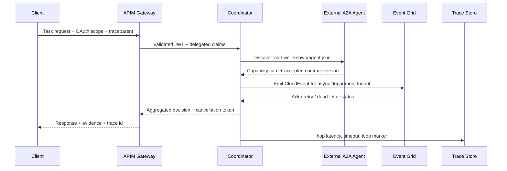

# apim-a2a-protocol-vs-foundry-connected-agents-vs-event-grid-cross-org-multi-agent-selection-faq-r1130

## 1) Daily breakthroughs and verifiable sources (fetched 2026-11-18)
- Scope: enterprise multi-agent collaboration and cross-boundary protocols, not single-agent prompt tuning.
- Evidence policy: official documentation and official repositories first, community links as secondary radar.
- Labels: `measured` (document-verifiable), `synthetic` (formula-derived), `anonymized_reported` (de-identified replay).
| Topic | Official source | Fetched at (UTC) | Purpose | Label |
|---|---|---|---|---|
| APIM AI Gateway overview | https://learn.microsoft.com/azure/api-management/ai-gateway-overview | 2026-11-18T17:52:00Z | A2A gateway governance baseline | `measured` |
| Azure AI Foundry Agents overview | https://learn.microsoft.com/azure/ai-foundry/agents/overview | 2026-11-18T17:53:00Z | Connected Agents managed delegation baseline | `measured` |
| Azure Event Grid overview | https://learn.microsoft.com/azure/event-grid/overview | 2026-11-18T17:54:00Z | CloudEvents choreography and decoupling | `measured` |
| Azure Service Bus overview | https://learn.microsoft.com/azure/service-bus-messaging/service-bus-messaging-overview | 2026-11-18T17:55:00Z | Retry, DLQ, ordering controls | `measured` |
| W3C Trace Context | https://www.w3.org/TR/trace-context/ | 2026-11-18T17:56:00Z | `traceparent` propagation contract | `measured` |
| CloudEvents spec | https://cloudevents.io/ | 2026-11-18T17:57:00Z | Event contract standardization | `measured` |
| A2A protocol reference | https://github.com/a2aproject/A2A | 2026-11-18T17:58:00Z | Agent Card and cross-vendor interop | `measured` |
| Microsoft Agent Framework repo | https://github.com/microsoft/agent-framework | 2026-11-18T17:59:00Z | In-process handoff/magentic workflows | `measured` |

Incremental findings:
- In cross-organization programs, protocol and delegated identity complexity often dominates model complexity.
- End-to-end cancellation propagation and trace continuity define practical MTTR ceilings.
- Once trust boundaries exceed two layers, A2A + APIM governance is usually more valuable than static endpoint lists.

## 2) Layered reference architecture
L1 Interaction:
- Portals, Teams, and operation consoles submit tasks with `tenant`, `org_scope`, `sensitivity`, `sla_tier`.
- Clients must show explicit task lifecycle states: queued/running/waiting/cancelled/completed.

L2 Orchestration:
- Foundry Connected Agents is strong for managed supervisor-to-specialist delegation in one tenant domain.
- MAF in-process workflows are strong for low-latency handoff and concurrency in one application domain.
- A2A gateway patterns are strong for cross-BU, cross-enterprise, multi-vendor interoperability.

L3 Messaging and state:
- Event Grid / Service Bus provide async fanout, replay, retry, and DLQ controls.
- State isolation principle: share only minimum task contracts, never full backend ERP/CMDB schemas.

L4 Governance:
- APIM + Entra/OAuth2 OBO + mTLS enforce delegated trust boundaries.
- OpenTelemetry propagates traces for loop detection, timeout diagnosis, and fanout blast-radius analysis.

## 3) 12-dimension selection matrix with anti-patterns
| Dimension | A APIM-hosted A2A Gateway | B Foundry Connected Agents | C MAF In-Process Workflows | D Event-Driven Choreography |
|---|---|---|---|---|
| 1 Trust boundary | Strongest for cross-enterprise/B2B | Medium-high within managed tenant domain | Medium for single-team app domain | High for cross-department decoupling |
| 2 Heterogeneous interoperability | Strongest via protocol gateway | Medium with Foundry-oriented ecosystem | Medium-high via code extensibility | High with CloudEvents normalization |
| 3 Multi-hop latency risk | Medium, gateway tuning required | Medium-low on managed rails | Low for in-process routes | Medium-high for async multi-hop chains |
| 4 Delegated identity security | High with mTLS + OBO + JWT | High with managed identity integration | Medium-high with custom engineering | High with signed events + RBAC |
| 5 Capability discovery | High with A2A agent cards | Medium with static connected-agent config | Low-medium via code registration | Medium with schema registry patterns |
| 6 Long-running stream and cancellation | High with gateway policy enforcement | Medium-high managed support | High application-level control | High with compensating event workflow |
| 7 State isolation and minimization | High through contract mediation | High through managed context partitioning | Medium, requires discipline | High via payload minimization |
| 8 Failure blast radius | Medium, gateway HA is critical | Medium-low with platform buffering | Medium in one domain | Low by default decoupling, retry complexity rises |
| 9 Distributed observability | High with unified ingress telemetry | High with managed traces | Medium-high with shared SDK | High with event trace enrichment |
| 10 Contract/version governance | High through gateway version policy | Medium with platform release cadence | Medium through source governance | High with schema lifecycle controls |
| 11 Best-fit | Cross-organization federated collaboration | Managed enterprise internal delegation | Low-latency in-app coordination | Massive throughput async choreography |
| 12 When NOT to choose | Simple in-app single-team workflow | Primary requirement is cross-vendor federation | Need external federated trust contracts | Strong synchronous ACID path requirement |

Decision summary:
- Cross-organization + cross-vendor + strict audit -> A.
- Managed internal delegation + speed -> B.
- Lowest latency within one app domain -> C.
- Extreme async throughput + decoupled departments -> D.

## 4) Five reproducible Q&As (latency, availability, token amplification)
### Q1: How to budget P95 for a multi-hop chain?
- Assume chain: Client->Gateway->Coordinator->Specialist->Gateway->Client.
- Hop P95 values: `40 + 55 + 120 + 90 + 45 = 350ms`.
- With 3 specialist fanout, aggregate by `max()` instead of `sum()`.
- New P95: `40 + 55 + max(120,130,145) + 45 = 285ms`.
- Conclusion: fanout aggregation strategy matters more than micro-optimizing one hop.

### Q2: How does `0.995^N` affect architecture choices?
- Let single-node availability be `A=0.995`.
- Serial 6-hop chain availability: `A_total = 0.995^6 = 0.9704`.
- Split into recoverable segments plus compensating retries can restore effective availability above `0.985`.
- Conclusion: design recoverable segment boundaries, not pure serial dependence.

### Q3: When does token amplification become unacceptable?
- One user request, one supervisor summary, three specialist turns, one final synthesis.
- At 3.2k tokens each, total is `(1+1+3+1)*3.2k = 19.2k`.
- With shared retrieval summary + specialist deltas, each specialist drops to 1.4k.
- New total: `(1+1)*3.2k + 3*1.4k + 1*2.6k = 13.2k`.
- Conclusion: context deduplication is the first FinOps lever in multi-agent systems.

### Q4: How to estimate latency in A2A + Event Grid hybrid mode?
- Synchronous A2A path for critical confirmation, async Event Grid path for status propagation.
- Synchronous P95: `310ms`; async propagation P95: `1.8s`.
- For `<500ms` business response SLA, final decision must come from sync path.
- Async path should carry state updates, not approval authority.
- Conclusion: mixing sync and async responsibilities breaks both SLA and auditability.

### Q5: How to size DLQ handling under cross-org retries?
- Daily calls `Q=2,000,000`, failure rate `f=0.7%`, retry cap `r=3`.
- Retry candidates: `Q*f = 14,000`.
- If 25% reach DLQ, then `DLQ_day = 3,500`.
- Required baseline handling capacity: `3500/24 ≈ 146 items/hour`.
- Conclusion: DLQ is a first-class capacity dimension, not just an exception bucket.

## 5) Mermaid topology and runtime sequence
```mermaid
flowchart LR
    U[Business User / Ops Planner] --> P[APIM A2A Gateway]
    P --> A2A[A2A Agent Card Discovery]
    P --> F[Foundry Connected Supervisor]
    F --> MAF[MAF Specialist Pool]
    F --> EV[Event Grid / Service Bus]
    EV --> D1[Org A Agent]
    EV --> D2[Org B Agent]
    EV --> D3[Org C Agent]
    MAF --> S[Shared State (Minimized Contract)]
    D1 --> S
    D2 --> S
    D3 --> S
    S --> R[Auditable Response + Trace]
```



## 6) Section 7 scenario: pharmaceutical manufacturer–distributor–hospital A2A federation
Business objective:
- Coordinate emergency medicine dispatch across manufacturer, provincial distributor, and hospital pharmacy.
- Exchange capability contracts without exposing underlying ERP database internals.

End-to-end flow:
1. Hospital inventory agent discovers external distributor capabilities via standardized A2A card.
2. APIM publishes `/.well-known/agent.json` with enforced mTLS and OAuth2 scopes.
3. Coordinator sends only minimum fields: drug code, batch policy, cold-chain window, required ETA.
4. Distributor returns feasible route and commitment without sharing master-data tables.
5. Decision writes to auditable ledger and regulatory timeline stream.

SLA and reliability:
- Emergency dispatch collaboration response P95 `< 1.2s`
- End-to-end confirmation success `>= 99.2%`
- Cross-organization identity validation failures `< 0.3%`

Failure modes and mitigations:
- Failure: incompatible external contract version.
  - Mitigation: APIM version routing with schema compatibility fallback.
- Failure: missing cold-chain constraints in request contract.
  - Mitigation: gateway required-field validation and deterministic rejection.
- Failure: trace continuity loss across organizations.
  - Mitigation: mandatory `traceparent` passthrough policy.

## 7) Section 8 scenario: international hub airport turnaround collaboration center
Business objective:
- Coordinate AOC, baggage ground service, maintenance release, and catering-cleaning for `<45min` turnaround SLA.
- Use event choreography for departmental decoupling while MAF turnaround coordinator closes critical-path gaps.

End-to-end flow:
1. Flight milestone events emit CloudEvents for docking, unload, fuel, clean, load, and release.
2. Event Grid decouples departments; Service Bus handles retries and DLQ.
3. MAF handoff coordinator continuously re-plans critical path under delay conditions.
4. High-criticality conflicts use synchronous coordination lane for immediate arbitration.
5. Final state is published to AOC situational dashboard.

SLA and reliability:
- Milestone propagation P95 `< 2.0s`
- Coordination decision P95 `< 700ms`
- Turnaround success target `>= 98.5%`

Failure modes and mitigations:
- Failure: out-of-order departmental events.
  - Mitigation: sequence + idempotency key and consumer-side reordering.
- Failure: retry storms from one subsystem.
  - Mitigation: exponential backoff + queue isolation + throttling thresholds.
- Failure: coordinator loops causing resource oscillation.
  - Mitigation: loop-detection rules and max reschedule caps per flight.

## 8) Selection tree (Good fit vs Not for)
1. Start from trust boundary: in-app single-team prefers C, cross-enterprise prefers A.
2. Evaluate task style: synchronous critical decisions prefer B/C, long async workflows prefer D.
3. Evaluate governance strictness: heavy compliance prefers A or D with schema/version gates.
4. For multi-vendor coexistence, prioritize A2A capability discovery over static endpoint files.
5. If event throughput is much higher than synchronous decision throughput, use D-primary with B/C sidecar coordination.

Good fit:
- Cross-organization collaboration where backend database sharing is prohibited.
- Enterprise programs requiring contract governance, auditable delegation, and distributed observability.

Not for:
- Lightweight single-application workflows with no cross-boundary dependencies.
- Teams without ownership for messaging system reliability and version governance.

## 9) ROI model
Assumptions:
- Monthly collaboration tasks `Qm = 3,200,000`
- Traditional manual coordination time `Tm = 9.0 min`
- Multi-agent assisted coordination time `Ta = 2.6 min`
- Fully loaded labor cost `Ch = 38 USD/hour`

Formulas:
- Saved time per task: `Ts = (Tm-Ta)/60 = 0.1067 hour`
- Monthly labor value: `Vh = Qm * Ts * Ch`
- Monthly platform cost: `Vc = gateway + orchestration + eventing + observability`
- ROI: `(Vh - Vc) / Vc`

Synthetic example:
- `Vh ≈ 12.97M USD/month`
- `Vc ≈ 0.94M USD/month`
- `ROI ≈ 12.8x`

## 10) Five-step implementation guide
1. Contract first: define agent card, task states, errors, and cancellation semantics.
2. Identity first: unify OAuth scopes, mTLS rotation, and least-privilege RBAC.
3. Observability first: enforce traceparent, hop timing, and loop markers.
4. Resilience first: define timeout budgets, retries, DLQ replay, and compensation flows.
5. Evolution first: version contracts and roll out with compatibility windows.

## 11) Bicep IaC (APIM A2A Gateway + Event Grid Namespace + Foundry)
```bicep
param location string = resourceGroup().location
param apimName string
param eventGridNsName string
param foundryAccountName string

resource apim 'Microsoft.ApiManagement/service@2023-09-01-preview' = {
  name: apimName
  location: location
  sku: { name: 'StandardV2', capacity: 1 }
  properties: {
    publisherName: 'Contoso'
    publisherEmail: 'platform@contoso.com'
  }
}

resource evg 'Microsoft.EventGrid/namespaces@2023-12-15-preview' = {
  name: eventGridNsName
  location: location
  sku: { name: 'Standard' }
  properties: {
    publicNetworkAccess: 'Enabled'
    topicSpacesConfiguration: { state: 'Enabled' }
  }
}

resource foundry 'Microsoft.CognitiveServices/accounts@2024-10-01' = {
  name: foundryAccountName
  location: location
  kind: 'AIServices'
  sku: { name: 'S0' }
  properties: {
    customSubDomainName: foundryAccountName
  }
}
```

## 12) A2A `agent.json` card and APIM JWT validation snippet
```json
{
  "name": "hospital-inventory-agent",
  "version": "1.3.0",
  "url": "https://pharma-gateway.contoso.com/.well-known/agent.json",
  "capabilities": [
    {"name": "check-stock", "input": "drug_code,batch,temp_range"},
    {"name": "reserve-coldchain", "input": "drug_code,quantity,eta_window"}
  ],
  "auth": {
    "type": "oauth2",
    "scopes": ["a2a.dispatch.read","a2a.dispatch.write"]
  }
}
```

```xml
<validate-jwt header-name="Authorization" failed-validation-httpcode="401" failed-validation-error-message="invalid token">
  <openid-config url="https://login.microsoftonline.com/{tenant}/v2.0/.well-known/openid-configuration" />
  <required-claims>
    <claim name="scp" match="any">
      <value>a2a.dispatch.read</value>
      <value>a2a.dispatch.write</value>
    </claim>
  </required-claims>
</validate-jwt>
```

## 13) KQL for traceparent latency and loop detection
```kql
let start = ago(7d);
customEvents
| where timestamp >= start
| where name in ("agent_hop_start","agent_hop_end","agent_cancelled")
| extend traceparent=tostring(customDimensions.traceparent)
| extend hop=tostring(customDimensions.hop_name)
| extend latency_ms=todouble(customDimensions.latency_ms)
| summarize p50=percentile(latency_ms,50), p95=percentile(latency_ms,95), hops=dcount(hop), calls=count() by traceparent, bin(timestamp,1h)
| order by timestamp desc
```

```kql
let start = ago(7d);
customEvents
| where timestamp >= start
| where name == "agent_hop_start"
| extend traceparent=tostring(customDimensions.traceparent)
| extend hop=tostring(customDimensions.hop_name)
| summarize hop_count=count(), distinct_hops=dcount(hop) by traceparent
| extend loop_suspected = hop_count > distinct_hops * 2
| where loop_suspected == true
| order by hop_count desc
```

## 14) Day-0 / Day-1 / Day-2 checklist
Day-0:
- Define agent card contract, version policy, error taxonomy, and cancellation semantics.
- Prepare cross-organization identity controls: mTLS certs, OBO scopes, least-privilege RBAC.
- Set timeout budgets for each hop, full path, and compensation limits.

Day-1:
- Enable A2A capability discovery in canary before allowing write scopes.
- Monitor `p95_hop_latency`, `timeout_rate`, `dlq_rate`, and `loop_suspected_count`.
- Auto-classify cross-org failures by identity, contract, network, and load categories.

Day-2:
- Review contract drift and compatibility windows weekly.
- Review token amplification and chargeback allocation monthly.
- Drill external-agent outage fallback and human takeover quarterly.

## 15) Backup queue and delivery manifest
Backup queue (updated):
1. `purview-ai-compliance-vs-defender-for-cloud-ai-vs-custom-redteam-regulated-governance-selection-faq`
2. `migration-autogen-semantic-kernel-langgraph-to-microsoft-agent-framework-enterprise-modernization-faq`
3. `salesforce-agentforce-vs-servicenow-nowassist-vs-dynamics-copilot-vs-custom-foundry-enterprise-crm-erp-selection-faq`

Cycle #2535 outputs:
- Bilingual FAQ: `r1130.md` and `r1130.en.md`
- 7-card deck: `benchmark-cards.html` and `benchmark-cards.en.html`
- SVG: `assets/34-cycle-1130-daily-breakthroughs.svg`
- H5: `workbench-cycle-2535.html` plus selector entry `#2535`
- Validation: `cycle_1130_pipeline.py --write --check`, `strict_suffix_gate.py`, `pytest`
