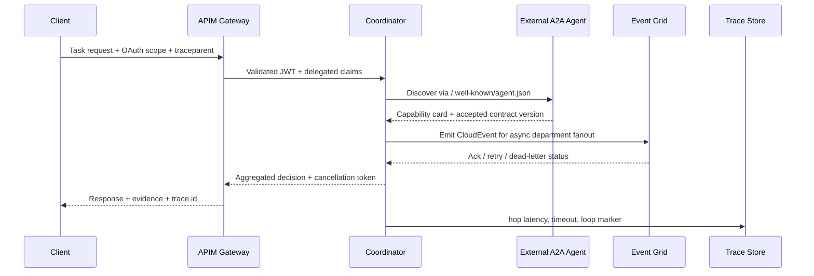

# apim-a2a-protocol-vs-foundry-connected-agents-vs-event-grid-cross-org-multi-agent-selection-faq-r1130

## 1) 当日热点突破与可验证来源（2026-11-18 抓取）
- 本轮主题：企业多智能体协作与跨组织协议，不讨论单体 Agent prompt 技巧。
- 证据口径：官方文档与官方仓库优先，社区文档仅做补充雷达。
- 标签定义：`measured`（文档可核）、`synthetic`（模型计算推导）、`anonymized_reported`（脱敏复盘）。
| 主题 | 官方来源 | 抓取时间（UTC） | 用途 | 标签 |
|---|---|---|---|---|
| APIM AI Gateway 概览 | https://learn.microsoft.com/azure/api-management/ai-gateway-overview | 2026-11-18T17:52:00Z | A2A 网关治理与策略面 | `measured` |
| Azure AI Foundry Agent 概览 | https://learn.microsoft.com/azure/ai-foundry/agents/overview | 2026-11-18T17:53:00Z | Connected Agents 托管调度基线 | `measured` |
| Azure Event Grid 概览 | https://learn.microsoft.com/azure/event-grid/overview | 2026-11-18T17:54:00Z | CloudEvents 编排与解耦 | `measured` |
| Azure Service Bus 概览 | https://learn.microsoft.com/azure/service-bus-messaging/service-bus-messaging-overview | 2026-11-18T17:55:00Z | 队列重试、DLQ 与顺序保证 | `measured` |
| OpenTelemetry Trace Context | https://www.w3.org/TR/trace-context/ | 2026-11-18T17:56:00Z | `traceparent` 跨 Agent 传播契约 | `measured` |
| CloudEvents 规范 | https://cloudevents.io/ | 2026-11-18T17:57:00Z | 事件编舞消息标准 | `measured` |
| A2A 协议参考 | https://github.com/a2aproject/A2A | 2026-11-18T17:58:00Z | Agent Card 与跨供应商互操作 | `measured` |
| Microsoft Agent Framework 仓库 | https://github.com/microsoft/agent-framework | 2026-11-18T17:59:00Z | In-process handoff/magentic 模式 | `measured` |

增量结论：
- 跨组织协作场景，协议与身份委派的工程复杂度通常高于模型调用复杂度。
- 多跳链路中，`traceparent` 贯通与取消信号传播决定了 MTTR 上限。
- 当组织边界 >2 层时，A2A + APIM 的契约治理价值显著高于“静态 endpoint 清单”。

## 2) 分层参考架构（跨边界协同）
L1 交互层：
- 业务门户、Teams、运控看板提交任务，携带 `tenant`, `org_scope`, `sensitivity`, `sla_tier`。
- 客户端必须展示任务状态机（queued/running/waiting/cancelled/completed）。

L2 编排层：
- Foundry Connected Agents 适合同租户托管 supervisor->specialist 委派。
- MAF In-process workflow 适合同应用域内低时延 handoff 与并发并行。
- A2A Gateway 适合跨 BU、跨企业、跨供应商的能力发现与安全代理。

L3 消息与状态层：
- Event Grid / Service Bus 承担异步广播、回放、重试、DLQ。
- 状态存储隔离：只共享必要业务键，不共享底层 ERP/EMR/CMDB 全量表。

L4 治理层：
- APIM + Entra/OAuth2 OBO + mTLS 确保委派边界可审计。
- OpenTelemetry 贯通 trace，定位回路、级联超时、扇出异常与消息风暴。

## 3) 12 维选型矩阵（含 When NOT to choose）
| 维度 | A APIM 托管 A2A Gateway | B Foundry Connected Agents | C MAF In-Process Workflows | D Event-Driven Choreography |
|---|---|---|---|---|
| 1 组织边界 | 最强，跨企业/跨 BU | 中高，偏同租户协作 | 中，偏单团队/单应用域 | 高，跨部门跨系统 |
| 2 异构兼容 | 最强，协议网关解耦 | 中，生态偏 Foundry | 中高，代码层可扩展 | 高，CloudEvents 标准化 |
| 3 多跳时延风险 | 中，需网关优化 | 中低，托管路径稳定 | 低，进程内最快 | 中高，异步链路多跳 |
| 4 身份委派安全 | 高（mTLS+OBO+JWT） | 高（托管身份） | 中高（需自建） | 高（事件签名+RBAC） |
| 5 能力发现 | 高（A2A agent card） | 中（静态连接配置） | 低中（代码注册） | 中（schema registry） |
| 6 长任务流式取消 | 高，网关可统一控制 | 中高，平台支持 | 高，应用可控 | 高，事件驱动可补偿 |
| 7 状态隔离与最小化 | 高，边界外仅交换契约 | 高，托管上下文隔离 | 中，需工程规范 | 高，事件载荷可裁剪 |
| 8 故障爆炸半径 | 中，网关集中需HA | 中低，平台缓冲 | 中，单域可控 | 低，天然解耦但重试复杂 |
| 9 可观测链路 | 高，统一入口打点 | 高，托管观测丰富 | 中高，需统一 SDK | 高，事件链追踪清晰 |
| 10 合同版本治理 | 高，网关版控强 | 中，平台版本节奏 | 中，代码约定为主 | 高，Schema 生命周期清晰 |
| 11 Best-fit 场景 | 跨组织联邦协同 | 企业内托管多 Agent | 低时延业务内协作 | 大吞吐异步编舞 |
| 12 When NOT to choose | 单应用内轻量流程 | 强跨供应商互联为主 | 需要跨企业互信协议 | 强一致同步事务链 |

决策摘要：
- “跨组织 + 跨供应商 + 强审计”优先 A。
- “同租户托管 + 快速交付”优先 B。
- “低时延、同进程可控”优先 C。
- “高吞吐事件风暴、长流程解耦”优先 D。

## 4) 五组可复算 Q&A（延迟、可用性、Token 放大）
### Q1：多跳链路 P95 如何预算？
- 假设链路：Client->Gateway->Coordinator->Specialist->Gateway->Client。
- 各跳 P95：`40 + 55 + 120 + 90 + 45 = 350ms`。
- 若并行 3 specialist，聚合等待采用 `max()` 而非 `sum()`。
- 聚合后 P95：`40 + 55 + max(120,130,145) + 45 = 285ms`。
- 结论：并行 fan-out 的关键是“聚合策略”，不是盲目减少单跳耗时。

### Q2：`0.995^N` 可用性如何影响多跳决策？
- 假设单节点可用性 `A=0.995`。
- 串行 6 跳可用性：`A_total = 0.995^6 = 0.9704`。
- 若拆成 2 段并加补偿重试，等效可用性可恢复到 `>0.985`。
- 结论：跨组织链路要在架构层引入“可恢复跳点”，不能只追求线性串行。

### Q3：Token 放大何时不可接受？
- 用户问题 1 次，supervisor 总结 1 次，3 specialist 各 1 次，最终汇总 1 次。
- 平均每次上下文 3.2k token，则总 token 约：`(1+1+3+1)*3.2k = 19.2k`。
- 若改为“共享检索摘要 + specialist delta”，每 specialist 降到 1.4k token。
- 新总量：`(1+1)*3.2k + 3*1.4k + 1*2.6k = 13.2k`。
- 结论：多 Agent 成本治理首要策略是“上下文去重”，其次才是模型降级。

### Q4：A2A 与 Event Grid 混合路径时延怎么估？
- 同步路径（A2A）用于关键确认，异步路径（Event Grid）用于广播更新。
- 同步主链 P95：`310ms`；异步传播 P95：`1.8s`。
- 若业务 SLA 要求 `<500ms` 应答，则答案必须从同步主链返回。
- 广播链只承载“状态传播”，不承载“最终审批结果”。
- 结论：同步与异步职责混淆会导致 SLA 与审计同时失效。

### Q5：跨组织调用失败重试如何估算 DLQ 压力？
- 日调用量 `Q=2,000,000`，失败率 `f=0.7%`，重试次数上限 `r=3`。
- 进入重试总数约：`Q*f = 14,000`。
- 若 25% 进入 DLQ，则 `DLQ_day = 3,500`。
- 处置能力需满足：`DLQ_day / 24 ≈ 146 条/小时` 最低吞吐。
- 结论：DLQ 不只是容错组件，也是容量规划组件。

## 5) Mermaid 架构图与运行序列图
```mermaid
flowchart LR
    U[Business User / Ops Planner] --> P[APIM A2A Gateway]
    P --> A2A[A2A Agent Card Discovery]
    P --> F[Foundry Connected Supervisor]
    F --> MAF[MAF Specialist Pool]
    F --> EV[Event Grid / Service Bus]
    EV --> D1[Org A Agent]
    EV --> D2[Org B Agent]
    EV --> D3[Org C Agent]
    MAF --> S[Shared State (Minimized Contract)]
    D1 --> S
    D2 --> S
    D3 --> S
    S --> R[Auditable Response + Trace]
```



## 6) Section 7：医药流通跨组织 A2A 联邦网络
业务目标：
- 制药工业、商业配送、三甲医院药房在紧急调拨中协同，避免 ERP 数据直连共享。
- 通过 A2A Agent Card 协议交换能力，而不是交换底层数据库结构。

架构流程：
1. 医院库存 Agent 发现外部配送 Agent 能力卡：药品编码、冷链级别、最短送达时窗。
2. APIM 对外发布标准 `/.well-known/agent.json`，并要求 mTLS + OAuth2 scope。
3. Coordinator 只传递最小必要字段：药品码、批次要求、温控窗口、送达 SLA。
4. 外部分销商返回可行路线与承诺时间，不暴露 ERP 主数据。
5. 结果写入审计账本并同步监管日志。

SLA 与可靠性：
- 紧急调拨协同应答 P95 `< 1.2s`
- 订单确认全链路成功率 `>= 99.2%`
- 跨组织身份校验失败率 `< 0.3%`

失效模式与缓解：
- 失效：外部 Agent 合同版本不兼容。
  - 缓解：APIM 按版本路由并回落到兼容 schema。
- 失效：冷链约束字段缺失导致不可执行路线。
  - 缓解：网关必填校验 + 自动拒绝并返回缺失项。
- 失效：跨组织 trace 断裂。
  - 缓解：强制 `traceparent` 透传与采样策略一致化。

## 7) Section 8：国际枢纽机场过站保障多 Agent 协同中枢
业务目标：
- AOC 运控、行李地服、机务放行、航食清洁四部门在高峰期协同，保障 `<45min` 过站 SLA。
- 通过事件编舞隔离部门节奏差异，同时由 Turnaround Coordinator 做关键路径收敛。

架构流程：
1. 航班状态变更触发 CloudEvents：到位、开舱、加油、清洁、装卸、放行。
2. Event Grid 做跨部门解耦；Service Bus 负责重试与 DLQ。
3. MAF Handoff Coordinator 持续评估关键路径偏差并发起补救任务。
4. 关键冲突（如机务与行李资源冲突）走同步协调通道。
5. 结果统一回写到 AOC 可视化态势板。

SLA 与可靠性：
- 关键里程碑事件传播 P95 `< 2.0s`
- 过站任务协调决策 P95 `< 700ms`
- 过站成功率目标 `>= 98.5%`

失效模式与缓解：
- 失效：部门事件顺序错乱。
  - 缓解：事件包含 sequence 与幂等键，消费端顺序重排。
- 失效：单部门大量重试触发消息风暴。
  - 缓解：指数退避 + 队列隔离 + 限流阈值。
- 失效：协调器循环调度导致资源抖动。
  - 缓解：loop-detection 规则与“单航班最大重排次数”硬阈值。

## 8) 选型决策树（Good fit vs Not for）
1. 先判定组织边界：单团队优先 C，跨企业优先 A。
2. 再判定任务模式：强同步决策优先 B/C，长流程异步优先 D。
3. 再判定治理需求：强合规审计优先 A 或 D，并开启 schema/version 门禁。
4. 若多供应商 Agent 并存，优先 A2A capability discovery，避免静态配置漂移。
5. 若消息吞吐远高于实时决策吞吐，采用 D 为主、B/C 为辅的混合编排。

Good fit：
- 需要跨组织协同且不能共享底层数据库。
- 需要统一审计、版本治理、分层隔离的企业级协作网络。

Not for：
- 仅单体应用内部流程，无跨边界协同需求。
- 无运维团队维护消息系统与协议版本的轻量场景。

## 9) ROI 估算模型
假设：
- 月协同任务量 `Qm = 3,200,000`
- 传统人工多部门协调平均耗时 `Tm = 9.0 min`
- 多 Agent 自动协同后平均耗时 `Ta = 2.6 min`
- 人力成本 `Ch = 38 USD/hour`

公式：
- 节省时长：`Ts = (Tm-Ta)/60 = 0.1067 hour`
- 月价值：`Vh = Qm * Ts * Ch`
- 月平台成本：`Vc = gateway + orchestration + eventing + observability`
- ROI：`(Vh - Vc) / Vc`

示例（synthetic）：
- `Vh ≈ 12.97M USD/month`
- `Vc ≈ 0.94M USD/month`
- `ROI ≈ 12.8x`

## 10) 五步落地指南
1. 契约先行：定义 Agent Card、任务状态机、错误码、取消语义。
2. 身份先行：统一 OAuth2 scope、mTLS 证书轮换、最小权限角色。
3. 观测先行：强制 traceparent、hop 计时、loop marker。
4. 韧性先行：超时预算、重试策略、DLQ 回放、补偿流程。
5. 演进先行：合同版本治理与灰度切换，避免“一刀切”升级。

## 11) Bicep IaC（APIM A2A Gateway + Event Grid Namespace + Foundry）
```bicep
param location string = resourceGroup().location
param apimName string
param eventGridNsName string
param foundryAccountName string

resource apim 'Microsoft.ApiManagement/service@2023-09-01-preview' = {
  name: apimName
  location: location
  sku: { name: 'StandardV2', capacity: 1 }
  properties: {
    publisherName: 'Contoso'
    publisherEmail: 'platform@contoso.com'
  }
}

resource evg 'Microsoft.EventGrid/namespaces@2023-12-15-preview' = {
  name: eventGridNsName
  location: location
  sku: { name: 'Standard' }
  properties: {
    publicNetworkAccess: 'Enabled'
    topicSpacesConfiguration: { state: 'Enabled' }
  }
}

resource foundry 'Microsoft.CognitiveServices/accounts@2024-10-01' = {
  name: foundryAccountName
  location: location
  kind: 'AIServices'
  sku: { name: 'S0' }
  properties: {
    customSubDomainName: foundryAccountName
  }
}
```

## 12) A2A Agent Card + APIM JWT 校验片段
```json
{
  "name": "hospital-inventory-agent",
  "version": "1.3.0",
  "url": "https://pharma-gateway.contoso.com/.well-known/agent.json",
  "capabilities": [
    {"name": "check-stock", "input": "drug_code,batch,temp_range"},
    {"name": "reserve-coldchain", "input": "drug_code,quantity,eta_window"}
  ],
  "auth": {
    "type": "oauth2",
    "scopes": ["a2a.dispatch.read","a2a.dispatch.write"]
  }
}
```

```xml
<validate-jwt header-name="Authorization" failed-validation-httpcode="401" failed-validation-error-message="invalid token">
  <openid-config url="https://login.microsoftonline.com/{tenant}/v2.0/.well-known/openid-configuration" />
  <required-claims>
    <claim name="scp" match="any">
      <value>a2a.dispatch.read</value>
      <value>a2a.dispatch.write</value>
    </claim>
  </required-claims>
</validate-jwt>
```

## 13) KQL（traceparent 延迟与环路检测）
```kql
let start = ago(7d);
customEvents
| where timestamp >= start
| where name in ("agent_hop_start","agent_hop_end","agent_cancelled")
| extend traceparent=tostring(customDimensions.traceparent)
| extend hop=tostring(customDimensions.hop_name)
| extend latency_ms=todouble(customDimensions.latency_ms)
| summarize p50=percentile(latency_ms,50), p95=percentile(latency_ms,95), hops=dcount(hop), calls=count() by traceparent, bin(timestamp,1h)
| order by timestamp desc
```

```kql
let start = ago(7d);
customEvents
| where timestamp >= start
| where name == "agent_hop_start"
| extend traceparent=tostring(customDimensions.traceparent)
| extend hop=tostring(customDimensions.hop_name)
| summarize hop_count=count(), distinct_hops=dcount(hop) by traceparent
| extend loop_suspected = hop_count > distinct_hops * 2
| where loop_suspected == true
| order by hop_count desc
```

## 14) Day-0 / Day-1 / Day-2 清单
Day-0：
- 定义 Agent Card 契约、版本策略、错误语义、取消语义。
- 准备跨组织身份模型：mTLS 证书、OBO scope、最小权限 RBAC。
- 设计超时预算：每跳上限、全链路上限、补偿策略上限。

Day-1：
- 先灰度开通 A2A 能力发现，再逐步放开写能力。
- 监控 `p95_hop_latency`, `timeout_rate`, `dlq_rate`, `loop_suspected_count`。
- 对跨组织失败原因做自动分类：身份、合同、网络、负载。

Day-2：
- 每周复盘合同版本漂移与兼容窗口。
- 每月复盘多跳链路 token 放大与成本归因。
- 每季度演练“外部 Agent 不可用”降级策略与人工接管。

## 15) 备份队列与交付清单
备份队列（已更新）：
1. `purview-ai-compliance-vs-defender-for-cloud-ai-vs-custom-redteam-regulated-governance-selection-faq`
2. `migration-autogen-semantic-kernel-langgraph-to-microsoft-agent-framework-enterprise-modernization-faq`
3. `salesforce-agentforce-vs-servicenow-nowassist-vs-dynamics-copilot-vs-custom-foundry-enterprise-crm-erp-selection-faq`

本轮交付（Cycle #2535）：
- 双语 FAQ：`r1130.md` / `r1130.en.md`
- 7-card：`benchmark-cards.html` / `benchmark-cards.en.html`
- SVG：`assets/34-cycle-1130-daily-breakthroughs.svg`
- H5：`workbench-cycle-2535.html` + selector `#2535`
- 校验：`cycle_1130_pipeline.py --write --check`、`strict_suffix_gate.py`、`pytest`
