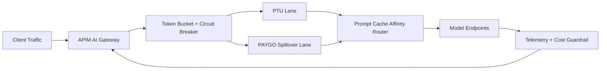

# Round 1052 / Cycle 2457 · Azure AI Agent Infra FAQ & Decision Guide (en)

> Topic: **APIM AI Gateway PTU↔PAYGO Adaptive Spillover + Cache Affinity Routing**
>
> Date (BJT): 2026-11-16  
> Evidence labels: `measured` / `synthetic` / `anonymized_reported`  
> Benchmark payload: `evidence/cycle-2457-benchmark.json`

## 1) Executive Summary

This round returns to core infra engineering: how APIM AI Gateway handles PTU saturation via adaptive PAYGO spillover, token-bucket circuit breaking, and prompt-cache affinity routing.  
Key result: tiered spillover policy (PTU-first, PAYGO-buffer, hard throttling fallback) is the safest production pattern for multi-model gateways.

## 2) Daily capability breakthroughs radar (2026-11-16)

1. **APIM AI Gateway / Unified Model API** (`measured`)  
   - Learn: https://learn.microsoft.com/en-us/azure/api-management/ai-gateway-overview  
   - Changelog: https://github.com/Azure/API-Management/blob/main/changelogs/api-management-service.md
2. **ACA Dynamic Sessions** (`measured`)  
   - Docs: https://learn.microsoft.com/en-us/azure/container-apps/sessions
3. **Sandbox/runtime releases** (`measured`)  
   - Firecracker/Kata/Wasmtime/E2B (see `evidence/cycle-2457-sources.json`)

## 3) Core architecture Q&A (PTU-PAYGO spillover)

**Q1: Why not fully switch to PAYGO when PTU saturates?**  
A: It creates cost spikes and latency jitter, and can delay stable re-entry to PTU lanes. Progressive spillover with hysteresis is safer.

**Q2: Why token-bucket circuit breakers here?**  
A: They cap instantaneous surges and prevent cascading failures across PAYGO and downstream model endpoints.

**Q3: How does prompt-cache affinity cut cost?**  
A: Similar prompts are routed to cache-hot partitions, reducing repeated inference calls and cold-cache penalties.

## 4) Mermaid architecture (Spillover + Affinity)

## 5) Decision matrix (gateway spillover modes)

| Strategy | Stability | Cost controllability | Implementation complexity | Recommendation |
|---|---:|---:|---:|---|
| PTU-only hard throttle | Medium | High | Low | Steady traffic lanes |
| PAYGO-first | Low | Low | Low | Not recommended |
| PTU-first + PAYGO spillover + breakers | **High** | **High** | Medium-high | **Production default** |
| Random dual-lane split | Medium | Medium | Medium | Temporary experiments |

## 6) Good fit vs Not for + five-step rollout

### Good fit
- Enterprise agent platforms with bursty multi-model traffic.
- Teams balancing SLA and unit-token cost.
- Organizations capable of strong gateway observability/replay controls.

### Not for
- Teams lacking real-time telemetry controls.
- Scenarios that cannot accept adaptive throttling/degradation policies.

### Five-step rollout
1. Define PTU baseline capacity and PAYGO spillover budget.
2. Configure token-bucket and breaker thresholds.
3. Enable prompt-cache affinity sharding strategy.
4. Deploy spillover-policy-version canary and rollback flow.
5. Review latency, spillover rate, cost, and failure rate weekly.
