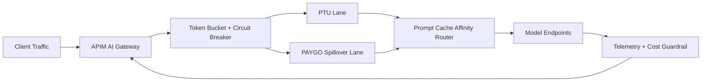

# Round 1052 / Cycle 2457 · Azure AI Agent Infra FAQ & 决策指南（zh-CN）

> Topic: **APIM AI Gateway PTU↔PAYGO Adaptive Spillover + Cache Affinity Routing**
>
> Date (BJT): 2026-11-16  
> Evidence labels: `measured` / `synthetic` / `anonymized_reported`  
> Benchmark payload: `evidence/cycle-2457-benchmark.json`

## 1) Executive Summary

本轮回到核心基础设施：APIM AI Gateway 在 PTU 饱和时如何进行 PAYGO 自适应溢出，并结合 token-bucket 熔断与 prompt-cache 亲和路由，兼顾成本与稳定性。  
核心结论：分层 spillover 策略（PTU 优先、PAYGO 缓冲、硬限流兜底）是生产多模型网关的必备模式。

## 2) Daily capability breakthroughs radar（2026-11-16）

1. **APIM AI Gateway / Unified Model API**（`measured`）  
   - Learn: https://learn.microsoft.com/en-us/azure/api-management/ai-gateway-overview  
   - Changelog: https://github.com/Azure/API-Management/blob/main/changelogs/api-management-service.md
2. **ACA Dynamic Sessions**（`measured`）  
   - Docs: https://learn.microsoft.com/en-us/azure/container-apps/sessions
3. **Sandbox/runtime releases**（`measured`）  
   - Firecracker/Kata/Wasmtime/E2B（见 `evidence/cycle-2457-sources.json`）

## 3) Core architecture Q&A（PTU-PAYGO 溢出）

**Q1: PTU 饱和时为什么不能直接全部切 PAYGO？**  
A: 会导致成本突刺与延迟抖动，且难以恢复到 PTU 基线。应采用渐进溢出比例与恢复滞回。

**Q2: token-bucket 熔断在这里作用是什么？**  
A: 约束瞬时流量峰值，避免 PAYGO 过载或下游模型抖动引发级联失败。

**Q3: prompt-cache 亲和路由怎么帮助降本？**  
A: 保持相似请求路由到高命中缓存分区，减少重复推理与冷缓存成本。

## 4) Mermaid architecture（Spillover + Affinity）

## 5) Decision matrix（网关溢出策略）

| 策略 | 稳定性 | 成本可控性 | 实现复杂度 | 推荐 |
|---|---:|---:|---:|---|
| PTU-only（硬限流） | 中 | 高 | 低 | 流量平稳场景 |
| PAYGO-first | 低 | 低 | 低 | 不建议 |
| PTU 优先 + PAYGO 溢出 + 熔断 | **高** | **高** | 中高 | **生产推荐** |
| 双通道随机分流 | 中 | 中 | 中 | 临时实验 |

## 6) Good fit vs Not for + 五步落地

### Good fit
- 多模型高并发调用、请求突刺明显的企业 Agent 平台。  
- 需要平衡推理 SLA 与单位 token 成本。  
- 可建设网关可观测与回放体系。

### Not for
- 无实时可观测能力的团队。  
- 不能接受动态限流与降级策略的场景。

### 五步落地
1. 定义 PTU 基线容量与 PAYGO 溢出预算。  
2. 配置 token-bucket 与熔断阈值。  
3. 上线 prompt-cache affinity 分片策略。  
4. 建立 spillover-policy-version 灰度与回滚。  
5. 按周复盘延迟、溢出率、成本与失败率。  
