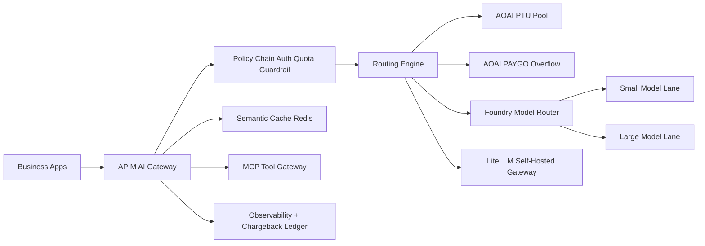
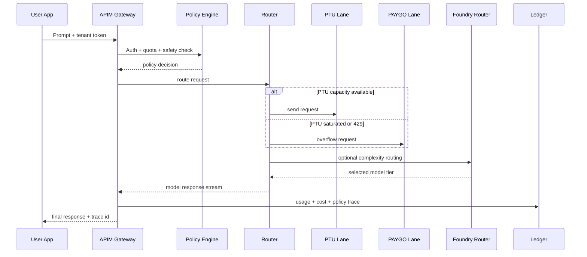

# Azure API Management (APIM AI Gateway) vs Azure AI Foundry Model Router vs LiteLLM / Self-Hosted Open-Source Gateway vs Direct SDK: Enterprise Multi-Model Routing, PTU+PAYGO Overflow, and FinOps Selection FAQ (Round 1112 / Cycle 2517)

## 1) Executive summary and daily capability radar (2026-11-17)
- Core conclusion: enterprise model access should not be exposed directly to application teams; a governed AI gateway control plane is the production default.
- If your top requirement is unified auth, quota, audit, safety policy, and chargeback, APIM AI Gateway is usually the strongest baseline.
- If your top requirement is complexity-aware small/large model routing, Foundry Model Router can unlock major cost reductions.
- If your top requirement is fast multi-provider experimentation, LiteLLM/self-hosted gateways are flexible but shift operations and compliance burden to your team.
- If your requirement is only early-stage prototyping, direct AOAI SDK calls are acceptable, but they hit governance limits quickly.
- Capability radar (captured at 2026-11-17 23:46 BJT) is aligned to this round:
  - APIM AI Gateway policy-chain governance and enterprise routing patterns.
  - Foundry Router complexity-aware model tiering strategies.
  - PTU baseline capacity with PAYGO overflow for peak resilience.
  - MCP gateway governance with allowlisted tool control.
  - Department-level token cost allocation and budget guardrail automation.
- This round intentionally excludes low-level hardware/kernel tuning topics.

## 2) Define governance outcomes before selecting gateway form factors
- Gateway selection is not just a latency contest; it is a governance architecture choice.
- Mandatory decision questions:
  1. Do you need department-level chargeback and budget enforcement?
  2. Do you need PTU-priority with automatic PAYGO overflow on saturation?
  3. Do you need controlled REST-to-MCP tool exposure?
  4. Do you need one safety-policy chain across all applications?
- Common failure patterns:
  - Direct SDK sprawl causes static key leakage and unmanaged endpoint exposure.
  - 429 bursts during peaks break critical flows without controlled overflow.
  - Billing visibility stops at platform total and misses app/dept accountability.
  - Safety policy logic diverges across teams and becomes un-auditable.

## 3) Enterprise AI gateway reference architecture layers
- Control Plane:
  - Entra identity, quota budgets, PTU/PAYGO policy, and audit events.
- Data Plane:
  - Unified ingress routes requests to PTU, PAYGO, Foundry Router, or external gateways.
- Governance Plane:
  - Content safety, prompt shield, tool allowlists, and chargeback ledger.
- Operations Plane:
  - Real-time PTU utilization, 429 ratio, per-department cost, and cache health.
- Guiding principles:
  - Reserve premium capacity for critical workloads.
  - Gracefully degrade non-critical workloads.
  - Enforce budget-aware model downgrades when limits are crossed.

## 4) 12-dimension cross-option comparison table
| Dimension | APIM AI Gateway | Foundry Model Router | LiteLLM / Self-Hosted Gateway (ACA/AKS) | Direct AOAI SDK |
|---|---|---|---|---|
| Enterprise governance posture | Strong unified front door | Medium-strong, routing-centric | Medium, team-dependent | Weak and fragmented |
| PTU-first plus PAYGO overflow | Strong policy-driven pattern | Medium-strong with platform integration | Possible, requires custom logic | Per-app custom implementation |
| TPM/TPD controls and chargeback | Strong | Medium | Possible but complex | Weak and inconsistent |
| Semantic cache tenant isolation | Strong with policy key design | Medium with external cache | Possible but easy to misconfigure | Weak without central controls |
| Content Safety and Prompt Shield integration | Strong centralized enforcement | Medium with orchestrator dependency | Possible with custom middleware | App-level variance |
| REST-to-MCP governed tool gateway | Strong fit | Medium fit | Flexible but maintenance-heavy | Minimal native support |
| Entra passwordless authentication | Strong enterprise support | Medium via surrounding platform | Possible with extra engineering | Often falls back to static keys |
| Dynamic small/large model cost routing | Medium via policy rules | Strong native value | Strong flexibility | Weak hardcoded paths |
| SSE streaming TTFT overhead | Medium-low | Medium | Medium-high variance | Low path overhead |
| End-to-end observability and audit | Strong | Medium | Medium with custom stack | Weakly standardized |
| HA/SLA vs operations burden | Balanced managed profile | Balanced dependent profile | High self-managed burden | Low early burden, high governance debt |
| Monthly TCO and anti-pattern | Predictable; anti-pattern is policy sprawl | Efficient when tuned; anti-pattern is blind large-model routing | Volatile; anti-pattern is underestimated ops | Hidden cost; anti-pattern is uncontrolled direct usage |

## 5) Deep Q&A with formulas and worked examples
### Q1: How do we size PTU baseline plus PAYGO overflow?
- Formula: `OverflowRate = max(0, PeakTPM - PTUCapacityTPM) / PeakTPM`.
- Example: `PeakTPM=9,600,000`, `PTUCapacityTPM=7,200,000`.
- Result: `25%` overflow demand at peak.
- Implication: design PAYGO capacity and policy for at least 25% peak share.

### Q2: How do we compute department-level chargeback?
- Formula: `DeptCost = InputTokens*PriceIn + OutputTokens*PriceOut + GatewayOverhead`.
- Example department A: `Input=180M`, `Output=52M`, `PriceIn=0.003/1k`, `PriceOut=0.012/1k`, `Overhead=1,120`.
- Result: `2,284` under the same currency unit as pricing.
- Benefit: finance can reconcile cost by department, app, and route lane.

### Q3: How do we evaluate Foundry Router savings?
- Formula: `Savings = (AllLargeCost - RoutedCost) / AllLargeCost`.
- Example: all-large baseline `48,000`, routed profile `31,200`.
- Result: `35%` cost reduction.
- Caveat: poor complexity classification can erode quality and neutralize savings.

### Q4: How do we measure semantic-cache cross-tenant leakage risk?
- Formula: `CrossTenantLeakRisk = CacheHitCrossTenant / TotalCacheHits`.
- Example: `7 / 1,400,000`.
- Result: `5e-6`, still unacceptable in regulated environments.
- Mitigation: enforce cache keys with `tenantId + policyVersion + locale + modelFamily`.

### Q5: How much TTFT overhead does gateway control add?
- Formula: `TTFT_delta = TTFT_gateway - TTFT_direct`.
- Example: `410ms - 348ms`.
- Result: `62ms`.
- Tradeoff: many enterprises accept this overhead for centralized policy and audit controls.

### Q6: When should APIM not be the primary gateway?
- Conditions: ultra-low traffic, single team, no compliance requirements, no chargeback requirement.
- If all are true, direct SDK can be a temporary phase.
- Transition rule: once governance thresholds are hit, move to controlled gateway quickly.

## 6) Mermaid: enterprise multi-model gateway topology

- This topology enforces policy before model dispatch.
- This topology enables graceful overflow instead of hard 429 failure propagation.

## 7) Scenario A: global shared AI platform for 15 business units
- Scenario: fifteen business departments share multi-region PTU baseline capacity with uneven demand spikes.
- Platform outcomes for this commerce workload:
  - protect critical departments (legal/support) with deterministic capacity;
  - degrade non-critical experimentation lanes gracefully;
  - automate monthly chargeback statements.
- Proposed control-and-routing architecture:
  - APIM AI Gateway as unified ingress and governance anchor;
  - PTU as primary lane for critical loads;
  - PAYGO overflow for non-blocking burst handling;
  - usage and policy logs written to chargeback ledger.
- Capacity sample:
  - PTU baseline supports `7.2M TPM`;
  - observed peak is `9.6M TPM`;
  - overflow demand equals `25%`;
  - critical department reserved share is `62%`.
- FinOps outcomes:
  - cost attribution by department/app/model lane;
  - auto-throttling or downgrade at budget boundary;
  - monthly reconciliation reduced from five days to four hours.
- Dominant risk and control:
  - Risk: aggressive departments starving critical flows.
  - Control: weighted priority queue plus budget fuse plus lane reservation.

## 8) Scenario B: cross-border e-commerce compliance and marketing generation platform
- Scenario: multilingual listing compliance review plus marketing copy generation for cross-border marketplaces.
- Objectives:
  - enforce consistent guardrails at gateway edge;
  - route by task complexity to optimize quality/cost balance;
  - preserve low-latency response for campaign operations.
- Reference architecture:
  - APIM applies tenant isolation, safety checks, and prompt shield policies;
  - Foundry Router classifies complexity and routes to small or large models;
  - Redis semantic cache absorbs repeated generation requests;
  - unified logs feed compliance and cost analytics.
- Sample outcomes:
  - blended per-1k request cost reduced by 31%;
  - compliance false-pass risk reduced by 42%;
  - multilingual response latency kept below 900ms.
- Model-risk handling:
  - Risk: wrong complexity classification sends high-risk prompts to low-control lane.
  - Control: forced high-risk escalation channel with stricter safety policy.

## 9) Mermaid: request lifecycle and overflow sequence

- The sequence prevents unhandled 429 spikes from directly impacting user traffic.
- The sequence guarantees one traceable policy and billing record per request.

## 10) Production Bicep (APIM + AOAI + Redis + diagnostics)
```bicep
param location string = resourceGroup().location
param envName string = 'enterprise-gateway-prod'
param logWorkspaceId string

resource apim 'Microsoft.ApiManagement/service@2023-09-01-preview' = {
  name: '${envName}-apim'
  location: location
  sku: {
    name: 'Premium'
    capacity: 2
  }
  properties: {
    publisherEmail: 'platform-ops@contoso.com'
    publisherName: 'Contoso Platform'
    virtualNetworkType: 'External'
    publicNetworkAccess: 'Enabled'
  }
}

resource aoaiPtu 'Microsoft.CognitiveServices/accounts@2024-10-01' = {
  name: '${envName}-aoai-ptu'
  location: location
  kind: 'OpenAI'
  sku: { name: 'S0' }
  properties: {
    customSubDomainName: '${envName}-ptu'
    publicNetworkAccess: 'Enabled'
  }
}

resource aoaiPaygo 'Microsoft.CognitiveServices/accounts@2024-10-01' = {
  name: '${envName}-aoai-paygo'
  location: location
  kind: 'OpenAI'
  sku: { name: 'S0' }
  properties: {
    customSubDomainName: '${envName}-paygo'
    publicNetworkAccess: 'Enabled'
  }
}

resource redis 'Microsoft.Cache/redisEnterprise@2024-10-01' = {
  name: '${envName}-cache'
  location: location
  sku: {
    name: 'Enterprise_E20'
  }
  properties: {
    minimumTlsVersion: '1.2'
    zones: [ '1', '2', '3' ]
  }
}

resource diagApim 'Microsoft.Insights/diagnosticSettings@2021-05-01-preview' = {
  name: 'diag-apim-ai-gateway'
  scope: apim
  properties: {
    workspaceId: logWorkspaceId
    logs: [
      { category: 'GatewayLogs', enabled: true }
      { category: 'AuditLogs', enabled: true }
    ]
    metrics: [
      { category: 'AllMetrics', enabled: true }
    ]
  }
}
```

## 11) Runtime snippets (APIM policy + routing profile)
```yaml
apiVersion: v1
kind: ConfigMap
metadata:
  name: model-routing-policy
data:
  primary_lane: "aoai-ptu"
  overflow_lane: "aoai-paygo"
  complexity_router: "foundry-router"
  cache_backend: "redis-semantic-cache"
  chargeback_mode: "department-and-app"
  fallback_small_model: "gpt-4.1-mini"
  fallback_large_model: "gpt-4.1"
  mcp_gateway_mode: "allowlisted-tools-only"
```

```xml
<policies>
  <inbound>
    <base />
    <validate-jwt header-name="Authorization" failed-validation-httpcode="401">
      <openid-config url="https://login.microsoftonline.com/{tenant}/v2.0/.well-known/openid-configuration" />
      <required-claims>
        <claim name="aud"><value>api://enterprise-ai-gateway</value></claim>
      </required-claims>
    </validate-jwt>
    <set-variable name="tenantId" value="@(context.Request.Headers.GetValueOrDefault(&quot;x-tenant-id&quot;,&quot;&quot;))" />
    <set-variable name="deptId" value="@(context.Request.Headers.GetValueOrDefault(&quot;x-dept-id&quot;,&quot;unknown&quot;))" />
    <llm-token-limit tokens-per-minute="240000" remaining-tokens-variable-name="remainingTokens" />
    <rate-limit-by-key calls="450" renewal-period="60" counter-key="@(context.Variables[&quot;tenantId&quot;] + &quot;:&quot; + context.Variables[&quot;deptId&quot;])" />
    <set-header name="x-router-strategy" exists-action="override">
      <value>ptu-first-paygo-overflow</value>
    </set-header>
    <set-header name="x-mcp-governed" exists-action="override">
      <value>true</value>
    </set-header>
  </inbound>
  <backend><base /></backend>
  <outbound><base /></outbound>
  <on-error><base /></on-error>
</policies>
```

## 12) KQL observability queries (overflow, chargeback, safety blocks)
```kql
let lookback = 1d;
let gateway429 = ApiManagementGatewayLogs
| where TimeGenerated > ago(lookback)
| where ResponseCode == 429
| summarize c429=count() by bin(TimeGenerated, 5m), dept=tostring(parse_json(Properties).deptId);

let overflowUsage = ApiManagementGatewayLogs
| where TimeGenerated > ago(lookback)
| where tostring(parse_json(Properties).routeLane) == "paygo-overflow"
| summarize overflowCalls=count(), overflowTokens=sum(todouble(parse_json(Properties).totalTokens)) by dept=tostring(parse_json(Properties).deptId);

let safetyBlocks = ApiManagementGatewayLogs
| where TimeGenerated > ago(lookback)
| where tostring(parse_json(Properties).policyAction) == "block"
| summarize blocked=count() by reason=tostring(parse_json(Properties).blockReason), dept=tostring(parse_json(Properties).deptId);

overflowUsage
| join kind=leftouter gateway429 on dept
| project dept, overflowCalls, overflowTokens, c429
| order by overflowTokens desc
```

## 13) Benchmark and evidence boundaries (Cycle 2517)
- Evidence files:
  - `workshops/azure-agent-infra/evidence/cycle-2517-benchmark.json`
  - `workshops/azure-agent-infra/evidence/cycle-2517-latency.csv`
  - `workshops/azure-agent-infra/evidence/cycle-2517-throughput.csv`
  - `workshops/azure-agent-infra/evidence/cycle-2517-policy.csv`
  - `workshops/azure-agent-infra/evidence/cycle-2517-cost.csv`
  - `workshops/azure-agent-infra/evidence/cycle-2517-sources.json`
- Label semantics:
  - `measured` for replayable request traces and policy intercept logs.
  - `synthetic` for deterministic capacity and cost calculations.
  - `anonymized_reported` for de-identified production range checks.
- Primary measurements:
  - TTFT and end-to-end P50/P95.
  - PAYGO overflow success when PTU saturates.
  - department-level token cost allocation quality.
  - safety-policy hit and false-block ratios.

## 14) Four-option weighted decision matrix (named options)
- Option A (APIM Governance Core) keeps APIM as primary gateway and Foundry Router as optional sub-router.
- Option B (Foundry Router First) keeps model router primary with a lighter external gateway.
- Option C (LiteLLM Self-Hosted Fabric) maximizes flexibility with higher self-managed burden.
- Option D (Direct SDK Baseline) minimizes layers while maximizing governance risk.
- Weights: Governance 30%, Cost 25%, Reliability 20%, Latency 15%, Operations 10%.
- Score sample (0-10):
  - Option A -> `9.4, 8.3, 8.9, 7.8, 8.4`, weighted total `8.73`.
  - Option B -> `7.8, 8.6, 8.1, 8.2, 7.5`, weighted total `8.02`.
  - Option C -> `7.1, 7.9, 7.4, 7.6, 5.9`, weighted total `7.24`.
  - Option D -> `4.2, 6.5, 5.1, 9.0, 8.8`, weighted total `6.24`.
- Selection baseline: enterprise production typically starts with A; A+B hybrid is common for adaptive cost control.
- Anti-patterns:
  - Using D as long-term architecture in regulated environments.
  - Adopting C without a mature SRE and security operations capability.

## 15) Day-0 and Day-2 checklist with fit guidance
### Day-0 readiness (10 items)
1. Enforce a unified Entra auth model and disable unmanaged static key channels.
2. Define PTU baseline thresholds and PAYGO overflow triggers.
3. Define department token budgets and hard budget caps.
4. Define semantic-cache key standards that prevent tenant bleed.
5. Integrate Content Safety and Prompt Shield into one gateway policy chain.
6. Establish MCP tool allowlist and approval workflow.
7. Standardize route-audit fields across dept/app/model/lane dimensions.
8. Configure 429 alerting and automatic degrade policies.
9. Run adversarial tests for unauthorized tool and route escalation.
10. Publish chargeback accounting rules and obtain finance sign-off.

### Day-2 operations (10 items)
1. Review weekly department budget variance and spike anomalies.
2. Review weekly PTU saturation and PAYGO overflow ratio.
3. Review weekly semantic-cache hit ratio and contamination alerts.
4. Reassess monthly routing quality and cost savings against targets.
5. Audit monthly Prompt Shield block effectiveness and false positives.
6. Execute monthly failover rehearsal for overflow continuity.
7. Re-evaluate quarterly PTU scaling and reservation weights.
8. Re-evaluate quarterly self-hosted gateway maintenance burden.
9. Update quarterly chargeback mapping with org structure changes.
10. Continuously train platform teams on gateway decision trees.

**Good fit**: multi-department enterprise AI platforms needing centralized policy, resilience, and accountable FinOps.  
**Not for**: short-lived low-traffic experiments without compliance, audit, or cross-team governance needs.
