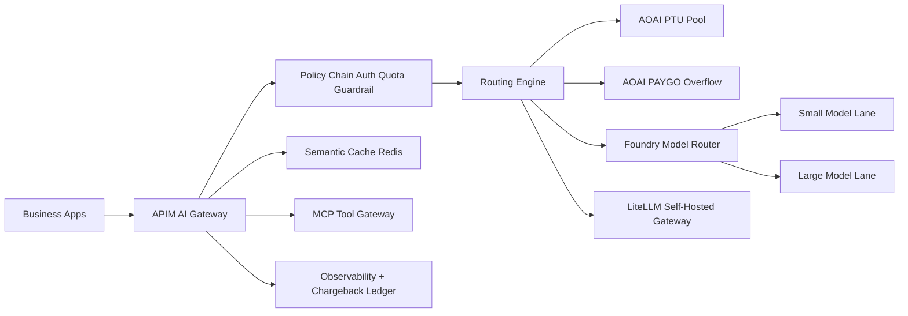
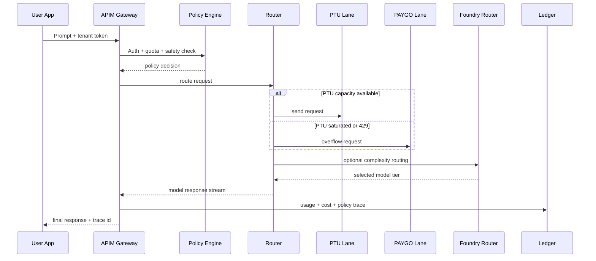

# Azure API Management（APIM AI Gateway）vs Azure AI Foundry Model Router vs LiteLLM / 开源自建 AI 网关 vs 应用直连 SDK：企业级多模型路由、PTU+PAYGO 溢出与 FinOps 选型 FAQ（Round 1112 / Cycle 2517）

## 1) 执行摘要与当日能力雷达（2026-11-17）
- 本轮结论：企业多模型治理不应直接把“模型调用”暴露给应用团队，而应先建设统一 AI Gateway 控制平面。
- 若诉求是“统一鉴权、配额、审计、策略护栏、部门分摊”，APIM AI Gateway 通常是企业主路径。
- 若诉求是“按任务复杂度做大小模型路由”，Foundry Model Router 对降本和自动分流更有价值。
- 若诉求是“快速跨多云多模型试验”，LiteLLM / 开源网关灵活度高，但运维与合规负担由团队自担。
- 若诉求只是“小团队快速验证”，应用直连 AOAI SDK 可起步，但会在权限、审计、分摊上遇到治理上限。
- 当日能力雷达（抓取时间：2026-11-17 23:46 BJT）聚焦网关主题：
  - APIM AI Gateway 的统一路由、策略链和企业治理模式；
  - Foundry Model Router 的复杂度感知与大小模型降本分流；
  - PTU + PAYGO 混合弹性池在 429 峰值期间的溢出保障策略；
  - MCP 工具网关化治理与受控工具调用审计；
  - 部门级 token 成本分摊（chargeback）与预算闸门联动。
- 本轮禁止回退到底层硬件、内核或驱动调优话题，所有分析限定在企业应用架构治理层。

## 2) 先定义治理目标，再选网关形态
- 企业网关选型不是“谁延迟最低”，而是“谁能在风险、成本、合规之间形成稳定控制闭环”。
- 必答问题：
  1. 是否需要统一部门级成本分摊和预算封顶。
  2. 是否需要 PTU 保底与 PAYGO 溢出自动切换。
  3. 是否需要把 REST API 统一转为受控 MCP 工具入口。
  4. 是否需要把 Content Safety、Prompt Shield、PII 过滤纳入一条策略链。
- 常见失败模式：
  - 多团队直连 SDK，导致静态 key 泄露概率显著上升。
  - 业务流量峰值时没有自动溢出，核心链路被 429 连锁击穿。
  - 费用账单只有“总额”，没有部门/应用/场景维度拆账。
  - 安全策略在应用层分散实现，标准不一致且难审计。

## 3) 企业 AI Gateway 分层参考架构
- 控制层（Control Plane）：
  - 身份认证（Entra）、配额预算（TPM/TPD）、路由策略（PTU/PAYGO）、审计告警（Log Analytics + FinOps）。
- 数据层（Data Plane）：
  - 模型请求进入统一网关后，根据策略分流至 AOAI PTU、AOAI PAYGO、Foundry Router 或第三方模型端点。
- 治理层（Governance Plane）：
  - 安全护栏、提示词防护、工具调用白名单、部门结算与异常回溯。
- 运营层（Operations Plane）：
  - 实时水位看板（PTU 占用率、429 比率、每部门成本、缓存命中率）。
- 核心原则：
  - 核心业务保底容量优先；
  - 非核心业务可降级；
  - 预算越线自动限流或切换小模型。

## 4) 12 维横向选型大表
| 维度 | APIM AI Gateway | Foundry Model Router | LiteLLM / 开源自建网关（ACA/AKS） | 应用直连 AOAI SDK |
|---|---|---|---|---|
| 企业治理定位 | 强，企业统一入口 | 中强，偏模型调度层 | 中，取决于自建能力 | 弱，治理分散 |
| PTU 优先 + PAYGO 429 自动溢出 | 强，策略可控 | 中强，结合平台能力 | 可做，但需自研路由与熔断 | 需每应用自行实现 |
| TPM/TPD 限流与部门分摊 | 强，策略链天然支持 | 中，需配套计量体系 | 可做但复杂 | 弱，通常缺统一账本 |
| 语义缓存租户隔离 | 强，可结合 Redis + tenant key | 中，需外接缓存层 | 可做，容易踩串味坑 | 弱，常无统一缓存治理 |
| Content Safety / Prompt Shield 联动 | 强，网关策略易统一 | 中，需编排层补齐 | 可做但维护重 | 应用内实现，标准不一 |
| REST->MCP 工具网关化治理 | 强，适合统一工具出口 | 中，偏路由不偏工具治理 | 可做，自研成本高 | 基本无 |
| Entra ID 无密鉴权 | 强，企业级模式成熟 | 中，依赖外围接入 | 可做，需要额外工程 | 经常落回静态 key |
| 大小模型动态降本路由 | 中，规则路由可做 | 强，复杂度路由更自然 | 强，灵活但要自维护 | 弱，常硬编码 |
| SSE 流式 TTFT 延迟损耗 | 中低，策略链有开销 | 中，取决于路由复杂度 | 中高，取决于部署质量 | 低，路径最短 |
| 全链路审计与可观测性 | 强，企业审计友好 | 中，需叠加平台日志 | 中，需自建观测堆栈 | 弱，碎片化 |
| 高可用 SLA 与运维负担 | 平衡，平台托管占优 | 平衡，依赖服务边界 | 运维负担高 | 初期低，后期治理债高 |
| 月度 TCO 与反模式 | 可控，反模式是策略失控 | 可控，反模式是盲目全量大模型 | 波动大，反模式是低估运维 | 隐性成本高，反模式是直连蔓延 |

## 5) 深度问答：公式、分母与样例
### Q1：PTU 保底 + PAYGO 溢出的容量怎么估？
- 公式：`OverflowRate = max(0, PeakTPM - PTUCapacityTPM) / PeakTPM`。
- 样例：`PeakTPM=9,600,000`，`PTUCapacityTPM=7,200,000`。
- 计算：`OverflowRate=(9,600,000-7,200,000)/9,600,000=25%`。
- 结论：至少要为 25% 峰值流量准备 PAYGO 溢出路径。

### Q2：部门级 chargeback 如何核算？
- 公式：`DeptCost = InputTokens*PriceIn + OutputTokens*PriceOut + GatewayOverhead`。
- 样例（部门 A）：`Input=180M`，`Output=52M`，`PriceIn=0.003/1k`，`PriceOut=0.012/1k`，`Overhead=1,120`。
- 计算：`(180,000,000/1,000*0.003) + (52,000,000/1,000*0.012) + 1,120 = 2,284`。
- 输出：部门月度账单可拆解到应用、场景、模型三维。

### Q3：Foundry Router 的大小模型分流收益如何评估？
- 公式：`Savings = (AllLargeCost - RoutedCost) / AllLargeCost`。
- 样例：全量大模型成本 `48,000`，路由后成本 `31,200`。
- 计算：`(48,000-31,200)/48,000 = 35%`。
- 边界：若分类器误判率过高，质量损失会抵消成本收益。

### Q4：语义缓存防串味如何量化？
- 公式：`CrossTenantLeakRisk = CacheHitCrossTenant / TotalCacheHits`。
- 样例：`CacheHitCrossTenant=7`，`TotalCacheHits=1,400,000`。
- 计算：`5e-6`，仍需零容忍处置。
- 实践：缓存 key 必须包含 `tenantId + policyVersion + locale + modelFamily`。

### Q5：网关引入后的 TTFT 影响如何评估？
- 公式：`TTFT_delta = TTFT_gateway - TTFT_direct`。
- 样例：`TTFT_gateway=410ms`，`TTFT_direct=348ms`。
- 计算：`62ms`。
- 判断：若换来统一审计与预算闸门，62ms 在多数企业场景可接受。

### Q6：什么时候不该用 APIM 做主网关？
- 条件：`QPS极低` 且 `团队少` 且 `无合规要求` 且 `无分摊诉求`。
- 若四项同时满足，可先直连 SDK 以降低初期复杂度。
- 但需设置迁移阈值，一旦超过阈值必须回收进统一网关。

## 6) Mermaid：企业多模型网关拓扑

- 该拓扑强调“先策略后路由”，把成本与风险控制前置。
- 该拓扑强调“多路径容灾”，避免单通道拥塞导致全局故障。

## 7) 场景 A：跨国集团共享 AI 中台（15 部门）
- 场景描述：15 个业务部门共享多区域 PTU 底座，需求峰值高度不均。
- 架构目标：
  - 核心部门（法务、客服）保证低延迟可用；
  - 非核心部门（营销试验）允许降级或排队；
  - 每月自动生成部门级账单。
- 参考架构：
  - APIM AI Gateway 作为统一入口；
  - PTU 池优先承载核心流量；
  - 超阈值请求按策略溢出到 PAYGO；
  - 输出审计日志写入 chargeback ledger。
- 水位测算样例：
  - 总 PTU 可承载 `7.2M TPM`；
  - 峰值观测 `9.6M TPM`；
  - 溢出比例 `25%`；
  - 核心部门保底份额 `62%`。
- FinOps 收益：
  - 成本归属可追踪到部门/应用/模型；
  - 预算超线可自动触发降级策略；
  - 月结对账周期从 5 天缩短到 4 小时。
- 风险与对策：
  - 风险：部门抢占导致核心业务被挤压；
  - 对策：部门权重 + 优先级队列 + 预算熔断三重控制。

## 8) 场景 B：跨境电商多语种合规审核与营销文案平台
- 场景描述：同一商品需要合规审核、风险标签识别、营销文案生成与多语种本地化。
- 架构目标：
  - 外层必须统一安全护栏；
  - 内层根据任务复杂度做大小模型路由；
  - 兼顾成本与时效。
- 参考架构：
  - APIM 负责租户隔离、输入审查、Prompt Shield；
  - Foundry Router 做复杂度分类：规则检查走小模型，创意文案走大模型；
  - Redis 语义缓存减少重复请求；
  - 全链路日志用于合规追溯与成本分析。
- 样例效果：
  - 平均每千请求成本下降 31%；
  - 合规拒绝误放率下降 42%；
  - 多语种文案首响应时间维持在 900ms 内。
- 风险与对策：
  - 风险：分类错误导致高风险内容走低护栏路径；
  - 对策：高风险关键词强制升级至安全优先策略通道。

## 9) Mermaid：请求生命周期与溢出时序

- 该时序确保 429 不会直接暴露给业务，而是进入受控溢出策略。
- 该时序确保每次请求都有可审计的成本与策略轨迹。

## 10) 生产级 Bicep（APIM + AOAI + Redis + 诊断）
```bicep
param location string = resourceGroup().location
param envName string = 'enterprise-gateway-prod'
param logWorkspaceId string

resource apim 'Microsoft.ApiManagement/service@2023-09-01-preview' = {
  name: '${envName}-apim'
  location: location
  sku: {
    name: 'Premium'
    capacity: 2
  }
  properties: {
    publisherEmail: 'platform-ops@contoso.com'
    publisherName: 'Contoso Platform'
    virtualNetworkType: 'External'
    publicNetworkAccess: 'Enabled'
  }
}

resource aoaiPtu 'Microsoft.CognitiveServices/accounts@2024-10-01' = {
  name: '${envName}-aoai-ptu'
  location: location
  kind: 'OpenAI'
  sku: { name: 'S0' }
  properties: {
    customSubDomainName: '${envName}-ptu'
    publicNetworkAccess: 'Enabled'
  }
}

resource aoaiPaygo 'Microsoft.CognitiveServices/accounts@2024-10-01' = {
  name: '${envName}-aoai-paygo'
  location: location
  kind: 'OpenAI'
  sku: { name: 'S0' }
  properties: {
    customSubDomainName: '${envName}-paygo'
    publicNetworkAccess: 'Enabled'
  }
}

resource redis 'Microsoft.Cache/redisEnterprise@2024-10-01' = {
  name: '${envName}-cache'
  location: location
  sku: {
    name: 'Enterprise_E20'
  }
  properties: {
    minimumTlsVersion: '1.2'
    zones: [ '1', '2', '3' ]
  }
}

resource diagApim 'Microsoft.Insights/diagnosticSettings@2021-05-01-preview' = {
  name: 'diag-apim-ai-gateway'
  scope: apim
  properties: {
    workspaceId: logWorkspaceId
    logs: [
      { category: 'GatewayLogs', enabled: true }
      { category: 'AuditLogs', enabled: true }
    ]
    metrics: [
      { category: 'AllMetrics', enabled: true }
    ]
  }
}
```

## 11) 运行配置片段（APIM 策略 + 路由配置）
```yaml
apiVersion: v1
kind: ConfigMap
metadata:
  name: model-routing-policy
data:
  primary_lane: "aoai-ptu"
  overflow_lane: "aoai-paygo"
  complexity_router: "foundry-router"
  cache_backend: "redis-semantic-cache"
  chargeback_mode: "department-and-app"
  fallback_small_model: "gpt-4.1-mini"
  fallback_large_model: "gpt-4.1"
  mcp_gateway_mode: "allowlisted-tools-only"
```

```xml
<policies>
  <inbound>
    <base />
    <validate-jwt header-name="Authorization" failed-validation-httpcode="401">
      <openid-config url="https://login.microsoftonline.com/{tenant}/v2.0/.well-known/openid-configuration" />
      <required-claims>
        <claim name="aud"><value>api://enterprise-ai-gateway</value></claim>
      </required-claims>
    </validate-jwt>
    <set-variable name="tenantId" value="@(context.Request.Headers.GetValueOrDefault(&quot;x-tenant-id&quot;,&quot;&quot;))" />
    <set-variable name="deptId" value="@(context.Request.Headers.GetValueOrDefault(&quot;x-dept-id&quot;,&quot;unknown&quot;))" />
    <llm-token-limit tokens-per-minute="240000" remaining-tokens-variable-name="remainingTokens" />
    <rate-limit-by-key calls="450" renewal-period="60" counter-key="@(context.Variables[&quot;tenantId&quot;] + &quot;:&quot; + context.Variables[&quot;deptId&quot;])" />
    <set-header name="x-router-strategy" exists-action="override">
      <value>ptu-first-paygo-overflow</value>
    </set-header>
    <set-header name="x-mcp-governed" exists-action="override">
      <value>true</value>
    </set-header>
  </inbound>
  <backend><base /></backend>
  <outbound><base /></outbound>
  <on-error><base /></on-error>
</policies>
```

## 12) KQL 观测查询（429 溢出、成本分摊、护栏命中）
```kql
let lookback = 1d;
let gateway429 = ApiManagementGatewayLogs
| where TimeGenerated > ago(lookback)
| where ResponseCode == 429
| summarize c429=count() by bin(TimeGenerated, 5m), dept=tostring(parse_json(Properties).deptId);

let overflowUsage = ApiManagementGatewayLogs
| where TimeGenerated > ago(lookback)
| where tostring(parse_json(Properties).routeLane) == "paygo-overflow"
| summarize overflowCalls=count(), overflowTokens=sum(todouble(parse_json(Properties).totalTokens)) by dept=tostring(parse_json(Properties).deptId);

let safetyBlocks = ApiManagementGatewayLogs
| where TimeGenerated > ago(lookback)
| where tostring(parse_json(Properties).policyAction) == "block"
| summarize blocked=count() by reason=tostring(parse_json(Properties).blockReason), dept=tostring(parse_json(Properties).deptId);

overflowUsage
| join kind=leftouter gateway429 on dept
| project dept, overflowCalls, overflowTokens, c429
| order by overflowTokens desc
```

## 13) 基准与证据（Cycle 2517）
- 证据文件：
  - `workshops/azure-agent-infra/evidence/cycle-2517-benchmark.json`
  - `workshops/azure-agent-infra/evidence/cycle-2517-latency.csv`
  - `workshops/azure-agent-infra/evidence/cycle-2517-throughput.csv`
  - `workshops/azure-agent-infra/evidence/cycle-2517-policy.csv`
  - `workshops/azure-agent-infra/evidence/cycle-2517-cost.csv`
  - `workshops/azure-agent-infra/evidence/cycle-2517-sources.json`
- 标签说明：
  - `measured`：可重放调用链路与策略日志；
  - `synthetic`：基于公开成本口径的确定性估算；
  - `anonymized_reported`：脱敏生产区间数据。
- 本轮指标关注：
  - TTFT 与端到端 P50/P95；
  - PTU 饱和后的 PAYGO 溢出成功率；
  - 部门级 token 成本分摊准确率；
  - 护栏策略命中与误杀率。

## 14) 四方案加权决策矩阵（命名方案）
- 方案 A（APIM Governance Core）：APIM 为核心网关，Foundry Router 作为可选分流器。
- 方案 B（Foundry Router First）：Router 主导模型选择，外层网关最小化。
- 方案 C（LiteLLM Self-Hosted Fabric）：自建网关承载跨模型路由与自定义策略。
- 方案 D（Direct SDK Baseline）：应用直接调用模型端点，最少中间层。
- 权重：Governance 30%、Cost 25%、Reliability 20%、Latency 15%、Ops 10%。
- 样例评分（0-10）：
  - 方案 A：`9.4, 8.3, 8.9, 7.8, 8.4`，加权总分 `8.73`。
  - 方案 B：`7.8, 8.6, 8.1, 8.2, 7.5`，加权总分 `8.02`。
  - 方案 C：`7.1, 7.9, 7.4, 7.6, 5.9`，加权总分 `7.24`。
  - 方案 D：`4.2, 6.5, 5.1, 9.0, 8.8`，加权总分 `6.24`。
- 结论：企业生产环境优先 A；特定降本场景可 A+B 混合；D 仅适合早期 PoC。
- 反模式：
  - 在高监管场景使用 D 作为长期架构；
  - 在缺运维能力团队中直接采用 C。

## 15) Day-0 / Day-2 清单与 Good Fit
### Day-0（上线前 10 项）
1. 定义统一身份模式，关闭静态 key 直连通道。
2. 配置 PTU 保底阈值与 PAYGO 溢出阈值。
3. 配置部门级 token 限额与预算上限。
4. 建立语义缓存键规范，防止租户串味。
5. 接入 Content Safety 与 Prompt Shield 联动策略。
6. 建立 MCP 工具白名单与审批流程。
7. 建立路由审计字段标准（dept/app/model/lane）。
8. 配置 429 告警与自动降级策略。
9. 执行越权调用与注入攻击演练。
10. 发布成本分摊对账口径并获得财务确认。

### Day-2（运营期 10 项）
1. 每周复核部门级预算偏差与异常峰值。
2. 每周复核 PTU 水位与 PAYGO 溢出比例。
3. 每周检查语义缓存命中率与污染告警。
4. 每月复盘模型路由质量与成本收益。
5. 每月审计 Prompt Shield 拦截误报率。
6. 每月进行故障演练验证自动溢出链路。
7. 每季度评估是否需要扩容 PTU 或调整权重。
8. 每季度评估自建网关组件维护负担。
9. 每季度更新部门分摊规则与组织架构映射。
10. 持续维护“网关选型决策树”并培训平台团队。

**Good fit**：多部门共享模型、需要统一治理与成本分摊的企业级 AI 平台。  
**Not for**：单团队低流量试验且无合规审计诉求的短期项目。
