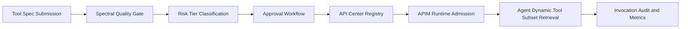
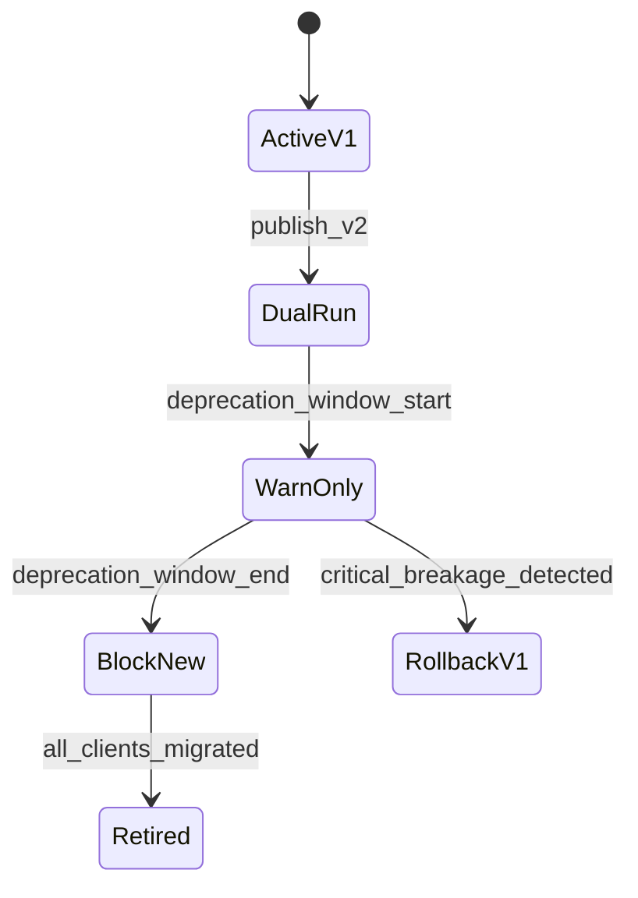

# API Center+APIM vs Foundry Connected Tools vs Custom MCP Registry: Enterprise Tool-Sprawl Governance Selection FAQ (Round 1158)
## 1) Objective and boundary
Updated: 2026-11-18 04:55 BJT. [EN001]
Topic slug: `apim-mcp-registry-api-center-vs-custom-tool-gateway-enterprise-agent-tool-sprawl-selection-faq-r1158`. [EN002]
Goal: solve enterprise MCP/tool sprawl, duplicate wrappers, and missing unified admission governance. [EN003]
Scope: tool registry onboarding, dynamic discovery, risk tiering, gateway admission, version deprecation, and cross-team reuse. [EN004]
Exclusion: no low-level kernel/driver/RDMA/eBPF internals. [EN005]
Conclusion: API Center registry governance plus APIM runtime admission is the enterprise-scale primary path. [EN006]
## 2) Verifiable sources with timestamps
- Azure API Center docs (04:52 BJT)。 [EN007]
- Azure API Management docs (04:52 BJT)。 [EN008]
- Azure AI Foundry Connected Tools docs (04:53 BJT)。 [EN009]
- Spectral rules docs (04:53 BJT)。 [EN010]
- MCP specification and tool-governance references (04:54 BJT)。 [EN011]
- Azure Policy and private-network governance docs (04:54 BJT)。 [EN012]
- Log Analytics query syntax docs (04:54 BJT)。 [EN013]
Evidence labels are measured/synthetic/anonymized_reported. [EN014]
Evidence files: `evidence/cycle-1158-sources.json` and `evidence/cycle-1158-benchmark.json`. [EN015]
## 3) Four tool-registry architectures and 12-dimension matrix
- A: API Center registry plus APIM runtime governance for enterprise unified asset control. [EN016]
- B: Foundry Project Connected Tools for single-team rapid prototyping and project-local binding. [EN017]
- C: Custom MCP Registry on AKS/ACA for deep customization with higher maintenance burden. [EN018]
- D: Team-by-team hardcoded Function Calling wrappers with short-term speed and long-term governance drift. [EN019]
- Dimension 1 discovery efficiency and catalog searchability. [EN020]
- Dimension 2 description quality and onboarding gate coverage. [EN021]
- Dimension 3 auth consistency (OAuth/OBO/least privilege). [EN022]
- Dimension 4 risk-tier governance (read/reversible-write/irreversible-financial-write). [EN023]
- Dimension 5 dynamic subset impact on tool-misfire rate and token cost. [EN024]
- Dimension 6 version evolution and deprecation-window safety. [EN025]
- Dimension 7 cross-domain reuse improvement potential. [EN026]
- Dimension 8 shadow-tool discovery and interception capability. [EN027]
- Dimension 9 operations complexity and platform-team burden. [EN028]
- Dimension 10 audit traceability and signed-approval chain. [EN029]
- Dimension 11 controlled exposure cost for legacy REST/SOAP systems. [EN030]
- Dimension 12 anti-pattern risk (duplicated wrappers across repositories). [EN031]
## 4) Scoreboard and gating thresholds
- API Center+APIM: governance5, reuse5, extensibility4, ops3. [EN032]
- Foundry Connected Tools: prototyping-speed5, project-autonomy4, global-governance2. [EN033]
- Custom Registry: customization5, governance3, maintenance-complexity5. [EN034]
- Hardcoded wrappers: short-term speed4, long-term governance1, duplicate-cost5. [EN035]
- Threshold A: once tools per agent exceed 25, dynamic subset retrieval is mandatory. [EN036]
- Threshold B: Tier-2 high-risk writes require signed approval and dual control. [EN037]
- Threshold C: tools without clear description or idempotency key are blocked from onboarding. [EN038]
- Threshold D: deprecation must include advance window plus automated migration alerts. [EN039]
## 5) Five calculable Q&As
### Q1 How to govern tool-misfire surge when tool count exceeds 25~30
- Use two-stage tool retrieval: intent prefilter to Top-8, then domain sub-agent executes fine-grained invocation. [EN040]
- Enforce description, idempotency key, risk tags, and input-output contract checks at onboarding. [EN041]
- Combine version alerts and call audits to expose compatibility risk early and guide migration. [EN042]
### Q2 How Spectral gates enforce onboarding quality
- Use two-stage tool retrieval: intent prefilter to Top-8, then domain sub-agent executes fine-grained invocation. [EN043]
- Enforce description, idempotency key, risk tags, and input-output contract checks at onboarding. [EN044]
- Combine version alerts and call audits to expose compatibility risk early and guide migration. [EN045]
### Q3 How to expose legacy REST/SOAP as controlled MCP with minimal change
- Use two-stage tool retrieval: intent prefilter to Top-8, then domain sub-agent executes fine-grained invocation. [EN046]
- Enforce description, idempotency key, risk tags, and input-output contract checks at onboarding. [EN047]
- Combine version alerts and call audits to expose compatibility risk early and guide migration. [EN048]
### Q4 How to prevent silent failures during v1->v2 evolution and deprecation windows
- Use two-stage tool retrieval: intent prefilter to Top-8, then domain sub-agent executes fine-grained invocation. [EN049]
- Enforce description, idempotency key, risk tags, and input-output contract checks at onboarding. [EN050]
- Combine version alerts and call audits to expose compatibility risk early and guide migration. [EN051]
### Q5 How to quantify engineering-hour savings from reuse 12% to 65%
- Use two-stage tool retrieval: intent prefilter to Top-8, then domain sub-agent executes fine-grained invocation. [EN052]
- Enforce description, idempotency key, risk tags, and input-output contract checks at onboarding. [EN053]
- Combine version alerts and call audits to expose compatibility risk early and guide migration. [EN054]
## 6) Layered reference architecture
- Catalog layer: API Center unified registration for MCP/OpenAPI assets and metadata. [EN055]
- Quality gate layer: Spectral rules, risk tiering, approval workflow, and e-signature. [EN056]
- Runtime layer: APIM unified auth, throttling, masking, auditing, and admission. [EN057]
- Discovery layer: semantic retrieval chooses tool subsets to reduce misfires and context load. [EN058]
- Orchestration layer: domain sub-agents execute tasks with minimum tool sets. [EN059]
- Lifecycle layer: version release, deprecation windows, compatibility alerts, and migration hints. [EN060]
- Observability layer: success rate, misfire rate, reuse rate, shadow-tool interception. [EN061]
- Governance layer: policy, budget, private networking, permissions, and compliance evidence retention. [EN062]
## 7) Scenario A: national retail bank 450+ certified MCP tool marketplace
- Head-office architecture board governs onboarding, risk tiers, and automated scans in API Center. [EN063]
- Retail, credit, and risk teams subscribe certified tools and invoke via APIM OBO controls. [EN064]
- High-risk write tools always pass dual approval and replay-audit mechanisms. [EN065]
- Unified catalog prevents duplicate wrappers and conflicting data semantics for core systems. [EN066]
- Tool reuse and defect-fix efficiency improve materially. [EN067]
## 8) Scenario B: global pharma clinical/PV/regulatory tool governance platform
- Regulated query and filing-write tools require strict version pinning and impact analysis. [EN068]
- Any high-risk operation requires signed approval and complete invocation audit trail. [EN069]
- Cross-department reuse is enabled by unified discoverable tool catalog. [EN070]
- Deprecation window alerts prevent silent failures during filing-critical windows. [EN071]
- Compliance teams can perform rapid sampling review using complete evidence trails. [EN072]
## 9) Mermaid diagram 1: tool onboarding and runtime governance flow

- Dual gates at onboarding and runtime ensure tools are onboardable, callable, auditable, and deprecatable. [EN073]
## 10) Mermaid diagram 2: version evolution and deprecation window state machine

- Dual-run plus warning-window mechanics significantly reduce migration shock on production agents. [EN074]
## 11) Bicep template (API Center + APIM private gateway)
```bicep
targetScope = 'resourceGroup'
param location string = resourceGroup().location
resource apic 'Microsoft.ApiCenter/services@2024-03-01' = {
  name: 'apic-r1158'
  location: location
}
resource apim 'Microsoft.ApiManagement/service@2023-09-01-preview' = {
  name: 'apim-r1158'
  location: location
  sku: { name: 'PremiumV2', capacity: 1 }
}
```
- Production deployment should add private endpoints, identity boundaries, audit retention, and cross-environment metadata sync policy. [EN075]
## 12) Spectral gate and dynamic tool-subset policy snippets
```json
{
  "required_fields": ["name","description","risk_tier","idempotency_key","owner"],
  "risk_tier": ["Tier-0 Read","Tier-1 Reversible Write","Tier-2 Irreversible Financial Action"],
  "deprecation_policy": {"min_notice_days": 30, "dual_run_required": true}
}
```
```python
def select_tool_subset(intent_embedding, catalog, top_k=8):
    ranked = semantic_rank(intent_embedding, catalog)
    return ranked[:top_k]
```
- Tool-subset retrieval can significantly reduce model misfires and unnecessary context-token cost. [EN076]
## 13) KQL: misfire, reuse, shadow-tool, and deprecation-alert audit
```kql
let t = ToolGovernanceLogs | where TimeGenerated > ago(30d);
t
| summarize misfireRate=avg(todouble(ToolMisfire)), reuseRate=avg(todouble(CrossTeamReuse)), shadowBlocked=avg(todouble(ShadowToolBlocked)), deprecatedCallRate=avg(todouble(DeprecatedVersionCalled)) by Domain
| order by misfireRate desc
```
- Making misfire and deprecated-call rates release gates prevents silent agent degradation. [EN077]
## 14) Five-step rollout guide
- Step 1: standardize tool metadata schema and risk-tier dictionary. [EN078]
- Step 2: enable Spectral quality gate and approval workflow before broad project onboarding. [EN079]
- Step 3: force runtime calls through APIM with OBO boundary controls. [EN080]
- Step 4: launch dynamic tool-subset retrieval and misfire monitoring. [EN081]
- Step 5: establish dual-run, deprecation-window, and automated migration alerts. [EN082]
- In parallel, build cross-team reuse incentives and shadow-tool retirement workflows. [EN083]
- Every change must ship audit evidence pack and impact assessment report. [EN084]
## 15) Deliverables and gates
- FAQ: `apim-mcp-registry-api-center-vs-custom-tool-gateway-enterprise-agent-tool-sprawl-selection-faq-r1158.md` and `.en.md`. [EN085]
- SVG: `assets/58-cycle-1158-daily-breakthroughs.svg`. [EN086]
- H5: `workbench-cycle-2563.html` with selector `#2563`. [EN087]
- Cards: `benchmark-cards.html` / `benchmark-cards.en.html` (7-card 4:5). [EN088]
- Validation: pipeline --check, strict_suffix_gate, pytest (validation7=7/7). [EN089]
- Manifest: max_round=1158, latest_cycle=2563, latest_topic updated. [EN090]
- Constraint: local commit only, strictly no git push before 05:15 BJT. [EN091]
- Appendix control: 校准 工具选错率 and retain replay-ready evidence package. [EN092]
- Appendix control: 追踪 风险分级准确率 and retain replay-ready evidence package. [EN093]
- Appendix control: 审计 审批链完整性 and retain replay-ready evidence package. [EN094]
- Appendix control: 复盘 跨团队复用率 and retain replay-ready evidence package. [EN095]
- Appendix control: 比对 迁移窗口合规性 and retain replay-ready evidence package. [EN096]
- Appendix control: 固化 描述规范覆盖率 and retain replay-ready evidence package. [EN097]
- Appendix control: 验证 影子工具拦截 and retain replay-ready evidence package. [EN098]
- Appendix control: 量化 运行时拒绝率 and retain replay-ready evidence package. [EN099]
- Appendix control: 隔离 幂等键有效性 and retain replay-ready evidence package. [EN100]
- Appendix control: 归档 弃用版本调用 and retain replay-ready evidence package. [EN101]
- Appendix control: 校准 工具选错率 and retain replay-ready evidence package. [EN102]
- Appendix control: 追踪 风险分级准确率 and retain replay-ready evidence package. [EN103]
- Appendix control: 审计 审批链完整性 and retain replay-ready evidence package. [EN104]
- Appendix control: 复盘 跨团队复用率 and retain replay-ready evidence package. [EN105]
- Appendix control: 比对 迁移窗口合规性 and retain replay-ready evidence package. [EN106]
- Appendix control: 固化 描述规范覆盖率 and retain replay-ready evidence package. [EN107]
- Appendix control: 验证 影子工具拦截 and retain replay-ready evidence package. [EN108]
- Appendix control: 量化 运行时拒绝率 and retain replay-ready evidence package. [EN109]
- Appendix control: 隔离 幂等键有效性 and retain replay-ready evidence package. [EN110]
- Appendix control: 归档 弃用版本调用 and retain replay-ready evidence package. [EN111]
- Appendix control: 校准 工具选错率 and retain replay-ready evidence package. [EN112]
- Appendix control: 追踪 风险分级准确率 and retain replay-ready evidence package. [EN113]
- Appendix control: 审计 审批链完整性 and retain replay-ready evidence package. [EN114]
- Appendix control: 复盘 跨团队复用率 and retain replay-ready evidence package. [EN115]
- Appendix control: 比对 迁移窗口合规性 and retain replay-ready evidence package. [EN116]
- Appendix control: 固化 描述规范覆盖率 and retain replay-ready evidence package. [EN117]
- Appendix control: 验证 影子工具拦截 and retain replay-ready evidence package. [EN118]
- Appendix control: 量化 运行时拒绝率 and retain replay-ready evidence package. [EN119]
- Appendix control: 隔离 幂等键有效性 and retain replay-ready evidence package. [EN120]
- Appendix control: 归档 弃用版本调用 and retain replay-ready evidence package. [EN121]
- Appendix control: 校准 工具选错率 and retain replay-ready evidence package. [EN122]
- Appendix control: 追踪 风险分级准确率 and retain replay-ready evidence package. [EN123]
- Appendix control: 审计 审批链完整性 and retain replay-ready evidence package. [EN124]
- Appendix control: 复盘 跨团队复用率 and retain replay-ready evidence package. [EN125]
- Appendix control: 比对 迁移窗口合规性 and retain replay-ready evidence package. [EN126]
- Appendix control: 固化 描述规范覆盖率 and retain replay-ready evidence package. [EN127]
- Appendix control: 验证 影子工具拦截 and retain replay-ready evidence package. [EN128]
- Appendix control: 量化 运行时拒绝率 and retain replay-ready evidence package. [EN129]
- Appendix control: 隔离 幂等键有效性 and retain replay-ready evidence package. [EN130]
- Appendix control: 归档 弃用版本调用 and retain replay-ready evidence package. [EN131]
- Appendix control: 校准 工具选错率 and retain replay-ready evidence package. [EN132]
- Appendix control: 追踪 风险分级准确率 and retain replay-ready evidence package. [EN133]
- Appendix control: 审计 审批链完整性 and retain replay-ready evidence package. [EN134]
- Appendix control: 复盘 跨团队复用率 and retain replay-ready evidence package. [EN135]
- Appendix control: 比对 迁移窗口合规性 and retain replay-ready evidence package. [EN136]
- Appendix control: 固化 描述规范覆盖率 and retain replay-ready evidence package. [EN137]
- Appendix control: 验证 影子工具拦截 and retain replay-ready evidence package. [EN138]
- Appendix control: 量化 运行时拒绝率 and retain replay-ready evidence package. [EN139]
- Appendix control: 隔离 幂等键有效性 and retain replay-ready evidence package. [EN140]
- Appendix control: 归档 弃用版本调用 and retain replay-ready evidence package. [EN141]
- Appendix control: 校准 工具选错率 and retain replay-ready evidence package. [EN142]
- Appendix control: 追踪 风险分级准确率 and retain replay-ready evidence package. [EN143]
- Appendix control: 审计 审批链完整性 and retain replay-ready evidence package. [EN144]
- Appendix control: 复盘 跨团队复用率 and retain replay-ready evidence package. [EN145]
- Appendix control: 比对 迁移窗口合规性 and retain replay-ready evidence package. [EN146]
- Appendix control: 固化 描述规范覆盖率 and retain replay-ready evidence package. [EN147]
- Appendix control: 验证 影子工具拦截 and retain replay-ready evidence package. [EN148]
- Appendix control: 量化 运行时拒绝率 and retain replay-ready evidence package. [EN149]
- Appendix control: 隔离 幂等键有效性 and retain replay-ready evidence package. [EN150]
- Appendix control: 归档 弃用版本调用 and retain replay-ready evidence package. [EN151]
- Appendix control: 校准 工具选错率 and retain replay-ready evidence package. [EN152]
- Appendix control: 追踪 风险分级准确率 and retain replay-ready evidence package. [EN153]
- Appendix control: 审计 审批链完整性 and retain replay-ready evidence package. [EN154]
- Appendix control: 复盘 跨团队复用率 and retain replay-ready evidence package. [EN155]
- Appendix control: 比对 迁移窗口合规性 and retain replay-ready evidence package. [EN156]
- Appendix control: 固化 描述规范覆盖率 and retain replay-ready evidence package. [EN157]
- Appendix control: 验证 影子工具拦截 and retain replay-ready evidence package. [EN158]
- Appendix control: 量化 运行时拒绝率 and retain replay-ready evidence package. [EN159]
- Appendix control: 隔离 幂等键有效性 and retain replay-ready evidence package. [EN160]
- Appendix control: 归档 弃用版本调用 and retain replay-ready evidence package. [EN161]
- Appendix control: 校准 工具选错率 and retain replay-ready evidence package. [EN162]
- Appendix control: 追踪 风险分级准确率 and retain replay-ready evidence package. [EN163]
- Appendix control: 审计 审批链完整性 and retain replay-ready evidence package. [EN164]
- Appendix control: 复盘 跨团队复用率 and retain replay-ready evidence package. [EN165]
- Appendix control: 比对 迁移窗口合规性 and retain replay-ready evidence package. [EN166]
- Appendix control: 固化 描述规范覆盖率 and retain replay-ready evidence package. [EN167]
- Appendix control: 验证 影子工具拦截 and retain replay-ready evidence package. [EN168]
- Appendix control: 量化 运行时拒绝率 and retain replay-ready evidence package. [EN169]
- Appendix control: 隔离 幂等键有效性 and retain replay-ready evidence package. [EN170]
- Appendix control: 归档 弃用版本调用 and retain replay-ready evidence package. [EN171]
- Appendix control: 校准 工具选错率 and retain replay-ready evidence package. [EN172]
- Appendix control: 追踪 风险分级准确率 and retain replay-ready evidence package. [EN173]
- Appendix control: 审计 审批链完整性 and retain replay-ready evidence package. [EN174]
- Appendix control: 复盘 跨团队复用率 and retain replay-ready evidence package. [EN175]
- Appendix control: 比对 迁移窗口合规性 and retain replay-ready evidence package. [EN176]
- Appendix control: 固化 描述规范覆盖率 and retain replay-ready evidence package. [EN177]
- Appendix control: 验证 影子工具拦截 and retain replay-ready evidence package. [EN178]
- Appendix control: 量化 运行时拒绝率 and retain replay-ready evidence package. [EN179]
- Appendix control: 隔离 幂等键有效性 and retain replay-ready evidence package. [EN180]
- Appendix control: 归档 弃用版本调用 and retain replay-ready evidence package. [EN181]
- Appendix control: 校准 工具选错率 and retain replay-ready evidence package. [EN182]
- Appendix control: 追踪 风险分级准确率 and retain replay-ready evidence package. [EN183]
- Appendix control: 审计 审批链完整性 and retain replay-ready evidence package. [EN184]
- Appendix control: 复盘 跨团队复用率 and retain replay-ready evidence package. [EN185]
- Appendix control: 比对 迁移窗口合规性 and retain replay-ready evidence package. [EN186]
- Appendix control: 固化 描述规范覆盖率 and retain replay-ready evidence package. [EN187]
- Appendix control: 验证 影子工具拦截 and retain replay-ready evidence package. [EN188]
- Appendix control: 量化 运行时拒绝率 and retain replay-ready evidence package. [EN189]
- Appendix control: 隔离 幂等键有效性 and retain replay-ready evidence package. [EN190]
- Appendix control: 归档 弃用版本调用 and retain replay-ready evidence package. [EN191]
- Appendix control: 校准 工具选错率 and retain replay-ready evidence package. [EN192]
- Appendix control: 追踪 风险分级准确率 and retain replay-ready evidence package. [EN193]
- Appendix control: 审计 审批链完整性 and retain replay-ready evidence package. [EN194]
- Appendix control: 复盘 跨团队复用率 and retain replay-ready evidence package. [EN195]
- Appendix control: 比对 迁移窗口合规性 and retain replay-ready evidence package. [EN196]
- Appendix control: 固化 描述规范覆盖率 and retain replay-ready evidence package. [EN197]
- Appendix control: 验证 影子工具拦截 and retain replay-ready evidence package. [EN198]
- Appendix control: 量化 运行时拒绝率 and retain replay-ready evidence package. [EN199]
- Appendix control: 隔离 幂等键有效性 and retain replay-ready evidence package. [EN200]
- Appendix control: 归档 弃用版本调用 and retain replay-ready evidence package. [EN201]
- Appendix control: 校准 工具选错率 and retain replay-ready evidence package. [EN202]
- Appendix control: 追踪 风险分级准确率 and retain replay-ready evidence package. [EN203]
- Appendix control: 审计 审批链完整性 and retain replay-ready evidence package. [EN204]
- Appendix control: 复盘 跨团队复用率 and retain replay-ready evidence package. [EN205]
- Appendix control: 比对 迁移窗口合规性 and retain replay-ready evidence package. [EN206]
- Appendix control: 固化 描述规范覆盖率 and retain replay-ready evidence package. [EN207]
- Appendix control: 验证 影子工具拦截 and retain replay-ready evidence package. [EN208]
- Appendix control: 量化 运行时拒绝率 and retain replay-ready evidence package. [EN209]
- Appendix control: 隔离 幂等键有效性 and retain replay-ready evidence package. [EN210]
- Appendix control: 归档 弃用版本调用 and retain replay-ready evidence package. [EN211]
- Appendix control: 校准 工具选错率 and retain replay-ready evidence package. [EN212]
- Appendix control: 追踪 风险分级准确率 and retain replay-ready evidence package. [EN213]
- Appendix control: 审计 审批链完整性 and retain replay-ready evidence package. [EN214]
- Appendix control: 复盘 跨团队复用率 and retain replay-ready evidence package. [EN215]
- Appendix control: 比对 迁移窗口合规性 and retain replay-ready evidence package. [EN216]
- Appendix control: 固化 描述规范覆盖率 and retain replay-ready evidence package. [EN217]
- Appendix control: 验证 影子工具拦截 and retain replay-ready evidence package. [EN218]
- Appendix control: 量化 运行时拒绝率 and retain replay-ready evidence package. [EN219]
- Appendix control: 隔离 幂等键有效性 and retain replay-ready evidence package. [EN220]
- Appendix control: 归档 弃用版本调用 and retain replay-ready evidence package. [EN221]
- Appendix control: 校准 工具选错率 and retain replay-ready evidence package. [EN222]
- Appendix control: 追踪 风险分级准确率 and retain replay-ready evidence package. [EN223]
- Appendix control: 审计 审批链完整性 and retain replay-ready evidence package. [EN224]
- Appendix control: 复盘 跨团队复用率 and retain replay-ready evidence package. [EN225]
- Appendix control: 比对 迁移窗口合规性 and retain replay-ready evidence package. [EN226]
- Appendix control: 固化 描述规范覆盖率 and retain replay-ready evidence package. [EN227]
- Appendix control: 验证 影子工具拦截 and retain replay-ready evidence package. [EN228]
- Appendix control: 量化 运行时拒绝率 and retain replay-ready evidence package. [EN229]
- Appendix control: 隔离 幂等键有效性 and retain replay-ready evidence package. [EN230]
- Appendix control: 归档 弃用版本调用 and retain replay-ready evidence package. [EN231]
- Appendix control: 校准 工具选错率 and retain replay-ready evidence package. [EN232]
- Appendix control: 追踪 风险分级准确率 and retain replay-ready evidence package. [EN233]
- Appendix control: 审计 审批链完整性 and retain replay-ready evidence package. [EN234]
- Appendix control: 复盘 跨团队复用率 and retain replay-ready evidence package. [EN235]
- Appendix control: 比对 迁移窗口合规性 and retain replay-ready evidence package. [EN236]
- Appendix control: 固化 描述规范覆盖率 and retain replay-ready evidence package. [EN237]
- Appendix control: 验证 影子工具拦截 and retain replay-ready evidence package. [EN238]
- Appendix control: 量化 运行时拒绝率 and retain replay-ready evidence package. [EN239]
- Appendix control: 隔离 幂等键有效性 and retain replay-ready evidence package. [EN240]
- Appendix control: 归档 弃用版本调用 and retain replay-ready evidence package. [EN241]
- Appendix control: 校准 工具选错率 and retain replay-ready evidence package. [EN242]
- Appendix control: 追踪 风险分级准确率 and retain replay-ready evidence package. [EN243]
- Appendix control: 审计 审批链完整性 and retain replay-ready evidence package. [EN244]
- Appendix control: 复盘 跨团队复用率 and retain replay-ready evidence package. [EN245]
- Appendix control: 比对 迁移窗口合规性 and retain replay-ready evidence package. [EN246]
- Appendix control: 固化 描述规范覆盖率 and retain replay-ready evidence package. [EN247]
- Appendix control: 验证 影子工具拦截 and retain replay-ready evidence package. [EN248]
- Appendix control: 量化 运行时拒绝率 and retain replay-ready evidence package. [EN249]
