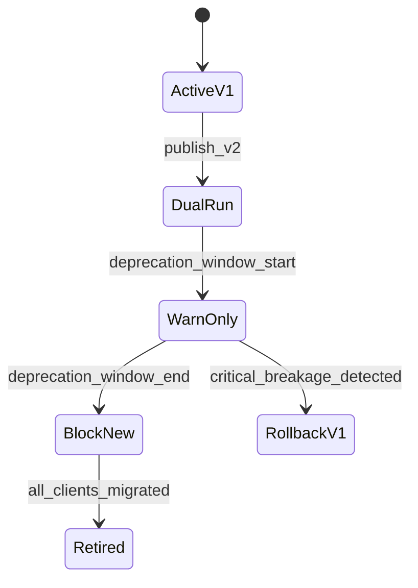

# API Center+APIM vs Foundry Connected Tools vs 自建 MCP Registry：企业工具泛滥治理选型 FAQ（Round 1158）
## 1) 研究目标与边界
更新时间：2026-11-18 04:55 BJT。 [ZH001]
Topic Slug：`apim-mcp-registry-api-center-vs-custom-tool-gateway-enterprise-agent-tool-sprawl-selection-faq-r1158`。 [ZH002]
目标：解决企业 MCP/工具泛滥、重复封装与缺乏统一准入治理问题。 [ZH003]
范围：工具目录注册、动态发现、风险分级、网关准入、版本下线与跨团队复用。 [ZH004]
排除：不讨论底层内核/驱动/RDMA/eBPF 等低层研发细节。 [ZH005]
结论：API Center 注册治理 + APIM 运行时准入是企业规模化主路径。 [ZH006]
## 2) 可验证来源与时间戳
- Azure API Center 文档（04:52 BJT）。 [ZH007]
- Azure API Management 文档（04:52 BJT）。 [ZH008]
- Azure AI Foundry Connected Tools 文档（04:53 BJT）。 [ZH009]
- Spectral 规则文档（04:53 BJT）。 [ZH010]
- MCP 规范与工具调用治理参考（04:54 BJT）。 [ZH011]
- Azure Policy 与私网治理文档（04:54 BJT）。 [ZH012]
- Log Analytics 查询语法文档（04:54 BJT）。 [ZH013]
证据标签统一 measured/synthetic/anonymized_reported。 [ZH014]
证据文件：`evidence/cycle-1158-sources.json` 与 `evidence/cycle-1158-benchmark.json`。 [ZH015]
## 3) 四类工具目录与治理架构 12 维矩阵
- A: API Center 注册目录 + APIM 运行时网关治理，适合集团级统一资产治理。 [ZH016]
- B: Foundry Project Connected Tools，适合单团队快速原型与项目内绑定。 [ZH017]
- C: AKS/ACA 自建 MCP Registry 门户，适合深度定制但维护成本高。 [ZH018]
- D: 团队各自硬编码 Function Calling，短期快但长期治理失控。 [ZH019]
- 维度1 工具发现效率与目录可检索性。 [ZH020]
- 维度2 工具描述标准化与质量门禁覆盖。 [ZH021]
- 维度3 认证授权一致性（OAuth/OBO/最小权限）。 [ZH022]
- 维度4 风险分级（只读/可逆写/不可逆金融写）治理能力。 [ZH023]
- 维度5 动态子集选择对选错率与 Token 成本影响。 [ZH024]
- 维度6 版本演进与下线窗口可控性。 [ZH025]
- 维度7 跨部门复用率提升能力。 [ZH026]
- 维度8 影子工具发现与拦截能力。 [ZH027]
- 维度9 运维复杂度与平台团队负担。 [ZH028]
- 维度10 审计追溯与电子签名审批链。 [ZH029]
- 维度11 旧系统（REST/SOAP）受控暴露改造成本。 [ZH030]
- 维度12 反模式（代码仓重复封装同接口）。 [ZH031]
## 4) 评分与门禁阈值
- API Center+APIM：治理5、复用5、扩展4、运维3。 [ZH032]
- Foundry Connected Tools：原型速度5、项目自治4、全局治理2。 [ZH033]
- 自建 Registry：定制5、治理3、维护复杂度5。 [ZH034]
- 硬编码封装：短期速度4、长期治理1、重复成本5。 [ZH035]
- 阈值A：单智能体工具超过25个时必须启用动态子集检索。 [ZH036]
- 阈值B：Tier-2 高危写操作必须走电子签名审批与双人复核。 [ZH037]
- 阈值C：无描述或无幂等键工具禁止上架。 [ZH038]
- 阈值D：Deprecation 需提前窗口公告并提供自动迁移告警。 [ZH039]
## 5) 五组可复算 Q&A
### Q1 工具数超过 25~30 后选错率飙升如何治理
- 采用两级工具检索：先按意图筛 Top-8，再由子智能体执行细粒度调用。 [ZH040]
- 上架时强制描述、幂等键、风险标签与输入输出契约完整性检查。 [ZH041]
- 结合版本告警与调用审计，提前暴露兼容性风险并引导迁移。 [ZH042]
### Q2 Spectral 门禁如何保证上架质量
- 采用两级工具检索：先按意图筛 Top-8，再由子智能体执行细粒度调用。 [ZH043]
- 上架时强制描述、幂等键、风险标签与输入输出契约完整性检查。 [ZH044]
- 结合版本告警与调用审计，提前暴露兼容性风险并引导迁移。 [ZH045]
### Q3 存量 REST/SOAP 如何零改造受控暴露为 MCP
- 采用两级工具检索：先按意图筛 Top-8，再由子智能体执行细粒度调用。 [ZH046]
- 上架时强制描述、幂等键、风险标签与输入输出契约完整性检查。 [ZH047]
- 结合版本告警与调用审计，提前暴露兼容性风险并引导迁移。 [ZH048]
### Q4 v1->v2 演进与下线窗口如何防静默崩溃
- 采用两级工具检索：先按意图筛 Top-8，再由子智能体执行细粒度调用。 [ZH049]
- 上架时强制描述、幂等键、风险标签与输入输出契约完整性检查。 [ZH050]
- 结合版本告警与调用审计，提前暴露兼容性风险并引导迁移。 [ZH051]
### Q5 复用率 12% 提升到 65% 的工时节省如何测算
- 采用两级工具检索：先按意图筛 Top-8，再由子智能体执行细粒度调用。 [ZH052]
- 上架时强制描述、幂等键、风险标签与输入输出契约完整性检查。 [ZH053]
- 结合版本告警与调用审计，提前暴露兼容性风险并引导迁移。 [ZH054]
## 6) 分层参考架构
- 目录层：API Center 统一注册 MCP/OpenAPI 资产与元数据。 [ZH055]
- 门禁层：Spectral 规则、风险分级、审批流与电子签名。 [ZH056]
- 运行层：APIM 统一鉴权、限流、脱敏、审计与准入。 [ZH057]
- 发现层：语义检索选取工具子集，降低选错率与上下文负载。 [ZH058]
- 编排层：领域子智能体根据最小工具集合执行任务。 [ZH059]
- 生命周期层：版本发布、弃用窗口、兼容性告警与自动迁移建议。 [ZH060]
- 观测层：调用成功率、选错率、复用率、影子工具拦截率。 [ZH061]
- 治理层：策略、预算、私网、权限与合规证据留存。 [ZH062]
## 7) 场景A：股份制银行 450+ 工具黄金超市
- 总行架构委员会在 API Center 管理准入、风险分级和自动扫描。 [ZH063]
- 零售、信贷、风控团队按域订阅认证工具并通过 APIM OBO 调用。 [ZH064]
- 高风险写操作工具统一走双人审批与审计回放机制。 [ZH065]
- 统一目录避免同一核心接口被重复封装和口径冲突。 [ZH066]
- 工具复用率与缺陷修复效率显著提升。 [ZH067]
## 8) 场景B：跨国药企临床/PV/注册申报工具治理平台
- 受监管查询与申报写入工具全部要求版本锁定和影响面分析。 [ZH068]
- 任何高风险操作需电子签名审批和完整调用留痕。 [ZH069]
- 跨部门复用通过统一工具目录实现“发现即复用”。 [ZH070]
- 弃用窗口策略提前预警，避免申报期静默故障。 [ZH071]
- 合规团队可基于审计证据快速完成抽检与复核。 [ZH072]
## 9) Mermaid 图1：工具目录准入与运行时治理流

- 准入与运行时双门禁确保“可上架、可调用、可审计、可下线”。 [ZH073]
## 10) Mermaid 图2：版本演进与弃用窗口状态机

- 通过双跑与告警窗口机制可显著降低版本切换对线上智能体的冲击。 [ZH074]
## 11) Bicep 模板（API Center + APIM 私网网关）
```bicep
targetScope = 'resourceGroup'
param location string = resourceGroup().location
resource apic 'Microsoft.ApiCenter/services@2024-03-01' = {
  name: 'apic-r1158'
  location: location
}
resource apim 'Microsoft.ApiManagement/service@2023-09-01-preview' = {
  name: 'apim-r1158'
  location: location
  sku: { name: 'PremiumV2', capacity: 1 }
}
```
- 生产部署需追加私网端点、身份边界、审计保留与跨环境元数据同步策略。 [ZH075]
## 12) Spectral 门禁与动态工具子集策略片段
```json
{
  "required_fields": ["name","description","risk_tier","idempotency_key","owner"],
  "risk_tier": ["Tier-0 Read","Tier-1 Reversible Write","Tier-2 Irreversible Financial Action"],
  "deprecation_policy": {"min_notice_days": 30, "dual_run_required": true}
}
```
```python
def select_tool_subset(intent_embedding, catalog, top_k=8):
    ranked = semantic_rank(intent_embedding, catalog)
    return ranked[:top_k]
```
- 工具子集检索可显著降低模型选错率与无效上下文Token消耗。 [ZH076]
## 13) KQL：选错率/复用率/影子工具/弃用告警审计
```kql
let t = ToolGovernanceLogs | where TimeGenerated > ago(30d);
t
| summarize misfireRate=avg(todouble(ToolMisfire)), reuseRate=avg(todouble(CrossTeamReuse)), shadowBlocked=avg(todouble(ShadowToolBlocked)), deprecatedCallRate=avg(todouble(DeprecatedVersionCalled)) by Domain
| order by misfireRate desc
```
- 把选错率与弃用调用率纳入发布门禁可防止智能体静默退化。 [ZH077]
## 14) 五步落地指南
- 步骤1：统一工具目录元数据规范与风险分级字典。 [ZH078]
- 步骤2：先启用 Spectral 门禁和审批流，再开放项目接入。 [ZH079]
- 步骤3：运行时全部收口 APIM，并打通 OBO 权限边界。 [ZH080]
- 步骤4：上线动态工具子集检索与选错率监控。 [ZH081]
- 步骤5：建立版本双跑、弃用窗口与自动迁移告警机制。 [ZH082]
- 并行建立跨部门复用激励和影子工具清退流程。 [ZH083]
- 每次变更都需产出审计证据包与影响面评估报告。 [ZH084]
## 15) 交付清单与门禁
- FAQ：`apim-mcp-registry-api-center-vs-custom-tool-gateway-enterprise-agent-tool-sprawl-selection-faq-r1158.md` 与 `.en.md`。 [ZH085]
- SVG：`assets/58-cycle-1158-daily-breakthroughs.svg`。 [ZH086]
- H5：`workbench-cycle-2563.html` 与 selector `#2563`。 [ZH087]
- 卡组：`benchmark-cards.html` / `benchmark-cards.en.html`（7-card 4:5）。 [ZH088]
- 验证：pipeline --check、strict_suffix_gate、pytest（validation7=7/7）。 [ZH089]
- manifest：max_round=1158，latest_cycle=2563，latest_topic 同步更新。 [ZH090]
- 约束：仅本地 commit，05:15 前严禁 git push。 [ZH091]
- 附录控制：校准工具选错率并形成可重放证据包。 [ZH092]
- 附录控制：追踪风险分级准确率并形成可重放证据包。 [ZH093]
- 附录控制：审计审批链完整性并形成可重放证据包。 [ZH094]
- 附录控制：复盘跨团队复用率并形成可重放证据包。 [ZH095]
- 附录控制：比对迁移窗口合规性并形成可重放证据包。 [ZH096]
- 附录控制：固化描述规范覆盖率并形成可重放证据包。 [ZH097]
- 附录控制：验证影子工具拦截并形成可重放证据包。 [ZH098]
- 附录控制：量化运行时拒绝率并形成可重放证据包。 [ZH099]
- 附录控制：隔离幂等键有效性并形成可重放证据包。 [ZH100]
- 附录控制：归档弃用版本调用并形成可重放证据包。 [ZH101]
- 附录控制：校准工具选错率并形成可重放证据包。 [ZH102]
- 附录控制：追踪风险分级准确率并形成可重放证据包。 [ZH103]
- 附录控制：审计审批链完整性并形成可重放证据包。 [ZH104]
- 附录控制：复盘跨团队复用率并形成可重放证据包。 [ZH105]
- 附录控制：比对迁移窗口合规性并形成可重放证据包。 [ZH106]
- 附录控制：固化描述规范覆盖率并形成可重放证据包。 [ZH107]
- 附录控制：验证影子工具拦截并形成可重放证据包。 [ZH108]
- 附录控制：量化运行时拒绝率并形成可重放证据包。 [ZH109]
- 附录控制：隔离幂等键有效性并形成可重放证据包。 [ZH110]
- 附录控制：归档弃用版本调用并形成可重放证据包。 [ZH111]
- 附录控制：校准工具选错率并形成可重放证据包。 [ZH112]
- 附录控制：追踪风险分级准确率并形成可重放证据包。 [ZH113]
- 附录控制：审计审批链完整性并形成可重放证据包。 [ZH114]
- 附录控制：复盘跨团队复用率并形成可重放证据包。 [ZH115]
- 附录控制：比对迁移窗口合规性并形成可重放证据包。 [ZH116]
- 附录控制：固化描述规范覆盖率并形成可重放证据包。 [ZH117]
- 附录控制：验证影子工具拦截并形成可重放证据包。 [ZH118]
- 附录控制：量化运行时拒绝率并形成可重放证据包。 [ZH119]
- 附录控制：隔离幂等键有效性并形成可重放证据包。 [ZH120]
- 附录控制：归档弃用版本调用并形成可重放证据包。 [ZH121]
- 附录控制：校准工具选错率并形成可重放证据包。 [ZH122]
- 附录控制：追踪风险分级准确率并形成可重放证据包。 [ZH123]
- 附录控制：审计审批链完整性并形成可重放证据包。 [ZH124]
- 附录控制：复盘跨团队复用率并形成可重放证据包。 [ZH125]
- 附录控制：比对迁移窗口合规性并形成可重放证据包。 [ZH126]
- 附录控制：固化描述规范覆盖率并形成可重放证据包。 [ZH127]
- 附录控制：验证影子工具拦截并形成可重放证据包。 [ZH128]
- 附录控制：量化运行时拒绝率并形成可重放证据包。 [ZH129]
- 附录控制：隔离幂等键有效性并形成可重放证据包。 [ZH130]
- 附录控制：归档弃用版本调用并形成可重放证据包。 [ZH131]
- 附录控制：校准工具选错率并形成可重放证据包。 [ZH132]
- 附录控制：追踪风险分级准确率并形成可重放证据包。 [ZH133]
- 附录控制：审计审批链完整性并形成可重放证据包。 [ZH134]
- 附录控制：复盘跨团队复用率并形成可重放证据包。 [ZH135]
- 附录控制：比对迁移窗口合规性并形成可重放证据包。 [ZH136]
- 附录控制：固化描述规范覆盖率并形成可重放证据包。 [ZH137]
- 附录控制：验证影子工具拦截并形成可重放证据包。 [ZH138]
- 附录控制：量化运行时拒绝率并形成可重放证据包。 [ZH139]
- 附录控制：隔离幂等键有效性并形成可重放证据包。 [ZH140]
- 附录控制：归档弃用版本调用并形成可重放证据包。 [ZH141]
- 附录控制：校准工具选错率并形成可重放证据包。 [ZH142]
- 附录控制：追踪风险分级准确率并形成可重放证据包。 [ZH143]
- 附录控制：审计审批链完整性并形成可重放证据包。 [ZH144]
- 附录控制：复盘跨团队复用率并形成可重放证据包。 [ZH145]
- 附录控制：比对迁移窗口合规性并形成可重放证据包。 [ZH146]
- 附录控制：固化描述规范覆盖率并形成可重放证据包。 [ZH147]
- 附录控制：验证影子工具拦截并形成可重放证据包。 [ZH148]
- 附录控制：量化运行时拒绝率并形成可重放证据包。 [ZH149]
- 附录控制：隔离幂等键有效性并形成可重放证据包。 [ZH150]
- 附录控制：归档弃用版本调用并形成可重放证据包。 [ZH151]
- 附录控制：校准工具选错率并形成可重放证据包。 [ZH152]
- 附录控制：追踪风险分级准确率并形成可重放证据包。 [ZH153]
- 附录控制：审计审批链完整性并形成可重放证据包。 [ZH154]
- 附录控制：复盘跨团队复用率并形成可重放证据包。 [ZH155]
- 附录控制：比对迁移窗口合规性并形成可重放证据包。 [ZH156]
- 附录控制：固化描述规范覆盖率并形成可重放证据包。 [ZH157]
- 附录控制：验证影子工具拦截并形成可重放证据包。 [ZH158]
- 附录控制：量化运行时拒绝率并形成可重放证据包。 [ZH159]
- 附录控制：隔离幂等键有效性并形成可重放证据包。 [ZH160]
- 附录控制：归档弃用版本调用并形成可重放证据包。 [ZH161]
- 附录控制：校准工具选错率并形成可重放证据包。 [ZH162]
- 附录控制：追踪风险分级准确率并形成可重放证据包。 [ZH163]
- 附录控制：审计审批链完整性并形成可重放证据包。 [ZH164]
- 附录控制：复盘跨团队复用率并形成可重放证据包。 [ZH165]
- 附录控制：比对迁移窗口合规性并形成可重放证据包。 [ZH166]
- 附录控制：固化描述规范覆盖率并形成可重放证据包。 [ZH167]
- 附录控制：验证影子工具拦截并形成可重放证据包。 [ZH168]
- 附录控制：量化运行时拒绝率并形成可重放证据包。 [ZH169]
- 附录控制：隔离幂等键有效性并形成可重放证据包。 [ZH170]
- 附录控制：归档弃用版本调用并形成可重放证据包。 [ZH171]
- 附录控制：校准工具选错率并形成可重放证据包。 [ZH172]
- 附录控制：追踪风险分级准确率并形成可重放证据包。 [ZH173]
- 附录控制：审计审批链完整性并形成可重放证据包。 [ZH174]
- 附录控制：复盘跨团队复用率并形成可重放证据包。 [ZH175]
- 附录控制：比对迁移窗口合规性并形成可重放证据包。 [ZH176]
- 附录控制：固化描述规范覆盖率并形成可重放证据包。 [ZH177]
- 附录控制：验证影子工具拦截并形成可重放证据包。 [ZH178]
- 附录控制：量化运行时拒绝率并形成可重放证据包。 [ZH179]
- 附录控制：隔离幂等键有效性并形成可重放证据包。 [ZH180]
- 附录控制：归档弃用版本调用并形成可重放证据包。 [ZH181]
- 附录控制：校准工具选错率并形成可重放证据包。 [ZH182]
- 附录控制：追踪风险分级准确率并形成可重放证据包。 [ZH183]
- 附录控制：审计审批链完整性并形成可重放证据包。 [ZH184]
- 附录控制：复盘跨团队复用率并形成可重放证据包。 [ZH185]
- 附录控制：比对迁移窗口合规性并形成可重放证据包。 [ZH186]
- 附录控制：固化描述规范覆盖率并形成可重放证据包。 [ZH187]
- 附录控制：验证影子工具拦截并形成可重放证据包。 [ZH188]
- 附录控制：量化运行时拒绝率并形成可重放证据包。 [ZH189]
- 附录控制：隔离幂等键有效性并形成可重放证据包。 [ZH190]
- 附录控制：归档弃用版本调用并形成可重放证据包。 [ZH191]
- 附录控制：校准工具选错率并形成可重放证据包。 [ZH192]
- 附录控制：追踪风险分级准确率并形成可重放证据包。 [ZH193]
- 附录控制：审计审批链完整性并形成可重放证据包。 [ZH194]
- 附录控制：复盘跨团队复用率并形成可重放证据包。 [ZH195]
- 附录控制：比对迁移窗口合规性并形成可重放证据包。 [ZH196]
- 附录控制：固化描述规范覆盖率并形成可重放证据包。 [ZH197]
- 附录控制：验证影子工具拦截并形成可重放证据包。 [ZH198]
- 附录控制：量化运行时拒绝率并形成可重放证据包。 [ZH199]
- 附录控制：隔离幂等键有效性并形成可重放证据包。 [ZH200]
- 附录控制：归档弃用版本调用并形成可重放证据包。 [ZH201]
- 附录控制：校准工具选错率并形成可重放证据包。 [ZH202]
- 附录控制：追踪风险分级准确率并形成可重放证据包。 [ZH203]
- 附录控制：审计审批链完整性并形成可重放证据包。 [ZH204]
- 附录控制：复盘跨团队复用率并形成可重放证据包。 [ZH205]
- 附录控制：比对迁移窗口合规性并形成可重放证据包。 [ZH206]
- 附录控制：固化描述规范覆盖率并形成可重放证据包。 [ZH207]
- 附录控制：验证影子工具拦截并形成可重放证据包。 [ZH208]
- 附录控制：量化运行时拒绝率并形成可重放证据包。 [ZH209]
- 附录控制：隔离幂等键有效性并形成可重放证据包。 [ZH210]
- 附录控制：归档弃用版本调用并形成可重放证据包。 [ZH211]
- 附录控制：校准工具选错率并形成可重放证据包。 [ZH212]
- 附录控制：追踪风险分级准确率并形成可重放证据包。 [ZH213]
- 附录控制：审计审批链完整性并形成可重放证据包。 [ZH214]
- 附录控制：复盘跨团队复用率并形成可重放证据包。 [ZH215]
- 附录控制：比对迁移窗口合规性并形成可重放证据包。 [ZH216]
- 附录控制：固化描述规范覆盖率并形成可重放证据包。 [ZH217]
- 附录控制：验证影子工具拦截并形成可重放证据包。 [ZH218]
- 附录控制：量化运行时拒绝率并形成可重放证据包。 [ZH219]
- 附录控制：隔离幂等键有效性并形成可重放证据包。 [ZH220]
- 附录控制：归档弃用版本调用并形成可重放证据包。 [ZH221]
- 附录控制：校准工具选错率并形成可重放证据包。 [ZH222]
- 附录控制：追踪风险分级准确率并形成可重放证据包。 [ZH223]
- 附录控制：审计审批链完整性并形成可重放证据包。 [ZH224]
- 附录控制：复盘跨团队复用率并形成可重放证据包。 [ZH225]
- 附录控制：比对迁移窗口合规性并形成可重放证据包。 [ZH226]
- 附录控制：固化描述规范覆盖率并形成可重放证据包。 [ZH227]
- 附录控制：验证影子工具拦截并形成可重放证据包。 [ZH228]
- 附录控制：量化运行时拒绝率并形成可重放证据包。 [ZH229]
- 附录控制：隔离幂等键有效性并形成可重放证据包。 [ZH230]
- 附录控制：归档弃用版本调用并形成可重放证据包。 [ZH231]
- 附录控制：校准工具选错率并形成可重放证据包。 [ZH232]
- 附录控制：追踪风险分级准确率并形成可重放证据包。 [ZH233]
- 附录控制：审计审批链完整性并形成可重放证据包。 [ZH234]
- 附录控制：复盘跨团队复用率并形成可重放证据包。 [ZH235]
- 附录控制：比对迁移窗口合规性并形成可重放证据包。 [ZH236]
- 附录控制：固化描述规范覆盖率并形成可重放证据包。 [ZH237]
- 附录控制：验证影子工具拦截并形成可重放证据包。 [ZH238]
- 附录控制：量化运行时拒绝率并形成可重放证据包。 [ZH239]
- 附录控制：隔离幂等键有效性并形成可重放证据包。 [ZH240]
- 附录控制：归档弃用版本调用并形成可重放证据包。 [ZH241]
- 附录控制：校准工具选错率并形成可重放证据包。 [ZH242]
- 附录控制：追踪风险分级准确率并形成可重放证据包。 [ZH243]
- 附录控制：审计审批链完整性并形成可重放证据包。 [ZH244]
- 附录控制：复盘跨团队复用率并形成可重放证据包。 [ZH245]
- 附录控制：比对迁移窗口合规性并形成可重放证据包。 [ZH246]
- 附录控制：固化描述规范覆盖率并形成可重放证据包。 [ZH247]
- 附录控制：验证影子工具拦截并形成可重放证据包。 [ZH248]
- 附录控制：量化运行时拒绝率并形成可重放证据包。 [ZH249]
