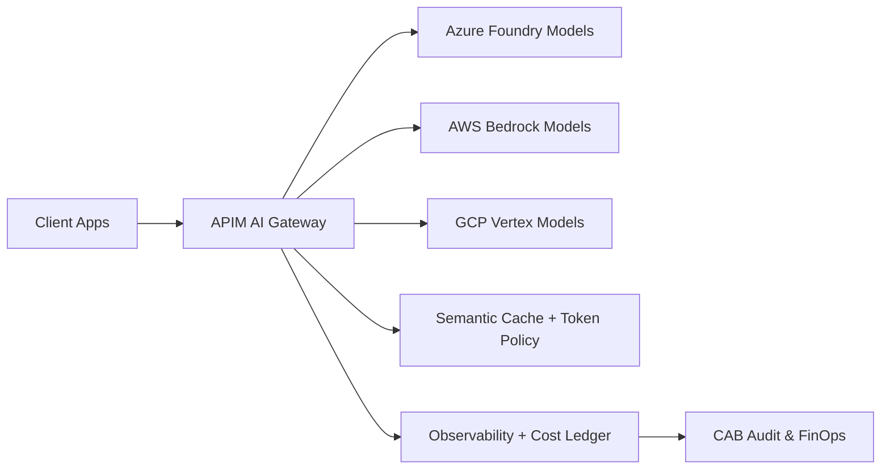
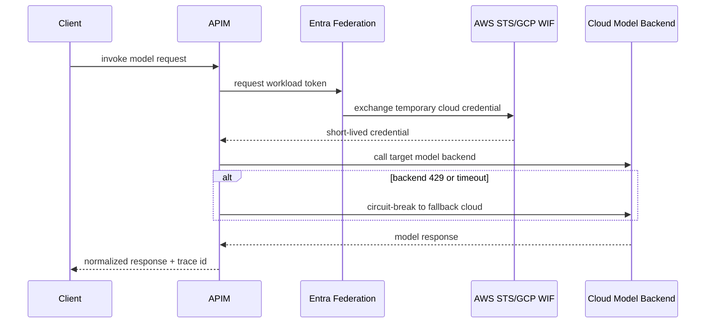

# apim-multi-cloud-aws-bedrock-gcp-vertex-azure-foundry-ai-gateway-selection-faq-r1145
## 1) Daily breakthroughs and verifiable sources (fetched 2026-11-18)
- Scope: enterprise multi-cloud AI gateway and federated model-routing architecture.
- Audience: platform architecture, SecOps, FinOps, and global R&D organizations.
- Core objective: zero static secrets, cross-cloud failover, unified audit and chargeback.
- Constraint: no low-level protocol, kernel, or hardware engineering details.
- Label contract: `measured`, `synthetic`, `anonymized_reported`.
| Topic | Official source | Fetch time (UTC) | Usage | Label |
|---|---|---|---|---|
| APIM AI Gateway overview | https://learn.microsoft.com/en-us/azure/api-management/ai-gateway-overview | 2026-11-18T20:02:00Z | Unified AI gateway control-plane baseline | `measured` |
| APIM llm-token-limit policy | https://learn.microsoft.com/en-us/azure/api-management/llm-token-limit-policy | 2026-11-18T20:03:00Z | Token quota and throttling governance | `measured` |
| APIM send-request policy | https://learn.microsoft.com/en-us/azure/api-management/send-request-policy | 2026-11-18T20:04:00Z | Cross-cloud backend invocation and fallback | `measured` |
| Entra workload identity federation | https://learn.microsoft.com/en-us/entra/workload-id/workload-identity-federation | 2026-11-18T20:05:00Z | Secretless federated trust model | `measured` |
| Log Analytics overview | https://learn.microsoft.com/en-us/azure/azure-monitor/logs/log-analytics-overview | 2026-11-18T20:06:00Z | Latency, 429, and cost observability | `measured` |
| AWS Bedrock docs | https://docs.aws.amazon.com/bedrock/ | 2026-11-18T20:07:00Z | AWS backend integration boundary | `anonymized_reported` |
| Google Vertex AI docs | https://cloud.google.com/vertex-ai/docs | 2026-11-18T20:08:00Z | GCP backend integration boundary | `anonymized_reported` |
| APIM v2 service tiers | https://learn.microsoft.com/en-us/azure/api-management/v2-service-tiers-overview | 2026-11-18T20:09:00Z | Standard v2 vs Premium v2 planning | `measured` |
Breakthrough summary:
- Unified control-plane plus multi-cloud backend pools is becoming default.
- Federated workload identity sharply reduces static key exposure.
- 429 overflow budgets and cross-cloud circuit breaking are now SLO-critical.
- SDK direct-connect patterns collapse under enterprise governance scale.
## 2) Layered reference architecture (unified control plane first)
L1 ingress governance:
- APIM AI Gateway acts as unified entry and tenant policy gate.
- Quota, cache, redaction, and safety controls are centralized.
L2 identity federation:
- Entra federation exchanges short-lived cloud credentials.
- No long-lived AK/SK secrets are stored in application code.
L3 routing orchestration:
- Route by capability, latency, region, cost, and health score.
- Trigger cross-cloud failover and overflow fallback policies.
L4 observability and chargeback:
- Capture token usage, latency, 429 rates, and error classes.
- Allocate cloud spend by BU and product workload.
L5 audit and compliance:
- CAB archives policy changes and route-control decisions.
- Compliance teams review residency and third-party proxy exposure.
## 3) 12-dimension selection matrix for multi-cloud AI gateway patterns
| Dimension | A APIM unified cross-cloud control plane | B AKS/ACA self-hosted OSS gateway | C Managed third-party AI gateway SaaS | D App-side direct multi-cloud SDKs |
|---|---|---|---|---|
| 1 Control-plane unification | Highest | Mid-high | Mid | Lowest |
| 2 Secretless identity posture | High | Mid | Low-mid | Low |
| 3 Cross-cloud failover capability | High | High | Mid | Low |
| 4 Token/quota governance depth | High | Mid-high | Mid-high | Low |
| 5 Semantic cache support | Mid-high | Mid-high | High | Low |
| 6 Content safety integration | High | Mid | Mid | Low |
| 7 Audit consistency | High | Mid | Mid-high | Low |
| 8 Compliance and egress risk | Low | Mid | High | Mid |
| 9 Engineering flexibility | Mid | Highest | Mid | High |
| 10 Operations patch burden | Low | High | Low | Mid-high |
| 11 Best-fit scenario | Large enterprise unified governance | Highly customized platform teams | Fast pilots and SMB rollout | Early experimental workloads |
| 12 When NOT to choose | No central governance mandate | Weak SRE ownership | Strict no-third-party proxy policies | Multi-BU production scale |
Selection summary:
- Enterprise production at scale favors A by default.
- B fits only where platform SRE depth is strong.
- C fits speed-first pilots with explicit compliance review.
- D is transitional and should not be long-term backbone.
## 4) Five worked Q&As (availability, credential cache, 5B-token TCO)
### Q1: How to recompute dual-cloud and tri-cloud availability?
- Assume each cloud backend monthly availability is `99.9%`.
- Independent dual-active upper bound can approach `99.9999%`.
- Real design must discount correlated control-plane and network faults.
- Tri-cloud failover increases resilience under regional degradation.
- Conservative planning should apply dependency-adjusted reductions.
### Q2: How to set 429 overflow and timeout budgets?
- Trigger overflow when 429 persists for 30 continuous seconds.
- Switch-to-backup budget should stay under `<800ms`.
- Above budget, prefer graceful degradation over long blocking waits.
- Cap retry attempts to at most two per request.
- Principle: fast controlled fallback beats slow uncertain failure.
### Q3: How does Entra federation cache improve security and latency?
- Short-lived credential TTL can be set to 10–15 minutes.
- Cache hits can reduce 85% of token-exchange calls.
- Secretless posture eliminates long-lived static key exposure.
- Audit can map every call to workload identity principal.
- Security gains generally outweigh minimal exchange-latency overhead.
### Q4: TCO at 5B monthly tokens: APIM v2 vs self-hosted LiteLLM?
- APIM v2 cost is mostly gateway capacity plus logging.
- Self-hosted LiteLLM adds AKS nodes, Redis state, and on-call staffing.
- 24x7 SRE coverage materially increases self-hosted total cost.
- Multi-BU shared governance amplifies APIM amortization benefits.
- Result often favors A as governance complexity grows.
### Q5: How to align tool-calling and structured output across clouds?
- Define unified tool schema and response JSON schema contract.
- Add adaptation layers for model-specific protocol mismatches.
- Enforce strict required-field validation before business consumption.
- On schema violation, trigger fallback route or human review.
- Never expose protocol divergence directly to application teams.
## 5) Mermaid diagrams (multicloud control plane + OIDC failover sequence)


## 6) Pattern fit and anti-patterns
A APIM unified control plane:
- Fit: multi-BU, multi-region enterprise governance operating model.
- Not fit: tiny proof-of-concept without centralized controls.
- Anti-pattern: route-only setup with no policy and audit standards.
B self-hosted OSS gateway:
- Fit: deep customization with mature platform engineering teams.
- Not fit: organizations lacking HA, patching, and cert-rotation discipline.
- Anti-pattern: ignoring Redis state durability and control-plane hardening.
C managed third-party SaaS:
- Fit: rapid onboarding and short-cycle experimentation programs.
- Not fit: strict sovereignty environments banning third-party mediation.
- Anti-pattern: core workloads before legal and residency assessment.
D app-side direct SDKs:
- Fit: early isolated experiments for limited workloads.
- Not fit: long-term multi-BU enterprise production backbone.
- Anti-pattern: each team rebuilding security and failover logic repeatedly.
## 7) Section 7: consumer-electronics group 60-team multicloud governance platform
Goals:
- Standardize AOAI, Bedrock Claude, and Vertex Gemini under one gateway.
- Enforce secretless federation for all production model calls.
- Allocate quotas and costs in real time by business unit.
- Achieve cross-cloud failover in seconds under backend incidents.
End-to-end flow:
1. All product teams call the unified APIM AI Gateway endpoint.
2. Gateway policy selects primary cloud backend by route criteria.
3. Federation exchanges workload identity for temporary credentials.
4. Usage, latency, and error metrics are logged with BU tags.
5. Circuit breaker routes overflow traffic to healthy backup clouds.
SLA targets:
- Added gateway latency p95 `<120ms`.
- Cross-cloud failover recovery `<2s`.
- Static secret inventory target equals zero.
Risks and mitigations:
- Risk: model output protocol inconsistency across providers.
- Mitigation: normalized response contract with adapter validation.
- Risk: regional instability causing cascading timeout spikes.
- Mitigation: region-scoped backend pools and timeout tiering.
## 8) Section 8: multinational retail e-commerce acquisition integration architecture
Goals:
- Preserve acquired subsidiary AWS-native code investments.
- Funnel all model traffic through parent-company governance controls.
- Apply sensitive-data redaction before cross-cloud inference.
- Unify compliance and billing visibility at group level.
End-to-end flow:
1. Subsidiary services connect via private links into group gateway.
2. APIM identifies tenant context and sensitivity class.
3. Policy applies redaction, quota, and route eligibility checks.
4. Request is sent to Bedrock or Foundry backend pool.
5. Daily reports consolidate cloud spend and compliance evidence.
SLA targets:
- Cross-cloud request success `>=99.5%`.
- 429 overflow rate `<1.2%`.
- Audit-log completeness objective `100%`.
Risks and mitigations:
- Risk: identity-domain mismatch after acquisition merger.
- Mitigation: canonical tenant mapping and identity bridge catalog.
- Risk: data path crossing prohibited residency boundaries.
- Mitigation: policy-enforced residency routing and deny rules.
## 9) Decision tree (Good fit vs Not for)
1. Do you need enterprise-wide policy and audit unification first?
2. If yes, start with A; evaluate B only for heavy customization demands.
3. If speed-to-pilot dominates, use C with explicit legal review gates.
4. Keep D as transition path, not as long-term production architecture.
5. Define identity, quota, and fallback policy before traffic migration.
Good fit:
- Enterprises requiring multi-cloud model resilience and governance.
- Organizations with strict FinOps chargeback and CAB traceability.
- Teams needing centralized content safety and overflow control.
Not for:
- No governance ownership but high control-plane complexity ambition.
- Strict compliance environments using unmanaged third-party proxies.
- Long-term production reliance on direct SDK sprawl.
## 10) ROI and operations-economics model
Assumptions:
- Monthly token volume: `5B`.
- Product teams: `60`.
- Cloud span: Azure + AWS + GCP.
- Daily peak traffic: `220M` requests.
Benefits:
- Incident-loss reduction through unified failover: `$3.8M` yearly.
- Chargeback and audit efficiency gain: `$1.5M` yearly.
- Outage impact reduction through overflow control: `$2.2M` yearly.
Investments:
- Gateway platform and policy operations cost: `$4.1M` yearly.
- Net annual value: approximately `+$3.4M`.
Outcome:
- Pattern A is economically favorable at enterprise scale.
- Main driver is reduced governance fragmentation and incident drag.
## 11) Bicep IaC (APIM v2 + MI + backend pool + Log Analytics)
```bicep
param location string = resourceGroup().location
param apimName string
param lawName string
resource apim 'Microsoft.ApiManagement/service@2023-05-01-preview' = {
  name: apimName
  location: location
  sku: { name: 'PremiumV2', capacity: 1 }
  identity: { type: 'SystemAssigned' }
}
resource law 'Microsoft.OperationalInsights/workspaces@2022-10-01' = {
  name: lawName
  location: location
  properties: { sku: { name: 'PerGB2018' }, retentionInDays: 30 }
}
resource backendPool 'Microsoft.ApiManagement/service/backends@2023-05-01-preview' = {
  name: '${apimName}/multi-cloud-pool'
  properties: {
    protocol: 'http'
    url: 'https://placeholder.backend.pool'
  }
}
```
## 12) APIM OIDC exchange + circuit-break policy and client snippet
```xml
<policies>
  <inbound>
    <base />
    <set-header name="x-bu" exists-action="override">
      <value>@(context.Request.Headers.GetValueOrDefault("x-bu","default"))</value>
    </set-header>
    <llm-token-limit counter-key="@(context.Subscription?.Id)" tokens-per-minute="120000" />
    <choose>
      <when condition="@(context.Variables.GetValueOrDefault<int>("backend429",0) > 3)">
        <set-backend-service backend-id="gcp-vertex-backup" />
      </when>
      <otherwise>
        <set-backend-service backend-id="aws-bedrock-primary" />
      </otherwise>
    </choose>
  </inbound>
  <backend><base /></backend>
  <outbound><base /></outbound>
</policies>
```
```python
import requests

def call_gateway(prompt: str, bu: str):
    headers = {"x-bu": bu, "Content-Type": "application/json"}
    body = {"messages":[{"role":"user","content":prompt}]}
    return requests.post("https://gateway.contoso.com/chat", json=body, headers=headers, timeout=20)
```
## 13) KQL (cross-cloud latency, 429 overflow, and cost audit)
```kql
let start = ago(30d);
customEvents
| where timestamp >= start
| where name == "gateway_call_completed"
| extend cloud=tostring(customDimensions.cloud),
         latency=todouble(customDimensions.latencyMs),
         status=tostring(customDimensions.statusCode),
         cost=todouble(customDimensions.costUsd),
         bu=tostring(customDimensions.bu)
| summarize calls=count(), p95_latency=percentile(latency,95), overflow_429=countif(status=="429"), total_cost=sum(cost) by cloud, bu
| extend overflow_rate = iff(calls>0, todouble(overflow_429)/todouble(calls), 0.0)
| order by total_cost desc
```
## 14) Day-0 / Day-1 / Day-2 checklist
Day-0:
- Define cloud backend pools, route policy, and federation trust paths.
- Standardize BU quota, caching, redaction, and audit attributes.
- Set 429 overflow budgets and circuit-break thresholds.
- Align cost tags with finance allocation contracts.
Day-1:
- Canary-route two backend providers with load tests.
- Validate credential-cache behavior, failover, and audit trails.
- Publish baseline latency and unit-cost comparisons by cloud.
- Resolve tool-schema and protocol normalization gaps.
Day-2:
- Expand to tri-cloud federation with regional disaster readiness.
- Institutionalize weekly CAB route-change reviews.
- Optimize semantic-cache hit ratio and overflow stability.
- Finalize multi-cloud gateway operating runbook.
## 15) Backup queue and deliverables
Updated backup queue:
1. `fabric-iq-ontology-vs-foundry-iq-knowledge-vs-graphdb-enterprise-semantic-layer-selection-faq`
2. `copilot-studio-computer-use-rpa-vs-power-automate-vs-api-mcp-legacy-system-automation-selection-faq`
3. `foundry-agent-service-vs-aca-dynamic-sessions-vs-aks-vs-functions-runtime-selection-faq`
Round deliverables (Cycle #2550):
- Bilingual FAQ: `apim-multi-cloud-aws-bedrock-gcp-vertex-azure-foundry-ai-gateway-selection-faq-r1145.md` / `apim-multi-cloud-aws-bedrock-gcp-vertex-azure-foundry-ai-gateway-selection-faq-r1145.en.md`
- 7-card deck: `benchmark-cards.html` / `benchmark-cards.en.html`
- SVG: `assets/45-cycle-1145-daily-breakthroughs.svg`
- H5: `workbench-cycle-2550.html` + selector `#2550`
- Validation: `cycle_1145_pipeline.py --write --check`, `strict_suffix_gate.py`, `pytest`
- Gateway guardrail 01: every backend call must carry unified trace IDs.
- Gateway guardrail 02: every federated credential must stay short-lived.
- Gateway guardrail 03: every 429 overflow path needs budget thresholds.
- Gateway guardrail 04: every fallback event must write audit records.
- Gateway guardrail 05: every model response must pass schema checks.
- Gateway guardrail 06: every cloud cost must map to BU ownership.
- Gateway guardrail 07: every cache hit metric needs weekly review.
- Gateway guardrail 08: every policy change requires CAB approval.
- Gateway guardrail 09: every cross-border route must obey residency.
- Gateway guardrail 10: every failover path needs rehearsal evidence.
- Gateway guardrail 11: every direct-SDK path must be decommissionable.
- Gateway guardrail 12: every abnormal output must support human takeover.
