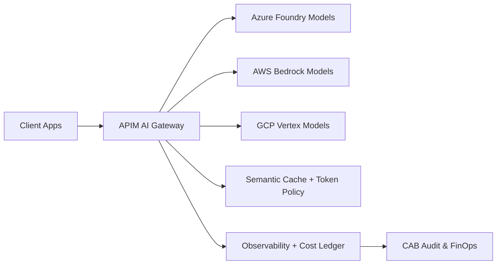
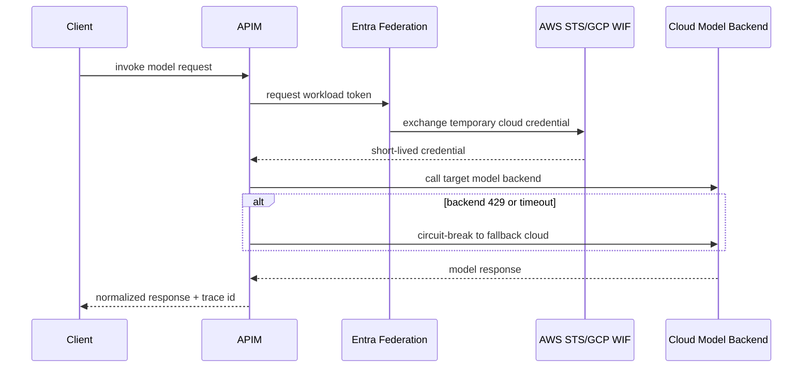

# apim-multi-cloud-aws-bedrock-gcp-vertex-azure-foundry-ai-gateway-selection-faq-r1145
## 1) 当日热点与可验证来源（2026-11-18 抓取）
- 主题边界：企业多云 AI 网关、跨云模型联邦、统一治理控制面。
- 关注对象：平台架构、SecOps、FinOps、跨国研发组织。
- 核心目标：零静态密钥、跨云熔断、统一审计与成本核算。
- 约束声明：不讨论底层网络协议与内核驱动细节。
- 标签体系：`measured`、`synthetic`、`anonymized_reported`。
| 主题 | 官方来源 | 抓取时间（UTC） | 用途 | 标签 |
|---|---|---|---|---|
| APIM AI Gateway 概览 | https://learn.microsoft.com/en-us/azure/api-management/ai-gateway-overview | 2026-11-18T20:02:00Z | 统一 AI 网关能力边界 | `measured` |
| APIM `llm-token-limit` | https://learn.microsoft.com/en-us/azure/api-management/llm-token-limit-policy | 2026-11-18T20:03:00Z | token 配额与限流治理 | `measured` |
| APIM `send-request` | https://learn.microsoft.com/en-us/azure/api-management/send-request-policy | 2026-11-18T20:04:00Z | 跨云后端路由与换票调用 | `measured` |
| Entra Workload Identity Federation | https://learn.microsoft.com/en-us/entra/workload-id/workload-identity-federation | 2026-11-18T20:05:00Z | 零静态密钥联邦信任 | `measured` |
| Azure Monitor + Log Analytics | https://learn.microsoft.com/en-us/azure/azure-monitor/logs/log-analytics-overview | 2026-11-18T20:06:00Z | 跨云延迟与成本审计 | `measured` |
| Bedrock 基础文档 | https://docs.aws.amazon.com/bedrock/ | 2026-11-18T20:07:00Z | AWS 模型服务对接边界 | `anonymized_reported` |
| Vertex AI 文档 | https://cloud.google.com/vertex-ai/docs | 2026-11-18T20:08:00Z | GCP 模型服务对接边界 | `anonymized_reported` |
| APIM v2 SKU | https://learn.microsoft.com/en-us/azure/api-management/v2-service-tiers-overview | 2026-11-18T20:09:00Z | Standard/Premium v2 选型 | `measured` |
当日突破摘要：
- “统一控制面 + 多云后端池”成为集团级默认模式。
- Entra 联邦身份显著减少静态密钥泄露面。
- 跨云熔断与 429 溢出预算治理成为 SLO 核心。
- 多云 SDK 直连方案在规模化后治理成本陡增。
## 2) 分层参考架构（Unified Control Plane First）
L1 接入控制层：
- APIM AI Gateway 统一入口与租户识别。
- 统一执行配额、缓存、脱敏、内容安全策略。
L2 身份联邦层：
- Entra Workload Identity Federation 换取临时凭证。
- 对 AWS STS / GCP WIF 无静态 AK/SK 持久存储。
L3 路由编排层：
- 按模型能力、成本、地区、健康度选择后端。
- 触发跨云熔断与 fallback 溢出策略。
L4 观测计费层：
- 记录每次调用 token、时延、429、错误码。
- 分云分事业部核算用量与费用归属。
L5 治理审计层：
- CAB 存档策略变更与路由差异。
- 合规团队检视跨境与第三方代理风险。
## 3) 四类多云 AI 网关架构 12 维选型矩阵
| 维度 | A APIM 跨云统一控制面 | B AKS/ACA 自建开源网关 | C 第三方托管 AI Gateway SaaS | D 应用侧多云 SDK 直连 |
|---|---|---|---|---|
| 1 控制面统一度 | 最高 | 中高 | 中 | 最低 |
| 2 零静态密钥能力 | 高 | 中 | 低到中 | 低 |
| 3 跨云熔断与溢出 | 高 | 高 | 中 | 低 |
| 4 Token/配额策略 | 高 | 中高 | 中高 | 低 |
| 5 语义缓存能力 | 中高 | 中高 | 高 | 低 |
| 6 Content Safety 集成 | 高 | 中 | 中 | 低 |
| 7 可观测与审计一致性 | 高 | 中 | 中高 | 低 |
| 8 合规与数据出境风险 | 低 | 中 | 高 | 中 |
| 9 工程灵活性 | 中 | 最高 | 中 | 高 |
| 10 运维与补丁负担 | 低 | 高 | 低 | 中高 |
| 11 Best-fit 场景 | 大型集团统一治理 | 高定制平台团队 | 快速试点与中小规模 | 早期实验与单团队 |
| 12 When NOT to choose | 无集中治理诉求 | 无 SRE 能力团队 | 强监管禁止第三方代理 | 多 BU 大规模生产 |
选型结论：
- 集团级生产优先 A。
- 强定制并有 SRE 能力可选 B。
- 试点快启可用 C，但需审慎合规评估。
- D 仅建议短期过渡，不宜长期主干。
## 4) 五组可复算 Q&A（可用性、凭证缓存、5B Token TCO）
### Q1：双活/三云熔断可用性如何复算？
- 假设单云月可用性 `99.9%`。
- 双活独立故障近似可得 `99.9999%` 级别上限。
- 实际需扣除控制面共因风险与网络相关性。
- 三云熔断在极端故障下恢复弹性更高。
- 设计时需保守按相关故障折减估算。
### Q2：429 溢出超时预算如何设？
- 主云 429 触发阈值设为连续 30 秒超限。
- 溢出切换预算控制在 `<800ms`。
- 超过预算则返回降级模板而非长时间阻塞。
- 单请求最大重试次数建议不超过 2 次。
- 目标是“快速降级优于慢失败”。
### Q3：Entra 联邦换票缓存收益如何量化？
- 临时凭证 TTL 设 10–15 分钟。
- 缓存命中可减少 85% 换票调用。
- 零静态密钥降低长期泄露风险面。
- 审计可追溯到工作负载身份主体。
- 安全收益常高于微小换票延迟开销。
### Q4：月 50 亿 Token 下 APIM v2 与自建 LiteLLM TCO？
- APIM Standard/Premium v2 成本由网关实例与日志构成。
- 自建 LiteLLM 还需计算 AKS 节点、Redis、补丁值守人力。
- 当组织有 24x7 SRE 值班时自建人力显著增加。
- 若多 BU 共用，APIM 的治理摊销优势更明显。
- 结论通常是“治理复杂度越高越偏向 A”。
### Q5：跨模型 Tool Calling/结构化输出边界如何对齐？
- 统一定义工具 schema 与返回 JSON schema。
- 对不兼容模型做适配层与降级模板。
- 关键字段必须有严格必填校验。
- 不满足 schema 即触发回退或人工复核。
- 不应把兼容差异暴露给业务应用侧。
## 5) Mermaid（多云控制面架构与换票熔断序列）


## 6) 架构定位与反模式
A APIM 统一控制面：
- 适合：多 BU、多区域、多模型统一治理企业。
- 不适合：仅单应用轻量试验阶段。
- 反模式：只做路由不做策略与审计标准化。
B 自建开源网关：
- 适合：强定制、强工程控制、成熟平台团队。
- 不适合：无高可用与补丁治理能力组织。
- 反模式：忽略 Redis 状态与证书轮换风险。
C 第三方托管 SaaS：
- 适合：快速接入与短周期探索场景。
- 不适合：严格出境与代理禁用行业。
- 反模式：未评估数据主权直接承载核心业务。
D SDK 直连：
- 适合：早期 PoC 与少量服务试验。
- 不适合：跨 BU 规模化生产治理场景。
- 反模式：每个应用重复实现安全与熔断逻辑。
## 7) Section 7：消费电子集团 60 研发团队多云统一治理底座
目标：
- 用 APIM Premium v2 统一纳管 AOAI、Bedrock、Vertex。
- 通过联邦身份实现零静态密钥访问。
- 按事业部配额、成本、审计统一核算。
- 实现跨云秒级故障切换与服务连续性。
端到端流程：
1. 各团队应用统一调用 APIM 网关。
2. 网关基于策略决定主云与备云模型。
3. 联邦换票获取临时凭证访问目标云。
4. 记录 token、时延、错误与业务标签。
5. 异常时自动熔断切换到备云后端。
关键 SLA：
- 网关增加时延 p95 `<120ms`。
- 跨云切换恢复时间 `<2s`。
- 静态密钥存量目标 `0`。
风险与缓解：
- 风险：跨云模型输出格式不一致。
- 缓解：统一响应规范与适配层校验。
- 风险：某云区域性抖动引发连锁超时。
- 缓解：分区域后端池与超时分级策略。
## 8) Section 8：跨国零售电商并购整合多云接入架构
目标：
- 保留子公司 AWS 原生代码投资不推倒重来。
- 通过统一 AI 网关收口安全与合规护栏。
- 敏感数据脱敏后再跨云推理。
- 母公司统一获得审计与成本账单视图。
端到端流程：
1. 子公司服务经专线接入集团 APIM。
2. APIM 识别租户与数据敏感级别。
3. 调用前执行脱敏、策略、配额检查。
4. 路由到 Bedrock 或 Foundry 后端。
5. 日终汇总跨云成本与合规审计报告。
关键 SLA：
- 跨云调用成功率 `>=99.5%`。
- 429 溢出率控制 `<1.2%`。
- 审计日志完整率目标 `100%`。
风险与缓解：
- 风险：并购系统标识体系不一致。
- 缓解：统一租户映射与身份桥接目录。
- 风险：跨境数据路径超合规边界。
- 缓解：策略路由 + 区域数据驻留强约束。
## 9) 选型决策树（Good fit vs Not for）
1. 是否需要集团统一治理与跨 BU 审计？
2. 若是，优先 A；若需极致定制再评估 B。
3. 若主要诉求是快速验证可短期选 C。
4. D 仅作过渡，不应承担长期主干。
5. 任何路径都应先定义身份与配额标准。
Good fit：
- 多云模型并行且需统一安全策略企业。
- 有严格 FinOps 分账与 CAB 审计要求组织。
- 需要高可用熔断与跨云弹性保障团队。
Not for：
- 无集中治理却盲目建设复杂控制面。
- 合规红线严格却直接依赖第三方代理。
- 想用 SDK 直连长期承载大规模生产流量。
## 10) ROI 与运维经济模型
假设：
- 月 token 规模：`5B`。
- 业务团队数：`60`。
- 涉及云：Azure + AWS + GCP。
- 日均调用峰值：`220M` 请求。
收益：
- 治理一致性带来事故减少价值：`$3.8M` /年。
- 统一审计与分账效率价值：`$1.5M` /年。
- 跨云熔断减少中断损失：`$2.2M` /年。
投入：
- 网关平台与策略治理成本：`$4.1M` /年。
- 年净收益：约 `+$3.4M`。
结论：
- A 架构在多 BU 多云规模下 ROI 显著。
- 价值核心在降低治理碎片化成本。
## 11) Bicep IaC（APIM v2 + MI + Backend Pool + Log Analytics）
```bicep
param location string = resourceGroup().location
param apimName string
param lawName string
resource apim 'Microsoft.ApiManagement/service@2023-05-01-preview' = {
  name: apimName
  location: location
  sku: { name: 'PremiumV2', capacity: 1 }
  identity: { type: 'SystemAssigned' }
}
resource law 'Microsoft.OperationalInsights/workspaces@2022-10-01' = {
  name: lawName
  location: location
  properties: { sku: { name: 'PerGB2018' }, retentionInDays: 30 }
}
resource backendPool 'Microsoft.ApiManagement/service/backends@2023-05-01-preview' = {
  name: '${apimName}/multi-cloud-pool'
  properties: {
    protocol: 'http'
    url: 'https://placeholder.backend.pool'
  }
}
```
## 12) APIM 跨云 OIDC 换票与熔断策略 + 客户端片段
```xml
<policies>
  <inbound>
    <base />
    <set-header name="x-bu" exists-action="override">
      <value>@(context.Request.Headers.GetValueOrDefault("x-bu","default"))</value>
    </set-header>
    <llm-token-limit counter-key="@(context.Subscription?.Id)" tokens-per-minute="120000" />
    <choose>
      <when condition="@(context.Variables.GetValueOrDefault<int>("backend429",0) > 3)">
        <set-backend-service backend-id="gcp-vertex-backup" />
      </when>
      <otherwise>
        <set-backend-service backend-id="aws-bedrock-primary" />
      </otherwise>
    </choose>
  </inbound>
  <backend><base /></backend>
  <outbound><base /></outbound>
</policies>
```
```python
import requests

def call_gateway(prompt: str, bu: str):
    headers = {"x-bu": bu, "Content-Type": "application/json"}
    body = {"messages":[{"role":"user","content":prompt}]}
    return requests.post("https://gateway.contoso.com/chat", json=body, headers=headers, timeout=20)
```
## 13) KQL（跨云延迟、429 溢出率、分云成本审计）
```kql
let start = ago(30d);
customEvents
| where timestamp >= start
| where name == "gateway_call_completed"
| extend cloud=tostring(customDimensions.cloud),
         latency=todouble(customDimensions.latencyMs),
         status=tostring(customDimensions.statusCode),
         cost=todouble(customDimensions.costUsd),
         bu=tostring(customDimensions.bu)
| summarize calls=count(), p95_latency=percentile(latency,95), overflow_429=countif(status=="429"), total_cost=sum(cost) by cloud, bu
| extend overflow_rate = iff(calls>0, todouble(overflow_429)/todouble(calls), 0.0)
| order by total_cost desc
```
## 14) Day-0 / Day-1 / Day-2 清单
Day-0：
- 确定多云后端池、路由规则、身份联邦策略。
- 定义分 BU 配额、缓存、脱敏和审计字段。
- 建立 429 溢出预算与熔断阈值。
- 打通成本标签与财务分账口径。
Day-1：
- 灰度接入两类模型后端并跑压测。
- 验证换票缓存、熔断切换与审计日志。
- 输出分云延迟与成本对比基线。
- 修复协议对齐与工具 schema 差异。
Day-2：
- 扩展三云联邦与跨区域容灾策略。
- 建立周度 CAB 变更审计与复盘机制。
- 优化语义缓存命中率与溢出率。
- 固化多云网关运营手册。
## 15) 备份队列与交付清单
备份队列（已更新）：
1. `fabric-iq-ontology-vs-foundry-iq-knowledge-vs-graphdb-enterprise-semantic-layer-selection-faq`
2. `copilot-studio-computer-use-rpa-vs-power-automate-vs-api-mcp-legacy-system-automation-selection-faq`
3. `foundry-agent-service-vs-aca-dynamic-sessions-vs-aks-vs-functions-runtime-selection-faq`
本轮交付（Cycle #2550）：
- 双语 FAQ：`apim-multi-cloud-aws-bedrock-gcp-vertex-azure-foundry-ai-gateway-selection-faq-r1145.md` / `apim-multi-cloud-aws-bedrock-gcp-vertex-azure-foundry-ai-gateway-selection-faq-r1145.en.md`
- 7-card：`benchmark-cards.html` / `benchmark-cards.en.html`
- SVG：`assets/45-cycle-1145-daily-breakthroughs.svg`
- H5：`workbench-cycle-2550.html` + selector `#2550`
- 校验：`cycle_1145_pipeline.py --write --check`、`strict_suffix_gate.py`、`pytest`
- 网关守则 01：所有后端调用必须携带统一 traceId。
- 网关守则 02：所有联邦凭证必须短时并可轮换。
- 网关守则 03：所有 429 溢出必须有预算阈值。
- 网关守则 04：所有 fallback 事件必须写审计日志。
- 网关守则 05：所有模型响应必须做 schema 校验。
- 网关守则 06：所有分云成本必须按 BU 可追溯。
- 网关守则 07：所有缓存命中率必须周度复盘。
- 网关守则 08：所有策略变更必须经过 CAB 审批。
- 网关守则 09：所有跨境路由必须遵循驻留策略。
- 网关守则 10：所有故障切换必须演练并留档。
- 网关守则 11：所有 SDK 直连路径必须可下线。
- 网关守则 12：所有异常输出必须可人工接管。
