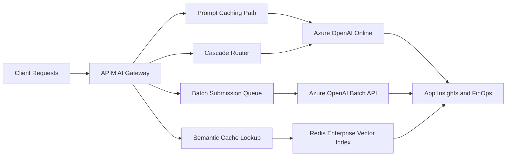
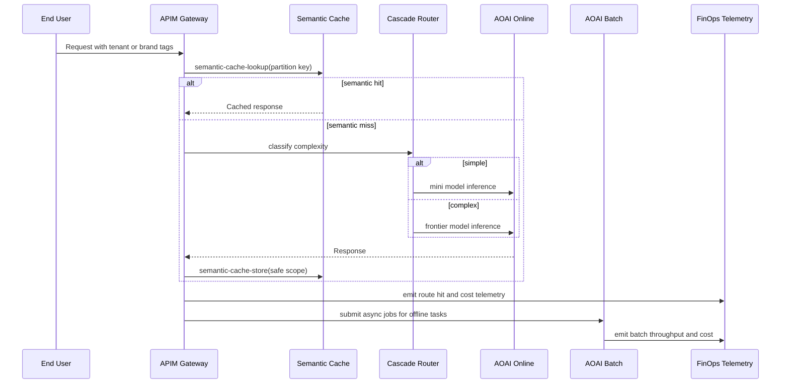

# Round 1127 · Cycle 2532
## APIM Semantic Cache vs AOAI Prompt Caching vs Batch API: Enterprise AI FinOps Optimization Selection FAQ

## 1) Executive summary for architecture and finance councils
- This round focuses on application architecture, FinOps ROI, cache safety boundaries, and governance; it excludes low-level systems internals.
- Recommended layering: Prompt Caching plus cascade routing for real-time traffic, APIM Semantic Cache for safely shareable semantic fragments, Batch API for asynchronous large-scale workloads.
- Core principle: any cost optimization must be tied to ACL isolation, audit replayability, and SLO constraints.
- Typical anti-pattern: storing personalized responses in shared semantic cache scopes.
- Operational target: 20% to 45% blended cost reduction without quality or compliance regression.

## 2) Topic-aligned capability radar (official references, fetched 2026-11-18 UTC)
- Azure OpenAI Prompt Caching: https://learn.microsoft.com/azure/ai-services/openai/how-to/prompt-caching
- Azure OpenAI Batch API: https://learn.microsoft.com/azure/ai-services/openai/how-to/batch
- Azure OpenAI quotas and limits: https://learn.microsoft.com/azure/ai-services/openai/quotas-limits
- APIM AI Gateway: https://learn.microsoft.com/azure/api-management/ai-gateway-overview
- APIM semantic cache policy: https://learn.microsoft.com/azure/api-management/azure-openai-semantic-cache-lookup-policy
- Azure Cache for Redis Enterprise: https://learn.microsoft.com/azure/azure-cache-for-redis/cache-overview
- APIM policy reference: https://learn.microsoft.com/azure/api-management/api-management-policies
- Azure Monitor and App Insights: https://learn.microsoft.com/azure/azure-monitor/
- Entra OBO flow: https://learn.microsoft.com/entra/identity-platform/v2-oauth2-on-behalf-of-flow
- Azure Architecture Center cost optimization: https://learn.microsoft.com/azure/architecture/guide/cost-optimization/
- Azure Front Door: https://learn.microsoft.com/azure/frontdoor/
- Microsoft Purview: https://learn.microsoft.com/purview/

## 3) Four FinOps optimization architecture options
- **Option A — AOAI Native Prompt Caching**: deterministic prefix reuse with zero extra infrastructure.
- **Option B — APIM Semantic Cache + Redis Vector**: semantic reuse with strict partition-key and invalidation governance.
- **Option C — AOAI Global Batch API**: asynchronous 24h window and dedicated quota pool with material discount.
- **Option D — SLM-to-LLM complexity routing**: lower-cost model first, frontier model on low confidence only.
- Recommended blend: A+D for online traffic, B for safe shared semantic snippets, C for offline scale tasks.

## 4) 12-dimension head-to-head matrix (including When NOT to choose)
| Dimension | A Prompt Caching | B APIM Semantic Cache | C Batch API | D SLM→LLM Cascade |
|---|---|---|---|---|
| 1. Unit token savings | High on input side | Indirect mixed savings | Strong discounted pricing | Strong blended savings |
| 2. Latency impact | Lowest | Fast on hit, added hop on miss | Not real-time | Added routing decision |
| 3. Stale/false-positive risk | Low | Medium-high | Low | Medium |
| 4. Multi-tenant leakage risk | Low | High if partitioning is weak | Low | Low-medium |
| 5. Quota pool isolation | Shared with online | Shared with online | Dedicated pool | Shared with online |
| 6. Multi-turn/tool compatibility | Medium | Medium-high | Low | High |
| 7. Additional infra cost | None | Redis + governance overhead | None | Routing and telemetry overhead |
| 8. Engineering complexity | Low-medium | High | Medium | Medium-high |
| 9. Freshness/invalidation governance | Medium | High requirement | Batch-level governance | Medium |
| 10. Observability/attribution | High | High | High | High |
| 11. Best-fit workload | Stable system prompts | Shared policy answers | Nightly bulk processing | Tiered support routing |
| 12. When NOT to choose | Highly personalized prefixes | No strict partition or invalidation strategy | Real-time chat workloads | No reliable confidence baseline |

## 5) Decision ladder and anti-patterns
- Step A: split online versus offline workloads first; evaluate Batch API for offline candidates.
- Step B: enable Prompt Caching first for online paths; validate prefix stability and hit-rate behavior.
- Step C: enable Semantic Cache only when safely shareable fragments and strict partition keys exist.
- Step D: enable cascade routing when complexity distribution is clearly tiered and threshold calibration is mature.
- Anti-pattern 1: caching private learner/customer artifacts in shared semantic stores.
- Anti-pattern 2: allowing batch jobs to consume live quota pools.
- Anti-pattern 3: never recalibrating cascade thresholds while model behavior drifts.
- Anti-pattern 4: chasing hit-rate while ignoring stale-answer complaints.

## 6) Five FinOps break-even worked Q&As
### Q1: How to estimate Prompt Caching gain threshold?
- `saving = prompt_input_tokens * hit_rate * input_unit_cost`.
- `net_saving = saving - extra_engineering_cost`.
- Prompt Caching usually repays quickly when prefix reuse is stable and hit-rate exceeds ~45%.

### Q2: When does Semantic Cache plus Redis break even?
- `semantic_benefit = reused_tokens * token_unit_cost * semantic_hit_rate`.
- `redis_total_cost = redis_fixed + redis_ops + governance_cost`.
- Break-even condition: `semantic_benefit > redis_total_cost`.

### Q3: How to evaluate Batch API ROI for nightly tasks?
- `batch_saving = batch_tokens * (online_unit_cost - batch_unit_cost)`.
- `deadline_risk_cost = delayed_jobs * business_penalty`.
- Batch is preferred when savings exceed delay risk and strict real-time feedback is unnecessary.

### Q4: How to tune cascade thresholds?
- `blended_cost = p_simple*cost_slm + p_complex*(cost_slm + cost_llm)`.
- `quality_guard = cascade_accuracy >= target_accuracy`.
- Minimize blended cost while keeping quality above policy threshold.

### Q5: How to close tenant/brand chargeback attribution?
- `chargeback = tokens * route_cost_factor * tenant_multiplier`.
- Enforce `x-brand`/`x-course` route headers and validate in KQL.
- Weekly dashboards should include hit-rate, upgrade-rate, unit-cost, and quality-complaint ratios.

## 7) Industry architecture #1: large-scale EdTech evening peak plus nightly reports
### Goals (EdTech)
- Real-time tutoring and essay grading require low latency with explainable rubric behavior.
- Nightly parent and learner progress reports require high throughput but allow async completion windows.
- Target: 35%+ blended cost reduction without learner-experience degradation.

### End-to-end flow (EdTech)
1. Standardize system prompts and 6K curriculum rubrics to drive high Prompt Caching hit rates.
2. APIM Semantic Cache stores only shared curriculum snippets with partition key `course_id + rubric_version`.
3. Personalized grades and private evaluation data are never cached semantically.
4. Evening live traffic uses `mini -> frontier` cascade routing.
5. Five million nightly reports run through Batch API dedicated quota pools.

### SLA and mitigations (EdTech)
- Live tutoring P95 < 2.5s; nightly batch completion within 24h at 99.9%.
- Failure A: cache contamination -> immediate partition invalidation and fallback to Prompt Caching only.
- Failure B: batch queue backlog -> shard retries and priority-based recovery.
- Failure C: cascade misclassification drift -> threshold tightening and human sampling escalation.

## 8) Industry architecture #2: cross-border e-commerce SKU re-audit plus global support cascade
### Goals (E-Commerce)
- Massive SKU compliance re-audit must remain isolated from storefront real-time traffic.
- Global buyer support must stay responsive with controlled unit economics.
- Target: protect live PTU headroom while scaling nightly compliance jobs.

### End-to-end flow (E-Commerce)
1. SKU compliance re-audit jobs run exclusively through Batch API pools.
2. Buyer support routes through `gpt-4.1-mini` then escalates to `gpt-4.1` on low confidence.
3. APIM injects brand-level chargeback headers (`x-brand-id`, `x-route-tier`).
4. Semantic cache stores only public policy snippets, never order- or customer-specific records.
5. FinOps dashboards report per-brand support unit cost and cascade escalation rates.

### SLA and mitigations (E-Commerce)
- Live ticket P95 < 2.0s; batch completion rate >= 99.5% in 24h.
- Failure A: brand-level surge -> per-brand throttling and tiered degradation templates.
- Failure B: batch backpressure -> auto-splitting and priority rebalance.
- Failure C: semantic stale risk -> stricter TTL and version-stamp invalidation.

## 9) Mermaid topology flowchart


## 10) Mermaid runtime sequence


## 11) Bicep IaC (APIM + Redis + AOAI)
```bicep
param location string = 'eastus2'
param apimName string
param redisName string
param aoaiName string
resource apim 'Microsoft.ApiManagement/service@2023-05-01-preview' = {
  name: apimName
  location: location
  sku: { name: 'Premium' capacity: 2 }
  properties: { publisherEmail: 'platform@contoso.com' publisherName: 'Contoso Platform' }
}
resource redis 'Microsoft.Cache/redisEnterprise@2024-03-01' = {
  name: redisName
  location: location
  sku: { name: 'Enterprise_E10' capacity: 2 }
}
resource aoai 'Microsoft.CognitiveServices/accounts@2024-10-01' = {
  name: aoaiName
  location: location
  kind: 'OpenAI'
  sku: { name: 'S0' }
  properties: { publicNetworkAccess: 'Disabled' customSubDomainName: aoaiName }
}
```

## 12) APIM semantic-cache policy snippet with partition-key safety
```xml
<policies>
  <inbound>
    <base />
    <set-variable name="tenantId" value="@(context.Request.Headers.GetValueOrDefault("x-tenant-id","na"))" />
    <set-variable name="courseId" value="@(context.Request.Headers.GetValueOrDefault("x-course-id","na"))" />
    <set-variable name="rubricVer" value="@(context.Request.Headers.GetValueOrDefault("x-rubric-version","na"))" />
    <set-variable name="partitionKey" value="@($"{context.Variables["tenantId"]}:{context.Variables["courseId"]}:{context.Variables["rubricVer"]}")" />
    <azure-openai-semantic-cache-lookup
      cache-id="redis-semantic-cache"
      score-threshold="0.92"
      max-candidates="3"
      partition-key="@(context.Variables.GetValueOrDefault<string>("partitionKey"))" />
  </inbound>
  <backend><forward-request timeout="120" /></backend>
  <outbound>
    <azure-openai-semantic-cache-store
      cache-id="redis-semantic-cache"
      partition-key="@(context.Variables.GetValueOrDefault<string>("partitionKey"))" />
  </outbound>
</policies>
```

## 13) KQL for cache hit and chargeback attribution
```kql
let start=ago(24h);
customEvents
| where timestamp >= start
| where name in ("semantic_hit","semantic_miss","prompt_cache_hit","cascade_upgrade")
| summarize events=count() by name, tostring(customDimensions.tenant), bin(timestamp, 1h)
| order by timestamp desc
```

```kql
let start=ago(7d);
customMetrics
| where timestamp >= start
| where name in ("token_input","token_output","estimated_cost_usd")
| summarize input=sumif(value,name=="token_input"), output=sumif(value,name=="token_output"), cost=sumif(value,name=="estimated_cost_usd")
  by brand=tostring(customDimensions.brand), route=tostring(customDimensions.routeTier), bin(timestamp,1d)
| extend usd_per_1k_tokens = iff((input+output)==0, real(null), cost*1000.0/(input+output))
| order by timestamp desc
```

## 14) Day-0 / Day-1 / Day-2 checklist
### Day-0 (design)
- D0-01 Define strict online versus offline quota pool separation.
- D0-02 Define prompt-prefix templates and version governance.
- D0-03 Define semantic-cache allowlist and disallowed personalized payloads.
- D0-04 Define partition-key strategy by tenant, course, brand, and version.
- D0-05 Define cascade thresholds and quality guardrails.
- D0-06 Define token-cost attribution tags and reconciliation workflow.
- D0-07 Define invalidation strategy by TTL, version stamp, and emergency purge.
- D0-08 Define audit replay and compliance sampling requirements.

### Day-1 (go-live)
- D1-01 Enable Prompt Caching first and validate latency plus savings.
- D1-02 Enable Semantic Cache in controlled cohorts and monitor stale complaints.
- D1-03 Validate Batch API isolation from live PTU/PAYGO capacity.
- D1-04 Validate cascade threshold behavior against quality baselines.
- D1-05 Execute cache-contamination and partition-boundary drills.
- D1-06 Execute batch backlog and retry recovery drills.
- D1-07 Publish first-week FinOps dashboards and alerts.
- D1-08 Freeze rollback paths and complete launch review.

### Day-2 (optimize)
- D2-01 Weekly review prompt and semantic hit rates with stale risk trends.
- D2-02 Weekly review cascade escalation rate and quality deltas.
- D2-03 Biweekly review batch completion and delay distribution.
- D2-04 Monthly re-evaluate Redis cost versus semantic benefit.
- D2-05 Monthly recalibrate partition strategy and route thresholds.
- D2-06 Monthly compliance replay sampling for leakage risk.
- D2-07 Quarterly update route policy and budget plans.
- D2-08 Quarterly update incident runbooks and training.

## 15) Extended Q&A, deliverables, and validation
### Five strategic Q&As
- QA-A When should we use Prompt Caching only? When prefix stability is high and latency SLO is strict.
- QA-B When should we add Semantic Cache? When safely shareable semantic fragments and strict partitioning are available.
- QA-C When should Batch API dominate? When workloads are asynchronous, huge-scale, and deadline-tolerant.
- QA-D When should cascade routing be enabled? When complexity distribution is tiered and confidence scoring is trustworthy.
- QA-E How to avoid cost-saving quality regressions? Bind quality guardrails directly to route policy activation.

### 12 FinOps review checks
- FR-01 Monitor hit-rate, stale-rate, and false-hit complaints together.
- FR-02 Verify partition keys cover all tenant and course boundaries.
- FR-03 Verify batch jobs never consume live-online quota pools.
- FR-04 Verify token and cost attribution fields are standardized.
- FR-05 Verify cascade threshold regression testing and rollback.
- FR-06 Verify Redis cost ceilings and auto-alert behavior.
- FR-07 Verify one-click invalidation during policy or model upgrades.
- FR-08 Verify per-brand chargeback reconciliation reports.
- FR-09 Verify anomaly alerts for extreme unit-cost spikes.
- FR-10 Verify model-upgrade A/B baseline for quality and cost.
- FR-11 Verify seasonal capacity plans protect budget and SLO.
- FR-12 Verify full compliance replay from prompt to final response.

### Deliverables this round
- Bilingual FAQ with sections 1..15 and zero loop padding.
- 12-dimension matrix, 5 break-even Q&As, 2 Mermaid diagrams, Bicep, APIM policy snippet, KQL, and Day-0/1/2 checklist.
- SVG: `assets/42-cycle-2532-daily-breakthroughs.svg`.
- H5 workbench: `workbench-cycle-2532.html` with selector `#2532`.
- 7-card outputs: `benchmark-cards.html` and `benchmark-cards.en.html`.
- Evidence: `evidence/cycle-2532-*.json/csv`.

### Run and validate
```bash
python workshops/azure-agent-infra/simulator/cycle_1127_pipeline.py --write
python workshops/azure-agent-infra/simulator/cycle_1127_pipeline.py --check
python workshops/azure-agent-infra/simulator/strict_suffix_gate.py workshops/azure-agent-infra/apim-semantic-cache-vs-aoai-prompt-caching-vs-batch-api-finops-optimization-selection-faq-r1127.md workshops/azure-agent-infra/apim-semantic-cache-vs-aoai-prompt-caching-vs-batch-api-finops-optimization-selection-faq-r1127.en.md docs/azure-agent-infra/apim-semantic-cache-vs-aoai-prompt-caching-vs-batch-api-finops-optimization-selection-faq-r1127.md docs/azure-agent-infra/apim-semantic-cache-vs-aoai-prompt-caching-vs-batch-api-finops-optimization-selection-faq-r1127.en.md
pytest workshops/azure-agent-infra/simulator -q
```
