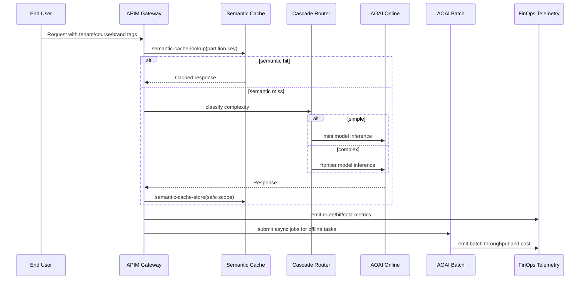

# Round 1127 · Cycle 2532
## APIM Semantic Cache vs AOAI Prompt Caching vs Batch API：企业 AI FinOps 降本选型 FAQ

## 1) 执行摘要（架构与财务联席）
- 本轮聚焦企业应用架构、FinOps ROI、缓存安全边界与治理，不涉及底层硬件细节。
- 推荐分层：前台实时流量优先 Prompt Caching + 小模型级联，跨租户复用且可控语义问答优先 APIM Semantic Cache，离线大批量任务优先 Batch API。
- 关键原则：所有降本策略必须与 ACL/租户隔离、审计回放、SLO 目标绑定，不能只看 token 单价。
- 典型反模式：把个性化用户答案写入共享语义缓存，造成跨租户泄漏风险。
- 运营目标：在不降低关键业务质量前提下，实现 20%~45% 综合成本下降。

## 2) Topic-aligned capability radar（官方来源，抓取时间 2026-11-18 UTC）
- Azure OpenAI Prompt Caching: https://learn.microsoft.com/azure/ai-services/openai/how-to/prompt-caching
- Azure OpenAI Batch API: https://learn.microsoft.com/azure/ai-services/openai/how-to/batch
- Azure OpenAI pricing and quotas: https://learn.microsoft.com/azure/ai-services/openai/quotas-limits
- APIM AI Gateway overview: https://learn.microsoft.com/azure/api-management/ai-gateway-overview
- APIM semantic cache policy reference: https://learn.microsoft.com/azure/api-management/azure-openai-semantic-cache-lookup-policy
- Azure Cache for Redis Enterprise: https://learn.microsoft.com/azure/azure-cache-for-redis/cache-overview
- APIM policy reference: https://learn.microsoft.com/azure/api-management/api-management-policies
- Azure Monitor + App Insights: https://learn.microsoft.com/azure/azure-monitor/
- Entra OBO flow: https://learn.microsoft.com/entra/identity-platform/v2-oauth2-on-behalf-of-flow
- Azure Architecture Center FinOps: https://learn.microsoft.com/azure/architecture/guide/cost-optimization/
- Azure Front Door: https://learn.microsoft.com/azure/frontdoor/
- Purview governance: https://learn.microsoft.com/purview/

## 3) 四类 FinOps 降本架构定义
- **Option A — AOAI Native Prompt Caching**：复用确定性前缀，零额外基础设施，实时链路收益高。
- **Option B — APIM Semantic Cache + Redis Vector**：面向语义近似复用，需严格分区键和缓存失效治理。
- **Option C — AOAI Global Batch API**：异步 24h 窗口、独立配额池、单价折扣明显，适合离线批任务。
- **Option D — SLM→LLM 级联路由**：小模型先判定，低置信度再升级大模型，实现单位问题成本分层。
- 组合建议：A+D 负责在线链路，B 负责可共享语义片段，C 吞吐离线任务。

## 4) 12 维度 head-to-head 选型矩阵（含 When NOT to choose）
| 维度 | A Prompt Caching | B APIM Semantic Cache | C Batch API | D SLM→LLM Cascade |
|---|---|---|---|---|
| 1. 单位 token 节省 | 输入侧高 | 输入/输出间接节省 | 总价折扣显著 | 混合节省显著 |
| 2. 延迟影响（TTFT/P95） | 最低 | 命中快，未命中增加 hop | 不适用实时 | 增加路由判断 |
| 3. stale/误命中风险 | 低（前缀确定） | 中高（语义近似） | 低（离线） | 中（分类误判） |
| 4. 多租户泄漏风险 | 低 | 高（若分区键不严） | 低 | 低中 |
| 5. 配额池隔离 | 与在线同池 | 与在线同池 | 独立池 | 与在线同池 |
| 6. 多轮工具兼容性 | 中 | 中高 | 低（批处理） | 高 |
| 7. 额外基础设施成本 | 无 | Redis/治理成本 | 无额外缓存成本 | 路由与观测成本 |
| 8. 调参与工程复杂度 | 低中 | 高 | 中 | 中高 |
| 9. 新鲜度与失效治理 | 中 | 高要求 | 批次级治理 | 中 |
| 10. 可观测与归因 | 高 | 高 | 高 | 高 |
| 11. Best-fit 场景 | 固定系统提示/模板 | 可共享标准问答片段 | 夜间批量报告/重审 | 在线客服分层问答 |
| 12. When NOT to choose | 个性化前缀频繁变化 | 无法做严格分区/失效策略 | 强实时交互 | 无高质量路由基线 |

## 5) 决策树与反模式
- Step A：先分在线/离线流量；离线优先评估 Batch API。
- Step B：在线链路先启用 Prompt Caching，评估前缀稳定度与命中率。
- Step C：仅在存在可共享语义片段且可严格分区时启用 APIM Semantic Cache。
- Step D：当问题复杂度分布明显分层时，启用 SLM→LLM 级联并持续校准阈值。
- 反模式 1：把个体画像、分数、私密答案写入共享语义缓存。
- 反模式 2：Batch 任务抢占在线配额池导致白天链路抖动。
- 反模式 3：级联阈值长期不校准，造成成本上升或质量下滑。
- 反模式 4：只追求缓存命中率，不追踪错误命中与 stale 影响。

## 6) 5 个 FinOps break-even worked Q&A（含公式）
### Q1：Prompt Caching 的收益阈值如何算？
- `saving = prompt_input_tokens * hit_rate * input_unit_cost`。
- `net_saving = saving - extra_engineering_cost`。
- 若前缀稳定且 `hit_rate >= 0.45`，通常可快速回本。

### Q2：Semantic Cache 引入 Redis 何时划算？
- `semantic_benefit = reused_tokens * token_unit_cost * semantic_hit_rate`。
- `redis_total_cost = redis_fixed + redis_ops + governance_cost`。
- break-even 条件：`semantic_benefit > redis_total_cost`。

### Q3：Batch API 对夜间任务的 ROI 如何估？
- `batch_saving = batch_tokens * (online_unit_cost - batch_unit_cost)`。
- `deadline_risk_cost = delayed_jobs * business_penalty`。
- 当 `batch_saving > deadline_risk_cost` 且不要求秒级反馈时优先 Batch。

### Q4：级联路由阈值如何选择？
- `blended_cost = p_simple*cost_slm + p_complex*(cost_slm + cost_llm)`。
- `quality_guard = cascade_accuracy >= target_accuracy`。
- 在满足质量红线前提下最小化 `blended_cost`。

### Q5：跨品牌/课程成本归因如何闭环？
- `chargeback = tokens * route_cost_factor * tenant_multiplier`。
- 必须写入 `x-brand`/`x-course` 头并在 KQL 聚合验证。
- 建议周报输出“命中率、升级率、单位成本、质量投诉率”四指标。

## 7) 行业架构一：在线教育 1000 万学员晚高峰 + 夜间学情报告
### 场景目标（EdTech）
- 晚高峰实时答疑/作文批改要求稳定低延迟与可解释评分标准。
- 夜间批量生成家长/学员学情报告，吞吐大但可接受异步窗口。
- 目标：保持体验不降的前提下降本 35%+。

### 架构流程（EdTech）
1. 统一系统提示和 6K 课程 rubric 前缀，驱动 Prompt Caching 高命中。
2. APIM Semantic Cache 仅缓存“课程公共问答片段”，分区键 `course_id + rubric_version`。
3. 个体化成绩、评语、敏感信息绝不写入语义缓存。
4. 晚高峰在线链路采用 `mini -> frontier` 级联提升性价比。
5. 夜间 5M 报告任务全部走 Batch API 独立配额池。

### SLA 与缓解（EdTech）
- 在线答疑 P95 < 2.5s；夜间批任务在 24h 窗口内完成率 99.9%。
- 失效 A：缓存污染 -> 立即分区失效 + 回退 Prompt Caching only。
- 失效 B：批队列堆积 -> 分片重提交流程 + 优先级回补。
- 失效 C：级联误判率升高 -> 提升升级阈值并触发人工抽检。

## 8) 行业架构二：跨境电商 100M SKU 合规重审 + 全球工单级联
### 场景目标（E-Commerce）
- SKU 合规复审为批量高吞吐任务，必须与在线店面流量隔离。
- 全球买家工单需要实时响应且成本可控。
- 目标：确保在线 PTU 不被夜间批量任务挤占。

### 架构流程（E-Commerce）
1. SKU 重审任务全部进入 Batch API，独立于在线 PTU/PAYGO 池。
2. 买家工单先走 `gpt-4.1-mini`，低置信度升级到 `gpt-4.1`。
3. APIM 按品牌注入 chargeback 头 `x-brand-id` 与 `x-route-tier`。
4. Semantic Cache 仅用于跨品牌共享的公开政策文本，不缓存订单个体数据。
5. FinOps 看板按品牌输出单位工单成本与升级率。

### SLA 与缓解（E-Commerce）
- 实时工单 P95 < 2.0s；批审任务 24h 完成率 >= 99.5%。
- 失效 A：品牌热点爆发 -> 单品牌限流 + 分层降级模板回复。
- 失效 B：批任务回压 -> 自动拆批并延迟低优先级批次。
- 失效 C：语义缓存 stale -> TTL 收紧 + 版本戳强制失效。

## 9) Mermaid 架构图（flowchart）

```mermaid
flowchart LR
    U[Client Requests] --> GW[APIM AI Gateway]
    GW --> A[Prompt Caching Path]
    GW --> B[Semantic Cache Lookup]
    GW --> D[SLM to LLM Cascade Router]
    GW --> C[Batch Submission Queue]
    B --> R[Redis Enterprise Vector Index]
    A --> AOAI[Azure OpenAI Online]
    D --> AOAI
    C --> BAOAI[Azure OpenAI Batch API]
    AOAI --> OBS[App Insights and FinOps]
    BAOAI --> OBS
    R --> OBS
```


## 10) Mermaid 运行时流程（sequenceDiagram）


## 11) Bicep IaC（APIM + Redis + AOAI）
```bicep
param location string = 'eastus2'
param apimName string
param redisName string
param aoaiName string

resource apim 'Microsoft.ApiManagement/service@2023-05-01-preview' = {
  name: apimName
  location: location
  sku: { name: 'Premium' capacity: 2 }
  properties: { publisherEmail: 'platform@contoso.com' publisherName: 'Contoso Platform' }
}

resource redis 'Microsoft.Cache/redisEnterprise@2024-03-01' = {
  name: redisName
  location: location
  sku: { name: 'Enterprise_E10' capacity: 2 }
}

resource aoai 'Microsoft.CognitiveServices/accounts@2024-10-01' = {
  name: aoaiName
  location: location
  kind: 'OpenAI'
  sku: { name: 'S0' }
  properties: { publicNetworkAccess: 'Disabled' customSubDomainName: aoaiName }
}
```

## 12) APIM Semantic Cache Policy（含分区键安全）
```xml
<policies>
  <inbound>
    <base />
    <set-variable name="tenantId" value="@(context.Request.Headers.GetValueOrDefault("x-tenant-id","na"))" />
    <set-variable name="courseId" value="@(context.Request.Headers.GetValueOrDefault("x-course-id","na"))" />
    <set-variable name="rubricVer" value="@(context.Request.Headers.GetValueOrDefault("x-rubric-version","na"))" />
    <set-variable name="partitionKey" value="@($"{context.Variables["tenantId"]}:{context.Variables["courseId"]}:{context.Variables["rubricVer"]}")" />
    <azure-openai-semantic-cache-lookup
      cache-id="redis-semantic-cache"
      score-threshold="0.92"
      max-candidates="3"
      partition-key="@(context.Variables.GetValueOrDefault<string>("partitionKey"))" />
  </inbound>
  <backend><forward-request timeout="120" /></backend>
  <outbound>
    <azure-openai-semantic-cache-store
      cache-id="redis-semantic-cache"
      partition-key="@(context.Variables.GetValueOrDefault<string>("partitionKey"))" />
  </outbound>
</policies>
```

## 13) KQL（缓存命中与成本归因）
```kql
let start=ago(24h);
customEvents
| where timestamp >= start
| where name in ("semantic_hit","semantic_miss","prompt_cache_hit","cascade_upgrade")
| summarize events=count() by name, tostring(customDimensions.tenant), bin(timestamp, 1h)
| order by timestamp desc
```

```kql
let start=ago(7d);
customMetrics
| where timestamp >= start
| where name in ("token_input","token_output","estimated_cost_usd")
| summarize input=sumif(value,name=="token_input"), output=sumif(value,name=="token_output"), cost=sumif(value,name=="estimated_cost_usd")
  by brand=tostring(customDimensions.brand), route=tostring(customDimensions.routeTier), bin(timestamp,1d)
| extend usd_per_1k_tokens = iff((input+output)==0, real(null), cost*1000.0/(input+output))
| order by timestamp desc
```

## 14) Day-0 / Day-1 / Day-2 清单
### Day-0（设计）
- D0-01：分离在线链路与离线批处理链路，定义不可互扰的配额池。
- D0-02：定义 Prompt 前缀模板规范与版本控制。
- D0-03：定义语义缓存允许写入的数据类别和禁止写入清单。
- D0-04：定义分区键策略（tenant/course/brand/version）。
- D0-05：定义级联阈值、升级条件与质量红线。
- D0-06：定义成本归因标签与账单核对口径。
- D0-07：定义缓存失效策略（TTL、版本戳、强制清空）。
- D0-08：定义审计回放与合规抽检流程。

### Day-1（上线）
- D1-01：先启用 Prompt Caching，观测命中率与延迟变化。
- D1-02：再灰度启用 Semantic Cache，严格监控误命中投诉。
- D1-03：验证 Batch API 与在线池完全隔离。
- D1-04：验证级联路由阈值与质量指标一致。
- D1-05：执行缓存污染与分区越界演练。
- D1-06：执行批处理积压与重试演练。
- D1-07：发布首周 FinOps 看板与告警策略。
- D1-08：固化回滚路径并完成上线复盘。

### Day-2（优化）
- D2-01：每周复盘 Prompt/semantic 命中率与 stale 风险。
- D2-02：每周复盘级联升级率与质量差异。
- D2-03：双周复盘 Batch 完成率与延迟分布。
- D2-04：每月复核 Redis 成本与语义收益差。
- D2-05：每月调整分区键和阈值参数。
- D2-06：每月抽检跨租户泄漏风险证据。
- D2-07：季度更新路由策略与成本预算。
- D2-08：季度更新值班手册与应急演练计划。

## 15) 扩展问答、交付清单与验收命令
### 五条扩展问答
- QA-A：何时只用 Prompt Caching？当系统提示高度稳定且实时性要求极高时。
- QA-B：何时上 Semantic Cache？当存在可共享语义片段且可严格做分区/失效治理时。
- QA-C：何时优先 Batch API？当任务可异步且规模巨大、实时性要求低时。
- QA-D：何时上级联路由？当问题复杂度分布明显且有可靠置信度判别时。
- QA-E：如何避免“降本即降质”？把质量红线（准确率/投诉率）绑定到路由策略开关。

### 12 条 FinOps 评审项
- FR-01：命中率、误命中率、stale 率是否同时监控。
- FR-02：是否验证缓存分区键覆盖全部租户边界。
- FR-03：Batch 与在线配额池是否物理/逻辑隔离。
- FR-04：是否有统一 token 与成本归因字段规范。
- FR-05：是否有级联阈值回归与回滚机制。
- FR-06：是否有 Redis 成本上限与触发策略。
- FR-07：是否有缓存版本升级的一键失效方案。
- FR-08：是否有跨品牌 chargeback 对账报表。
- FR-09：是否有异常高成本请求自动告警。
- FR-10：是否有模型升级后的成本/质量对比基线。
- FR-11：是否有高峰季节的预算保护策略。
- FR-12：是否有合规抽检可回放证据链。

### 本轮交付
- 双语 FAQ（sections 1..15，零循环填充）；
- 12 维度矩阵、5 个 break-even Q&A、2 张 Mermaid、Bicep、APIM policy、KQL、Day-0/1/2；
- SVG：`assets/42-cycle-2532-daily-breakthroughs.svg`；
- H5：`workbench-cycle-2532.html` + selector `#2532`；
- 7-card：`benchmark-cards.html` 与 `benchmark-cards.en.html`；
- Evidence：`evidence/cycle-2532-*.json/csv`。

### 运行与验收
```bash
python workshops/azure-agent-infra/simulator/cycle_1127_pipeline.py --write
python workshops/azure-agent-infra/simulator/cycle_1127_pipeline.py --check
python workshops/azure-agent-infra/simulator/strict_suffix_gate.py workshops/azure-agent-infra/apim-semantic-cache-vs-aoai-prompt-caching-vs-batch-api-finops-optimization-selection-faq-r1127.md workshops/azure-agent-infra/apim-semantic-cache-vs-aoai-prompt-caching-vs-batch-api-finops-optimization-selection-faq-r1127.en.md docs/azure-agent-infra/apim-semantic-cache-vs-aoai-prompt-caching-vs-batch-api-finops-optimization-selection-faq-r1127.md docs/azure-agent-infra/apim-semantic-cache-vs-aoai-prompt-caching-vs-batch-api-finops-optimization-selection-faq-r1127.en.md
pytest workshops/azure-agent-infra/simulator -q
```
