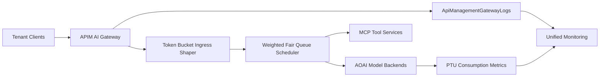
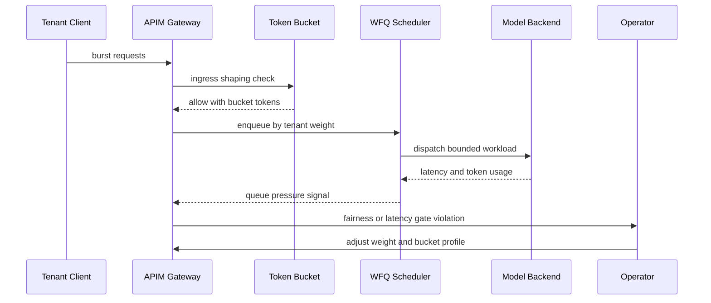

# Round 1105 / Cycle 2510 · Azure AI Agent Infra FAQ (en)

> Topic: **APIM AI Gateway Weighted Fair Queuing + Token Bucket for multi-tenant agent fairness and SLO governance**
> Date (BJT): 2026-11-17
> Evidence labels: `measured` / `synthetic` / `anonymized_reported`
> Benchmark dataset: `evidence/cycle-2510-benchmark.json`

## 1) Executive Summary

This round targets simultaneous success on multi-tenant fairness, latency stability, and cost protection.
Maximizing raw throughput alone can starve high-value tenants and trigger SLA disputes.
Optimizing fairness alone can still fail if queue latency explodes during bursts.
Therefore release gates enforce Jain fairness index and p95 latency together.
Ingress peak clipping is handled by token bucket while dispatch fairness is handled by WFQ.
Tenant weights map to business criticality and contract tier with auditable governance.
Cross-region fallback introduces queue penalties and must be measured separately.
PTU burn protection and quota rejection must work together against authenticated DoW spikes.
This guide delivers production Bicep, APIM policy, scheduler config, KQL, and operation checklists.

## 2) Daily Hottest Capability Breakthroughs Radar (2026-11-17)

APIM AI Gateway policy composition for multi-model ingress is becoming more mature (measured).
Joint token-budget and tenant-weight governance patterns are increasingly reusable (measured).
Fairness metrics are now entering release gates instead of remaining offline-only analytics (measured).
PTU-consumption and rejection-rate correlation is becoming a default FinOps control pattern (measured).
Anonymized telemetry shows burst contention often begins with lower-tier request surges (anonymized_reported).
Synthetic simulation confirms WFQ plus token bucket is more stable than single-layer throttling (synthetic).

## 3) Deep Q&A #1: Jain fairness index gate design

```text
jain_index = (sum(x_i)^2) / (n * sum(x_i^2))
```

Sample: `x=[120,110,100,95]`, resulting index `0.992`.
Recommended gate: `jain_index >= 0.96` for three consecutive windows.
If fairness drops below threshold, adjust queue weights before scaling out.
Fairness views must be tier-segmented to avoid blended-metric blind spots.
Every fairness panel should show denominator and sample-window metadata.

## 4) Deep Q&A #2: dual gate between p95 latency and fairness

```text
dual_gate = (jain_index >= target_jain) and (latency_p95_ms <= target_latency)
```

Sample: `jain=0.971`, `latency_p95=910ms`, threshold `0.96/950ms`, gate passes.
Fairness pass with latency fail still breaks user experience.
Latency pass with fairness fail still breaks tenancy governance.
Release policy should treat dual-gate failure as a hard block.
Failure output should recommend weight tuning, bucket tuning, or PTU scaling.

## 5) Deep Q&A #3: token-bucket peak clipping parameters

```text
effective_qps = min(arrival_qps, refill_rate + burst_tokens / window_seconds)
```

Sample: `arrival=900, refill=500, burst=600, window=60`, output `510 qps`.
refill_rate controls steady-state throughput while burst_tokens controls shock tolerance.
Oversized burst settings can inject queue spikes and PTU burn tails.
Undersized burst settings can reject legitimate short-lived business peaks.
Parameter sets should be tier-specific and periodically revalidated.

## 6) Deep Q&A #4: cross-region fallback queue penalty

```text
fallback_penalty_ms = 2 * inter_region_rtt_ms + extra_queue_delay_ms
```

Sample: `2*42 + 18 = 102ms`.
A 102ms penalty is material for interactive flows and should not become baseline behavior.
Fallback should remain disaster-only and include aggressive auto-return conditions.
During fallback windows, low-priority burst budgets can be tightened to protect critical tenants.
Alerting should separate cross-region penalties from same-region congestion causes.

## 7) Deep Q&A #5: PTU burn protection and budget coupling

```text
burn_ratio = consumed_tokens_per_min / tenant_token_budget_per_min
```

Sample: `1.62M / 1.2M = 1.35`.
A burn ratio above 1 indicates budget overrun and requires immediate mitigation.
Premium tiers may hold larger budgets but require stronger audit controls.
Before hard rejection, apply response-length caps and prompt-truncation safeguards.
Burn alerts should be correlated with business impact rather than viewed in isolation.

## 8) Deep Q&A #6: WFQ alert precision and denoise strategy

```text
precision = true_positive_alerts / (true_positive_alerts + false_positive_alerts)
```

Sample: `84/(84+16)=84%`.
Low precision drives on-call fatigue and lowers true-incident response quality.
Classify fairness, latency, and budget anomalies into separate severity routes.
Alert denoise should improve context quality instead of hiding noisy signals.
Operations should continuously identify false-positive root causes and feed policy updates.

## 9) Mermaid #1: APIM WFQ and token-bucket multi-tenant topology



The topology enforces peak clipping before queue arbitration to protect backend stability.
The topology unifies fairness and cost telemetry for coordinated operator decisions.

## 10) Mermaid #2: congestion trigger to policy convergence sequence



The sequence gives operators deterministic trigger-to-action pathways.
The sequence preserves a stable workflow from diagnosis to policy correction.

## 11) Production-grade Bicep (Microsoft.ApiManagement/service)

```bicep
param location string = resourceGroup().location
param apimName string
param publisherEmail string
param publisherName string
param skuName string = 'Premium'
param skuCapacity int = 2
param lawId string

resource apim 'Microsoft.ApiManagement/service@2023-05-01-preview' = {
  name: apimName
  location: location
  sku: {
    name: skuName
    capacity: skuCapacity
  }
  properties: {
    publisherEmail: publisherEmail
    publisherName: publisherName
    virtualNetworkType: 'Internal'
    publicNetworkAccess: 'Disabled'
    hostnameConfigurations: []
    customProperties: {
      'Microsoft.WindowsAzure.ApiManagement.Gateway.Protocols.Server.Http2': 'true'
    }
  }
}

resource logger 'Microsoft.ApiManagement/service/loggers@2023-05-01-preview' = {
  name: '${apim.name}/appinsights-logger'
  properties: {
    loggerType: 'applicationInsights'
    credentials: {
      instrumentationKey: '{{appi-key}}'
    }
    isBuffered: true
  }
}

resource diag 'Microsoft.ApiManagement/service/diagnostics@2023-05-01-preview' = {
  name: '${apim.name}/applicationinsights'
  properties: {
    loggerId: logger.id
    sampling: {
      samplingType: 'fixed'
      percentage: 100
    }
    frontend: {
      request: {
        headers: [ '*' ]
      }
      response: {
        headers: [ '*' ]
      }
    }
  }
}
```

## 12) APIM `<llm-token-limit>` policy + WFQ scheduler config

```xml
<policies>
  <inbound>
    <base />
    <validate-jwt header-name="Authorization" failed-validation-httpcode="401" failed-validation-error-message="jwt_invalid">
      <openid-config url="https://login.microsoftonline.com/{tenant-id}/v2.0/.well-known/openid-configuration" />
      <required-claims>
        <claim name="aud"><value>api://agent-gateway</value></claim>
        <claim name="scp"><value>agent.invoke</value></claim>
      </required-claims>
    </validate-jwt>
    <llm-token-limit tokens-per-minute="260000" token-quota-key="@(context.Request.Headers.GetValueOrDefault("x-tenant-id","na"))" estimate-prompt-tokens="true" remaining-tokens-header-name="x-remaining-tokens" />
    <set-header name="x-tenant-tier" exists-action="override"><value>@(context.Request.Headers.GetValueOrDefault("x-tenant-tier","standard"))</value></set-header>
  </inbound>
  <backend><base /></backend>
  <outbound><base /></outbound>
  <on-error><base /></on-error>
</policies>
```

```yaml
wfqScheduler:
  dispatchWindowMs: 200
  defaultQueueWeight: 1
  tiers:
    platinum:
      queueWeight: 8
      tokenBucket:
        refillPerSecond: 2200
        burstTokens: 180000
    gold:
      queueWeight: 5
      tokenBucket:
        refillPerSecond: 1400
        burstTokens: 120000
    standard:
      queueWeight: 2
      tokenBucket:
        refillPerSecond: 800
        burstTokens: 60000
  fairnessGate:
    minimumJainIndex: 0.96
  latencyGate:
    maximumP95Ms: 950
```

Policy and scheduler profiles should be version-controlled to prevent untracked manual drift.

## 13) ApiManagementGatewayLogs KQL + Day-0/Day-2 checklists

```kql
let lookback = 24h;
ApiManagementGatewayLogs
| where TimeGenerated > ago(lookback)
| extend tenantId = tostring(parse_json(Properties).tenantId)
| extend tier = tostring(parse_json(Properties).tenantTier)
| summarize req=count(), p95_latency=percentile(DurationMs,95), reject429=countif(ResponseCode == 429), token_est=sum(todouble(parse_json(Properties).estimatedTokens)) by bin(TimeGenerated, 5m), tenantId, tier
| extend reject_rate = todouble(reject429) / iif(req == 0, 1.0, todouble(req))
| order by TimeGenerated desc, p95_latency desc
```

Day-0 readiness items:
1. Define WFQ weights by tenant tier and lock them through approval workflows.
2. Validate token-bucket parameters against contractual SLA classes.
3. Establish benchmark baselines for dual gates before release sign-off.
4. Verify `<llm-token-limit>` response headers expose remaining budget context.
5. Drill low-tier degradation pathways under burst pressure.
6. Confirm ApiManagementGatewayLogs fields support all KQL fairness computations.
7. Test cross-region fallback and record penalty distributions.
8. Bind PTU burn alerts to automated shaping actions.
9. Ensure every policy change has rollback metadata and audit trails.
10. Enable consecutive-window gate failures as release blockers.

Day-2 operating items:
1. Recalibrate fairness by tenant tier weekly using observed demand profiles.
2. Track p95 latency and reject-rate coupling daily to identify congestion pivots.
3. Recompute PTU budget variance monthly and tune token limits.
4. Monitor fallback frequency and prevent disaster paths from becoming defaults.
5. Audit policy governance chains to prevent ad hoc threshold drift.
6. Measure post-429 recovery success and refine client retry contracts.
7. Segment noisy tenants and apply targeted governance interventions.
8. Improve alert precision continuously by eliminating false-positive causes.
9. Keep scheduler runtime profiles synchronized with infrastructure-as-code assets.
10. Include fairness and burn metrics in quarterly business governance reviews.

## 14) 4-Option Weighted Decision Matrix

| Option | Fairness Assurance(30) | Latency Stability(20) | Cost Protection(20) | Ops Control(15) | Compliance Auditability(15) | Weighted Score |
| --- | --- | --- | --- | --- | --- | --- |
| Option A: WFQ + Token Bucket + dual gates (recommended) | 29 | 17 | 18 | 12 | 14 | 90 |
| Option B: Token-bucket throttling only | 18 | 15 | 16 | 13 | 11 | 73 |
| Option C: Fixed quotas without weighted queues | 14 | 14 | 15 | 12 | 10 | 65 |
| Option D: First-come-first-served without governance | 6 | 8 | 7 | 9 | 5 | 35 |

Option A assessment: strongest balance across fairness, latency, and cost resilience.
Option B assessment: simple to deploy but weak under multi-tenant fairness pressure.
Option C assessment: moderate control with unstable burst behavior.
Option D assessment: unacceptable risk profile for production agent platforms.

## 15) Good fit / Not for and closeout guidance

Good fit: multi-tenant agent platforms that require fairness and latency as explicit SLOs.
Good fit: businesses sensitive to PTU burn and authenticated token-drain behavior.
Good fit: teams with active gateway operations that can sustain Day-2 parameter governance.
Not for: single-tenant low-concurrency systems with no fairness contention risk.
Not for: teams unable to maintain policy versioning and audit closure.
Closing recommendation: adopt Option A and keep Option B as a short transitional fallback.
Next action: enforce Jain index, reject-rate, and burn-ratio as dual release and runtime gates.
