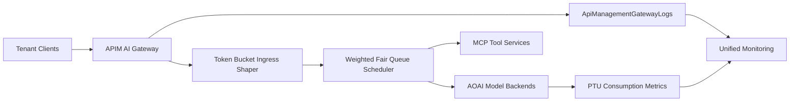
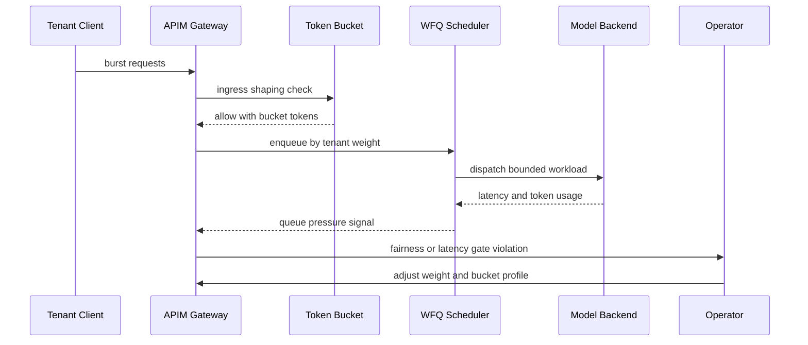

# Round 1105 / Cycle 2510 · Azure AI Agent Infra FAQ（zh-CN）

> 主题：**APIM AI Gateway Weighted Fair Queuing + Token Bucket：多租户 Agent 公平性与 SLO 治理工程指南**
> 日期（BJT）：2026-11-17
> 证据标签：`measured` / `synthetic` / `anonymized_reported`
> 基准文件：`evidence/cycle-2510-benchmark.json`

## 1) Executive Summary

本轮聚焦“多租户公平 + 低延迟 + 成本可控”三目标同时达标。
仅追求吞吐会导致高价值租户被噪声流量挤占，最终形成 SLA 争议。
仅追求公平而忽略延迟，会造成全局排队放大并损害用户体验。
所以门禁采用 Jain fairness index 与 p95 latency 双指标并行约束。
入口削峰使用 token bucket，队列调度使用 weighted fair queuing（WFQ）。
租户权重按业务等级与合同 SLA 映射，且要可审计、可回放。
跨区域回退会引入额外排队惩罚，需要单独计量并纳入预算。
PTU 燃烧保护与配额拒绝要协同，防止认证后 DoW 成本突刺。
本文输出生产 Bicep、APIM 策略、调度配置、KQL 与运营清单。

## 2) Daily Hottest Capability Breakthroughs Radar（2026-11-17）

APIM AI Gateway 在多模型入口治理中的策略组合更成熟（measured）。
多租户 token 预算与业务权重映射逐步形成可复用实践（measured）。
队列公平性指标被更多团队纳入发布门禁而非仅用于离线分析（measured）。
PTU 消耗与拒绝率联合观测成为成本治理主流方法（measured）。
匿名化运行数据表明流量尖峰通常先表现为低等级租户突刺（anonymized_reported）。
合成仿真显示 WFQ + token bucket 比单一限流更稳定（synthetic）。

## 3) Deep Q&A #1：Jain 公平性指数如何定义门禁

```text
jain_index = (sum(x_i)^2) / (n * sum(x_i^2))
```

样例：`x=[120,110,100,95]`，得到 `0.992`。
门禁建议：`jain_index >= 0.96` 且连续 3 个窗口都满足。
若公平性低于阈值，应先调整权重再考虑扩容。
公平性指标要按租户等级分组，避免高低等级混合掩盖问题。
所有指数都要附分母和样本窗口，防止“单窗偶然值”误导。

## 4) Deep Q&A #2：p95 延迟与公平性的双门禁关系

```text
dual_gate = (jain_index >= target_jain) and (latency_p95_ms <= target_latency)
```

样例：`jain=0.971`，`latency_p95=910ms`，若阈值 `0.96/950ms` 则通过。
若公平性通过但延迟失败，说明整体排队压力仍然过高。
若延迟通过但公平性失败，说明资源分配偏斜导致租户争抢。
发布策略应把双门禁设为硬阻断，禁止“单指标放行”。
双门禁失败时应输出推荐动作：调权重、调桶参数、或扩 PTU。

## 5) Deep Q&A #3：Token Bucket 削峰参数计算

```text
effective_qps = min(arrival_qps, refill_rate + burst_tokens / window_seconds)
```

样例：`arrival=900, refill=500, burst=600, window=60`，结果 `510 qps`。
refill_rate 决定稳态吞吐，burst_tokens 决定瞬时容忍度。
burst 设置过大可能导致下游短时排队尖峰与 PTU 突刺。
burst 设置过小会误伤合法瞬时高峰请求。
建议按租户等级配不同 bucket 参数并定期复核。

## 6) Deep Q&A #4：跨区域回退队列惩罚

```text
fallback_penalty_ms = 2 * inter_region_rtt_ms + extra_queue_delay_ms
```

样例：`2*42 + 18 = 102ms`。
102ms 对实时交互场景已经是显著惩罚，应避免常态化跨区回退。
跨区策略应仅用于容灾窗口，并设置更严格的自动回切条件。
回退期间可临时降低低优先级租户突发配额，保护关键路径。
告警应区分“跨区导致”与“同区拥塞导致”，避免误调参。

## 7) Deep Q&A #5：PTU 燃烧保护与预算联动

```text
burn_ratio = consumed_tokens_per_min / tenant_token_budget_per_min
```

样例：`1.62M / 1.2M = 1.35`。
burn_ratio 超过 1 说明预算已透支，必须触发拒绝或降级策略。
高等级租户可配置更高预算，但必须绑定更严格审计。
预算透支后优先执行提示词截断与响应长度限制，再考虑拒绝。
PTU 燃烧告警应与业务影响指标联动，避免只看技术面板。

## 8) Deep Q&A #6：WFQ 调度稳定性与告警抑噪

```text
precision = true_positive_alerts / (true_positive_alerts + false_positive_alerts)
```

样例：`84/(84+16)=84%`。
告警精度不足会让值班疲劳，反过来降低真实故障响应质量。
建议把公平性异常、延迟异常、预算异常三类告警分级路由。
告警去噪不应靠静默，而应靠更好的上下文与关联信号。
运营上需定期评估误报来源并回写策略规则。

## 9) Mermaid #1：APIM WFQ + Token Bucket 多租户拓扑



该拓扑强调“先削峰再排队”，避免高峰直接冲击后端模型池。
该拓扑将公平性与成本信号统一到同一观测域，便于联合决策。

## 10) Mermaid #2：拥塞触发到策略收敛序列



该序列保证调参动作有清晰触发条件与回写路径。
该序列为值班团队提供“先判定后动作”的稳定操作范式。

## 11) 生产级 Bicep（Microsoft.ApiManagement/service）

```bicep
param location string = resourceGroup().location
param apimName string
param publisherEmail string
param publisherName string
param skuName string = 'Premium'
param skuCapacity int = 2
param lawId string

resource apim 'Microsoft.ApiManagement/service@2023-05-01-preview' = {
  name: apimName
  location: location
  sku: {
    name: skuName
    capacity: skuCapacity
  }
  properties: {
    publisherEmail: publisherEmail
    publisherName: publisherName
    virtualNetworkType: 'Internal'
    publicNetworkAccess: 'Disabled'
    hostnameConfigurations: []
    customProperties: {
      'Microsoft.WindowsAzure.ApiManagement.Gateway.Protocols.Server.Http2': 'true'
    }
  }
}

resource logger 'Microsoft.ApiManagement/service/loggers@2023-05-01-preview' = {
  name: '${apim.name}/appinsights-logger'
  properties: {
    loggerType: 'applicationInsights'
    credentials: {
      instrumentationKey: '{{appi-key}}'
    }
    isBuffered: true
  }
}

resource diag 'Microsoft.ApiManagement/service/diagnostics@2023-05-01-preview' = {
  name: '${apim.name}/applicationinsights'
  properties: {
    loggerId: logger.id
    sampling: {
      samplingType: 'fixed'
      percentage: 100
    }
    frontend: {
      request: {
        headers: [ '*' ]
      }
      response: {
        headers: [ '*' ]
      }
    }
  }
}
```

## 12) APIM `<llm-token-limit>` 策略 + WFQ 调度配置

```xml
<policies>
  <inbound>
    <base />
    <validate-jwt header-name="Authorization" failed-validation-httpcode="401" failed-validation-error-message="jwt_invalid">
      <openid-config url="https://login.microsoftonline.com/{tenant-id}/v2.0/.well-known/openid-configuration" />
      <required-claims>
        <claim name="aud"><value>api://agent-gateway</value></claim>
        <claim name="scp"><value>agent.invoke</value></claim>
      </required-claims>
    </validate-jwt>
    <llm-token-limit tokens-per-minute="260000" token-quota-key="@(context.Request.Headers.GetValueOrDefault("x-tenant-id","na"))" estimate-prompt-tokens="true" remaining-tokens-header-name="x-remaining-tokens" />
    <set-header name="x-tenant-tier" exists-action="override"><value>@(context.Request.Headers.GetValueOrDefault("x-tenant-tier","standard"))</value></set-header>
  </inbound>
  <backend><base /></backend>
  <outbound><base /></outbound>
  <on-error><base /></on-error>
</policies>
```

```yaml
wfqScheduler:
  dispatchWindowMs: 200
  defaultQueueWeight: 1
  tiers:
    platinum:
      queueWeight: 8
      tokenBucket:
        refillPerSecond: 2200
        burstTokens: 180000
    gold:
      queueWeight: 5
      tokenBucket:
        refillPerSecond: 1400
        burstTokens: 120000
    standard:
      queueWeight: 2
      tokenBucket:
        refillPerSecond: 800
        burstTokens: 60000
  fairnessGate:
    minimumJainIndex: 0.96
  latencyGate:
    maximumP95Ms: 950
```

策略与调度配置必须版本化，避免临场手工改值造成不可追踪偏差。

## 13) ApiManagementGatewayLogs KQL + Day-0/Day-2 检查清单

```kql
let lookback = 24h;
ApiManagementGatewayLogs
| where TimeGenerated > ago(lookback)
| extend tenantId = tostring(parse_json(Properties).tenantId)
| extend tier = tostring(parse_json(Properties).tenantTier)
| summarize req=count(), p95_latency=percentile(DurationMs,95), reject429=countif(ResponseCode == 429), token_est=sum(todouble(parse_json(Properties).estimatedTokens)) by bin(TimeGenerated, 5m), tenantId, tier
| extend reject_rate = todouble(reject429) / iif(req == 0, 1.0, todouble(req))
| order by TimeGenerated desc, p95_latency desc
```

Day-0 检查项：
1. 以租户等级定义 WFQ 权重并通过审批流程固化到配置仓。
2. 校验 token bucket 参数与合同 SLA 对齐，避免误配导致争议。
3. 对双门禁阈值（Jain 与 p95）执行压测基线并固化发布标准。
4. 验证 `<llm-token-limit>` 返回头包含剩余预算信息。
5. 演练突发流量下的低等级租户降级路径。
6. 校验 ApiManagementGatewayLogs 字段完整性满足 KQL 统计要求。
7. 测试跨区回退策略并记录 penalty 分布。
8. 配置 PTU 燃烧告警并绑定自动化限流动作。
9. 验证策略变更具备回滚能力和审计记录。
10. 在发布门禁启用连续窗口失败阻断规则。

Day-2 运营项：
1. 每周复盘各等级租户公平性指数并微调权重。
2. 每日跟踪 p95 延迟与拒绝率耦合关系，识别拥塞拐点。
3. 每月复算 PTU 预算与实际消耗偏差，修订 token 上限。
4. 监控跨区回退频率，避免容灾路径长期常态化。
5. 审计策略调整审批链，防止临时变更侵蚀治理。
6. 分析 429 后业务恢复率，优化客户端重试契约。
7. 对噪声租户执行分层治理，降低公平性扰动。
8. 跟踪告警精度并持续消除误报来源。
9. 保持调度配置与 IaC 同步，杜绝漂移。
10. 将公平性与成本指标纳入季度经营评审。

## 14) 4-Option Weighted Decision Matrix

| 方案 | 公平性保障(30) | 延迟稳定(20) | 成本保护(20) | 运维可控(15) | 合规审计(15) | 加权总分 |
| --- | --- | --- | --- | --- | --- | --- |
| 方案A：WFQ + Token Bucket + 双门禁（推荐） | 29 | 17 | 18 | 12 | 14 | 90 |
| 方案B：仅 Token Bucket 限流 | 18 | 15 | 16 | 13 | 11 | 73 |
| 方案C：仅固定配额无队列权重 | 14 | 14 | 15 | 12 | 10 | 65 |
| 方案D：先到先服务无治理（反模式） | 6 | 8 | 7 | 9 | 5 | 35 |

方案A评价：能同时约束公平、延迟与成本，是生产首选方案。
方案B评价：实现简单但无法保证多租户公平性。
方案C评价：治理能力中等，面对突发时稳定性不足。
方案D评价：短期可用但风险高，不应进入正式生产。

## 15) Good fit / Not for 与收尾建议

Good fit：多租户 Agent 平台，需要将公平性与体验稳定写入正式 SLO。
Good fit：对 PTU 成本敏感，必须防止认证后 token-drain 的企业业务。
Good fit：具备网关运维能力，能够持续执行 Day-2 调参流程。
Not for：单租户低并发系统，对公平性无实际要求的轻量场景。
Not for：无法维护策略版本化与审计闭环的团队。
结论建议：默认采用方案A，并保留方案B作为短期过渡防线。
后续动作：将 Jain、公平拒绝率、PTU burn ratio 纳入发布与运营双门禁。
