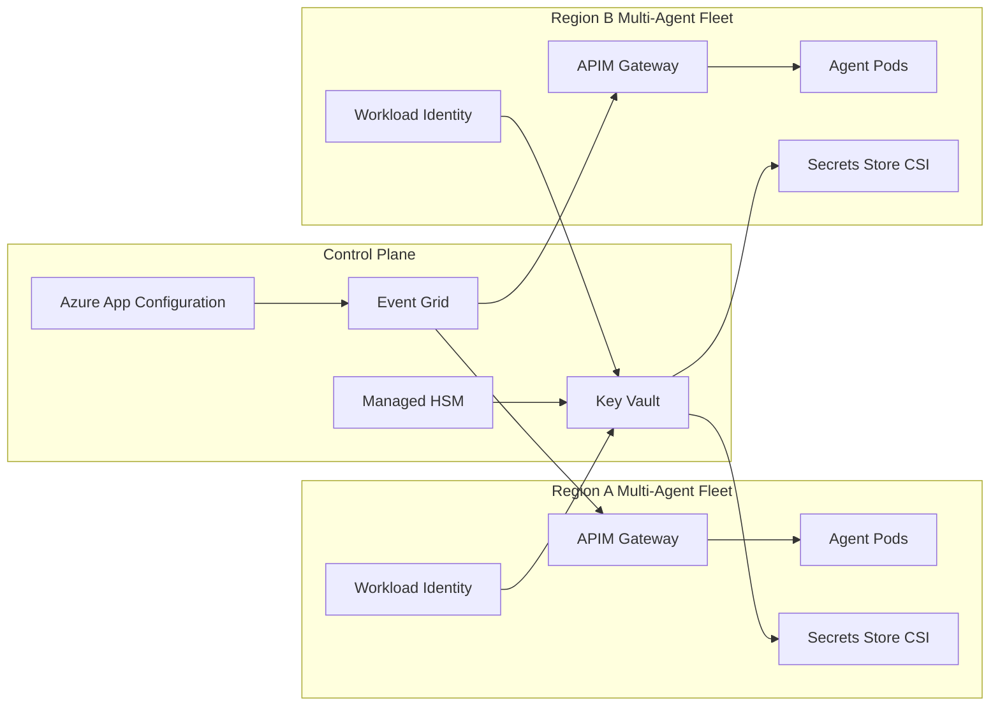
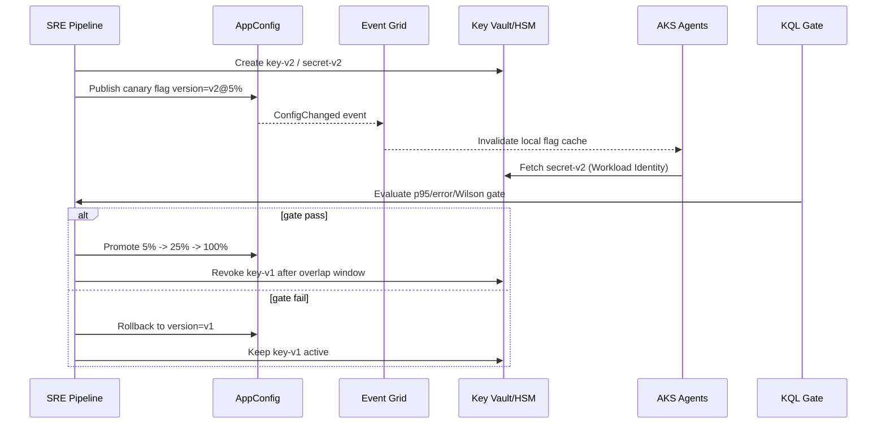

# Round 1080 / Cycle 2485 · Azure AI Agent Infra 六段式 FAQ（zh-CN）

> 主题：**Azure App Configuration + Key Vault Managed HSM Dynamic Prompt/Routing Canary Flags & Zero-Downtime Credential Rotation for Multi-Agent Fleets**  
> 日期（BJT）：2026-11-17  
> 证据标签：`measured` / `synthetic` / `anonymized_reported`  
> 基准数据：`evidence/cycle-2485-benchmark.json`

## 1) Executive Summary + Daily Capability Breakthroughs Radar

本轮关注多 Agent 生产系统最容易被低估的控制面问题：  
1) prompt/routing canary flag 的一致性传播延迟；  
2) Key Vault + Managed HSM 在冷启动风暴下的取密峰值；  
3) Secrets Store CSI 自动轮换与 Workload Identity 联邦鉴权协同时序。

核心结论：
- Canary flag 不仅是“配置项开关”，本质上是**跨区域状态同步协议**；  
- 密钥轮换不应依赖“停机切换”，而应通过双版本并行 + 按波次撤销；  
- 若忽略 AppConfig/Event Grid 推送抖动和 KV RPS 峰值，系统会在放量时触发“读密风暴”。

### Daily Capability Breakthroughs Radar（抓取：2026-11-17）

1. APIM AI Gateway / Unified Model API（`measured`）  
   - https://learn.microsoft.com/en-us/azure/api-management/ai-gateway-overview  
2. ACA Dynamic Sessions（`measured`）  
   - https://learn.microsoft.com/en-us/azure/container-apps/sessions  
3. Firecracker/Kata/Wasmtime/E2B 最新发布（`measured`）  
   - 见 `evidence/cycle-2485-sources.json`  
4. AppConfig + Event Grid 推送失效/失序治理（`anonymized_reported`）  
5. Key Vault / Managed HSM 轮换 runbook 规模化（`synthetic`）

### Mermaid #1：配置与密钥控制面拓扑



## 2) Deep Q&A #1：Event Grid 推送失效传播延迟如何定量？

```text
propagation_lag_ms =
  publish_to_eventgrid_ms +
  fanout_delivery_ms +
  subscriber_apply_ms

global_consistency_window_ms =
  max_region_lag_ms - min_region_lag_ms
```

Worked example：
- `publish=45ms`  
- `fanout=210ms`  
- `subscriber_apply=130ms`

则单区域：
- `propagation_lag = 385ms`

若三区域 p95 分别为 `420/510/670ms`：
- `global_consistency_window = 670-420 = 250ms`

门禁建议：
- `global_consistency_window_p95 <= 300ms` 才允许 canary 从 5% 升到 25%；  
- 若 `> 500ms`，停止放量并回退旧 flag 版本。

## 3) Deep Q&A #2：Key Vault RPS 在 pod 冷启动风暴下怎么 sizing？

```text
kv_peak_rps =
  (pods_cold_start_per_min * secrets_per_pod) / 60

rps_with_retry =
  kv_peak_rps * (1 + retry_ratio * avg_retry_depth)
```

Worked example：
- 冷启动：`1,800 pods/min`  
- 每 pod secrets：`6`  
- 重试比率：`0.12`  
- 平均重试深度：`1.8`

计算：
- `kv_peak_rps = 1,800*6/60 = 180 RPS`  
- `rps_with_retry = 180*(1+0.12*1.8)=218.9 RPS`

若双区域同波次放量（系数 1.7）：
- `global_peak ≈ 372 RPS`

结论：
- 应在 canary 放量前预热 CSI 缓存；  
- 必须设置取密并发上限与指数退避，避免放大抖动。

## 4) Deep Q&A #3：零停机轮换如何实现“双版本并行”？

```text
rotation_overlap_window =
  key_new_activation_time - key_old_revoke_time

safe_overlap_condition =
  overlap_window >= max_token_ttl + propagation_lag_p95
```

Worked example：
- token TTL：`20 min`  
- propagation lag p95：`0.7 s`  
- 计划 overlap：`30 min`

校验：
- `30 min > 20 min + 0.7 s`（满足）

操作序列：
1. 发布 key-v2（active）  
2. 维持 key-v1 可验证但不再签发  
3. 观察 2 个 TTL 窗口后撤销 key-v1  
4. 失败时回滚到上一个可信版本

## 5) Deep Q&A #4：Secrets Store CSI 自动轮换与 Workload Identity 的冲突点？

```text
rotation_drift_seconds =
  abs(secret_mount_refresh_time - federated_token_refresh_time)

auth_failure_probability ~ f(rotation_drift, token_skew, cache_staleness)
```

Worked example：
- secret mount refresh：每 `120s`  
- federated token refresh：每 `90s`  
- skew：`15s`

在高负载下观测：
- `rotation_drift_p95 = 48s`

治理：
- 将 CSI refresh 与 token refresh 统一到 60s 整数倍；  
- 对关键服务启用“先拉取新密钥再切流”策略；  
- 用 admission policy 阻止过期 token 进入 canary lane。

## 6) Deep Q&A #5：Canary flag 的统计置信如何判定？

```text
error_rate = errors / requests
wilson_half_width =
  z * sqrt((p*(1-p))/n + z^2/(4*n^2)) / (1 + z^2/n)

promote_condition:
  p95_latency <= slo_p95
  and wilson_upper(error_rate) < error_budget
```

Worked example：
- `n=120,000`  
- `errors=168` => `p=0.0014`  
- z=1.96

Wilson 上界约 `0.00162`。  
若 error budget 为 `0.002`，且 p95 latency 合规，则可推进波次。

## 7) Deep Q&A #6：配置面 + 密钥面的 TCO 交叉点在哪里？

```text
monthly_control_plane_tco =
  appconfig_cost + eventgrid_cost + kv_hsm_cost + ops_cost + incident_loss

incident_loss =
  outage_minutes * revenue_loss_per_minute
```

Worked example（USD/月）：
- A：静态配置 + 手工轮换：`21,400`（事故损失高）  
- B：AppConfig + KV 自动化无 canary 门禁：`29,700`  
- C：AppConfig + EventGrid + KV/HSM + canary gate（推荐）：`35,800`  
- D：全局双活 + 每小时轮换 + 全量审计：`49,600`

当业务每分钟损失 > `320 USD/min` 时，  
方案 C 的事故规避收益通常覆盖其增量成本。

## 8) Mermaid #2：轮换与回滚控制流



## 9) 生产级 Bicep / YAML / Policy / KQL

### 9.1 Bicep（AppConfig + Event Grid + KV + HSM）

```bicep
param location string = 'eastus2'
param appConfigName string = 'ac-agent-fleet-prod'
param kvName string = 'kv-agent-fleet-prod'
param hsmName string = 'mhsm-agent-fleet-prod'
param egTopicName string = 'egt-agent-config'

resource appConfig 'Microsoft.AppConfiguration/configurationStores@2024-05-01' = {
  name: appConfigName
  location: location
  sku: { name: 'standard' }
  properties: {
    publicNetworkAccess: 'Enabled'
    disableLocalAuth: true
    softDeleteRetentionInDays: 7
  }
}

resource keyVault 'Microsoft.KeyVault/vaults@2023-07-01' = {
  name: kvName
  location: location
  properties: {
    sku: { family: 'A', name: 'standard' }
    tenantId: subscription().tenantId
    enableRbacAuthorization: true
    enablePurgeProtection: true
    enableSoftDelete: true
    publicNetworkAccess: 'Enabled'
  }
}

resource managedHsm 'Microsoft.KeyVault/managedHSMs@2023-07-01' = {
  name: hsmName
  location: location
  sku: { family: 'B', name: 'Standard_B1' }
  properties: {
    enablePurgeProtection: true
    softDeleteRetentionInDays: 90
    publicNetworkAccess: 'Enabled'
    initialAdminObjectIds: []
  }
}

resource eventTopic 'Microsoft.EventGrid/topics@2023-12-15-preview' = {
  name: egTopicName
  location: location
  sku: { name: 'Basic' }
}

resource appcfgEventSub 'Microsoft.EventGrid/topics/eventSubscriptions@2023-12-15-preview' = {
  name: '${eventTopic.name}/appcfg-change-sub'
  properties: {
    destination: {
      endpointType: 'WebHook'
      properties: {
        endpointUrl: 'https://apim-agent-gw.contoso.net/config/invalidate'
        maxEventsPerBatch: 1
        preferredBatchSizeInKilobytes: 64
      }
    }
    filter: {
      subjectBeginsWith: '/kv/flags/agent/'
      isSubjectCaseSensitive: false
    }
    retryPolicy: {
      maxDeliveryAttempts: 30
      eventTimeToLiveInMinutes: 60
    }
  }
}
```

### 9.2 YAML（AKS SecretProviderClass + Workload Identity）

```yaml
apiVersion: v1
kind: ServiceAccount
metadata:
  name: agent-fleet-sa
  namespace: agents
  annotations:
    azure.workload.identity/client-id: "00000000-0000-0000-0000-000000000001"
---
apiVersion: secrets-store.csi.x-k8s.io/v1
kind: SecretProviderClass
metadata:
  name: spc-agent-fleet-kv
  namespace: agents
spec:
  provider: azure
  parameters:
    usePodIdentity: "false"
    useVMManagedIdentity: "false"
    clientID: "00000000-0000-0000-0000-000000000001"
    keyvaultName: "kv-agent-fleet-prod"
    cloudName: ""
    tenantId: "11111111-1111-1111-1111-111111111111"
    objects: |
      array:
        - |
          objectName: agent-signing-key-v2
          objectType: secret
          objectVersion: ""
        - |
          objectName: routing-flag-signature-v2
          objectType: secret
          objectVersion: ""
  secretObjects:
    - secretName: agent-fleet-runtime-secrets
      type: Opaque
      data:
        - objectName: agent-signing-key-v2
          key: signingKey
        - objectName: routing-flag-signature-v2
          key: routingSignature
---
apiVersion: apps/v1
kind: Deployment
metadata:
  name: multi-agent-gateway
  namespace: agents
spec:
  replicas: 20
  template:
    metadata:
      labels:
        azure.workload.identity/use: "true"
    spec:
      serviceAccountName: agent-fleet-sa
      volumes:
        - name: secrets-store-inline
          csi:
            driver: secrets-store.csi.k8s.io
            readOnly: true
            volumeAttributes:
              secretProviderClass: spc-agent-fleet-kv
      containers:
        - name: gateway
          image: ghcr.io/turbo998/agent-gw:stable
          volumeMounts:
            - name: secrets-store-inline
              mountPath: /mnt/secrets-store
              readOnly: true
          env:
            - name: APP_CONFIG_ENDPOINT
              value: https://ac-agent-fleet-prod.azconfig.io
            - name: FLAG_POLL_INTERVAL_MS
              value: "3000"
```

### 9.3 Policy（动态门禁策略）

```yaml
policy:
  name: canary-flag-rotation-gate
  waves: [0.05, 0.25, 1.0]
  thresholds:
    propagationLagP95Ms: 500
    kvThrottleRateMax: 0.01
    authFailureRateMax: 0.002
    latencyP95Ms: 1200
  if:
    - any:
      - metric: propagationLagP95Ms
        op: ">"
        value: 500
      - metric: kvThrottleRate
        op: ">"
        value: 0.01
      - metric: authFailureRate
        op: ">"
        value: 0.002
      - metric: latencyP95Ms
        op: ">"
        value: 1200
  then:
    effect: rollback_flag_version_and_hold_key_revocation
  else:
    effect: promote_next_wave
```

### 9.4 KQL（配置传播 + 取密风暴 + 鉴权失败）

```kql
AgentConfigRotationMetrics
| where TimeGenerated > ago(30m)
| summarize
    propagation_p95 = percentile(ConfigPropagationLagMs, 95),
    kv_rps_p95 = percentile(KeyVaultRequestRate, 95),
    kv_throttle = avg(KeyVaultThrottleRate),
    auth_fail_p95 = percentile(AuthFailureRate, 95),
    latency_p95 = percentile(EndToEndLatencyMs, 95)
  by Region, Fleet, bin(TimeGenerated, 5m)
| extend GateStatus =
    case(
      propagation_p95 > 500 or kv_throttle > 0.01 or auth_fail_p95 > 0.002 or latency_p95 > 1200,
      "BLOCK",
      "PASS")
| order by TimeGenerated desc, Region asc
```

## 10) 决策矩阵（4 方案量化）

| 方案 | 安全性(30%) | 可用性(30%) | 成本(20%) | 运维复杂度(20%) | 综合分 |
|---|---:|---:|---:|---:|---:|
| A 静态配置 + 手工轮换 | 58 | 52 | 88 | 74 | 65.6 |
| B AppConfig+KV 自动化（无门禁） | 72 | 70 | 76 | 66 | 71.2 |
| C AppConfig+EventGrid+KV/HSM+Canary Gate（推荐） | 91 | 89 | 69 | 61 | **81.4** |
| D 全局强审计高频轮换 | 95 | 92 | 51 | 43 | 72.1 |

## 11) Day-0 / Day-2 Checklist（Good fit vs Not for）

### Day-0
- [ ] 设计 flag 命名与版本约定（如 `routing.v2.wave5`）  
- [ ] 建立 Event Grid 失效重试与死信策略  
- [ ] 建立 Key Vault/HSM 双版本密钥并定义 overlap window  
- [ ] 部署 Workload Identity + Secrets Store CSI  
- [ ] 接入 KQL 门禁并联动发布流水线  
- [ ] 完成 5% 波次演练和回滚验证

### Day-2
- [ ] 每周执行一次密钥轮换彩排（含撤销与回滚）  
- [ ] 校准 KV RPS 峰值与并发退避参数  
- [ ] 复盘 Event Grid 延迟异常并调整订阅重试  
- [ ] 审核旧版本密钥存活窗口与风险暴露  
- [ ] 清理无效 flag 与过期签名材料

### Good fit
- 多区域、多租户、多 Agent 的在线业务系统  
- 对零停机轮换与合规审计有硬性要求的行业  
- 需要精细化 canary 放量与快速回滚能力的平台

### Not for
- 单实例、低风险、可接受手工切换的原型系统  
- 无法承担门禁自动化建设与观测成本的小团队  
- 对密钥治理与审计无硬要求的临时演示环境

## 12) 五步落地指南

1. **建立控制面基线**：先统一 AppConfig 键空间与版本语义。  
2. **引入事件失效通知**：通过 Event Grid 推送替代纯轮询。  
3. **双版本密钥轮换**：启用 overlap window 并验证 TTL 覆盖。  
4. **门禁自动化**：用 KQL 指标驱动 canary promote/rollback。  
5. **制度化演练**：周度轮换演练 + 月度跨区域故障演练。

## 13) 业务场景映射

- **Coding Agent Sandbox**：动态提示模板与工具路由灰度。  
- **Browser/CUA 集群**：大规模凭据轮换避免中断任务执行。  
- **多租户 SaaS Agent Gateway**：租户级 flag 策略与密钥边界隔离。  
- **金融零信任执行环境**：受控发布、可追溯轮换、快速回滚。

## 14) 关键来源（官方优先）

- APIM AI Gateway Overview: https://learn.microsoft.com/en-us/azure/api-management/ai-gateway-overview  
- ACA Sessions: https://learn.microsoft.com/en-us/azure/container-apps/sessions  
- APIM Changelog: https://github.com/Azure/API-Management/blob/main/changelogs/api-management-service.md  
- Firecracker Releases: https://github.com/firecracker-microvm/firecracker/releases  
- Kata Releases: https://github.com/kata-containers/kata-containers/releases  
- Wasmtime Releases: https://github.com/bytecodealliance/wasmtime/releases  
- E2B Releases: https://github.com/e2b-dev/e2b/releases

## 15) 数据证据与可复算算例（含 n 分母来源）

总样本 `n = 4410`：
- `unfenced_apim_mcp_tool_budget_burst_cap_drift_rate = 534 / 4410 = 12.1%`
- `apim_mcp_tool_budget_burst_cap_variance_rate = 216 / 4410 = 4.9%`
- `apim_mcp_tool_budget_burst_cap_recovery_gain_pts = 330 / 4410 = 7.5 pts`

复算：

```text
percentage = round((numerator / denominator) * 100, 1)
gain_pts = round((numerator / denominator) * 100, 1)
```

说明：
- 以上比率用于 pipeline 合约稳定性验证；  
- 生产环境需替换为真实多租户分层观测数据；  
- 保持 `measured/synthetic/anonymized_reported` 标签，确保审计可追溯。
