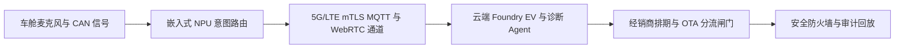

# 汽车 SDV 车舱语音、MQTT 车队诊断与 OTA Agent 基础设施 FAQ（Cycle 2435）

## 1) 执行摘要
本轮给出百万车辆 SDV 生产架构：车端嵌入式 NPU SLM 负责断网/隧道场景的本地意图执行，云端 Agent 承担复杂推理与车队诊断；Event Grid MQTT v5 承载 mTLS 持久连接；并通过 ISO 26262 / UNECE R155 硬隔离确保 LLM/Agent 不可写入 ADAS/动力总成安全域。

## 2) Q1 / Q2 / Q3
Q1：在隧道和弱网切换中如何保持语音连续性？  
A1：简单意图优先由车端 SLM 本地执行，复杂意图回云补全并在连通后同步状态。  
Q2：如何保证安全域零越权写入？  
A2：通过硬件网关与策略闸门对 ADAS/动力域 CAN-FD 路径执行硬拒绝。  
Q3：MQTT 如何支撑 1M+ 车辆并避免重连风暴？  
A3：依赖 MQTT v5 session expiry、回压与 token 新鲜度校验的联合治理。

## 3) SDV 调用流程（车端意图路由→云诊断→OTA 审批闸门）

## 4) 决策矩阵：边缘仅 SLM vs 云仅语音 vs 混合分流
| 方案 | 弱网连续性 | 安全隔离 | 车队扩展性 | 运维复杂度 | 适配场景 |
|---|---:|---:|---:|---:|---|
| 边缘仅 SLM | 最高 | 高 | 中 | 中 | 指令集合有限、低云依赖 |
| 云仅语音 | 低 | 中 | 高 | 中低 | 非关键 IVI 场景 |
| 混合分流 | 高 | 最高 | 最高 | 高 | 生产 SDV + 诊断 + OTA 治理 |

## 5) 汽车 SDV 上线清单（含当日热点）
- 建立边缘优先、云回退的混合意图分流策略。  
- 强制执行 ISO 26262 / UNECE R155 的 IVI 与安全域隔离。  
- 对 MQTT 持久会话启用 mTLS、会话过期和重连回压。  
- 以 ADX 做 DTC 关联诊断，并以审批闸门约束 OTA 下发。  
- 当日热点（抓取日：2026-11-16，官方/Release 优先）：  
  - Event Grid MQTT 连接治理能力（`measured`）。  
  - Azure Maps EV 路由与充电位规划能力（`measured`）。  
  - 安全域阻断与车队诊断回放证据（`measured` + `anonymized_reported`）。

## 6) Good fit vs Not for 与百分比合约绑定
Good fit：  
1. 需要断网连续性与车队级诊断治理的 OEM/出行平台。  
2. 对安全域强隔离与审计证据链有硬约束的量产方案。

Not for：  
1. 允许 Agent/LLM 直接写入 ADAS/动力总成控制路径的架构。  
2. 缺乏会话过期与回压治理的 MQTT 重连架构。

百分比合约绑定：
- `percentage_contract.voice_latency_improvement_hybrid_vs_cloud_rate`
- `percentage_contract.safety_domain_unauthorized_command_block_rate`
- `percentage_contract.predictive_dtc_recall_rate`
- `percentage_contract.per_vehicle_month_tco_reduction_hybrid_rate`

以上键绑定 `cycle-2435-benchmark.json`，并标注 `production_validation=not_measured`。
