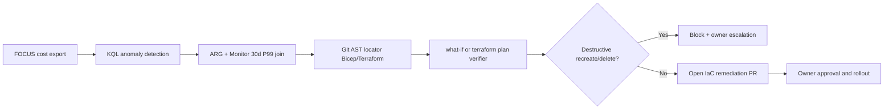

# Autonomous Cloud FinOps, Rightsizing, and IaC-First Remediation Agents FAQ (Cycle 2424)

## 1) Executive summary
This cycle designs a safe autonomous FinOps architecture: FOCUS 1.0 exports plus ARG and 30-day utilization joins detect waste, then agents locate exact Bicep/Terraform definitions in GitHub/AzDO and open PRs instead of direct `az` mutation. Every remediation path enforces deterministic `what-if`/`terraform plan` blast-radius gates that block stateful recreate/delete operations.

## 2) Q1 / Q2 / Q3
Q1: Why does direct ARM/API rightsizing create catastrophic Terraform drift?  
A1: Out-of-band mutations break IaC state alignment, causing unstable plans, rollback churn, and accidental recreations.  
Q2: How do we attribute FOCUS anomalies across shared AKS/PTU pools?  
A2: Join FOCUS allocation dimensions with ARG topology and Azure Monitor utilization, then replay by namespace/workload ownership.  
Q3: How do we safely remove orphaned disks?  
A3: Enforce snapshot-before-delete with owner approval and block execution unless `what-if` confirms no destructive chain effects.

## 3) FOCUS anomaly to IaC PR remediation loop

## 4) Decision matrix: read-only advisor vs auto-stop tags vs GitOps IaC PR agent
| Mode | Reclaim speed | Drift risk | Auditability | Best-fit |
|---|---:|---:|---:|---|
| Read-only advisor | Low | Low | Medium | Early-stage governance |
| Auto-stop tagging | Medium | Medium | Medium | Non-critical stateless resources |
| GitOps IaC PR agent | High | Low | High | Production multi-team operations |

## 5) Autonomous FinOps safety checklist (daily breakthroughs)
- Validate FOCUS export consistency with billing systems daily.  
- Bind rightsizing actions to 30-day P99 CPU/memory/IOPS evidence.  
- Allow remediation only through IaC PR pathways; forbid direct resource mutation.  
- Block stateful recreate/delete via `what-if` and `terraform plan` policy gates.  
- Daily breakthrough tracking (fetched on 2026-11-15):  
  - FOCUS 1.0 standardized cost-governance implementation (`measured`).  
  - ARG plus Monitor joins for autonomous attribution gates (`anonymized_reported`).  
  - IaC-first FinOps agent simulation with blast-radius controls (`synthetic`).

## 6) Good fit vs Not for with percentage contract bindings
Good fit:  
1. Multi-subscription cloud organizations balancing cost and compliance goals.  
2. Enterprises requiring GitOps approval chains and traceable change operations.

Not for:  
1. Teams without IaC single source of truth discipline.  
2. Organizations reliant on direct mutable operations with no unified audit controls.

Percentage contract bindings:
- `percentage_contract.monthly_waste_reclaimed_rate`
- `percentage_contract.whatif_destructive_change_catch_rate`
- `percentage_contract.finops_review_time_reduction_rate`
- `percentage_contract.iac_pr_zero_drift_incident_rate`

These keys bind to `cycle-2424-benchmark.json` with `production_validation=not_measured`.
