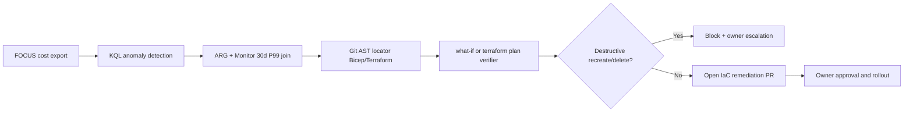

# 自治云 FinOps、Rightsizing 与 IaC-First 修复 Agent 架构 FAQ（Cycle 2424）

## 1) 执行摘要
本轮聚焦可安全自治的 FinOps 架构：以 FOCUS 1.0 成本导出 + ARG + 30 天利用率联合分析定位浪费，再由 Agent 在 GitHub/AzDO 中精确定位 Bicep/Terraform 定义并发起 PR，而非直接 `az` 改配置；修复前强制 `what-if`/`terraform plan` 做爆炸半径校验，阻断有状态资源重建/删除风险。

## 2) Q1 / Q2 / Q3
Q1：为什么直接 ARM API rightsizing 会导致灾难性 Terraform drift？  
A1：状态漂移会让后续 IaC 计划出现不可预测变更，轻则反复回滚，重则触发错误重建。  
Q2：共享 AKS/PTU 池异常成本如何归因？  
A2：将 FOCUS 成本分摊维度与 ARG 资源拓扑、Azure Monitor 利用率做关联，按命名空间/工作负载回放。  
Q3：孤儿磁盘删除如何避免误删？  
A3：采用 snapshot-before-delete 与 owner 审批联锁，先通过 what-if 验证无级联破坏再执行。

## 3) FOCUS 异常到 IaC PR 修复闭环

## 4) 决策矩阵：只读建议 vs Auto-stop 标签化 vs GitOps IaC PR Agent
| 模式 | 回收速度 | 漂移风险 | 审计性 | 适用场景 |
|---|---:|---:|---:|---|
| 只读建议 | 低 | 低 | 中 | 组织初期启用 |
| Auto-stop 标签化 | 中 | 中 | 中 | 非关键无状态资源 |
| GitOps IaC PR Agent | 高 | 低 | 高 | 生产级多团队治理 |

## 5) Autonomous FinOps 安全清单（含当日突破）
- FOCUS 导出口径与账单系统一致性按天校验。  
- Rightsizing 必须绑定 30 天 P99 CPU/内存/IOPS 证据。  
- 所有修复仅允许 IaC PR 路径，禁止直改资源平面。  
- what-if / plan 需阻断有状态重建和 delete 操作。  
- 当日突破追踪（抓取日：2026-11-15）：  
  - FOCUS 1.0 成本治理标准化实践（`measured`）。  
  - ARG + Monitor 联合归因用于自动修复门禁（`anonymized_reported`）。  
  - IaC-first FinOps Agent 与 blast-radius guard 仿真（`synthetic`）。

## 6) Good fit vs Not for 与百分比合约绑定
Good fit：  
1. 多订阅/多团队、成本与合规双目标的云平台组织。  
2. 具备 GitOps 审批链路并要求可追溯变更的企业。  

Not for：  
1. 无法维护 IaC 单一事实源（SSOT）的团队。  
2. 依赖手工直改资源且无法执行统一变更审计的组织。  

百分比合约绑定：
- `percentage_contract.monthly_waste_reclaimed_rate`
- `percentage_contract.whatif_destructive_change_catch_rate`
- `percentage_contract.finops_review_time_reduction_rate`
- `percentage_contract.iac_pr_zero_drift_incident_rate`

以上键绑定 `cycle-2424-benchmark.json`，并标注 `production_validation=not_measured`。
