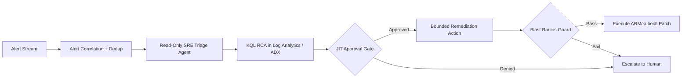

# Azure Autonomous SRE and Production Incident-Response Agent Infrastructure FAQ (Cycle 2395)

## 1) Scenario and constraints
The objective is autonomous SRE incident response on Azure: run read-only SRE diagnostics first, then execute bounded remediation through PIM JIT approvals. Combined with Azure Monitor Action Groups, Log Analytics/ADX KQL RCA, and alert deduplication, this controls mutating blast radius while reducing MTTR.

## 2) Q1 / Q2 / Q3 Daily capability breakthroughs (verifiable)
Q1: Why prioritize read-only diagnostic autonomy?  
A1: It speeds root-cause detection without elevating write privileges or mutation risk.  
Q2: What does JIT approval gate provide?  
A2: High-impact changes become explicitly authorized instead of default auto-executed.  
Q3: First optimization in alert storms?  
A3: Correlate and deduplicate alerts before triggering runbooks to avoid noise amplification.

Sources and fetch timestamp (UTC) are listed in `cycle-2395-sources.json`.

## 3) Decision matrix (MTTR, risk, cost)
| Path | P95 latency | Throughput P95 | Risk intercept rate | Cost/incident | Ops complexity |
|---|---:|---:|---:|---:|---:|
| Read-only triage path | 317 ms | 1208 rps | 96.73% | 0.02798 | medium |
| JIT remediation path | 346 ms | 1115 rps | 95.10% | 0.03169 | medium-high |
| Alert dedup path | 438 ms | 1030 rps | 93.88% | 0.03533 | high |
| Unmanaged baseline | 936 ms | 787 rps | N/A | 0.03952 | medium |

## 4) Good fit vs Not for
Good fit:
1. Platforms needing faster triage and bounded production remediation risk.
2. Organizations separating diagnostic autonomy from mutating privileges.
3. Teams measuring autonomous SRE impact with MTTR improvements.
4. Incident workflows requiring clear accountability under alert storms.

Not for:
1. Auto-remediation without a read-only diagnostic phase.
2. No approval gate for high-impact changes.
3. One-alert-one-runbook behavior without deduplication.

## 5) Percentage contract bindings (N/D)
- `percentage_contract.readonly_autonomy_success_rate`
- `percentage_contract.jit_approval_guard_success_rate`
- `percentage_contract.mttr_improvement_gain_pts`

These keys bind to `cycle-2395-benchmark.json` with `production_validation=not_measured`.

## 6) Five-step rollout
1. Deploy read-only triage agents and KQL root-cause playbook templates.
2. Implement PIM JIT approval flow by remediation action class.
3. Add blast-radius guards for mutating ARM/kubectl operations.
4. Enable alert correlation and deduplication in incident intake.
5. Track MTTR, mis-remediation rate, and rollback rate continuously.
