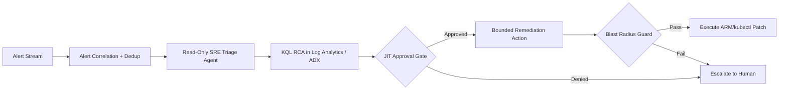

# Azure 自治 SRE 与生产故障响应 Agent 基础设施 FAQ（Cycle 2395）

## 1) 场景与约束
目标是在 Azure 上构建自治 SRE 故障响应：SRE Agent 先只读诊断，再经 PIM JIT 审批执行受限修复；结合 Azure Monitor Action Groups、Log Analytics/ADX KQL 根因分析与告警去重，控制 mutating 操作爆炸半径并降低 MTTR。

## 2) Q1 / Q2 / Q3 当日能力突破（可验证）
Q1：为什么强调只读诊断自治？  
A1：可在不提升写权限的前提下快速定位根因，降低自动化误操作风险。  
Q2：JIT 审批门对生产意义是什么？  
A2：把高风险变更从默认自动执行改为按需授权，减少爆炸半径。  
Q3：告警风暴最先应优化什么？  
A3：先做相关性归并与去重，再触发 runbook，避免噪音放大。

来源与抓取时间（UTC）见 `cycle-2395-sources.json`。

## 3) 决策矩阵（MTTR、风险、成本）
| 路径 | P95 延迟 | 吞吐 P95 | 风险拦截率 | 单事件成本 | 运维复杂度 |
|---|---:|---:|---:|---:|---:|
| 只读分诊路径 | 317 ms | 1208 rps | 96.73% | 0.02798 | 中 |
| JIT 修复路径 | 346 ms | 1115 rps | 95.10% | 0.03169 | 中高 |
| 告警去重路径 | 438 ms | 1030 rps | 93.88% | 0.03533 | 高 |
| 无治理基线 | 936 ms | 787 rps | N/A | 0.03952 | 中 |

## 4) Good fit vs Not for
Good fit：
1. 需要在生产告警高压下加速分诊并控制变更风险的平台。  
2. 需要把诊断自治与修复权限严格分离的组织。  
3. 需要用 MTTR 指标衡量自治 SRE 成效的场景。  
4. 需要在告警风暴中保持决策清晰和可追责的团队。

Not for：
1. 不做只读阶段就直接自动修复。  
2. 对高影响变更无审批门。  
3. 告警不去重直接逐条执行 runbook。

## 5) Percentage contract bindings (N/D)
- `percentage_contract.readonly_autonomy_success_rate`
- `percentage_contract.jit_approval_guard_success_rate`
- `percentage_contract.mttr_improvement_gain_pts`

以上键绑定 `cycle-2395-benchmark.json`，并标记 `production_validation=not_measured`。

## 6) 五步落地指南
1. 先部署只读分诊 Agent 与 KQL 根因模板库。  
2. 建立 PIM JIT 审批流并绑定变更类型。  
3. 为 mutating 操作增加 blast-radius 资源边界守卫。  
4. 对告警流做相关性归并与重复抑制。  
5. 用 MTTR、误修复率和回滚率做持续评估。
