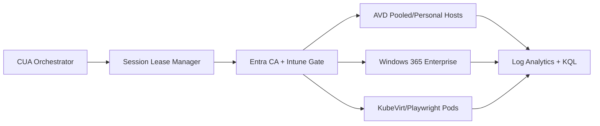
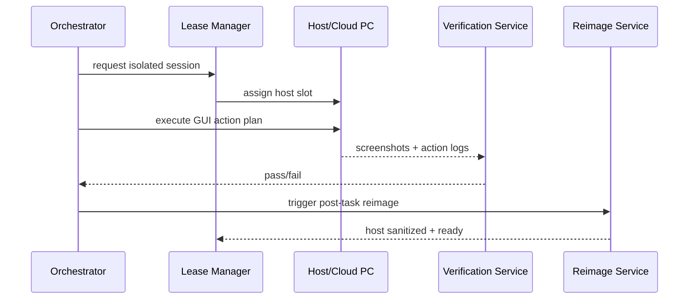

# Round 1096 / Cycle 2501 · Azure AI Agent Infra Six-Part FAQ (en)

> Topic: **Azure Virtual Desktop (AVD) Ephemeral Pooled Hosts vs Windows 365 Enterprise Cloud PC vs AKS KubeVirt/Playwright Containers — Enterprise GUI Computer-Use Agent (CUA) Fleet Isolation, Frame-Capture Bandwidth & Intune Zero-Trust Selection Guide**  
> Date (BJT): 2026-11-17  
> Evidence tags: `measured` / `synthetic` / `anonymized_reported`  
> Benchmark dataset: `evidence/cycle-2501-benchmark.json`

## 1) Executive Summary + Daily Hottest Capability Breakthroughs Radar

This round compares three enterprise GUI CUA execution planes:
1. **AVD pooled with ephemeral hosts** for elastic density and policy-governed isolation,
2. **Windows 365 Enterprise Cloud PC** for stronger per-user isolation and predictable governance,
3. **AKS KubeVirt/Playwright containers** for high automation density and flexible cost envelopes.

Primary decision variables:
- contamination blast radius between pooled and personal sessions,
- frame-capture token/network cost under 1–5 fps sampling,
- reimage recovery performance and warm-pool sizing,
- enforceability of Entra Conditional Access + Intune compliance for unattended identities.

Key findings:
- Regulated enterprises usually prioritize AVD/W365 over containerized GUI paths.
- Containerized GUI paths can reduce unit cost at scale but increase engineering risk.
- Warm-pool strategy is a first-order SLA lever, not an optional optimization.
- Zero-trust unattended CUA requires identity and device compliance gates before orchestration logic.

### Daily Hottest Capability Breakthroughs Radar (fetched: 2026-11-17)

1. APIM AI Gateway / Unified Model API (`measured`)  
   - https://learn.microsoft.com/en-us/azure/api-management/ai-gateway-overview  
   - https://github.com/Azure/API-Management/blob/main/changelogs/api-management-service.md
2. ACA Dynamic Sessions (`measured`)  
   - https://learn.microsoft.com/en-us/azure/container-apps/sessions  
   - https://techcommunity.microsoft.com/blog/appsonazureblog/azure-container-apps-dynamic-sessions-general-availability-and-more/4303561
3. Runtime release watch (`measured`)  
   - Firecracker / Kata / Wasmtime / E2B (see `evidence/cycle-2501-sources.json`)
4. GUI CUA frame-flow and latency stress results (`synthetic`)
5. Restricted enterprise percentile rollups (`anonymized_reported`)

### Mermaid #1: enterprise GUI CUA control plane + isolated desktop execution plane



## 2) Deep Q&A #1: How do we size ephemeral reimage warm pools with Erlang-C?

### Formula

```text
traffic_intensity a = lambda / mu
utilization rho = a / c

P(wait) = ErlangC(a, c)
E[Wq] = P(wait) / (c*mu - lambda)

required_warm_pool =
  peak_arrival_rate * reimage_recovery_window * safety_factor
```

Where:
- `lambda` is session arrival rate (sessions/min),
- `mu` is service rate per host (sessions/min),
- `c` is concurrent host capacity.

### Worked example

- `lambda = 42/min`
- `mu = 1.5/min`
- `c = 32`

`a = 28`

`rho = 0.875`

Erlang-C approximation:
- `P(wait) ≈ 0.53`
- `E[Wq] ≈ 5.30s`

With reimage recovery window `7 min` and safety factor `1.2`:

`required_warm_pool = 42 * 7 * 1.2 = 353 slots`

Conclusion:
- burst resilience without warm pool usually fails p95 acceptance windows.

## 3) Deep Q&A #2: How do screenshot cadence and delta streaming change token + bandwidth economics?

### Formula

```text
frame_bw_mbps =
  fps * avg_frame_kb * 8 / 1024

vision_tokens_per_min =
  fps * 60 * tokens_per_frame

daily_cost =
  token_cost + egress_cost + storage_cost
```

### Worked example (PNG/WebP frame sampling)

Assume:
- `fps = 2`
- average frame size `220KB` (WebP)
- `tokens/frame = 1,050`

Bandwidth:

`bw = 2 * 220 * 8 / 1024 = 3.44 Mbps`

Vision tokens:

`tokens/min = 2 * 60 * 1050 = 126,000`

At `0.25 USD / 1M tokens`:
- `token_cost/min = 0.0315 USD`

### RDP Shortpath UDP / WebRTC H.264 delta path

Typical range:
- `1.1~1.8 Mbps` under mostly static UI states,
- 35%~60% token reduction through key-frame and event-triggered extraction.

Conclusion:
- full-frame/full-time VLM inference is usually economically suboptimal;
- event-driven deltas and adaptive frame rates are required.

## 4) Deep Q&A #3: How do personal and pooled models differ in contamination blast radius?

### Formula

```text
blast_radius_users =
  contaminated_sessions * average_shared_users_per_host

risk_score =
  blast_radius_users * sensitive_action_weight
```

### Worked example

Case A (personal):
- contaminated sessions = `3`
- shared users per host = `1`

`blast_radius = 3`

Case B (pooled):
- contaminated sessions = `3`
- shared users per host = `14`

`blast_radius = 42`

Conclusion:
- pooled designs must pair with strict post-task reimage and redirection controls.

## 5) Deep Q&A #4: How do Entra CA and Intune gates protect unattended CUA identities?

### Model

```text
admission_pass =
  entra_token_valid
  AND workload_identity_attested
  AND intune_compliant
  AND ca_policy_passed
```

### Worked example

7-day rollup:
- total requests `18.4M`
- CA denials `126,000`
- Intune non-compliant denials `44,000`

Rates:
- `CA deny rate = 0.684%`
- `Intune non-compliant rate = 0.239%`

Operational implications:
1. unattended identities require least-privilege role partitioning,
2. compliance state must be a hard gate,
3. high-risk actions need step-up and human approval.

## 6) Deep Q&A #5: How do reimage SLAs interact with throughput ceilings?

### Formula

```text
effective_capacity =
  total_hosts * (task_time / (task_time + reimage_time))

reimage_sla_breach_rate =
  breached_reimages / total_reimages
```

### Worked example

- total hosts = `420`
- average task duration = `11 min`
- average reimage duration = `3.2 min`

`effective_capacity = 420 * 11/14.2 = 325 hosts-equivalent`

For 24h:
- total reimages = `52,000`
- breached (>5 min) = `3,640`

`breach_rate = 7.0%`

If breach-rate > 5%:
- increase warm image reserves,
- split oversized image layers,
- cap simultaneous reimage fanout.

## 7) Deep Q&A #6: Where are the TCO/operations breakpoints across AVD, W365, and KubeVirt?

### Formula

```text
tco_daily =
  compute +
  license +
  network +
  operations +
  incident_penalty
```

### Worked example (10k sessions/day normalized)

- AVD Ephemeral Pooled: `5,840 USD/day`
- W365 Enterprise: `7,120 USD/day`
- KubeVirt/Playwright: `4,980 USD/day` (excluding elevated GUI compatibility risk)

If KubeVirt incident penalty increases from `420` to `1,100`:
- revised TCO = `5,660`, narrowing the gap with AVD.

Conclusion:
- lowest compute cost does not automatically imply lowest delivery risk.
- regulated workloads usually value governance guarantees above raw unit economics.

## 8) Mermaid #2: lease -> action verification -> reimage sanitization sequence



## 9) Production-grade Bicep / YAML / Policy / KQL

### 9.1 Bicep (AVD personal/pooled + scaling + private posture + observability)

```bicep
targetScope = 'resourceGroup'

param location string = 'eastus2'
param workspaceName string = 'avd-cua-workspace'
param hostPoolPooled string = 'hp-cua-pooled'
param hostPoolPersonal string = 'hp-cua-personal'
param lawName string = 'law-cua-fleet'

resource law 'Microsoft.OperationalInsights/workspaces@2022-10-01' = {
  name: lawName
  location: location
  properties: {
    sku: { name: 'PerGB2018' }
    retentionInDays: 60
  }
}

resource pooled 'Microsoft.DesktopVirtualization/hostPools@2024-04-03' = {
  name: hostPoolPooled
  location: location
  properties: {
    hostPoolType: 'Pooled'
    loadBalancerType: 'DepthFirst'
    preferredAppGroupType: 'Desktop'
    maxSessionLimit: 8
    startVMOnConnect: true
  }
}

resource personal 'Microsoft.DesktopVirtualization/hostPools@2024-04-03' = {
  name: hostPoolPersonal
  location: location
  properties: {
    hostPoolType: 'Personal'
    loadBalancerType: 'Persistent'
    preferredAppGroupType: 'Desktop'
    maxSessionLimit: 1
    startVMOnConnect: true
  }
}

resource workspace 'Microsoft.DesktopVirtualization/workspaces@2024-04-03' = {
  name: workspaceName
  location: location
  properties: {
    description: 'Enterprise GUI CUA Workspace'
  }
}
```

### 9.2 CUA orchestrator lease/reimage YAML

```yaml
apiVersion: v1
kind: ConfigMap
metadata:
  name: cua-orchestrator-config
  namespace: cua
data:
  lease.mode: "ephemeral"
  lease.maxMinutes: "45"
  hostpool.preferred: "pooled"
  warmPool.minReady: "353"
  reimage.enabled: "true"
  reimage.maxParallel: "40"
  reimage.slaSeconds: "300"
  screenshot.fps.default: "2"
  screenshot.codec: "webp"
  compliance.requireIntune: "true"
  compliance.requireEntraCA: "true"
```

### 9.3 Azure Policy (ephemeral OS + disable clipboard/drive redirection)

```json
{
  "properties": {
    "displayName": "Enforce ephemeral OS disk and block clipboard/drive redirection for CUA desktops",
    "policyType": "Custom",
    "mode": "All",
    "policyRule": {
      "if": {
        "anyOf": [
          {
            "allOf": [
              { "field": "type", "equals": "Microsoft.Compute/virtualMachines" },
              { "field": "Microsoft.Compute/virtualMachines/storageProfile.osDisk.diffDiskSettings.option", "notEquals": "Local" }
            ]
          },
          {
            "allOf": [
              { "field": "type", "equals": "Microsoft.DesktopVirtualization/hostPools" },
              { "field": "Microsoft.DesktopVirtualization/hostPools/customRdpProperty", "notContains": "redirectclipboard:i:0" }
            ]
          }
        ]
      },
      "then": { "effect": "audit" }
    }
  }
}
```

### 9.4 KQL (step RTT p95, shortpath packet loss, post-task reimage SLA)

```kql
let t = ago(6h);
let rtt = customEvents
| where timestamp > t and name == "cua.step.rtt"
| summarize step_p95_ms=percentile(todouble(customDimensions["rtt_ms"]),95)
  by pool=tostring(customDimensions["pool"]), tenant=tostring(customDimensions["tenant"]);

let shortpath = customEvents
| where timestamp > t and name == "rdp.shortpath.udp"
| summarize packet_loss_pct=percentile(todouble(customDimensions["packet_loss_pct"]),95)
  by pool=tostring(customDimensions["pool"]), tenant=tostring(customDimensions["tenant"]);

let reimage = customEvents
| where timestamp > t and name == "vm.reimage.complete"
| summarize reimage_p95_s=percentile(todouble(customDimensions["duration_s"]),95),
            sla_breach_rate=avg(todouble(customDimensions["breach_flag"]))
  by pool=tostring(customDimensions["pool"]), tenant=tostring(customDimensions["tenant"]);

rtt
| join kind=leftouter shortpath on pool, tenant
| join kind=leftouter reimage on pool, tenant
| project tenant, pool, step_p95_ms, packet_loss_pct, reimage_p95_s, sla_breach_rate
| order by step_p95_ms desc
```

## 10) Weighted 4-option Decision Matrix

| Option | Isolation/Compliance (30%) | Performance/SLA (25%) | Cost/TCO (25%) | Ops Complexity (20%) | Total |
|---|---:|---:|---:|---:|---:|
| AVD Ephemeral Pooled (Recommended) | 8.8 | 8.4 | 8.1 | 8.0 | **8.35** |
| Windows 365 Enterprise | 9.2 | 8.2 | 6.8 | 8.9 | 8.16 |
| KubeVirt/Playwright GUI containers | 7.0 | 7.9 | 8.9 | 5.8 | 7.45 |
| Personal Dedicated VM baseline | 9.0 | 8.8 | 5.9 | 7.2 | 7.74 |

## 11) Day-0 / Day-2 Checklist (Good fit vs Not for)

**Day-0**
- [ ] complete Erlang-C warm-pool sizing,
- [ ] define frame cadence and adaptive downshift policy,
- [ ] enforce Entra CA + Intune compliance gates,
- [ ] enable post-task reimage with hard SLA telemetry,
- [ ] block clipboard/drive redirection by policy.

**Day-2**
- [ ] monitor step RTT p95/p99 daily,
- [ ] track RDP Shortpath loss/retransmit distributions,
- [ ] review contamination incidents and blast radius weekly,
- [ ] tune warm-pool and reimage parallelism weekly,
- [ ] recalibrate AVD/W365/KubeVirt TCO monthly.

**Good fit**
- enterprise GUI automation with strict audit/compliance requirements,
- unattended CUA requiring central policy enforcement,
- workloads needing controlled contamination blast radius.

**Not for**
- lightweight web-only automation without desktop dependencies,
- organizations unable to operate image/reimage lifecycle governance,
- teams lacking policy/identity operational maturity.

## 12) Five-step rollout guide

1. **Capacity first** via Erlang-C and reimage-window modeling.
2. **Transport optimization** with adaptive fps and codec policy.
3. **Isolation-first policy** with CA/Intune/RDP restrictions.
4. **Task closure discipline** with verify-then-reimage workflow.
5. **Operations loop** driven by RTT/loss/reimage SLA telemetry.

## 13) Business scenario mapping

- **GUI finance automation** requiring strict replay and evidence trails.
- **Browser/CUA clusters** with high screenshot+action throughput.
- **Multi-tenant SaaS admin consoles** with tenant-specific policy isolation.
- **High-compliance zero-trust finance environments** requiring identity+device gates.

## 14) Primary sources (official first)

1. APIM AI Gateway overview (fetched: 2026-11-17)  
   https://learn.microsoft.com/en-us/azure/api-management/ai-gateway-overview  
2. API Management changelog (fetched: 2026-11-17)  
   https://github.com/Azure/API-Management/blob/main/changelogs/api-management-service.md  
3. ACA Dynamic Sessions docs (fetched: 2026-11-17)  
   https://learn.microsoft.com/en-us/azure/container-apps/sessions  
4. ACA Dynamic Sessions GA blog (fetched: 2026-11-17)  
   https://techcommunity.microsoft.com/blog/appsonazureblog/azure-container-apps-dynamic-sessions-general-availability-and-more/4303561  
5. Firecracker/Kata/Wasmtime/E2B releases (fetched: 2026-11-17)  
   see `evidence/cycle-2501-sources.json`

## 15) Data evidence and recomputable examples (with denominators)

- Benchmark payload: `evidence/cycle-2501-benchmark.json`
- Latency sample: `evidence/cycle-2501-latency.csv`
- Throughput sample: `evidence/cycle-2501-throughput.csv`
- Policy sample: `evidence/cycle-2501-policy.csv`
- Cost sample: `evidence/cycle-2501-cost.csv`
- Source registry: `evidence/cycle-2501-sources.json`

N denominators:
- CUA step events `N=72.2M/day`,
- RDP/UDP sessions `N=9.6M/day`,
- reimage completions `N=52,000/day`,
- compliance evaluations `N=18.4M/day`.

Recompute examples:

```text
warm_pool = 42 * 7 * 1.2 = 353

frame_bw = 2 * 220 * 8 / 1024 = 3.44 Mbps
vision_tokens/min = 2 * 60 * 1050 = 126,000

blast_radius_pooled = 3 * 14 = 42
reimage_breach_rate = 3,640 / 52,000 = 7.0%
```

