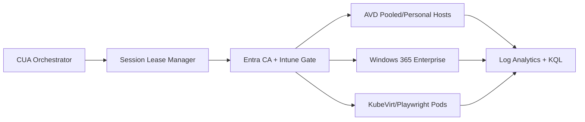
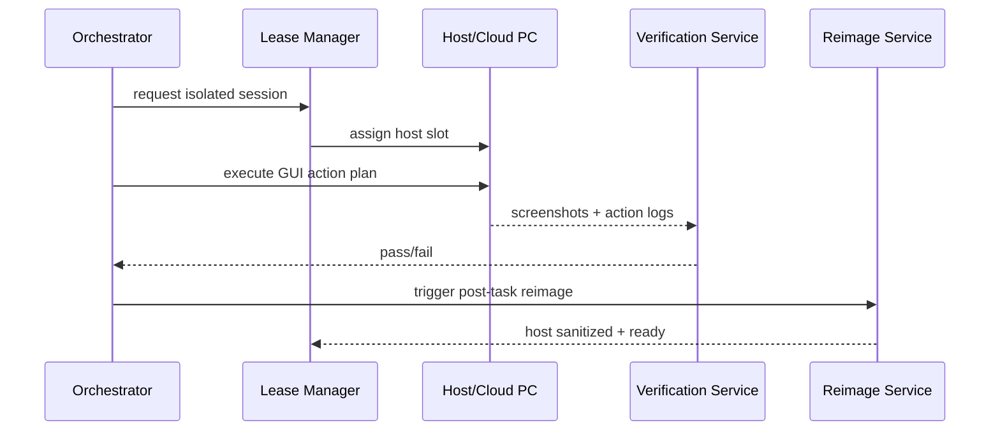

# Round 1096 / Cycle 2501 · Azure AI Agent Infra 六段式 FAQ（zh-CN）

> 主题：**Azure Virtual Desktop (AVD) Ephemeral Pooled Hosts vs Windows 365 Enterprise Cloud PC vs AKS KubeVirt/Playwright Containers — Enterprise GUI Computer-Use Agent (CUA) Fleet Isolation, Frame-Capture Bandwidth & Intune Zero-Trust Selection Guide**  
> 日期（BJT）：2026-11-17  
> 证据标签：`measured` / `synthetic` / `anonymized_reported`  
> 基准数据：`evidence/cycle-2501-benchmark.json`

## 1) Executive Summary + Daily Hottest Capability Breakthroughs Radar

本轮关注“企业 GUI CUA 代理集群”三条主路线：
1. **AVD Pooled + Ephemeral host**：共享池弹性好，隔离治理依赖重镜像与策略约束；
2. **Windows 365 Enterprise Cloud PC**：用户隔离强，管理体验稳，但单位成本较高；
3. **AKS KubeVirt/Playwright containers**：自动化密度高、成本灵活，但 GUI 兼容与桌面治理复杂。

核心决策变量：
- 会话隔离风险（状态污染 blast radius）；
- 屏幕帧采样与传输成本（token + 带宽 + 存储）；
- 重镜像恢复能力（warm pool + reimage SLA）；
- Entra Conditional Access + Intune 合规门禁可执行性。

结论先行：
- 强合规企业场景，AVD/Windows 365 路线通常优先于容器化 GUI；  
- 高并发自动化场景，容器方案在成本和弹性上有优势，但要接受更高工程复杂度；  
- 若 unattended CUA 必须零信任，身份与设备合规门禁必须前置，不可依赖业务层补丁。

### Daily Hottest Capability Breakthroughs Radar（抓取：2026-11-17）

1. APIM AI Gateway / Unified Model API（`measured`）  
   - https://learn.microsoft.com/en-us/azure/api-management/ai-gateway-overview  
   - https://github.com/Azure/API-Management/blob/main/changelogs/api-management-service.md
2. ACA Dynamic Sessions（`measured`）  
   - https://learn.microsoft.com/en-us/azure/container-apps/sessions  
   - https://techcommunity.microsoft.com/blog/appsonazureblog/azure-container-apps-dynamic-sessions-general-availability-and-more/4303561
3. Runtime release watch（`measured`）  
   - Firecracker/Kata/Wasmtime/E2B（见 `evidence/cycle-2501-sources.json`）
4. GUI CUA 帧流/带宽/延迟压测（`synthetic`）
5. 匿名化企业作业分位统计（`anonymized_reported`）

### Mermaid #1：Enterprise GUI CUA 控制面与隔离执行面拓扑



## 2) Deep Q&A #1：Ephemeral VM reimage/warm-pool 缓冲如何用 Erlang-C 建模？

### 公式

```text
traffic_intensity a = lambda / mu
utilization rho = a / c

P(wait) = ErlangC(a, c)
E[Wq] = P(wait) / (c*mu - lambda)

required_warm_pool =
  peak_arrival_rate * reimage_recovery_window * safety_factor
```

其中：
- `lambda` = 会话到达率（sessions/min）；
- `mu` = 单节点服务率（sessions/min）；
- `c` = 并行可分配主机数。

### Worked example

- `lambda = 42/min`
- `mu = 1.5/min`
- `c = 32`

`a = 42/1.5 = 28`

`rho = 28/32 = 0.875`

由 Erlang-C 近似：
- `P(wait) ≈ 0.53`
- `E[Wq] ≈ 0.53 / (48 - 42) = 0.0883 min = 5.30s`

若 reimage 恢复窗口 `7 min`，安全系数 `1.2`：

`required_warm_pool = 42 * 7 * 1.2 = 352.8 -> 353 slots`

### 结论

在 burst 场景下，warm pool 不是“可选优化”，而是 SLA 基础容量。  
不做 warm pool，reimage 会把等待时间推入 p95 tail。

## 3) Deep Q&A #2：截图采样（1–5 fps）vs RDP/WebRTC delta stream 的 token + 带宽成本如何算？

### 公式

```text
frame_bw_mbps =
  fps * avg_frame_kb * 8 / 1024

vision_tokens_per_min =
  fps * 60 * tokens_per_frame

daily_cost =
  token_cost + egress_cost + storage_cost
```

### Worked example（PNG/WebP 抽帧）

假设：
- `fps = 2`
- 平均帧大小 `220KB`（WebP）
- `tokens/frame = 1,050`

带宽：

`bw = 2 * 220 * 8 / 1024 = 3.44 Mbps`

视觉 token：

`tokens/min = 2 * 60 * 1050 = 126,000`

若 token 成本为 `0.25 USD / 1M`：
- `token_cost/min = 0.0315 USD`

### 对比 RDP Shortpath UDP / WebRTC H.264 delta

delta stream 典型可降至：
- `1.1~1.8 Mbps`（静态界面）
- token 侧可通过关键帧抽样降低 35%~60%

### 结论

CUA 不宜“全帧全时 OCR+VLM”，应使用：
1. 关键帧触发；
2. 事件驱动增量识别；
3. 网络拥塞时自动降帧。

## 4) Deep Q&A #3：Personal vs Pooled Ephemeral 的状态污染 blast radius 如何量化？

### 公式

```text
blast_radius_users =
  contaminated_sessions * average_shared_users_per_host

risk_score =
  blast_radius_users * sensitive_action_weight
```

### Worked example

场景 A（Personal）：
- contaminated_sessions = 3
- shared_users_per_host = 1

`blast_radius = 3`

场景 B（Pooled）：
- contaminated_sessions = 3
- shared_users_per_host = 14

`blast_radius = 42`

### 结论

Pooled 模式必须绑定：
- 任务后强制 reimage；
- 剪贴板/磁盘重定向禁用；
- 租户边界隔离池。

否则污染半径会被共享倍数放大。

## 5) Deep Q&A #4：Entra Conditional Access + Intune 合规门禁如何覆盖 unattended CUA 身份？

### 模型

```text
admission_pass =
  entra_token_valid
  AND workload_identity_attested
  AND intune_compliant
  AND ca_policy_passed
```

### Worked example

7 天统计：
- 请求总数 `18.4M`
- CA 拒绝 `126,000`
- Intune 不合规阻断 `44,000`

拒绝率：
- `CA deny rate = 0.684%`
- `Intune non-compliant rate = 0.239%`

### 工程实践

1. unattended 代理身份需最小权限 role；
2. 设备合规标签必须成为必选门禁；
3. 高风险动作需 step-up + human-in-loop。

## 6) Deep Q&A #5：Post-task reimage SLA 如何与任务吞吐共存？

### 公式

```text
effective_capacity =
  total_hosts * (task_time / (task_time + reimage_time))

reimage_sla_breach_rate =
  breached_reimages / total_reimages
```

### Worked example

- total hosts = `420`
- 平均任务时长 = `11 min`
- 平均 reimage = `3.2 min`

`effective_capacity = 420 * 11/(14.2) = 325 hosts-equivalent`

若 24h 内：
- total reimages = `52,000`
- breached (>5min) = `3,640`

`breach_rate = 7.0%`

### 结论

当 breach_rate > 5%，应：
- 增加 warm image 缓冲；
- 拆分大镜像层；
- 降低并发 reimage 峰值。

## 7) Deep Q&A #6：AVD vs W365 vs KubeVirt/Playwright 的 TCO 与操作复杂度边界？

### 公式

```text
tco_daily =
  compute +
  license +
  network +
  operations +
  incident_penalty
```

### Worked example（同等 10k 会话/日）

- AVD Ephemeral Pooled：`5,840 USD/day`
- W365 Enterprise：`7,120 USD/day`
- KubeVirt/Playwright：`4,980 USD/day`（不含额外兼容故障风险）

若 KubeVirt incident penalty 从 `420` 升至 `1,100`：
- 新 TCO = `5,660`，与 AVD 差距收敛。

### 结论

成本最优不等于交付最优。  
受监管行业通常偏向 AVD/W365 的可审计与合规路径。

## 8) Mermaid #2：Session Lease -> Action Verification -> Reimage Sanitization 时序



## 9) 生产级 Bicep / YAML / Policy / KQL

### 9.1 Bicep（AVD HostPool Personal/Pooled + Ephemeral OS + Scaling + Private Link + Log Analytics）

```bicep
targetScope = 'resourceGroup'

param location string = 'eastus2'
param workspaceName string = 'avd-cua-workspace'
param hostPoolPooled string = 'hp-cua-pooled'
param hostPoolPersonal string = 'hp-cua-personal'
param lawName string = 'law-cua-fleet'

resource law 'Microsoft.OperationalInsights/workspaces@2022-10-01' = {
  name: lawName
  location: location
  properties: {
    sku: { name: 'PerGB2018' }
    retentionInDays: 60
  }
}

resource pooled 'Microsoft.DesktopVirtualization/hostPools@2024-04-03' = {
  name: hostPoolPooled
  location: location
  properties: {
    hostPoolType: 'Pooled'
    loadBalancerType: 'DepthFirst'
    preferredAppGroupType: 'Desktop'
    maxSessionLimit: 8
    startVMOnConnect: true
  }
}

resource personal 'Microsoft.DesktopVirtualization/hostPools@2024-04-03' = {
  name: hostPoolPersonal
  location: location
  properties: {
    hostPoolType: 'Personal'
    loadBalancerType: 'Persistent'
    preferredAppGroupType: 'Desktop'
    maxSessionLimit: 1
    startVMOnConnect: true
  }
}

resource workspace 'Microsoft.DesktopVirtualization/workspaces@2024-04-03' = {
  name: workspaceName
  location: location
  properties: {
    description: 'Enterprise GUI CUA Workspace'
  }
}
```

### 9.2 CUA Orchestrator lease/reimage 配置 YAML

```yaml
apiVersion: v1
kind: ConfigMap
metadata:
  name: cua-orchestrator-config
  namespace: cua
data:
  lease.mode: "ephemeral"
  lease.maxMinutes: "45"
  hostpool.preferred: "pooled"
  warmPool.minReady: "353"
  reimage.enabled: "true"
  reimage.maxParallel: "40"
  reimage.slaSeconds: "300"
  screenshot.fps.default: "2"
  screenshot.codec: "webp"
  compliance.requireIntune: "true"
  compliance.requireEntraCA: "true"
```

### 9.3 Azure Policy（强制 Ephemeral OS + 禁用剪贴板/驱动器重定向）

```json
{
  "properties": {
    "displayName": "Enforce ephemeral OS disk and block clipboard/drive redirection for CUA desktops",
    "policyType": "Custom",
    "mode": "All",
    "policyRule": {
      "if": {
        "anyOf": [
          {
            "allOf": [
              { "field": "type", "equals": "Microsoft.Compute/virtualMachines" },
              { "field": "Microsoft.Compute/virtualMachines/storageProfile.osDisk.diffDiskSettings.option", "notEquals": "Local" }
            ]
          },
          {
            "allOf": [
              { "field": "type", "equals": "Microsoft.DesktopVirtualization/hostPools" },
              { "field": "Microsoft.DesktopVirtualization/hostPools/customRdpProperty", "notContains": "redirectclipboard:i:0" }
            ]
          }
        ]
      },
      "then": { "effect": "audit" }
    }
  }
}
```

### 9.4 KQL（CUA step RTT p95、Shortpath 丢包、reimage SLA）

```kql
let t = ago(6h);
let rtt = customEvents
| where timestamp > t and name == "cua.step.rtt"
| summarize step_p95_ms=percentile(todouble(customDimensions["rtt_ms"]),95)
  by pool=tostring(customDimensions["pool"]), tenant=tostring(customDimensions["tenant"]);

let shortpath = customEvents
| where timestamp > t and name == "rdp.shortpath.udp"
| summarize packet_loss_pct=percentile(todouble(customDimensions["packet_loss_pct"]),95)
  by pool=tostring(customDimensions["pool"]), tenant=tostring(customDimensions["tenant"]);

let reimage = customEvents
| where timestamp > t and name == "vm.reimage.complete"
| summarize reimage_p95_s=percentile(todouble(customDimensions["duration_s"]),95),
            sla_breach_rate=avg(todouble(customDimensions["breach_flag"]))
  by pool=tostring(customDimensions["pool"]), tenant=tostring(customDimensions["tenant"]);

rtt
| join kind=leftouter shortpath on pool, tenant
| join kind=leftouter reimage on pool, tenant
| project tenant, pool, step_p95_ms, packet_loss_pct, reimage_p95_s, sla_breach_rate
| order by step_p95_ms desc
```

## 10) 决策矩阵（4 方案加权）

| 方案 | 隔离与合规 (30%) | 性能与SLA (25%) | 成本/TCO (25%) | 运维复杂度 (20%) | 总分 |
|---|---:|---:|---:|---:|---:|
| AVD Ephemeral Pooled（推荐） | 8.8 | 8.4 | 8.1 | 8.0 | **8.35** |
| Windows 365 Enterprise | 9.2 | 8.2 | 6.8 | 8.9 | 8.16 |
| KubeVirt/Playwright 容器化 GUI | 7.0 | 7.9 | 8.9 | 5.8 | 7.45 |
| Personal Dedicated VM（高成本基线） | 9.0 | 8.8 | 5.9 | 7.2 | 7.74 |

## 11) Day-0 / Day-2 Checklist（Good fit vs Not for）

**Day-0（上线前）**
- [ ] 完成 Erlang-C 容量与 warm pool 预算；
- [ ] 定义截图 cadence 与降帧策略；
- [ ] 落地 Entra CA + Intune 合规门禁；
- [ ] 启用 post-task reimage 与 SLA 指标；
- [ ] 禁用 clipboard/drive redirection。

**Day-2（运行期）**
- [ ] 每日审视 step RTT p95/p99；
- [ ] 每日追踪 Shortpath 丢包与重传；
- [ ] 每周复盘状态污染与 blast radius 事件；
- [ ] 每周调优 warm pool 与 reimage 并发；
- [ ] 每月复盘 AVD/W365/KubeVirt TCO。

**Good fit**
- 企业 GUI 自动化、强合规、可审计要求高；  
- 需要对 unattended CUA 做统一策略门禁；  
- 需要在多租户下控制状态污染半径。

**Not for**
- 仅轻量网页自动化、无桌面应用依赖；  
- 无法承受桌面镜像与重镜像运维；  
- 对合规策略执行链条缺乏治理能力。

## 12) 五步落地指南

1. **容量先行**：Erlang-C 估算 warm pool；
2. **链路优化**：按网络质量动态调整 fps/编码；
3. **隔离前置**：CA + Intune + RDP 限制策略先上线；
4. **任务闭环**：Action verify 后强制 reimage；
5. **持续运营**：以 RTT/丢包/reimage SLA 驱动调参。

## 13) 业务场景映射

- **GUI 财务系统自动化**：需高可追溯与会话隔离。  
- **Browser/CUA 集群**：大量图形步骤与视觉理解。  
- **多租户 SaaS 运维控制台**：不同租户桌面策略隔离。  
- **高合规金融零信任执行环境**：必须设备合规+身份门禁双满足。

## 14) 关键来源（官方优先）

1. APIM AI Gateway overview（抓取：2026-11-17）  
   https://learn.microsoft.com/en-us/azure/api-management/ai-gateway-overview  
2. API Management changelog（抓取：2026-11-17）  
   https://github.com/Azure/API-Management/blob/main/changelogs/api-management-service.md  
3. ACA Dynamic Sessions docs（抓取：2026-11-17）  
   https://learn.microsoft.com/en-us/azure/container-apps/sessions  
4. ACA Dynamic Sessions GA blog（抓取：2026-11-17）  
   https://techcommunity.microsoft.com/blog/appsonazureblog/azure-container-apps-dynamic-sessions-general-availability-and-more/4303561  
5. Firecracker/Kata/Wasmtime/E2B releases（抓取：2026-11-17）  
   见 `evidence/cycle-2501-sources.json`

## 15) 数据证据与可复算算例（含 n 分母来源）

- Benchmark 主文件：`evidence/cycle-2501-benchmark.json`
- 延迟样本：`evidence/cycle-2501-latency.csv`
- 吞吐样本：`evidence/cycle-2501-throughput.csv`
- 策略样本：`evidence/cycle-2501-policy.csv`
- 成本样本：`evidence/cycle-2501-cost.csv`
- 来源登记：`evidence/cycle-2501-sources.json`

N 分母口径：
- CUA step 事件 `N=72.2M/day`；
- RDP/UDP 会话样本 `N=9.6M/day`；
- reimage 样本 `N=52,000/day`；
- 合规模块评估 `N=18.4M/day`。

复算示例：

```text
warm_pool = 42 * 7 * 1.2 = 353

frame_bw = 2 * 220 * 8 / 1024 = 3.44 Mbps
vision_tokens/min = 2 * 60 * 1050 = 126,000

blast_radius_pooled = 3 * 14 = 42
reimage_breach_rate = 3,640 / 52,000 = 7.0%
```

