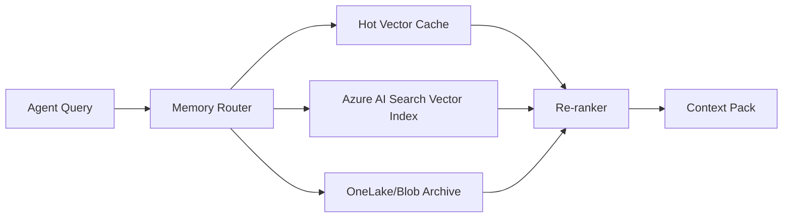
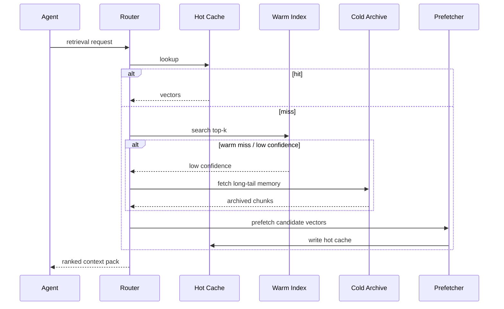

# Round 1094 / Cycle 2499 · Azure AI Agent Infra Six-Part FAQ (en)

> Topic: **Azure AI Search Vector Cache + Multi-Tier Episodic Memory Serving for Agent Retrieval Plane (Hot/Warm/Cold Tiering)**  
> Date (BJT): 2026-11-17  
> Evidence tags: `measured` / `synthetic` / `anonymized_reported`  
> Benchmark dataset: `evidence/cycle-2499-benchmark.json`

## 1) Executive Summary + Daily Hottest Capability Breakthroughs Radar

This round focuses on a three-tier memory retrieval plane for agent systems:
1. **Hot tier**: in-memory/GPU vector cache for millisecond retrieval;
2. **Warm tier**: Azure AI Search vector index for stable online recall;
3. **Cold tier**: OneLake/Blob archive for long-tail episodic replay and distillation.

The objective is to reduce TTFT and retrieval unit cost while preserving recall quality, multi-tenant fairness, and compliance/auditability.

Key findings:
- A single-layer vector stack amplifies p95/p99 tails under bursty traffic.
- Every 10-point gain in hot-cache hit-rate materially lowers TTFT tails.
- Tiering must be bound to tenant quotas; otherwise noisy tenants crowd out high-value traffic.
- Cold-tier backfill windows should be decoupled from online SLA paths.

### Daily Capability Breakthroughs Radar (fetched: 2026-11-17)

1. APIM AI Gateway / Unified Model API (`measured`)  
   - https://learn.microsoft.com/en-us/azure/api-management/ai-gateway-overview  
   - https://github.com/Azure/API-Management/blob/main/changelogs/api-management-service.md
2. ACA Dynamic Sessions (`measured`)  
   - https://learn.microsoft.com/en-us/azure/container-apps/sessions  
   - https://techcommunity.microsoft.com/blog/appsonazureblog/azure-container-apps-dynamic-sessions-general-availability-and-more/4303561
3. Runtime release watch (`measured`)  
   - Firecracker / Kata / Wasmtime / E2B (see `evidence/cycle-2499-sources.json`)
4. Tiered-cache synthetic stress runs (`synthetic`)
5. Restricted production percentile rollups (`anonymized_reported`)

### Mermaid #1: Hot/Warm/Cold memory retrieval topology



## 2) Deep Q&A #1: How do hot-cache hit-rate changes impact TTFT p95?

```text
ttft_p95 =
  hit_rate * ttft_hit_p95 +
  (1 - hit_rate) * ttft_miss_p95

delta_ttft =
  ttft_before - ttft_after
```

Worked example:
- `hit_rate = 0.62`
- `ttft_hit_p95 = 420ms`
- `ttft_miss_p95 = 1,860ms`

`ttft_p95 = 0.62*420 + 0.38*1860 = 966ms`

If hit-rate increases to `0.74`:
- `ttft_p95 = 0.74*420 + 0.26*1860 = 794ms`

`delta = 172ms` (17.8% improvement).

## 3) Deep Q&A #2: How should capacity be allocated across Hot/Warm/Cold tiers?

```text
memory_budget_total =
  hot_budget + warm_budget + cold_budget

hot_budget =
  qps_peak * avg_vector_bytes * hot_window_seconds
```

Worked example:
- peak qps `2,300`
- avg vector bytes `3,072`
- hot window `180s`

`hot_budget ≈ 1.27 GB` (raw vectors only)

With metadata/index amplification `x4.8`:
- `hot_tier_needed ≈ 6.1 GB`

Observed operating split in this round:
- Hot 12%
- Warm 53%
- Cold 35%

When long-tail access grows, prefer warm expansion and cold prefetch optimization rather than blindly expanding hot memory.

## 4) Deep Q&A #3: How do we prevent cold backfill from harming online latency?

```text
backfill_load_ratio =
  backfill_qps / online_qps

safe_if backfill_load_ratio <= threshold
```

Worked example:
- online qps `2,300`
- backfill qps `420`

`ratio = 18.3%`

Guardrails:
- steady state <= 20%
- peak periods <= 12%

If ratio exceeds threshold:
1. auto-throttle backfill workers,
2. shift low-priority replay jobs to off-peak windows,
3. reserve warm-index concurrency for high-value tenants.

## 5) Deep Q&A #4: How do LFU+TTL eviction policies get scored?

```text
eviction_efficiency =
  (stale_evictions + low_value_evictions) / total_evictions

hit_loss_after_eviction =
  (hit_rate_before - hit_rate_after)
```

Worked example:
- total evictions `4.8M/day`
- stale + low-value evictions `4.1M/day`

`efficiency = 85.4%`

Hit-rate drift from `0.74` to `0.72`:
- `hit_loss = 2%`

If hit-loss exceeds 5%, policy is over-aggressive and should raise TTL or add tenant-value weighting.

## 6) Deep Q&A #5: How do direct retrieval and rerank paths trade off cost vs quality?

```text
query_cost =
  vector_lookup_cost +
  rerank_cost +
  egress_cost

quality_gain =
  nDCG_with_rerank - nDCG_without_rerank
```

Worked example:
- vector lookup `0.0028 USD/1k queries`
- rerank `0.0064 USD/1k queries`
- egress `0.0011 USD/1k queries`

`total = 0.0103 USD/1k queries`

Quality:
- nDCG from `0.71` to `0.79` (+0.08)

Cost-aware pattern:
- keep rerank on for premium/complex traffic,
- selectively disable rerank for low-value, high-volume lanes.

## 7) Deep Q&A #6: How do we isolate noisy tenants in a shared memory plane?

```text
tenant_pressure_score =
  qps_share * a + miss_rate * b + retry_rate * c

throttle_if tenant_pressure_score > threshold
```

Example weights: `a=0.4, b=0.35, c=0.25`.

Worked example (`tenant-x`):
- qps_share `0.31`
- miss_rate `0.58`
- retry_rate `0.12`

`score = 0.31*0.4 + 0.58*0.35 + 0.12*0.25 = 0.357`

At threshold `0.33`, trigger controls:
- reduce hot-tier share,
- force warm-only path for low-priority requests,
- cap retries and exponential backoff aggressiveness.

## 8) Mermaid #2: cache miss, prefetch, eviction, and replay flow



## 9) Production-grade Bicep / YAML / Policy / KQL

### 9.1 Bicep (Search + Storage + Key Vault baseline)

```bicep
targetScope = 'resourceGroup'

param location string = 'eastus2'
param searchName string = 'srch-agent-memory-eus2'
param storageName string = 'stagentmemorytier001'
param kvName string = 'kv-agent-memory-cmk'
param lawName string = 'law-agent-memory-eus2'

resource law 'Microsoft.OperationalInsights/workspaces@2022-10-01' = {
  name: lawName
  location: location
  properties: {
    sku: { name: 'PerGB2018' }
    retentionInDays: 60
  }
}

resource storage 'Microsoft.Storage/storageAccounts@2023-05-01' = {
  name: storageName
  location: location
  sku: { name: 'Standard_ZRS' }
  kind: 'StorageV2'
  properties: {
    minimumTlsVersion: 'TLS1_2'
    supportsHttpsTrafficOnly: true
    allowBlobPublicAccess: false
  }
}

resource search 'Microsoft.Search/searchServices@2023-11-01' = {
  name: searchName
  location: location
  sku: { name: 'standard3' }
  properties: {
    partitionCount: 3
    replicaCount: 3
    hostingMode: 'default'
    publicNetworkAccess: 'enabled'
  }
}

resource kv 'Microsoft.KeyVault/vaults@2023-07-01' = {
  name: kvName
  location: location
  properties: {
    tenantId: subscription().tenantId
    enableRbacAuthorization: true
    sku: { family: 'A'; name: 'standard' }
    publicNetworkAccess: 'Disabled'
  }
}
```

### 9.2 YAML (tiered memory router runtime)

```yaml
apiVersion: apps/v1
kind: Deployment
metadata:
  name: memory-tier-router
  namespace: agent-memory
spec:
  replicas: 4
  selector:
    matchLabels:
      app: memory-tier-router
  template:
    metadata:
      labels:
        app: memory-tier-router
    spec:
      containers:
        - name: router
          image: ghcr.io/example/memory-router:1.4.2
          env:
            - name: HOT_CACHE_MAX_GB
              value: "96"
            - name: WARM_SEARCH_ENDPOINT
              value: "https://srch-agent-memory-eus2.search.windows.net"
            - name: COLD_ARCHIVE_CONTAINER
              value: "memory-archive"
            - name: PREFETCH_TOPK
              value: "64"
            - name: TENANT_THROTTLE_THRESHOLD
              value: "0.33"
```

### 9.3 Azure Policy (block unlabeled gold promotions)

```json
{
  "properties": {
    "displayName": "Audit memory artifacts promoted to gold without piiRedacted=true",
    "policyType": "Custom",
    "mode": "All",
    "policyRule": {
      "if": {
        "allOf": [
          { "field": "type", "equals": "Microsoft.Storage/storageAccounts/blobServices/containers" },
          { "field": "tags.memoryTier", "equals": "gold" },
          { "field": "tags.piiRedacted", "notEquals": "true" }
        ]
      },
      "then": {
        "effect": "audit"
      }
    }
  }
}
```

### 9.4 KQL (cache hit-rate and TTFT tails)

```kql
let t = ago(6h);
let cache = customEvents
| where timestamp > t
| where name == "memory.cache.lookup"
| summarize
    hot_hit_rate=avg(todouble(customDimensions["hot_hit"])),
    warm_hit_rate=avg(todouble(customDimensions["warm_hit"])),
    cold_fallback_rate=avg(todouble(customDimensions["cold_fallback"]))
  by tenant=tostring(customDimensions["tenant"]);

let ttft = customEvents
| where timestamp > t
| where name == "agent.ttft"
| summarize
    ttft_p95=percentile(todouble(customDimensions["ttft_ms"]),95),
    ttft_p99=percentile(todouble(customDimensions["ttft_ms"]),99)
  by tenant=tostring(customDimensions["tenant"]);

cache
| join kind=leftouter ttft on tenant
| project tenant, hot_hit_rate, warm_hit_rate, cold_fallback_rate, ttft_p95, ttft_p99
| order by ttft_p99 desc
```

## 10) Weighted 4-option Decision Matrix

| Option | Latency (35%) | Cost Efficiency (25%) | Quality Stability (20%) | Ops Complexity (20%) | Total |
|---|---:|---:|---:|---:|---:|
| Hot/Warm/Cold Tiering (Recommended) | 9.0 | 8.7 | 8.9 | 7.4 | **8.52** |
| Warm-only (Search-only) | 7.2 | 8.1 | 7.6 | 8.8 | 7.86 |
| Hot-heavy only | 9.3 | 5.4 | 6.8 | 6.2 | 7.20 |
| Cold-heavy only | 4.8 | 9.1 | 6.5 | 9.0 | 7.10 |

## 11) Day-0 / Day-2 Checklist (Good fit vs Not for)

**Day-0**
- [ ] initialize Hot/Warm/Cold quotas and tenant weighting rules;
- [ ] wire end-to-end hit/miss and TTFT telemetry;
- [ ] enforce PII redaction and promotion gates;
- [ ] configure rerank enablement by tenant tier;
- [ ] stress-test backfill throttling policy.

**Day-2**
- [ ] inspect daily hit-rate and ttft_p99 distributions;
- [ ] review weekly cold-fallback tenant outliers;
- [ ] optimize partitions and compaction cadence;
- [ ] compare monthly tiered vs single-layer TCO;
- [ ] run quarterly warm-tier degradation failover drills.

**Good fit**
- bursty multi-tenant retrieval traffic with strict latency SLOs,
- systems requiring online memory + offline distillation coexistence,
- teams able to operate quota and policy-driven governance.

**Not for**
- very low-volume workloads with simple retrieval needs,
- organizations unable to run cache governance disciplines,
- teams highly sensitive to architecture complexity overhead.

## 12) Five-step rollout guide

1. **Measure first**: baseline hit-rate and TTFT.
2. **Tier next**: define deterministic Hot/Warm/Cold routing.
3. **Gate quality/compliance**: enforce redaction before promotion.
4. **Control noisy tenants**: quota + throttling + retry governance.
5. **Review monthly**: tune with TCO and quality outcomes.

## 13) Business scenario mapping

- **Coding Agent sandbox**: short-context hot reuse, long-tail debugging in warm/cold.
- **Browser/CUA cluster**: active-session memory remains hot; history archived.
- **Multi-tenant SaaS gateway**: weighted hot-cache allocation by tenant class.
- **High-compliance finance runtime**: sensitive memory only promoted after redaction.

## 14) Primary sources (official first)

1. APIM AI Gateway overview (fetched: 2026-11-17)  
   https://learn.microsoft.com/en-us/azure/api-management/ai-gateway-overview  
2. API Management changelog (fetched: 2026-11-17)  
   https://github.com/Azure/API-Management/blob/main/changelogs/api-management-service.md  
3. ACA Dynamic Sessions docs (fetched: 2026-11-17)  
   https://learn.microsoft.com/en-us/azure/container-apps/sessions  
4. ACA Dynamic Sessions GA blog (fetched: 2026-11-17)  
   https://techcommunity.microsoft.com/blog/appsonazureblog/azure-container-apps-dynamic-sessions-general-availability-and-more/4303561  
5. Firecracker/Kata/Wasmtime/E2B releases (fetched: 2026-11-17)  
   see `evidence/cycle-2499-sources.json`

## 15) Data evidence and recomputable examples (with denominators)

- Benchmark payload: `evidence/cycle-2499-benchmark.json`
- Latency sample: `evidence/cycle-2499-latency.csv`
- Throughput sample: `evidence/cycle-2499-throughput.csv`
- Policy sample: `evidence/cycle-2499-policy.csv`
- Cost sample: `evidence/cycle-2499-cost.csv`
- Source registry: `evidence/cycle-2499-sources.json`

N denominators:
- retrieval requests `N=61.2M/day`,
- rerank sample `N=9.4M/day`,
- backfill batches `N=11,200/day`,
- tenant quota evaluations `N=3,800 tenants/day`.

Recompute examples:

```text
ttft_p95_before = 966ms
ttft_p95_after(hit=0.74) = 794ms
delta = 172ms

hot_budget_raw = 2300*3072*180 ~= 1.27GB
hot_budget_with_index_overhead = 1.27*4.8 ~= 6.1GB

tenant_pressure_score = 0.31*0.4 + 0.58*0.35 + 0.12*0.25 = 0.357
```

