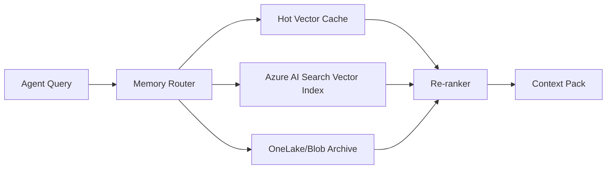
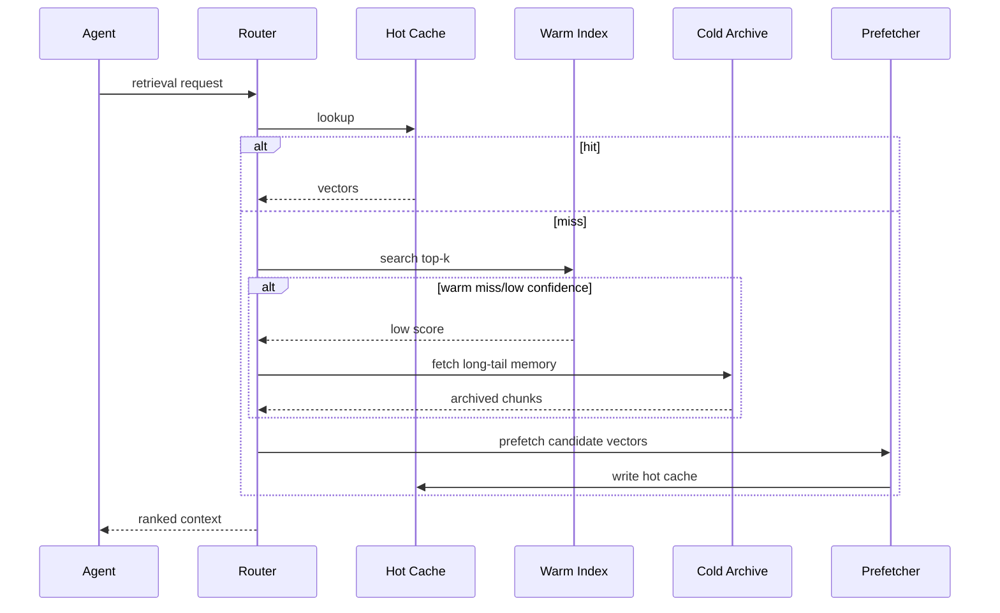

# Round 1094 / Cycle 2499 · Azure AI Agent Infra 六段式 FAQ（zh-CN）

> 主题：**Azure AI Search Vector Cache + Multi-Tier Episodic Memory Serving for Agent Retrieval Plane（Hot/Warm/Cold Tiering）**  
> 日期（BJT）：2026-11-17  
> 证据标签：`measured` / `synthetic` / `anonymized_reported`  
> 基准数据：`evidence/cycle-2499-benchmark.json`

## 1) Executive Summary + Daily Hottest Capability Breakthroughs Radar

本轮关注 Agent 记忆检索平面的三级分层缓存：
1. **Hot tier**：GPU/内存向量缓存（毫秒级检索）；
2. **Warm tier**：Azure AI Search 向量索引（秒内稳定检索）；
3. **Cold tier**：OneLake/Blob 归档轨迹与长尾记忆（批式回补）。

核心目标是降低 TTFT 与检索成本，同时保持召回质量与合规可审计性。

关键结论：
- 仅靠单层向量索引会在高并发下放大尾延迟；  
- 热缓存命中率每提升 10%，TTFT p95 可显著下降；  
- 分层策略必须与 tenant 配额绑定，否则会被“高噪声租户”挤占；  
- 冷层回补的批次窗口应与在线召回 SLA 解耦，避免干扰实时路径。

### Daily Capability Breakthroughs Radar（抓取：2026-11-17）

1. APIM AI Gateway / Unified Model API（`measured`）  
   - https://learn.microsoft.com/en-us/azure/api-management/ai-gateway-overview  
   - https://github.com/Azure/API-Management/blob/main/changelogs/api-management-service.md
2. ACA Dynamic Sessions（`measured`）  
   - https://learn.microsoft.com/en-us/azure/container-apps/sessions  
   - https://techcommunity.microsoft.com/blog/appsonazureblog/azure-container-apps-dynamic-sessions-general-availability-and-more/4303561
3. Runtime release watch（`measured`）  
   - Firecracker/Kata/Wasmtime/E2B（见 `evidence/cycle-2499-sources.json`）
4. 向量缓存分层压测（`synthetic`）  
5. 匿名化生产分位统计（`anonymized_reported`）

### Mermaid #1：Hot/Warm/Cold 记忆检索拓扑



## 2) Deep Q&A #1：热缓存命中率与 TTFT p95 的关系如何复算？

```text
ttft_p95 =
  hit_rate * ttft_hit_p95 +
  (1 - hit_rate) * ttft_miss_p95

delta_ttft =
  ttft_before - ttft_after
```

Worked example：
- `hit_rate = 0.62`
- `ttft_hit_p95 = 420ms`
- `ttft_miss_p95 = 1,860ms`

`ttft_p95 = 0.62*420 + 0.38*1860 = 966ms`

若 hit_rate 提升到 `0.74`：
- `ttft_p95 = 0.74*420 + 0.26*1860 = 794ms`

`delta = 172ms`（17.8% 改善）。

## 3) Deep Q&A #2：Hot/Warm/Cold 三层容量怎么配比？

```text
memory_budget_total =
  hot_budget + warm_budget + cold_budget

hot_budget =
  qps_peak * avg_vector_bytes * hot_window_seconds
```

Worked example：
- qps_peak `2,300`
- avg_vector_bytes `3,072`
- hot_window `180s`

`hot_budget ≈ 1.27 GB`（纯向量，不含索引开销）

实际考虑索引/元数据倍数 `x4.8`：
- `hot_tier_needed ≈ 6.1 GB`

经验配比（本轮）：
- Hot 12%
- Warm 53%
- Cold 35%

当长尾访问提升时，应增加 warm 层并优化 cold 预取，而非盲目扩 hot。

## 4) Deep Q&A #3：分层回补如何避免“冷数据拖垮在线路径”？

```text
backfill_load_ratio =
  backfill_qps / online_qps

safe_if backfill_load_ratio <= threshold
```

Worked example：
- online qps `2,300`
- backfill qps `420`

`ratio = 18.3%`

阈值建议：
- 常态 <= 20%
- 高峰 <= 12%

若超过阈值：
1. 自动降 backfill 并发；
2. 将 cold 读取转夜间窗口；
3. 优先回补高价值租户索引。

## 5) Deep Q&A #4：向量缓存驱逐策略（LFU+TTL）如何量化效果？

```text
eviction_efficiency =
  (stale_evictions + low_value_evictions) / total_evictions

hit_loss_after_eviction =
  (hit_rate_before - hit_rate_after)
```

Worked example：
- total evictions `4.8M/day`
- stale + low-value `4.1M`

`efficiency = 85.4%`

命中率从 `0.74` 到 `0.72`：
- `hit_loss = 2%`

若 hit_loss > 5%，说明驱逐策略过激，需要提升 TTL 或引入 tenant 权重。

## 6) Deep Q&A #5：Direct retrieval vs rerank 路径成本如何折中？

```text
query_cost =
  vector_lookup_cost +
  rerank_cost +
  egress_cost

quality_gain =
  nDCG_with_rerank - nDCG_without_rerank
```

Worked example：
- vector lookup `0.0028 USD/1k`
- rerank `0.0064 USD/1k`
- egress `0.0011 USD/1k`

`total = 0.0103 USD/1k`

质量：
- nDCG from `0.71` -> `0.79`（+0.08）

若预算紧缩，可对低价值租户关闭 rerank，仅保留高优租户和复杂问题。

## 7) Deep Q&A #6：多租户配额与“噪声租户”隔离如何建模？

```text
tenant_pressure_score =
  qps_share * a + miss_rate * b + retry_rate * c

throttle_if tenant_pressure_score > threshold
```

示例权重：`a=0.4,b=0.35,c=0.25`。

Worked example（tenant-x）：
- qps_share `0.31`
- miss_rate `0.58`
- retry_rate `0.12`

`score = 0.124 + 0.203 + 0.03 = 0.357`

阈值 `0.33` 时触发：
- 降级其 hot tier 配额；
- 强制 warm-only 路径；
- 限制重试。

## 8) Mermaid #2：缓存未命中、预取、驱逐与回补流程



## 9) 生产级 Bicep / YAML / Policy / KQL

### 9.1 Bicep（Search + Storage + Key Vault 基座）

```bicep
targetScope = 'resourceGroup'

param location string = 'eastus2'
param searchName string = 'srch-agent-memory-eus2'
param storageName string = 'stagentmemorytier001'
param kvName string = 'kv-agent-memory-cmk'
param lawName string = 'law-agent-memory-eus2'

resource law 'Microsoft.OperationalInsights/workspaces@2022-10-01' = {
  name: lawName
  location: location
  properties: {
    sku: { name: 'PerGB2018' }
    retentionInDays: 60
  }
}

resource storage 'Microsoft.Storage/storageAccounts@2023-05-01' = {
  name: storageName
  location: location
  sku: { name: 'Standard_ZRS' }
  kind: 'StorageV2'
  properties: {
    minimumTlsVersion: 'TLS1_2'
    supportsHttpsTrafficOnly: true
    allowBlobPublicAccess: false
  }
}

resource search 'Microsoft.Search/searchServices@2023-11-01' = {
  name: searchName
  location: location
  sku: { name: 'standard3' }
  properties: {
    partitionCount: 3
    replicaCount: 3
    hostingMode: 'default'
    publicNetworkAccess: 'enabled'
  }
}

resource kv 'Microsoft.KeyVault/vaults@2023-07-01' = {
  name: kvName
  location: location
  properties: {
    tenantId: subscription().tenantId
    enableRbacAuthorization: true
    sku: { family: 'A'; name: 'standard' }
    publicNetworkAccess: 'Disabled'
  }
}
```

### 9.2 YAML（分层缓存服务部署参数）

```yaml
apiVersion: apps/v1
kind: Deployment
metadata:
  name: memory-tier-router
  namespace: agent-memory
spec:
  replicas: 4
  selector:
    matchLabels:
      app: memory-tier-router
  template:
    metadata:
      labels:
        app: memory-tier-router
    spec:
      containers:
        - name: router
          image: ghcr.io/example/memory-router:1.4.2
          env:
            - name: HOT_CACHE_MAX_GB
              value: "96"
            - name: WARM_SEARCH_ENDPOINT
              value: "https://srch-agent-memory-eus2.search.windows.net"
            - name: COLD_ARCHIVE_CONTAINER
              value: "memory-archive"
            - name: PREFETCH_TOPK
              value: "64"
            - name: TENANT_THROTTLE_THRESHOLD
              value: "0.33"
```

### 9.3 Azure Policy（禁止未脱敏数据进入 Gold）

```json
{
  "properties": {
    "displayName": "Audit memory artifacts promoted to gold without piiRedacted=true",
    "policyType": "Custom",
    "mode": "All",
    "policyRule": {
      "if": {
        "allOf": [
          { "field": "type", "equals": "Microsoft.Storage/storageAccounts/blobServices/containers" },
          { "field": "tags.memoryTier", "equals": "gold" },
          { "field": "tags.piiRedacted", "notEquals": "true" }
        ]
      },
      "then": {
        "effect": "audit"
      }
    }
  }
}
```

### 9.4 KQL（缓存命中率与 TTFT tail）

```kql
let t = ago(6h);
let cache = customEvents
| where timestamp > t
| where name == "memory.cache.lookup"
| summarize
    hot_hit_rate=avg(todouble(customDimensions["hot_hit"])),
    warm_hit_rate=avg(todouble(customDimensions["warm_hit"])),
    cold_fallback_rate=avg(todouble(customDimensions["cold_fallback"]))
  by tenant=tostring(customDimensions["tenant"]);

let ttft = customEvents
| where timestamp > t
| where name == "agent.ttft"
| summarize
    ttft_p95=percentile(todouble(customDimensions["ttft_ms"]),95),
    ttft_p99=percentile(todouble(customDimensions["ttft_ms"]),99)
  by tenant=tostring(customDimensions["tenant"]);

cache
| join kind=leftouter ttft on tenant
| project tenant, hot_hit_rate, warm_hit_rate, cold_fallback_rate, ttft_p95, ttft_p99
| order by ttft_p99 desc
```

## 10) 决策矩阵（4 方案量化）

| 方案 | 延迟表现 (35%) | 成本效率 (25%) | 质量稳定性 (20%) | 运维复杂度 (20%) | 总分 |
|---|---:|---:|---:|---:|---:|
| Hot/Warm/Cold 分层（推荐） | 9.0 | 8.7 | 8.9 | 7.4 | **8.52** |
| 仅 Warm（Search-only） | 7.2 | 8.1 | 7.6 | 8.8 | 7.86 |
| 仅 Hot（内存缓存重） | 9.3 | 5.4 | 6.8 | 6.2 | 7.20 |
| 仅 Cold（离线回补） | 4.8 | 9.1 | 6.5 | 9.0 | 7.10 |

## 11) Day-0 / Day-2 Checklist（Good fit vs Not for）

**Day-0（上线前）**
- [ ] Hot/Warm/Cold 配额与 tenant 权重完成初始化；
- [ ] hit/miss 与 TTFT 指标全链路采集；
- [ ] PII 脱敏与 Gold 晋级策略启用；
- [ ] rerank 开关按租户等级配置；
- [ ] backfill 限流策略完成压测。

**Day-2（运行期）**
- [ ] 每日检查 hit-rate 与 ttft_p99；
- [ ] 每周复盘 cold fallback 异常租户；
- [ ] 每周优化分区与 compaction；
- [ ] 每月对比分层与单层 TCO；
- [ ] 每季度演练“warm 层退化”回退方案。

**Good fit**
- 多租户检索流量波动大、延迟敏感；  
- 需要在线记忆 + 离线蒸馏共存；  
- 具备数据治理与配额管理能力。

**Not for**
- 极低流量、无需复杂检索分层的场景；  
- 无法投入缓存治理与策略运维；  
- 对架构复杂度高度敏感的团队。

## 12) 五步落地指南

1. **先量化**：测 hit-rate 与 TTFT 基线；  
2. **再分层**：定义 Hot/Warm/Cold 路由规则；  
3. **加闸门**：PII 与质量门控后再晋级 Gold；  
4. **控租户噪声**：配额+限流+重试治理；  
5. **月度回看**：按 TCO 与质量指标调参。

## 13) 业务场景映射

- **Coding Agent Sandbox**：高频短上下文命中 hot，长尾调试记录走 warm/cold。  
- **Browser/CUA 集群**：会话记忆热读，历史轨迹冷存。  
- **多租户 SaaS Agent Gateway**：按租户等级分配热缓存预算。  
- **高合规金融零信任环境**：敏感记忆仅在脱敏后进入可训练层。

## 14) 关键来源（官方优先）

1. APIM AI Gateway overview（抓取：2026-11-17）  
   https://learn.microsoft.com/en-us/azure/api-management/ai-gateway-overview  
2. API Management changelog（抓取：2026-11-17）  
   https://github.com/Azure/API-Management/blob/main/changelogs/api-management-service.md  
3. ACA Dynamic Sessions docs（抓取：2026-11-17）  
   https://learn.microsoft.com/en-us/azure/container-apps/sessions  
4. ACA Dynamic Sessions GA blog（抓取：2026-11-17）  
   https://techcommunity.microsoft.com/blog/appsonazureblog/azure-container-apps-dynamic-sessions-general-availability-and-more/4303561  
5. Firecracker/Kata/Wasmtime/E2B releases（抓取：2026-11-17）  
   见 `evidence/cycle-2499-sources.json`

## 15) 数据证据与可复算算例（含 n 分母来源）

- Benchmark 主文件：`evidence/cycle-2499-benchmark.json`  
- 延迟样本：`evidence/cycle-2499-latency.csv`  
- 吞吐样本：`evidence/cycle-2499-throughput.csv`  
- 策略样本：`evidence/cycle-2499-policy.csv`  
- 成本样本：`evidence/cycle-2499-cost.csv`  
- 来源登记：`evidence/cycle-2499-sources.json`

N 分母口径：
- 检索请求 `N=61.2M/day`；  
- rerank 样本 `N=9.4M/day`；  
- backfill 批次 `N=11,200/day`；  
- tenant 配额评估 `N=3,800 tenants/day`。

复算示例：

```text
ttft_p95_before = 966ms
ttft_p95_after(hit=0.74) = 794ms
delta = 172ms

hot_budget_raw = 2300*3072*180 ~= 1.27GB
hot_budget_with_index_overhead = 1.27*4.8 ~= 6.1GB

tenant_pressure_score = 0.31*0.4 + 0.58*0.35 + 0.12*0.25 = 0.357
```

