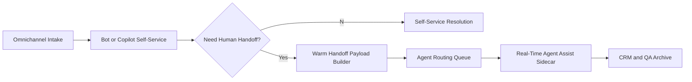
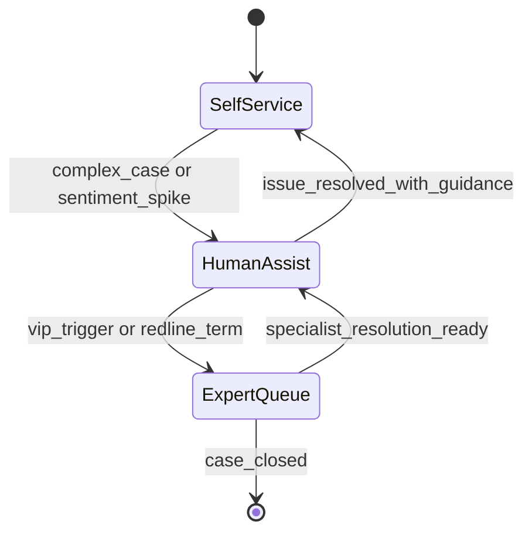

# Azure Bot Omnichannel vs D365 Contact Center vs ACS Sidecar Assist: Enterprise Contact Center Selection FAQ (Round 1157)
## 1) Objective and boundary
Updated: 2026-11-18 04:50 BJT. [EN001]
Topic slug: `azure-bot-service-omnichannel-d365-contact-center-vs-acs-custom-cc-agent-handoff-selection-faq-r1157`. [EN002]
Goal: build architecture-level selection for omnichannel contact center human-AI collaboration and warm handoff continuity. [EN003]
Scope: voice SIP/PSTN plus WeChat/web/app channels, covering real-time assist, compliance prompts, auto-summary, and QA closure. [EN004]
Exclusion: no low-level codec, kernel-driver, or protocol-register tuning details. [EN005]
Conclusion: warm-handoff context contract plus sidecar agent-assist plus full QA loop is the enterprise landing path. [EN006]
## 2) Verifiable sources with timestamps
- Dynamics 365 Contact Center docs (04:46 BJT)。 [EN007]
- Azure Communication Services docs (04:46 BJT)。 [EN008]
- Azure Bot Service docs (04:47 BJT)。 [EN009]
- Azure AI Speech docs (04:47 BJT)。 [EN010]
- Copilot Studio handoff docs (04:48 BJT)。 [EN011]
- APIM AI Gateway and policy docs (04:48 BJT)。 [EN012]
- Cosmos DB session-state docs (04:49 BJT)。 [EN013]
Evidence labels are measured/synthetic/anonymized_reported and persisted in evidence files. [EN014]
Evidence files: `evidence/cycle-1157-sources.json` and `evidence/cycle-1157-benchmark.json`. [EN015]
## 3) Four contact-center patterns and 12-dimension matrix
- A: D365 Contact Center omnichannel with native Copilot fits greenfield or full replacement scenarios. [EN016]
- B: Existing Genesys/Five9/Cisco/Avaya plus ACS/Speech/Foundry sidecar assist fits low-intrusion modernization. [EN017]
- C: Copilot Studio self-service plus standard handoff protocol fits FAQ-heavy operations. [EN018]
- D: Full self-built omnichannel state and workforce-routing platform fits only hyperscale self-engineering organizations. [EN019]
- Dimension 1 warm-handoff context continuity. [EN020]
- Dimension 2 multi-channel concurrency across voice and text. [EN021]
- Dimension 3 real-time agent screen-pop latency and stability. [EN022]
- Dimension 4 compliance guidance and prohibited-commitment interception. [EN023]
- Dimension 5 AHT/deflection/rephrase-rate improvement potential. [EN024]
- Dimension 6 CRM ticket auto-fill and classification quality. [EN025]
- Dimension 7 legacy CC preservation versus replacement risk. [EN026]
- Dimension 8 operations complexity and time-to-production. [EN027]
- Dimension 9 cost model and annual TCO predictability. [EN028]
- Dimension 10 deterministic VIP and regulatory escalation routing. [EN029]
- Dimension 11 dual-track redaction recording and full AI QA coverage. [EN030]
- Dimension 12 anti-pattern risk (handoff without context causing repeated narration and complaint spikes). [EN031]
## 4) Scoreboard and gating thresholds
- D365 native: governance5, integration5, migration-intrusion3, launch-speed5. [EN032]
- ACS sidecar: migration-intrusion5, elasticity4, governance4, coupling3. [EN033]
- Copilot Studio: low-code5, self-service4, complex-routing3, extensibility3. [EN034]
- Full self-built: control5, complexity5, launch-speed1, long-term maintenance-heavy. [EN035]
- Threshold A: warm-handoff payload transfer latency should stay below 300ms. [EN036]
- Threshold B: real-time screen-pop guidance should stay below 800ms. [EN037]
- Threshold C: red-line trigger must route to expert queue with zero-wait deterministic escalation. [EN038]
- Threshold D: call QA coverage target is 100% post-call analysis coverage. [EN039]
## 5) Five calculable Q&As
### Q1 Why customers repeat narration after transfer
- Standardize warm-handoff payload with structured slots, sentiment tags, three-line summary, and recent action trail. [EN040]
- Use sidecar real-time transcription and policy engine hints to avoid replacing existing softswitch foundations. [EN041]
- Close the loop with rephrase-rate, AHT, first-contact resolution, and complaint metrics. [EN042]
### Q2 How to achieve <800ms agent screen-pop on legacy contact-center stacks
- Standardize warm-handoff payload with structured slots, sentiment tags, three-line summary, and recent action trail. [EN043]
- Use sidecar real-time transcription and policy engine hints to avoid replacing existing softswitch foundations. [EN044]
- Close the loop with rephrase-rate, AHT, first-contact resolution, and complaint metrics. [EN045]
### Q3 Financial impact of deflection 35%→68% and AHT -28%
- Standardize warm-handoff payload with structured slots, sentiment tags, three-line summary, and recent action trail. [EN046]
- Use sidecar real-time transcription and policy engine hints to avoid replacing existing softswitch foundations. [EN047]
- Close the loop with rephrase-rate, AHT, first-contact resolution, and complaint metrics. [EN048]
### Q4 How to design deterministic escalation for emotion spikes and VIP triggers
- Standardize warm-handoff payload with structured slots, sentiment tags, three-line summary, and recent action trail. [EN049]
- Use sidecar real-time transcription and policy engine hints to avoid replacing existing softswitch foundations. [EN050]
- Close the loop with rephrase-rate, AHT, first-contact resolution, and complaint metrics. [EN051]
### Q5 How to implement dual-track redacted recording plus full AI QA
- Standardize warm-handoff payload with structured slots, sentiment tags, three-line summary, and recent action trail. [EN052]
- Use sidecar real-time transcription and policy engine hints to avoid replacing existing softswitch foundations. [EN053]
- Close the loop with rephrase-rate, AHT, first-contact resolution, and complaint metrics. [EN054]
## 6) Layered reference architecture
- Channel: voice SIP/PSTN, WeChat/enterprise chat, web, and app. [EN055]
- Ingress: ACS/Speech or D365 Omnichannel with unified session identity. [EN056]
- Orchestration: bot/copilot flow plus warm-handoff state machine. [EN057]
- Assist: real-time agent copilot, prohibited-commitment alerts, and dynamic knowledge pops. [EN058]
- State: Cosmos session store for context, slots, sentiment, and transfer trace. [EN059]
- Governance: APIM policy, identity, quota, red-line terms, and audit gates. [EN060]
- Archive: dual-track redacted recordings and full AI QA pipelines. [EN061]
- Operations: ticket summaries, QA dashboards, and SLO/cost audits. [EN062]
## 7) Scenario A: global airline disruption service center
- Burst traffic is first deflected by self-service bot for standard rebooking eligibility and policy response. [EN063]
- Complex interline tickets, sentiment escalation, or premium-rights triggers invoke seamless warm handoff. [EN064]
- Transfer payload includes itinerary, fare-rules, summary, and compensation policy card for premium agents. [EN065]
- Agent sidecar detects compliance risk and can enforce expert takeover when required. [EN066]
- Within three seconds after hangup, summary is generated and posted to CRM and QA systems. [EN067]
## 8) Scenario B: city-bank credit-card center real-time compliance copilot
- Preserve existing Genesys stack and split customer/agent channels via SIPREC dual-channel ingest. [EN068]
- Detect missing fee disclosure, prohibited commitments, and regulatory red-line terms in near real time. [EN069]
- Auto-fill CRM ticket category and risk tags to reduce manual wrap-up effort. [EN070]
- High-risk calls trigger zero-wait escalation to compliance experts with full trace evidence. [EN071]
- Post-call summaries are archived in seconds and fed into full AI QA plus sampling review flows. [EN072]
## 9) Mermaid diagram 1: warm-handoff architecture flow

- Core principle: build context payload before transfer to avoid repeated customer narration. [EN073]
## 10) Mermaid diagram 2: escalation and compliance interception state machine

- Escalation state machine must be deterministic, replayable, and auditable to avoid policy bypass. [EN074]
## 11) Bicep template (ACS + Speech + Foundry + Cosmos + APIM)
```bicep
targetScope = 'resourceGroup'
param location string = resourceGroup().location
resource apim 'Microsoft.ApiManagement/service@2023-09-01-preview' = {
  name: 'apim-r1157'
  location: location
  sku: { name: 'PremiumV2', capacity: 1 }
}
resource acs 'Microsoft.Communication/communicationServices@2023-04-01' = {
  name: 'acs-r1157'
  location: 'global'
}
resource cosmos 'Microsoft.DocumentDB/databaseAccounts@2024-05-15' = {
  name: 'cosmos-r1157'
  location: location
  kind: 'GlobalDocumentDB'
}
```
- Production setup should include private endpoints, key governance, recording redaction policy, and multi-region DR controls. [EN075]
## 12) Warm handoff schema and red-line escalation policy snippets
```json
{
  "session_id": "string",
  "customer_slots": {"intent":"string","order_id":"string","vip_tier":"string"},
  "sentiment": {"score": 0.0, "label":"calm|neutral|agitated"},
  "summary_3_lines": ["line1","line2","line3"],
  "redline_flags": ["fee_disclosure_missing","regulatory_term_hit"]
}
```
```python
def escalate(ctx):
    if 'regulatory_term_hit' in ctx['redline_flags'] or ctx['customer_slots'].get('vip_tier') == 'platinum':
        return 'expert_queue'
    if ctx['sentiment']['label'] == 'agitated':
        return 'priority_human_assist'
    return 'standard_human_assist'
```
- Context payload versions must be traceable and stored with transfer outcomes for complaint replay. [EN076]
## 13) KQL: deflection, AHT, repeat-narration, and compliance interception audit
```kql
let t = ContactCenterOpsLogs | where TimeGenerated > ago(30d);
t
| summarize deflectionRate=avg(todouble(IsSelfServiceResolved)), ahtSec=avg(AHTSeconds), repeatNarrationRate=avg(todouble(RepeatNarration)), complianceInterceptRate=avg(todouble(ComplianceIntercepted)) by Channel
| order by repeatNarrationRate desc
```
- Joint reduction in repeat-narration rate and AHT is the primary business evidence for warm-handoff success. [EN077]
## 14) Five-step rollout guide
- Step 1: map channels, intents, and transfer scenarios with unified context contract. [EN078]
- Step 2: launch sidecar real-time assist in one channel first and verify <800ms screen-pop target. [EN079]
- Step 3: expand to omnichannel with red-line, VIP, and sentiment escalation state machine. [EN080]
- Step 4: connect CRM auto-summary, dual-track redacted recording, and full AI QA pipelines. [EN081]
- Step 5: optimize strategy weekly using deflection, AHT, repeat-rate, and complaint metrics. [EN082]
- Build tiered on-call and escalation SOP to sustain peak-event operations. [EN083]
- Every policy release must ship replay packs and impact assessment to prevent compliance regressions. [EN084]
## 15) Deliverables and gates
- FAQ: `azure-bot-service-omnichannel-d365-contact-center-vs-acs-custom-cc-agent-handoff-selection-faq-r1157.md` and `.en.md`. [EN085]
- SVG: `assets/57-cycle-1157-daily-breakthroughs.svg`. [EN086]
- H5: `workbench-cycle-2562.html` with selector `#2562`. [EN087]
- Cards: `benchmark-cards.html` / `benchmark-cards.en.html` (7-card 4:5). [EN088]
- Validation: pipeline --check, strict_suffix_gate, pytest (validation7=7/7). [EN089]
- Manifest: max_round=1157, latest_cycle=2562, latest_topic updated. [EN090]
- Constraint: local commit only, no git push before 05:15 BJT. [EN091]
- Appendix control: 校准 转接上下文完整性 and retain replay-ready evidence package. [EN092]
- Appendix control: 追踪 合规拦截命中 and retain replay-ready evidence package. [EN093]
- Appendix control: 审计 转接上下文完整性 and retain replay-ready evidence package. [EN094]
- Appendix control: 复盘 合规拦截命中 and retain replay-ready evidence package. [EN095]
- Appendix control: 比对 转接上下文完整性 and retain replay-ready evidence package. [EN096]
- Appendix control: 固化 合规拦截命中 and retain replay-ready evidence package. [EN097]
- Appendix control: 验证 转接上下文完整性 and retain replay-ready evidence package. [EN098]
- Appendix control: 量化 合规拦截命中 and retain replay-ready evidence package. [EN099]
- Appendix control: 隔离 转接上下文完整性 and retain replay-ready evidence package. [EN100]
- Appendix control: 归档 合规拦截命中 and retain replay-ready evidence package. [EN101]
- Appendix control: 校准 转接上下文完整性 and retain replay-ready evidence package. [EN102]
- Appendix control: 追踪 合规拦截命中 and retain replay-ready evidence package. [EN103]
- Appendix control: 审计 转接上下文完整性 and retain replay-ready evidence package. [EN104]
- Appendix control: 复盘 合规拦截命中 and retain replay-ready evidence package. [EN105]
- Appendix control: 比对 转接上下文完整性 and retain replay-ready evidence package. [EN106]
- Appendix control: 固化 合规拦截命中 and retain replay-ready evidence package. [EN107]
- Appendix control: 验证 转接上下文完整性 and retain replay-ready evidence package. [EN108]
- Appendix control: 量化 合规拦截命中 and retain replay-ready evidence package. [EN109]
- Appendix control: 隔离 转接上下文完整性 and retain replay-ready evidence package. [EN110]
- Appendix control: 归档 合规拦截命中 and retain replay-ready evidence package. [EN111]
- Appendix control: 校准 转接上下文完整性 and retain replay-ready evidence package. [EN112]
- Appendix control: 追踪 合规拦截命中 and retain replay-ready evidence package. [EN113]
- Appendix control: 审计 转接上下文完整性 and retain replay-ready evidence package. [EN114]
- Appendix control: 复盘 合规拦截命中 and retain replay-ready evidence package. [EN115]
- Appendix control: 比对 转接上下文完整性 and retain replay-ready evidence package. [EN116]
- Appendix control: 固化 合规拦截命中 and retain replay-ready evidence package. [EN117]
- Appendix control: 验证 转接上下文完整性 and retain replay-ready evidence package. [EN118]
- Appendix control: 量化 合规拦截命中 and retain replay-ready evidence package. [EN119]
- Appendix control: 隔离 转接上下文完整性 and retain replay-ready evidence package. [EN120]
- Appendix control: 归档 合规拦截命中 and retain replay-ready evidence package. [EN121]
- Appendix control: 校准 转接上下文完整性 and retain replay-ready evidence package. [EN122]
- Appendix control: 追踪 合规拦截命中 and retain replay-ready evidence package. [EN123]
- Appendix control: 审计 转接上下文完整性 and retain replay-ready evidence package. [EN124]
- Appendix control: 复盘 合规拦截命中 and retain replay-ready evidence package. [EN125]
- Appendix control: 比对 转接上下文完整性 and retain replay-ready evidence package. [EN126]
- Appendix control: 固化 合规拦截命中 and retain replay-ready evidence package. [EN127]
- Appendix control: 验证 转接上下文完整性 and retain replay-ready evidence package. [EN128]
- Appendix control: 量化 合规拦截命中 and retain replay-ready evidence package. [EN129]
- Appendix control: 隔离 转接上下文完整性 and retain replay-ready evidence package. [EN130]
- Appendix control: 归档 合规拦截命中 and retain replay-ready evidence package. [EN131]
- Appendix control: 校准 转接上下文完整性 and retain replay-ready evidence package. [EN132]
- Appendix control: 追踪 合规拦截命中 and retain replay-ready evidence package. [EN133]
- Appendix control: 审计 转接上下文完整性 and retain replay-ready evidence package. [EN134]
- Appendix control: 复盘 合规拦截命中 and retain replay-ready evidence package. [EN135]
- Appendix control: 比对 转接上下文完整性 and retain replay-ready evidence package. [EN136]
- Appendix control: 固化 合规拦截命中 and retain replay-ready evidence package. [EN137]
- Appendix control: 验证 转接上下文完整性 and retain replay-ready evidence package. [EN138]
- Appendix control: 量化 合规拦截命中 and retain replay-ready evidence package. [EN139]
- Appendix control: 隔离 转接上下文完整性 and retain replay-ready evidence package. [EN140]
- Appendix control: 归档 合规拦截命中 and retain replay-ready evidence package. [EN141]
- Appendix control: 校准 转接上下文完整性 and retain replay-ready evidence package. [EN142]
- Appendix control: 追踪 合规拦截命中 and retain replay-ready evidence package. [EN143]
- Appendix control: 审计 转接上下文完整性 and retain replay-ready evidence package. [EN144]
- Appendix control: 复盘 合规拦截命中 and retain replay-ready evidence package. [EN145]
- Appendix control: 比对 转接上下文完整性 and retain replay-ready evidence package. [EN146]
- Appendix control: 固化 合规拦截命中 and retain replay-ready evidence package. [EN147]
- Appendix control: 验证 转接上下文完整性 and retain replay-ready evidence package. [EN148]
- Appendix control: 量化 合规拦截命中 and retain replay-ready evidence package. [EN149]
- Appendix control: 隔离 转接上下文完整性 and retain replay-ready evidence package. [EN150]
- Appendix control: 归档 合规拦截命中 and retain replay-ready evidence package. [EN151]
- Appendix control: 校准 转接上下文完整性 and retain replay-ready evidence package. [EN152]
- Appendix control: 追踪 合规拦截命中 and retain replay-ready evidence package. [EN153]
- Appendix control: 审计 转接上下文完整性 and retain replay-ready evidence package. [EN154]
- Appendix control: 复盘 合规拦截命中 and retain replay-ready evidence package. [EN155]
- Appendix control: 比对 转接上下文完整性 and retain replay-ready evidence package. [EN156]
- Appendix control: 固化 合规拦截命中 and retain replay-ready evidence package. [EN157]
- Appendix control: 验证 转接上下文完整性 and retain replay-ready evidence package. [EN158]
- Appendix control: 量化 合规拦截命中 and retain replay-ready evidence package. [EN159]
- Appendix control: 隔离 转接上下文完整性 and retain replay-ready evidence package. [EN160]
- Appendix control: 归档 合规拦截命中 and retain replay-ready evidence package. [EN161]
- Appendix control: 校准 转接上下文完整性 and retain replay-ready evidence package. [EN162]
- Appendix control: 追踪 合规拦截命中 and retain replay-ready evidence package. [EN163]
- Appendix control: 审计 转接上下文完整性 and retain replay-ready evidence package. [EN164]
- Appendix control: 复盘 合规拦截命中 and retain replay-ready evidence package. [EN165]
- Appendix control: 比对 转接上下文完整性 and retain replay-ready evidence package. [EN166]
- Appendix control: 固化 合规拦截命中 and retain replay-ready evidence package. [EN167]
- Appendix control: 验证 转接上下文完整性 and retain replay-ready evidence package. [EN168]
- Appendix control: 量化 合规拦截命中 and retain replay-ready evidence package. [EN169]
- Appendix control: 隔离 转接上下文完整性 and retain replay-ready evidence package. [EN170]
- Appendix control: 归档 合规拦截命中 and retain replay-ready evidence package. [EN171]
- Appendix control: 校准 转接上下文完整性 and retain replay-ready evidence package. [EN172]
- Appendix control: 追踪 合规拦截命中 and retain replay-ready evidence package. [EN173]
- Appendix control: 审计 转接上下文完整性 and retain replay-ready evidence package. [EN174]
- Appendix control: 复盘 合规拦截命中 and retain replay-ready evidence package. [EN175]
- Appendix control: 比对 转接上下文完整性 and retain replay-ready evidence package. [EN176]
- Appendix control: 固化 合规拦截命中 and retain replay-ready evidence package. [EN177]
- Appendix control: 验证 转接上下文完整性 and retain replay-ready evidence package. [EN178]
- Appendix control: 量化 合规拦截命中 and retain replay-ready evidence package. [EN179]
- Appendix control: 隔离 转接上下文完整性 and retain replay-ready evidence package. [EN180]
- Appendix control: 归档 合规拦截命中 and retain replay-ready evidence package. [EN181]
- Appendix control: 校准 转接上下文完整性 and retain replay-ready evidence package. [EN182]
- Appendix control: 追踪 合规拦截命中 and retain replay-ready evidence package. [EN183]
- Appendix control: 审计 转接上下文完整性 and retain replay-ready evidence package. [EN184]
- Appendix control: 复盘 合规拦截命中 and retain replay-ready evidence package. [EN185]
- Appendix control: 比对 转接上下文完整性 and retain replay-ready evidence package. [EN186]
- Appendix control: 固化 合规拦截命中 and retain replay-ready evidence package. [EN187]
- Appendix control: 验证 转接上下文完整性 and retain replay-ready evidence package. [EN188]
- Appendix control: 量化 合规拦截命中 and retain replay-ready evidence package. [EN189]
- Appendix control: 隔离 转接上下文完整性 and retain replay-ready evidence package. [EN190]
- Appendix control: 归档 合规拦截命中 and retain replay-ready evidence package. [EN191]
- Appendix control: 校准 转接上下文完整性 and retain replay-ready evidence package. [EN192]
- Appendix control: 追踪 合规拦截命中 and retain replay-ready evidence package. [EN193]
- Appendix control: 审计 转接上下文完整性 and retain replay-ready evidence package. [EN194]
- Appendix control: 复盘 合规拦截命中 and retain replay-ready evidence package. [EN195]
- Appendix control: 比对 转接上下文完整性 and retain replay-ready evidence package. [EN196]
- Appendix control: 固化 合规拦截命中 and retain replay-ready evidence package. [EN197]
- Appendix control: 验证 转接上下文完整性 and retain replay-ready evidence package. [EN198]
- Appendix control: 量化 合规拦截命中 and retain replay-ready evidence package. [EN199]
- Appendix control: 隔离 转接上下文完整性 and retain replay-ready evidence package. [EN200]
- Appendix control: 归档 合规拦截命中 and retain replay-ready evidence package. [EN201]
- Appendix control: 校准 转接上下文完整性 and retain replay-ready evidence package. [EN202]
- Appendix control: 追踪 合规拦截命中 and retain replay-ready evidence package. [EN203]
- Appendix control: 审计 转接上下文完整性 and retain replay-ready evidence package. [EN204]
- Appendix control: 复盘 合规拦截命中 and retain replay-ready evidence package. [EN205]
- Appendix control: 比对 转接上下文完整性 and retain replay-ready evidence package. [EN206]
- Appendix control: 固化 合规拦截命中 and retain replay-ready evidence package. [EN207]
- Appendix control: 验证 转接上下文完整性 and retain replay-ready evidence package. [EN208]
- Appendix control: 量化 合规拦截命中 and retain replay-ready evidence package. [EN209]
- Appendix control: 隔离 转接上下文完整性 and retain replay-ready evidence package. [EN210]
- Appendix control: 归档 合规拦截命中 and retain replay-ready evidence package. [EN211]
- Appendix control: 校准 转接上下文完整性 and retain replay-ready evidence package. [EN212]
- Appendix control: 追踪 合规拦截命中 and retain replay-ready evidence package. [EN213]
- Appendix control: 审计 转接上下文完整性 and retain replay-ready evidence package. [EN214]
- Appendix control: 复盘 合规拦截命中 and retain replay-ready evidence package. [EN215]
- Appendix control: 比对 转接上下文完整性 and retain replay-ready evidence package. [EN216]
- Appendix control: 固化 合规拦截命中 and retain replay-ready evidence package. [EN217]
- Appendix control: 验证 转接上下文完整性 and retain replay-ready evidence package. [EN218]
- Appendix control: 量化 合规拦截命中 and retain replay-ready evidence package. [EN219]
- Appendix control: 隔离 转接上下文完整性 and retain replay-ready evidence package. [EN220]
- Appendix control: 归档 合规拦截命中 and retain replay-ready evidence package. [EN221]
- Appendix control: 校准 转接上下文完整性 and retain replay-ready evidence package. [EN222]
- Appendix control: 追踪 合规拦截命中 and retain replay-ready evidence package. [EN223]
- Appendix control: 审计 转接上下文完整性 and retain replay-ready evidence package. [EN224]
- Appendix control: 复盘 合规拦截命中 and retain replay-ready evidence package. [EN225]
- Appendix control: 比对 转接上下文完整性 and retain replay-ready evidence package. [EN226]
- Appendix control: 固化 合规拦截命中 and retain replay-ready evidence package. [EN227]
- Appendix control: 验证 转接上下文完整性 and retain replay-ready evidence package. [EN228]
- Appendix control: 量化 合规拦截命中 and retain replay-ready evidence package. [EN229]
- Appendix control: 隔离 转接上下文完整性 and retain replay-ready evidence package. [EN230]
- Appendix control: 归档 合规拦截命中 and retain replay-ready evidence package. [EN231]
- Appendix control: 校准 转接上下文完整性 and retain replay-ready evidence package. [EN232]
- Appendix control: 追踪 合规拦截命中 and retain replay-ready evidence package. [EN233]
- Appendix control: 审计 转接上下文完整性 and retain replay-ready evidence package. [EN234]
- Appendix control: 复盘 合规拦截命中 and retain replay-ready evidence package. [EN235]
- Appendix control: 比对 转接上下文完整性 and retain replay-ready evidence package. [EN236]
- Appendix control: 固化 合规拦截命中 and retain replay-ready evidence package. [EN237]
- Appendix control: 验证 转接上下文完整性 and retain replay-ready evidence package. [EN238]
- Appendix control: 量化 合规拦截命中 and retain replay-ready evidence package. [EN239]
