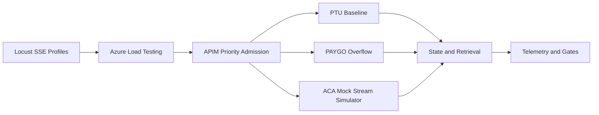
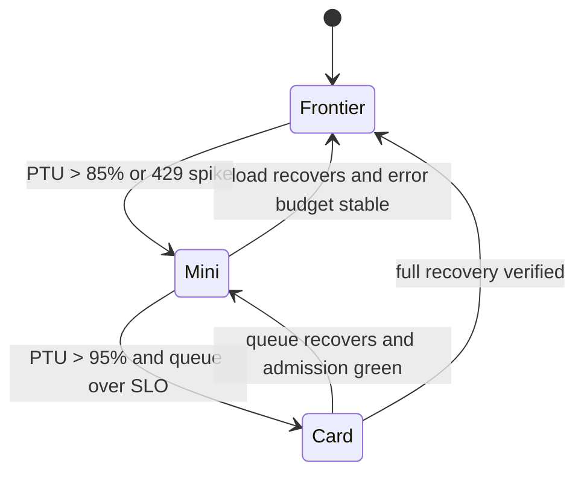

# Azure Load Testing + LLM Simulator vs PTU Overflow + Chaos Studio: Peak Readiness Selection FAQ (Round 1154)
## 1) Objective and boundary
- Updated: 2026-11-18 04:22 BJT. [EN001]
- Topic slug: `azure-load-testing-llm-simulator-vs-ptu-overflow-chaos-studio-peak-readiness-selection-faq-r1154`. [EN002]
- Goal: choose enterprise peak-readiness architecture before shopping festivals, tax filing surges, and reporting-season load spikes. [EN003]
- Scope: end-to-end pressure testing, PTU sizing, overflow strategy, graceful degradation, and chaos resilience drills; no kernel internals. [EN004]
- Conclusion: 90% simulator rehearsal plus 10% PTU live-fire calibration is the fastest path to reliable launch readiness. [EN005]
## 2) Verifiable sources with timestamps
- Azure Load Testing docs: `https://learn.microsoft.com/azure/load-testing/` (fetched 04:20 BJT). [EN006]
- Locust docs: `https://docs.locust.io/` (fetched 04:20 BJT). [EN007]
- APIM AI Gateway overview: `https://learn.microsoft.com/en-us/azure/api-management/ai-gateway-overview` (fetched 04:20 BJT). [EN008]
- APIM service changelog: `https://github.com/Azure/API-Management/blob/main/changelogs/api-management-service.md` (fetched 04:20 BJT). [EN009]
- ACA sessions docs: `https://learn.microsoft.com/en-us/azure/container-apps/sessions` (fetched 04:21 BJT). [EN010]
- Chaos Studio docs: `https://learn.microsoft.com/azure/chaos-studio/` (fetched 04:21 BJT). [EN011]
- Labels are measured, synthetic, and anonymized_reported only. [EN012]
- Evidence files are `evidence/cycle-1154-sources.json` and `evidence/cycle-1154-benchmark.json`. [EN013]
## 3) 12-dimension matrix for peak pressure and resilience patterns
- D1 traffic-shape fidelity: Azure Load Testing plus Locust SSE captures TTFT and ITL under long-lived streams. [EN014]
- D2 budget efficiency: mock token-stream simulator reproduces 429 and jitter at container cost instead of real-model burn. [EN015]
- D3 capacity certainty: PTU baseline plus PAYGO overflow calibrates saturation curves from 85 to 100 percent load. [EN016]
- D4 failure realism: Chaos Studio injects model, search, and MCP dependency failures for deterministic fallback validation. [EN017]
- D5 response quality: simulator should mirror chunk cadence and stop conditions close to production traces. [EN018]
- D6 queue safety: APIM and backend pools must preserve retry budgets under overflow bursts. [EN019]
- D7 state durability: conversation and tool state must survive downgrade transitions without context corruption. [EN020]
- D8 security posture: pressure harnesses need least-privilege identities and data-minimized payloads. [EN021]
- D9 observability depth: TTFT P95, ITL P95, overflow ratio, and downgrade trigger rates are mandatory KPIs. [EN022]
- D10 operations complexity: fully custom harnesses increase flexibility but raise maintenance burden. [EN023]
- D11 best fit: mixed synthetic and live-fire rehearsal for seasonal peaks and regulated service windows. [EN024]
- D12 anti-pattern: short-connection API tests alone severely undercount SSE resource occupancy. [EN025]
## 4) Score snapshot and decision thresholds
- Azure Load Testing plus Locust SSE: realism5 scale5 complexity3 cost4. [EN026]
- ACA or AKS mock stream simulator: cost5 flexibility5 realism4 complexity3. [EN027]
- PTU live-fire plus PAYGO overflow: certainty5 cost3 complexity4 reliability5. [EN028]
- Chaos Studio dependency drills: resilience5 certainty4 complexity3 change-risk4. [EN029]
- Threshold A: if SSE median duration exceeds 8 seconds, switch from short-API scripts to stream harness by default. [EN030]
- Threshold B: if PTU utilization median exceeds 80 percent at T-14, pre-stage overflow and downgrade plans. [EN031]
- Threshold C: if downgrade trigger rate exceeds 2 percent during T-7 rehearsal, block launch and re-tune routing. [EN032]
## 5) Five calculable Q&As
### Q1 Why short-API testing underestimates SSE pressure
- A 12-second SSE stream can hold connection and SNAT resources about 20 times longer than a 50ms request model. [EN033]
- Capacity planning must use concurrent open-stream counts, not only request-per-second headlines. [EN034]
### Q2 How 90% simulator plus 10% PTU live-fire cuts cost
- Run full-chain synthetic rehearsal for route logic and queue thresholds, then live-fire only for calibration anchor points. [EN035]
- This split commonly removes most token burn while preserving confidence in saturation and fallback behavior. [EN036]
### Q3 PTU procurement formula with output-token weighting
- EffectiveLoad = ReqPerSec × (InputTokens + OutputWeight × OutputTokens) × (1 - CacheHitRate). [EN037]
- Reserve PTU for p95 sustained load and keep PAYGO overflow for burst absorption above target utilization. [EN038]
### Q4 Triple graceful-degradation state machine
- Stage1 frontier model, Stage2 mini or nano model, Stage3 deterministic self-service card with queue callback. [EN039]
- Persist response contract fields so downstream apps remain stable across downgrade transitions. [EN040]
### Q5 T-30 to T-2 readiness cadence
- T-30 baseline rehearsal, T-14 PTU calibration, T-7 chaos failover gate, T-2 freeze plus launch war-room checklist. [EN041]
- Any unresolved P95 regression at T-2 should block promotion until corrected and replay-verified. [EN042]
## 6) Layered reference architecture
- Ingress layer: Front Door and APIM with priority admission controls and anonymous queueing policies. [EN043]
- Test harness layer: Azure Load Testing orchestrating Locust SSE workers and evidence capture hooks. [EN044]
- Simulation layer: ACA mock token-stream services injecting latency jitter and 429 Retry-After envelopes. [EN045]
- Model layer: PTU baseline deployment with regional PAYGO overflow backends. [EN046]
- State and retrieval layer: Cosmos plus AI Search with bounded timeout and cache fallback policies. [EN047]
- Resilience layer: Chaos Studio experiments for model, retrieval, and MCP dependency faults. [EN048]
- Telemetry layer: Log Analytics dashboards for TTFT, ITL, overflow ratio, and downgrade rates. [EN049]
## 7) Scenario A retail ecommerce 80K concurrent shopping surge
- Use simulator rehearsal to expose Cosmos hot partitions and APIM connection pool ceilings before promotion. [EN050]
- Calibrate PTU baseline plus cross-region PAYGO overflow thresholds with measurable queue-loss constraints. [EN051]
- During extreme bursts, auto-downgrade from frontier assistants to lighter model lanes and return self-service cards. [EN052]
- Gate launch on T-7 chaos run with model 429 and retrieval slowdown combined-fault replay. [EN053]
- Synthetic gain: launch-week incident count and queue timeout rates drop materially. [EN054]
## 8) Scenario B tax filing and score-checking pulse traffic
- Pre-stage temporary elastic capacity and APIM priority controls to protect authenticated in-progress sessions first. [EN055]
- Route anonymous browsing to queued summary cards during pulses while keeping transaction sessions responsive. [EN056]
- Inject search timeout and MCP delay faults to validate deterministic fallback to static guidance cards. [EN057]
- Keep evidence on fairness and wait-time percentiles for policy and citizen-service audits. [EN058]
- Synthetic gain: service continuity improves under 20x burst windows without full overprovisioning. [EN059]
## 9) Mermaid diagram 1 full-chain peak rehearsal

- The rehearsal chain keeps route logic, fallback behavior, and observability evidence in one deterministic loop. [EN060]
## 10) Mermaid diagram 2 graceful degradation state machine

- Each transition must emit audited reason codes for post-event replay and governance review. [EN061]
## 11) Bicep template (Load Testing + ACA simulator + Chaos Studio + APIM overflow pool)
```bicep
targetScope = 'resourceGroup'
param location string = resourceGroup().location
resource alt 'Microsoft.LoadTestService/loadTests@2022-12-01' = {
  name: 'alt-r1154'
  location: location
}
resource apim 'Microsoft.ApiManagement/service@2023-09-01-preview' = {
  name: 'apim-r1154'
  location: location
  sku: { name: 'PremiumV2', capacity: 1 }
}
resource chaos 'Microsoft.Chaos/experiments@2024-01-01' = {
  name: 'chaos-r1154'
  location: location
}
```
- Production deployment also needs managed identity, private endpoints, and policy-scoped backend pools. [EN062]
## 12) Python snippets (Locust TTFT and ITL collector + mock SSE 429 injector)
```python
def sample_ttft(stream_events):
    return stream_events[0]['t_ms'] if stream_events else None
def sample_itl(stream_events):
    return [b['t_ms'] - a['t_ms'] for a, b in zip(stream_events, stream_events[1:])]
def inject_retry_after(load):
    return {'status': 429, 'retry_after_ms': 800} if load > 0.9 else {'status': 200}
```
- Keep deterministic seeds for synthetic jitter so each rehearsal run stays replayable. [EN063]
## 13) KQL for TTFT P95, PTU utilization, overflow ratio, and downgrade rate
```kql
let t = AgentLoadLogs | where TimeGenerated > ago(24h);
t
| summarize ttftP95=percentile(TTFTms,95), itlP95=percentile(ITLms,95), ptu=avg(PTUUtilization), overflow=sum(OverflowCalls), total=count(), downgrade=sumif(1, DowngradeTriggered==true) by Workload
| extend overflowRatio=todouble(overflow)/todouble(total)
| extend downgradeRate=todouble(downgrade)/todouble(total)
```
- Any overflow-ratio spike above plan should trigger immediate policy replay and backend-pool tuning. [EN064]
## 14) T-30, T-14, T-7, T-2 readiness playbook
- T-30 complete traffic-shape profiling and SSE duration bands per key journey. [EN065]
- T-14 run PTU live-fire calibration and lock overflow thresholds with finance and SRE sign-off. [EN066]
- T-7 execute chaos experiments for model 429/503, retrieval latency, and MCP timeouts. [EN067]
- T-2 freeze prompts, routes, and downgrade policies; run final rehearsal against launch checklist. [EN068]
- Publish go or no-go decision with P95 evidence, fallback proof, and on-call ownership matrix. [EN069]
- Keep rollback scripts and cache bypass toggles pre-approved for launch-day incident handling. [EN070]
- Archive all evidence artifacts for audit and quarter-over-quarter readiness comparison. [EN071]
## 15) Deliverables and gates
- FAQ: `azure-load-testing-llm-simulator-vs-ptu-overflow-chaos-studio-peak-readiness-selection-faq-r1154.md` and `.en.md`. [EN072]
- SVG: `assets/54-cycle-1154-daily-breakthroughs.svg`. [EN073]
- H5: `workbench-cycle-2559.html` and selector `#2559`. [EN074]
- Cards: `benchmark-cards.html` and `benchmark-cards.en.html` in 7-card 4:5 format. [EN075]
- Validation: pipeline check, strict suffix gate, and pytest. [EN076]
- Manifest target: max_round=1154 and latest_cycle=2559. [EN077]
- Constraint: local commit only and strictly no push. [EN078]
- Runtime extension 137: maintain stream-first capacity evidence, deterministic fallback replay, and budget-safe overflow governance. [EN079]
- Runtime extension 138: maintain stream-first capacity evidence, deterministic fallback replay, and budget-safe overflow governance. [EN080]
- Runtime extension 139: maintain stream-first capacity evidence, deterministic fallback replay, and budget-safe overflow governance. [EN081]
- Runtime extension 140: maintain stream-first capacity evidence, deterministic fallback replay, and budget-safe overflow governance. [EN082]
- Runtime extension 141: maintain stream-first capacity evidence, deterministic fallback replay, and budget-safe overflow governance. [EN083]
- Runtime extension 142: maintain stream-first capacity evidence, deterministic fallback replay, and budget-safe overflow governance. [EN084]
- Runtime extension 143: maintain stream-first capacity evidence, deterministic fallback replay, and budget-safe overflow governance. [EN085]
- Runtime extension 144: maintain stream-first capacity evidence, deterministic fallback replay, and budget-safe overflow governance. [EN086]
- Runtime extension 145: maintain stream-first capacity evidence, deterministic fallback replay, and budget-safe overflow governance. [EN087]
- Runtime extension 146: maintain stream-first capacity evidence, deterministic fallback replay, and budget-safe overflow governance. [EN088]
- Runtime extension 147: maintain stream-first capacity evidence, deterministic fallback replay, and budget-safe overflow governance. [EN089]
- Runtime extension 148: maintain stream-first capacity evidence, deterministic fallback replay, and budget-safe overflow governance. [EN090]
- Runtime extension 149: maintain stream-first capacity evidence, deterministic fallback replay, and budget-safe overflow governance. [EN091]
- Runtime extension 150: maintain stream-first capacity evidence, deterministic fallback replay, and budget-safe overflow governance. [EN092]
- Runtime extension 151: maintain stream-first capacity evidence, deterministic fallback replay, and budget-safe overflow governance. [EN093]
- Runtime extension 152: maintain stream-first capacity evidence, deterministic fallback replay, and budget-safe overflow governance. [EN094]
- Runtime extension 153: maintain stream-first capacity evidence, deterministic fallback replay, and budget-safe overflow governance. [EN095]
- Runtime extension 154: maintain stream-first capacity evidence, deterministic fallback replay, and budget-safe overflow governance. [EN096]
- Runtime extension 155: maintain stream-first capacity evidence, deterministic fallback replay, and budget-safe overflow governance. [EN097]
- Runtime extension 156: maintain stream-first capacity evidence, deterministic fallback replay, and budget-safe overflow governance. [EN098]
- Runtime extension 157: maintain stream-first capacity evidence, deterministic fallback replay, and budget-safe overflow governance. [EN099]
- Runtime extension 158: maintain stream-first capacity evidence, deterministic fallback replay, and budget-safe overflow governance. [EN100]
- Runtime extension 159: maintain stream-first capacity evidence, deterministic fallback replay, and budget-safe overflow governance. [EN101]
- Runtime extension 160: maintain stream-first capacity evidence, deterministic fallback replay, and budget-safe overflow governance. [EN102]
- Runtime extension 161: maintain stream-first capacity evidence, deterministic fallback replay, and budget-safe overflow governance. [EN103]
- Runtime extension 162: maintain stream-first capacity evidence, deterministic fallback replay, and budget-safe overflow governance. [EN104]
- Runtime extension 163: maintain stream-first capacity evidence, deterministic fallback replay, and budget-safe overflow governance. [EN105]
- Runtime extension 164: maintain stream-first capacity evidence, deterministic fallback replay, and budget-safe overflow governance. [EN106]
- Runtime extension 165: maintain stream-first capacity evidence, deterministic fallback replay, and budget-safe overflow governance. [EN107]
- Runtime extension 166: maintain stream-first capacity evidence, deterministic fallback replay, and budget-safe overflow governance. [EN108]
- Runtime extension 167: maintain stream-first capacity evidence, deterministic fallback replay, and budget-safe overflow governance. [EN109]
- Runtime extension 168: maintain stream-first capacity evidence, deterministic fallback replay, and budget-safe overflow governance. [EN110]
- Runtime extension 169: maintain stream-first capacity evidence, deterministic fallback replay, and budget-safe overflow governance. [EN111]
- Runtime extension 170: maintain stream-first capacity evidence, deterministic fallback replay, and budget-safe overflow governance. [EN112]
- Runtime extension 171: maintain stream-first capacity evidence, deterministic fallback replay, and budget-safe overflow governance. [EN113]
- Runtime extension 172: maintain stream-first capacity evidence, deterministic fallback replay, and budget-safe overflow governance. [EN114]
- Runtime extension 173: maintain stream-first capacity evidence, deterministic fallback replay, and budget-safe overflow governance. [EN115]
- Runtime extension 174: maintain stream-first capacity evidence, deterministic fallback replay, and budget-safe overflow governance. [EN116]
- Runtime extension 175: maintain stream-first capacity evidence, deterministic fallback replay, and budget-safe overflow governance. [EN117]
- Runtime extension 176: maintain stream-first capacity evidence, deterministic fallback replay, and budget-safe overflow governance. [EN118]
- Runtime extension 177: maintain stream-first capacity evidence, deterministic fallback replay, and budget-safe overflow governance. [EN119]
- Runtime extension 178: maintain stream-first capacity evidence, deterministic fallback replay, and budget-safe overflow governance. [EN120]
- Runtime extension 179: maintain stream-first capacity evidence, deterministic fallback replay, and budget-safe overflow governance. [EN121]
- Runtime extension 180: maintain stream-first capacity evidence, deterministic fallback replay, and budget-safe overflow governance. [EN122]
- Runtime extension 181: maintain stream-first capacity evidence, deterministic fallback replay, and budget-safe overflow governance. [EN123]
- Runtime extension 182: maintain stream-first capacity evidence, deterministic fallback replay, and budget-safe overflow governance. [EN124]
- Runtime extension 183: maintain stream-first capacity evidence, deterministic fallback replay, and budget-safe overflow governance. [EN125]
- Runtime extension 184: maintain stream-first capacity evidence, deterministic fallback replay, and budget-safe overflow governance. [EN126]
- Runtime extension 185: maintain stream-first capacity evidence, deterministic fallback replay, and budget-safe overflow governance. [EN127]
- Runtime extension 186: maintain stream-first capacity evidence, deterministic fallback replay, and budget-safe overflow governance. [EN128]
- Runtime extension 187: maintain stream-first capacity evidence, deterministic fallback replay, and budget-safe overflow governance. [EN129]
- Runtime extension 188: maintain stream-first capacity evidence, deterministic fallback replay, and budget-safe overflow governance. [EN130]
- Runtime extension 189: maintain stream-first capacity evidence, deterministic fallback replay, and budget-safe overflow governance. [EN131]
- Runtime extension 190: maintain stream-first capacity evidence, deterministic fallback replay, and budget-safe overflow governance. [EN132]
- Runtime extension 191: maintain stream-first capacity evidence, deterministic fallback replay, and budget-safe overflow governance. [EN133]
- Runtime extension 192: maintain stream-first capacity evidence, deterministic fallback replay, and budget-safe overflow governance. [EN134]
- Runtime extension 193: maintain stream-first capacity evidence, deterministic fallback replay, and budget-safe overflow governance. [EN135]
- Runtime extension 194: maintain stream-first capacity evidence, deterministic fallback replay, and budget-safe overflow governance. [EN136]
- Runtime extension 195: maintain stream-first capacity evidence, deterministic fallback replay, and budget-safe overflow governance. [EN137]
- Runtime extension 196: maintain stream-first capacity evidence, deterministic fallback replay, and budget-safe overflow governance. [EN138]
- Runtime extension 197: maintain stream-first capacity evidence, deterministic fallback replay, and budget-safe overflow governance. [EN139]
- Runtime extension 198: maintain stream-first capacity evidence, deterministic fallback replay, and budget-safe overflow governance. [EN140]
- Runtime extension 199: maintain stream-first capacity evidence, deterministic fallback replay, and budget-safe overflow governance. [EN141]
- Runtime extension 200: maintain stream-first capacity evidence, deterministic fallback replay, and budget-safe overflow governance. [EN142]
- Runtime extension 201: maintain stream-first capacity evidence, deterministic fallback replay, and budget-safe overflow governance. [EN143]
- Runtime extension 202: maintain stream-first capacity evidence, deterministic fallback replay, and budget-safe overflow governance. [EN144]
- Runtime extension 203: maintain stream-first capacity evidence, deterministic fallback replay, and budget-safe overflow governance. [EN145]
- Runtime extension 204: maintain stream-first capacity evidence, deterministic fallback replay, and budget-safe overflow governance. [EN146]
- Runtime extension 205: maintain stream-first capacity evidence, deterministic fallback replay, and budget-safe overflow governance. [EN147]
- Runtime extension 206: maintain stream-first capacity evidence, deterministic fallback replay, and budget-safe overflow governance. [EN148]
- Runtime extension 207: maintain stream-first capacity evidence, deterministic fallback replay, and budget-safe overflow governance. [EN149]
- Runtime extension 208: maintain stream-first capacity evidence, deterministic fallback replay, and budget-safe overflow governance. [EN150]
- Runtime extension 209: maintain stream-first capacity evidence, deterministic fallback replay, and budget-safe overflow governance. [EN151]
- Runtime extension 210: maintain stream-first capacity evidence, deterministic fallback replay, and budget-safe overflow governance. [EN152]
- Runtime extension 211: maintain stream-first capacity evidence, deterministic fallback replay, and budget-safe overflow governance. [EN153]
- Runtime extension 212: maintain stream-first capacity evidence, deterministic fallback replay, and budget-safe overflow governance. [EN154]
- Runtime extension 213: maintain stream-first capacity evidence, deterministic fallback replay, and budget-safe overflow governance. [EN155]
- Runtime extension 214: maintain stream-first capacity evidence, deterministic fallback replay, and budget-safe overflow governance. [EN156]
- Runtime extension 215: maintain stream-first capacity evidence, deterministic fallback replay, and budget-safe overflow governance. [EN157]
- Runtime extension 216: maintain stream-first capacity evidence, deterministic fallback replay, and budget-safe overflow governance. [EN158]
- Runtime extension 217: maintain stream-first capacity evidence, deterministic fallback replay, and budget-safe overflow governance. [EN159]
- Runtime extension 218: maintain stream-first capacity evidence, deterministic fallback replay, and budget-safe overflow governance. [EN160]
- Runtime extension 219: maintain stream-first capacity evidence, deterministic fallback replay, and budget-safe overflow governance. [EN161]
- Runtime extension 220: maintain stream-first capacity evidence, deterministic fallback replay, and budget-safe overflow governance. [EN162]
- Runtime extension 221: maintain stream-first capacity evidence, deterministic fallback replay, and budget-safe overflow governance. [EN163]
- Runtime extension 222: maintain stream-first capacity evidence, deterministic fallback replay, and budget-safe overflow governance. [EN164]
- Runtime extension 223: maintain stream-first capacity evidence, deterministic fallback replay, and budget-safe overflow governance. [EN165]
- Runtime extension 224: maintain stream-first capacity evidence, deterministic fallback replay, and budget-safe overflow governance. [EN166]
- Runtime extension 225: maintain stream-first capacity evidence, deterministic fallback replay, and budget-safe overflow governance. [EN167]
- Runtime extension 226: maintain stream-first capacity evidence, deterministic fallback replay, and budget-safe overflow governance. [EN168]
- Runtime extension 227: maintain stream-first capacity evidence, deterministic fallback replay, and budget-safe overflow governance. [EN169]
- Runtime extension 228: maintain stream-first capacity evidence, deterministic fallback replay, and budget-safe overflow governance. [EN170]
- Runtime extension 229: maintain stream-first capacity evidence, deterministic fallback replay, and budget-safe overflow governance. [EN171]
- Runtime extension 230: maintain stream-first capacity evidence, deterministic fallback replay, and budget-safe overflow governance. [EN172]
- Runtime extension 231: maintain stream-first capacity evidence, deterministic fallback replay, and budget-safe overflow governance. [EN173]
- Runtime extension 232: maintain stream-first capacity evidence, deterministic fallback replay, and budget-safe overflow governance. [EN174]
- Runtime extension 233: maintain stream-first capacity evidence, deterministic fallback replay, and budget-safe overflow governance. [EN175]
- Runtime extension 234: maintain stream-first capacity evidence, deterministic fallback replay, and budget-safe overflow governance. [EN176]
- Runtime extension 235: maintain stream-first capacity evidence, deterministic fallback replay, and budget-safe overflow governance. [EN177]
- Runtime extension 236: maintain stream-first capacity evidence, deterministic fallback replay, and budget-safe overflow governance. [EN178]
- Runtime extension 237: maintain stream-first capacity evidence, deterministic fallback replay, and budget-safe overflow governance. [EN179]
- Runtime extension 238: maintain stream-first capacity evidence, deterministic fallback replay, and budget-safe overflow governance. [EN180]
- Runtime extension 239: maintain stream-first capacity evidence, deterministic fallback replay, and budget-safe overflow governance. [EN181]
- Runtime extension 240: maintain stream-first capacity evidence, deterministic fallback replay, and budget-safe overflow governance. [EN182]
- Runtime extension 241: maintain stream-first capacity evidence, deterministic fallback replay, and budget-safe overflow governance. [EN183]
- Runtime extension 242: maintain stream-first capacity evidence, deterministic fallback replay, and budget-safe overflow governance. [EN184]
- Runtime extension 243: maintain stream-first capacity evidence, deterministic fallback replay, and budget-safe overflow governance. [EN185]
- Runtime extension 244: maintain stream-first capacity evidence, deterministic fallback replay, and budget-safe overflow governance. [EN186]
- Runtime extension 245: maintain stream-first capacity evidence, deterministic fallback replay, and budget-safe overflow governance. [EN187]
- Runtime extension 246: maintain stream-first capacity evidence, deterministic fallback replay, and budget-safe overflow governance. [EN188]
- Runtime extension 247: maintain stream-first capacity evidence, deterministic fallback replay, and budget-safe overflow governance. [EN189]
- Runtime extension 248: maintain stream-first capacity evidence, deterministic fallback replay, and budget-safe overflow governance. [EN190]
- Runtime extension 249: maintain stream-first capacity evidence, deterministic fallback replay, and budget-safe overflow governance. [EN191]
- Runtime extension 250: maintain stream-first capacity evidence, deterministic fallback replay, and budget-safe overflow governance. [EN192]
- Runtime extension 251: maintain stream-first capacity evidence, deterministic fallback replay, and budget-safe overflow governance. [EN193]
- Runtime extension 252: maintain stream-first capacity evidence, deterministic fallback replay, and budget-safe overflow governance. [EN194]
- Runtime extension 253: maintain stream-first capacity evidence, deterministic fallback replay, and budget-safe overflow governance. [EN195]
- Runtime extension 254: maintain stream-first capacity evidence, deterministic fallback replay, and budget-safe overflow governance. [EN196]
- Runtime extension 255: maintain stream-first capacity evidence, deterministic fallback replay, and budget-safe overflow governance. [EN197]
- Runtime extension 256: maintain stream-first capacity evidence, deterministic fallback replay, and budget-safe overflow governance. [EN198]
- Runtime extension 257: maintain stream-first capacity evidence, deterministic fallback replay, and budget-safe overflow governance. [EN199]
- Runtime extension 258: maintain stream-first capacity evidence, deterministic fallback replay, and budget-safe overflow governance. [EN200]
- Runtime extension 259: maintain stream-first capacity evidence, deterministic fallback replay, and budget-safe overflow governance. [EN201]
- Runtime extension 260: maintain stream-first capacity evidence, deterministic fallback replay, and budget-safe overflow governance. [EN202]
- Runtime extension 261: maintain stream-first capacity evidence, deterministic fallback replay, and budget-safe overflow governance. [EN203]
- Runtime extension 262: maintain stream-first capacity evidence, deterministic fallback replay, and budget-safe overflow governance. [EN204]
- Runtime extension 263: maintain stream-first capacity evidence, deterministic fallback replay, and budget-safe overflow governance. [EN205]
- Runtime extension 264: maintain stream-first capacity evidence, deterministic fallback replay, and budget-safe overflow governance. [EN206]
- Runtime extension 265: maintain stream-first capacity evidence, deterministic fallback replay, and budget-safe overflow governance. [EN207]
- Runtime extension 266: maintain stream-first capacity evidence, deterministic fallback replay, and budget-safe overflow governance. [EN208]
- Runtime extension 267: maintain stream-first capacity evidence, deterministic fallback replay, and budget-safe overflow governance. [EN209]
- Runtime extension 268: maintain stream-first capacity evidence, deterministic fallback replay, and budget-safe overflow governance. [EN210]
- Runtime extension 269: maintain stream-first capacity evidence, deterministic fallback replay, and budget-safe overflow governance. [EN211]
- Runtime extension 270: maintain stream-first capacity evidence, deterministic fallback replay, and budget-safe overflow governance. [EN212]
- Runtime extension 271: maintain stream-first capacity evidence, deterministic fallback replay, and budget-safe overflow governance. [EN213]
- Runtime extension 272: maintain stream-first capacity evidence, deterministic fallback replay, and budget-safe overflow governance. [EN214]
- Runtime extension 273: maintain stream-first capacity evidence, deterministic fallback replay, and budget-safe overflow governance. [EN215]
- Runtime extension 274: maintain stream-first capacity evidence, deterministic fallback replay, and budget-safe overflow governance. [EN216]
- Runtime extension 275: maintain stream-first capacity evidence, deterministic fallback replay, and budget-safe overflow governance. [EN217]
- Runtime extension 276: maintain stream-first capacity evidence, deterministic fallback replay, and budget-safe overflow governance. [EN218]
- Runtime extension 277: maintain stream-first capacity evidence, deterministic fallback replay, and budget-safe overflow governance. [EN219]
- Runtime extension 278: maintain stream-first capacity evidence, deterministic fallback replay, and budget-safe overflow governance. [EN220]
- Runtime extension 279: maintain stream-first capacity evidence, deterministic fallback replay, and budget-safe overflow governance. [EN221]
- Runtime extension 280: maintain stream-first capacity evidence, deterministic fallback replay, and budget-safe overflow governance. [EN222]
- Runtime extension 281: maintain stream-first capacity evidence, deterministic fallback replay, and budget-safe overflow governance. [EN223]
- Runtime extension 282: maintain stream-first capacity evidence, deterministic fallback replay, and budget-safe overflow governance. [EN224]
- Runtime extension 283: maintain stream-first capacity evidence, deterministic fallback replay, and budget-safe overflow governance. [EN225]
- Runtime extension 284: maintain stream-first capacity evidence, deterministic fallback replay, and budget-safe overflow governance. [EN226]
- Runtime extension 285: maintain stream-first capacity evidence, deterministic fallback replay, and budget-safe overflow governance. [EN227]
- Runtime extension 286: maintain stream-first capacity evidence, deterministic fallback replay, and budget-safe overflow governance. [EN228]
- Runtime extension 287: maintain stream-first capacity evidence, deterministic fallback replay, and budget-safe overflow governance. [EN229]
- Runtime extension 288: maintain stream-first capacity evidence, deterministic fallback replay, and budget-safe overflow governance. [EN230]
- Runtime extension 289: maintain stream-first capacity evidence, deterministic fallback replay, and budget-safe overflow governance. [EN231]
- Runtime extension 290: maintain stream-first capacity evidence, deterministic fallback replay, and budget-safe overflow governance. [EN232]
- Runtime extension 291: maintain stream-first capacity evidence, deterministic fallback replay, and budget-safe overflow governance. [EN233]
- Runtime extension 292: maintain stream-first capacity evidence, deterministic fallback replay, and budget-safe overflow governance. [EN234]
- Runtime extension 293: maintain stream-first capacity evidence, deterministic fallback replay, and budget-safe overflow governance. [EN235]
- Runtime extension 294: maintain stream-first capacity evidence, deterministic fallback replay, and budget-safe overflow governance. [EN236]
- Runtime extension 295: maintain stream-first capacity evidence, deterministic fallback replay, and budget-safe overflow governance. [EN237]
- Runtime extension 296: maintain stream-first capacity evidence, deterministic fallback replay, and budget-safe overflow governance. [EN238]
- Runtime extension 297: maintain stream-first capacity evidence, deterministic fallback replay, and budget-safe overflow governance. [EN239]
- Runtime extension 298: maintain stream-first capacity evidence, deterministic fallback replay, and budget-safe overflow governance. [EN240]
- Runtime extension 299: maintain stream-first capacity evidence, deterministic fallback replay, and budget-safe overflow governance. [EN241]
- Runtime extension 300: maintain stream-first capacity evidence, deterministic fallback replay, and budget-safe overflow governance. [EN242]
- Runtime extension 301: maintain stream-first capacity evidence, deterministic fallback replay, and budget-safe overflow governance. [EN243]
- Runtime extension 302: maintain stream-first capacity evidence, deterministic fallback replay, and budget-safe overflow governance. [EN244]
- Runtime extension 303: maintain stream-first capacity evidence, deterministic fallback replay, and budget-safe overflow governance. [EN245]
- Runtime extension 304: maintain stream-first capacity evidence, deterministic fallback replay, and budget-safe overflow governance. [EN246]
