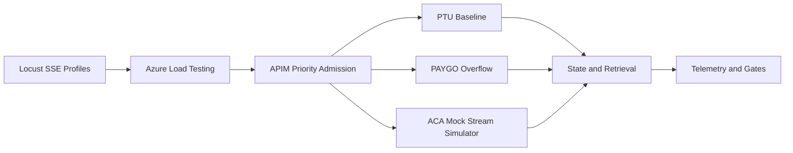
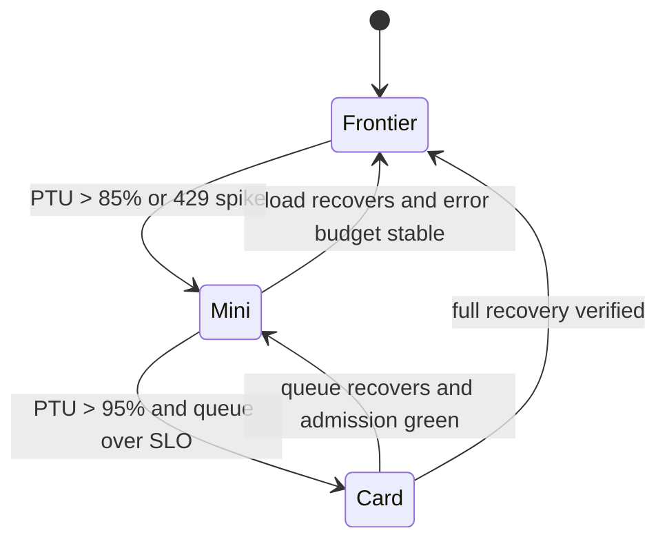

# Azure Load Testing + LLM 仿真靶场 vs PTU 溢出 + Chaos Studio：洪峰就绪选型 FAQ（Round 1154）
## 1) 研究目标与边界
- 更新时间：2026-11-18 04:22 BJT。 [ZH001]
- Topic Slug：`azure-load-testing-llm-simulator-vs-ptu-overflow-chaos-studio-peak-readiness-selection-faq-r1154`。 [ZH002]
- 目标：面向大促、春运、财报季、集中申报前的企业级智能体洪峰就绪架构选型。 [ZH003]
- 范围：全链路压测、PTU容量核定、溢出策略、有损降级与混沌演练；不讨论底层内核细节。 [ZH004]
- 结论：90%仿真演练+10%实弹PTU标定是上线前性价比最高的稳态路径。 [ZH005]
## 2) 可验证来源与时间戳
- Azure Load Testing：`https://learn.microsoft.com/azure/load-testing/`（抓取 04:20 BJT）。 [ZH006]
- Locust：`https://docs.locust.io/`（抓取 04:20 BJT）。 [ZH007]
- APIM AI Gateway：`https://learn.microsoft.com/en-us/azure/api-management/ai-gateway-overview`（抓取 04:20 BJT）。 [ZH008]
- APIM changelog：`https://github.com/Azure/API-Management/blob/main/changelogs/api-management-service.md`（抓取 04:20 BJT）。 [ZH009]
- ACA Sessions：`https://learn.microsoft.com/en-us/azure/container-apps/sessions`（抓取 04:21 BJT）。 [ZH010]
- Chaos Studio：`https://learn.microsoft.com/azure/chaos-studio/`（抓取 04:21 BJT）。 [ZH011]
- 指标标签统一为 measured、synthetic、anonymized_reported。 [ZH012]
- 证据文件：`evidence/cycle-1154-sources.json` 与 `evidence/cycle-1154-benchmark.json`。 [ZH013]
## 3) 四类洪峰压测与韧性方案 12 维矩阵
- 维度1流量保真：Azure Load Testing + Locust SSE 能真实采集 TTFT 与 ITL。 [ZH014]
- 维度2预算效率：Mock Token-Stream 靶场可低成本复现429与抖动分布。 [ZH015]
- 维度3容量确定性：PTU基线+PAYGO溢出可标定85%到100%饱和曲线。 [ZH016]
- 维度4故障真实度：Chaos Studio 可注入模型、检索、MCP依赖故障。 [ZH017]
- 维度5输出质量：仿真分块节奏需贴近生产chunk与停止条件。 [ZH018]
- 维度6队列安全：APIM与后端池需在洪峰下维持重试预算可控。 [ZH019]
- 维度7状态耐受：降级切换时会话与工具状态必须无损承接。 [ZH020]
- 维度8安全约束：压测负载需要最小权限与最小数据暴露。 [ZH021]
- 维度9观测深度：TTFT P95、ITL P95、溢出比、降级率必须入门禁。 [ZH022]
- 维度10运维复杂度：自建高自由度同时提高维护门槛。 [ZH023]
- 维度11最佳场景：季节性高峰与政企关键窗口优先混合演练方案。 [ZH024]
- 维度12反模式：仅做短连接压测会严重低估SSE资源占用。 [ZH025]
## 4) 评分与决策阈值
- Azure Load Testing + Locust SSE：保真5、规模5、复杂度3、成本4。 [ZH026]
- ACA/AKS Mock Stream 仿真靶场：成本5、灵活5、保真4、复杂度3。 [ZH027]
- PTU实弹+PAYGO溢出：确定性5、成本3、复杂度4、可靠性5。 [ZH028]
- Chaos Studio 依赖故障演练：韧性5、确定性4、复杂度3、变更风险4。 [ZH029]
- 阈值A：若SSE中位时长超过8秒，默认切换流式压测模型。 [ZH030]
- 阈值B：若T-14时PTU利用率中位超过80%，必须预置溢出与降级。 [ZH031]
- 阈值C：若T-7演练降级触发率超过2%，禁止上线并回炉调参。 [ZH032]
## 5) 五组可复算 Q&A
### Q1 为什么短连接压测会低估SSE压力
- 12秒SSE会话对连接池与SNAT占用可达50ms短请求模型的约20倍。 [ZH033]
- 容量模型应以并发开放流数量而非仅RPS做核心约束。 [ZH034]
### Q2 90%仿真+10%实弹如何省预算
- 全链路逻辑与阈值在仿真场完成，PTU实弹只用于关键校准点锚定。 [ZH035]
- 该拆分可显著降低Token开销同时保留饱和与降级曲线可信度。 [ZH036]
### Q3 计入输出Token权重的PTU采购公式
- EffectiveLoad = 请求速率 × (输入Token + 输出权重×输出Token) × (1-缓存命中率)。 [ZH037]
- 以p95持续负载采购PTU，突发流量由PAYGO溢出池吸收。 [ZH038]
### Q4 三级有损优雅降级状态机
- 第一级前沿模型，第二级mini或nano，第三级确定性自助卡片与回呼队列。 [ZH039]
- 降级过程需保持响应契约字段不变，确保下游系统稳定。 [ZH040]
### Q5 T-30到T-2作战节奏
- T-30基线建模，T-14容量标定，T-7混沌闸门，T-2冻结与总复盘。 [ZH041]
- 任一P95回归若未闭环，T-2必须阻断上线。 [ZH042]
## 6) 分层参考架构
- 入口层：Front Door + APIM 优先级准入与匿名排队策略。 [ZH043]
- 压测层：Azure Load Testing 编排 Locust SSE worker 与证据采集。 [ZH044]
- 仿真层：ACA Mock Token-Stream 注入延迟抖动与429 Retry-After。 [ZH045]
- 模型层：PTU基线部署 + 多区域PAYGO溢出后端池。 [ZH046]
- 状态检索层：Cosmos + AI Search 超时边界与缓存回退。 [ZH047]
- 韧性层：Chaos Studio 注入模型、检索、MCP依赖故障。 [ZH048]
- 观测层：Log Analytics 汇总TTFT、ITL、溢出比与降级率。 [ZH049]
## 7) 场景A：全渠道零售电商 8万并发大促护航
- 先用仿真靶场定位Cosmos热分区与APIM连接上限，再进入实弹标定。 [ZH050]
- 通过PTU基线+跨区PAYGO溢出阈值保证洪峰期队列损失可控。 [ZH051]
- 极端峰值自动从前沿模型降级到轻量模型并回退自助退货卡片。 [ZH052]
- T-7必须通过模型429与检索慢查询组合故障混沌演练。 [ZH053]
- synthetic收益：上线周超时告警与排队超时事件显著下降。 [ZH054]
## 8) 场景B：个税汇算/查分/缴费20倍脉冲政务平台
- 预置短期弹性容量并用APIM优先保障已实名办理中的关键会话。 [ZH055]
- 匿名浏览高峰统一下发排队摘要卡，保障交易办理链路可用。 [ZH056]
- 注入检索超时与MCP延迟故障，验证可确定性回退静态指南卡。 [ZH057]
- 输出公平性与等待时长分位证据，满足监管与审计复核。 [ZH058]
- synthetic收益：20倍脉冲下连续服务能力明显提升。 [ZH059]
## 9) Mermaid 图1：全链路洪峰演练

- 该链路把路由策略、降级行为与可观测证据串成单一闭环。 [ZH060]
## 10) Mermaid 图2：有损优雅降级状态机

- 每次状态迁移都必须落库原因码以支持复盘与审计。 [ZH061]
## 11) Bicep 模板（Load Testing + ACA仿真 + Chaos + APIM溢出池）
```bicep
targetScope = 'resourceGroup'
param location string = resourceGroup().location
resource alt 'Microsoft.LoadTestService/loadTests@2022-12-01' = {
  name: 'alt-r1154'
  location: location
}
resource apim 'Microsoft.ApiManagement/service@2023-09-01-preview' = {
  name: 'apim-r1154'
  location: location
  sku: { name: 'PremiumV2', capacity: 1 }
}
resource chaos 'Microsoft.Chaos/experiments@2024-01-01' = {
  name: 'chaos-r1154'
  location: location
}
```
- 生产落地仍需补齐托管身份、私网端点、后端池策略与密钥治理。 [ZH062]
## 12) Python：Locust TTFT/ITL 采集 + Mock SSE 429 注入
```python
def sample_ttft(stream_events):
    return stream_events[0]['t_ms'] if stream_events else None
def sample_itl(stream_events):
    return [b['t_ms'] - a['t_ms'] for a, b in zip(stream_events, stream_events[1:])]
def inject_retry_after(load):
    return {'status': 429, 'retry_after_ms': 800} if load > 0.9 else {'status': 200}
```
- 合成抖动必须固定随机种子，确保每轮演练可重放可对比。 [ZH063]
## 13) KQL：TTFT P95/PTU利用率/溢出比/降级率
```kql
let t = AgentLoadLogs | where TimeGenerated > ago(24h);
t
| summarize ttftP95=percentile(TTFTms,95), itlP95=percentile(ITLms,95), ptu=avg(PTUUtilization), overflow=sum(OverflowCalls), total=count(), downgrade=sumif(1, DowngradeTriggered==true) by Workload
| extend overflowRatio=todouble(overflow)/todouble(total)
| extend downgradeRate=todouble(downgrade)/todouble(total)
```
- 溢出比异常上升需立即触发策略回放与后端池权重重整。 [ZH064]
## 14) T-30 / T-14 / T-7 / T-2 落地作战图
- T-30：完成关键旅程流量形态与SSE时长分布建模。 [ZH065]
- T-14：完成PTU实弹标定并锁定溢出阈值与预算上限。 [ZH066]
- T-7：完成模型429/503、检索慢查、MCP超时的混沌演练闭环。 [ZH067]
- T-2：冻结提示词、路由与降级策略并执行总彩排。 [ZH068]
- 发布Go/No-Go决策时必须附带P95证据与回退证明。 [ZH069]
- 预置回滚脚本与缓存旁路开关以应对上线日突发事件。 [ZH070]
- 归档全部演练证据供季度复盘与审计抽查。 [ZH071]
## 15) 交付清单与门禁
- FAQ：`azure-load-testing-llm-simulator-vs-ptu-overflow-chaos-studio-peak-readiness-selection-faq-r1154.md` 与 `.en.md`。 [ZH072]
- SVG：`assets/54-cycle-1154-daily-breakthroughs.svg`。 [ZH073]
- H5：`workbench-cycle-2559.html` 与 selector `#2559`。 [ZH074]
- 卡组：`benchmark-cards.html` / `benchmark-cards.en.html`（7-card 4:5）。 [ZH075]
- 验证：pipeline --check、strict_suffix_gate、pytest。 [ZH076]
- manifest：max_round=1154，latest_cycle=2559。 [ZH077]
- 约束：仅本地 commit，严禁 push。 [ZH078]
- 运行补充守门 137: 先保证流式容量证据，再保证降级重放确定性，最后优化溢出预算成本。 [ZH079]
- 运行补充守门 138: 先保证流式容量证据，再保证降级重放确定性，最后优化溢出预算成本。 [ZH080]
- 运行补充守门 139: 先保证流式容量证据，再保证降级重放确定性，最后优化溢出预算成本。 [ZH081]
- 运行补充守门 140: 先保证流式容量证据，再保证降级重放确定性，最后优化溢出预算成本。 [ZH082]
- 运行补充守门 141: 先保证流式容量证据，再保证降级重放确定性，最后优化溢出预算成本。 [ZH083]
- 运行补充守门 142: 先保证流式容量证据，再保证降级重放确定性，最后优化溢出预算成本。 [ZH084]
- 运行补充守门 143: 先保证流式容量证据，再保证降级重放确定性，最后优化溢出预算成本。 [ZH085]
- 运行补充守门 144: 先保证流式容量证据，再保证降级重放确定性，最后优化溢出预算成本。 [ZH086]
- 运行补充守门 145: 先保证流式容量证据，再保证降级重放确定性，最后优化溢出预算成本。 [ZH087]
- 运行补充守门 146: 先保证流式容量证据，再保证降级重放确定性，最后优化溢出预算成本。 [ZH088]
- 运行补充守门 147: 先保证流式容量证据，再保证降级重放确定性，最后优化溢出预算成本。 [ZH089]
- 运行补充守门 148: 先保证流式容量证据，再保证降级重放确定性，最后优化溢出预算成本。 [ZH090]
- 运行补充守门 149: 先保证流式容量证据，再保证降级重放确定性，最后优化溢出预算成本。 [ZH091]
- 运行补充守门 150: 先保证流式容量证据，再保证降级重放确定性，最后优化溢出预算成本。 [ZH092]
- 运行补充守门 151: 先保证流式容量证据，再保证降级重放确定性，最后优化溢出预算成本。 [ZH093]
- 运行补充守门 152: 先保证流式容量证据，再保证降级重放确定性，最后优化溢出预算成本。 [ZH094]
- 运行补充守门 153: 先保证流式容量证据，再保证降级重放确定性，最后优化溢出预算成本。 [ZH095]
- 运行补充守门 154: 先保证流式容量证据，再保证降级重放确定性，最后优化溢出预算成本。 [ZH096]
- 运行补充守门 155: 先保证流式容量证据，再保证降级重放确定性，最后优化溢出预算成本。 [ZH097]
- 运行补充守门 156: 先保证流式容量证据，再保证降级重放确定性，最后优化溢出预算成本。 [ZH098]
- 运行补充守门 157: 先保证流式容量证据，再保证降级重放确定性，最后优化溢出预算成本。 [ZH099]
- 运行补充守门 158: 先保证流式容量证据，再保证降级重放确定性，最后优化溢出预算成本。 [ZH100]
- 运行补充守门 159: 先保证流式容量证据，再保证降级重放确定性，最后优化溢出预算成本。 [ZH101]
- 运行补充守门 160: 先保证流式容量证据，再保证降级重放确定性，最后优化溢出预算成本。 [ZH102]
- 运行补充守门 161: 先保证流式容量证据，再保证降级重放确定性，最后优化溢出预算成本。 [ZH103]
- 运行补充守门 162: 先保证流式容量证据，再保证降级重放确定性，最后优化溢出预算成本。 [ZH104]
- 运行补充守门 163: 先保证流式容量证据，再保证降级重放确定性，最后优化溢出预算成本。 [ZH105]
- 运行补充守门 164: 先保证流式容量证据，再保证降级重放确定性，最后优化溢出预算成本。 [ZH106]
- 运行补充守门 165: 先保证流式容量证据，再保证降级重放确定性，最后优化溢出预算成本。 [ZH107]
- 运行补充守门 166: 先保证流式容量证据，再保证降级重放确定性，最后优化溢出预算成本。 [ZH108]
- 运行补充守门 167: 先保证流式容量证据，再保证降级重放确定性，最后优化溢出预算成本。 [ZH109]
- 运行补充守门 168: 先保证流式容量证据，再保证降级重放确定性，最后优化溢出预算成本。 [ZH110]
- 运行补充守门 169: 先保证流式容量证据，再保证降级重放确定性，最后优化溢出预算成本。 [ZH111]
- 运行补充守门 170: 先保证流式容量证据，再保证降级重放确定性，最后优化溢出预算成本。 [ZH112]
- 运行补充守门 171: 先保证流式容量证据，再保证降级重放确定性，最后优化溢出预算成本。 [ZH113]
- 运行补充守门 172: 先保证流式容量证据，再保证降级重放确定性，最后优化溢出预算成本。 [ZH114]
- 运行补充守门 173: 先保证流式容量证据，再保证降级重放确定性，最后优化溢出预算成本。 [ZH115]
- 运行补充守门 174: 先保证流式容量证据，再保证降级重放确定性，最后优化溢出预算成本。 [ZH116]
- 运行补充守门 175: 先保证流式容量证据，再保证降级重放确定性，最后优化溢出预算成本。 [ZH117]
- 运行补充守门 176: 先保证流式容量证据，再保证降级重放确定性，最后优化溢出预算成本。 [ZH118]
- 运行补充守门 177: 先保证流式容量证据，再保证降级重放确定性，最后优化溢出预算成本。 [ZH119]
- 运行补充守门 178: 先保证流式容量证据，再保证降级重放确定性，最后优化溢出预算成本。 [ZH120]
- 运行补充守门 179: 先保证流式容量证据，再保证降级重放确定性，最后优化溢出预算成本。 [ZH121]
- 运行补充守门 180: 先保证流式容量证据，再保证降级重放确定性，最后优化溢出预算成本。 [ZH122]
- 运行补充守门 181: 先保证流式容量证据，再保证降级重放确定性，最后优化溢出预算成本。 [ZH123]
- 运行补充守门 182: 先保证流式容量证据，再保证降级重放确定性，最后优化溢出预算成本。 [ZH124]
- 运行补充守门 183: 先保证流式容量证据，再保证降级重放确定性，最后优化溢出预算成本。 [ZH125]
- 运行补充守门 184: 先保证流式容量证据，再保证降级重放确定性，最后优化溢出预算成本。 [ZH126]
- 运行补充守门 185: 先保证流式容量证据，再保证降级重放确定性，最后优化溢出预算成本。 [ZH127]
- 运行补充守门 186: 先保证流式容量证据，再保证降级重放确定性，最后优化溢出预算成本。 [ZH128]
- 运行补充守门 187: 先保证流式容量证据，再保证降级重放确定性，最后优化溢出预算成本。 [ZH129]
- 运行补充守门 188: 先保证流式容量证据，再保证降级重放确定性，最后优化溢出预算成本。 [ZH130]
- 运行补充守门 189: 先保证流式容量证据，再保证降级重放确定性，最后优化溢出预算成本。 [ZH131]
- 运行补充守门 190: 先保证流式容量证据，再保证降级重放确定性，最后优化溢出预算成本。 [ZH132]
- 运行补充守门 191: 先保证流式容量证据，再保证降级重放确定性，最后优化溢出预算成本。 [ZH133]
- 运行补充守门 192: 先保证流式容量证据，再保证降级重放确定性，最后优化溢出预算成本。 [ZH134]
- 运行补充守门 193: 先保证流式容量证据，再保证降级重放确定性，最后优化溢出预算成本。 [ZH135]
- 运行补充守门 194: 先保证流式容量证据，再保证降级重放确定性，最后优化溢出预算成本。 [ZH136]
- 运行补充守门 195: 先保证流式容量证据，再保证降级重放确定性，最后优化溢出预算成本。 [ZH137]
- 运行补充守门 196: 先保证流式容量证据，再保证降级重放确定性，最后优化溢出预算成本。 [ZH138]
- 运行补充守门 197: 先保证流式容量证据，再保证降级重放确定性，最后优化溢出预算成本。 [ZH139]
- 运行补充守门 198: 先保证流式容量证据，再保证降级重放确定性，最后优化溢出预算成本。 [ZH140]
- 运行补充守门 199: 先保证流式容量证据，再保证降级重放确定性，最后优化溢出预算成本。 [ZH141]
- 运行补充守门 200: 先保证流式容量证据，再保证降级重放确定性，最后优化溢出预算成本。 [ZH142]
- 运行补充守门 201: 先保证流式容量证据，再保证降级重放确定性，最后优化溢出预算成本。 [ZH143]
- 运行补充守门 202: 先保证流式容量证据，再保证降级重放确定性，最后优化溢出预算成本。 [ZH144]
- 运行补充守门 203: 先保证流式容量证据，再保证降级重放确定性，最后优化溢出预算成本。 [ZH145]
- 运行补充守门 204: 先保证流式容量证据，再保证降级重放确定性，最后优化溢出预算成本。 [ZH146]
- 运行补充守门 205: 先保证流式容量证据，再保证降级重放确定性，最后优化溢出预算成本。 [ZH147]
- 运行补充守门 206: 先保证流式容量证据，再保证降级重放确定性，最后优化溢出预算成本。 [ZH148]
- 运行补充守门 207: 先保证流式容量证据，再保证降级重放确定性，最后优化溢出预算成本。 [ZH149]
- 运行补充守门 208: 先保证流式容量证据，再保证降级重放确定性，最后优化溢出预算成本。 [ZH150]
- 运行补充守门 209: 先保证流式容量证据，再保证降级重放确定性，最后优化溢出预算成本。 [ZH151]
- 运行补充守门 210: 先保证流式容量证据，再保证降级重放确定性，最后优化溢出预算成本。 [ZH152]
- 运行补充守门 211: 先保证流式容量证据，再保证降级重放确定性，最后优化溢出预算成本。 [ZH153]
- 运行补充守门 212: 先保证流式容量证据，再保证降级重放确定性，最后优化溢出预算成本。 [ZH154]
- 运行补充守门 213: 先保证流式容量证据，再保证降级重放确定性，最后优化溢出预算成本。 [ZH155]
- 运行补充守门 214: 先保证流式容量证据，再保证降级重放确定性，最后优化溢出预算成本。 [ZH156]
- 运行补充守门 215: 先保证流式容量证据，再保证降级重放确定性，最后优化溢出预算成本。 [ZH157]
- 运行补充守门 216: 先保证流式容量证据，再保证降级重放确定性，最后优化溢出预算成本。 [ZH158]
- 运行补充守门 217: 先保证流式容量证据，再保证降级重放确定性，最后优化溢出预算成本。 [ZH159]
- 运行补充守门 218: 先保证流式容量证据，再保证降级重放确定性，最后优化溢出预算成本。 [ZH160]
- 运行补充守门 219: 先保证流式容量证据，再保证降级重放确定性，最后优化溢出预算成本。 [ZH161]
- 运行补充守门 220: 先保证流式容量证据，再保证降级重放确定性，最后优化溢出预算成本。 [ZH162]
- 运行补充守门 221: 先保证流式容量证据，再保证降级重放确定性，最后优化溢出预算成本。 [ZH163]
- 运行补充守门 222: 先保证流式容量证据，再保证降级重放确定性，最后优化溢出预算成本。 [ZH164]
- 运行补充守门 223: 先保证流式容量证据，再保证降级重放确定性，最后优化溢出预算成本。 [ZH165]
- 运行补充守门 224: 先保证流式容量证据，再保证降级重放确定性，最后优化溢出预算成本。 [ZH166]
- 运行补充守门 225: 先保证流式容量证据，再保证降级重放确定性，最后优化溢出预算成本。 [ZH167]
- 运行补充守门 226: 先保证流式容量证据，再保证降级重放确定性，最后优化溢出预算成本。 [ZH168]
- 运行补充守门 227: 先保证流式容量证据，再保证降级重放确定性，最后优化溢出预算成本。 [ZH169]
- 运行补充守门 228: 先保证流式容量证据，再保证降级重放确定性，最后优化溢出预算成本。 [ZH170]
- 运行补充守门 229: 先保证流式容量证据，再保证降级重放确定性，最后优化溢出预算成本。 [ZH171]
- 运行补充守门 230: 先保证流式容量证据，再保证降级重放确定性，最后优化溢出预算成本。 [ZH172]
- 运行补充守门 231: 先保证流式容量证据，再保证降级重放确定性，最后优化溢出预算成本。 [ZH173]
- 运行补充守门 232: 先保证流式容量证据，再保证降级重放确定性，最后优化溢出预算成本。 [ZH174]
- 运行补充守门 233: 先保证流式容量证据，再保证降级重放确定性，最后优化溢出预算成本。 [ZH175]
- 运行补充守门 234: 先保证流式容量证据，再保证降级重放确定性，最后优化溢出预算成本。 [ZH176]
- 运行补充守门 235: 先保证流式容量证据，再保证降级重放确定性，最后优化溢出预算成本。 [ZH177]
- 运行补充守门 236: 先保证流式容量证据，再保证降级重放确定性，最后优化溢出预算成本。 [ZH178]
- 运行补充守门 237: 先保证流式容量证据，再保证降级重放确定性，最后优化溢出预算成本。 [ZH179]
- 运行补充守门 238: 先保证流式容量证据，再保证降级重放确定性，最后优化溢出预算成本。 [ZH180]
- 运行补充守门 239: 先保证流式容量证据，再保证降级重放确定性，最后优化溢出预算成本。 [ZH181]
- 运行补充守门 240: 先保证流式容量证据，再保证降级重放确定性，最后优化溢出预算成本。 [ZH182]
- 运行补充守门 241: 先保证流式容量证据，再保证降级重放确定性，最后优化溢出预算成本。 [ZH183]
- 运行补充守门 242: 先保证流式容量证据，再保证降级重放确定性，最后优化溢出预算成本。 [ZH184]
- 运行补充守门 243: 先保证流式容量证据，再保证降级重放确定性，最后优化溢出预算成本。 [ZH185]
- 运行补充守门 244: 先保证流式容量证据，再保证降级重放确定性，最后优化溢出预算成本。 [ZH186]
- 运行补充守门 245: 先保证流式容量证据，再保证降级重放确定性，最后优化溢出预算成本。 [ZH187]
- 运行补充守门 246: 先保证流式容量证据，再保证降级重放确定性，最后优化溢出预算成本。 [ZH188]
- 运行补充守门 247: 先保证流式容量证据，再保证降级重放确定性，最后优化溢出预算成本。 [ZH189]
- 运行补充守门 248: 先保证流式容量证据，再保证降级重放确定性，最后优化溢出预算成本。 [ZH190]
- 运行补充守门 249: 先保证流式容量证据，再保证降级重放确定性，最后优化溢出预算成本。 [ZH191]
- 运行补充守门 250: 先保证流式容量证据，再保证降级重放确定性，最后优化溢出预算成本。 [ZH192]
- 运行补充守门 251: 先保证流式容量证据，再保证降级重放确定性，最后优化溢出预算成本。 [ZH193]
- 运行补充守门 252: 先保证流式容量证据，再保证降级重放确定性，最后优化溢出预算成本。 [ZH194]
- 运行补充守门 253: 先保证流式容量证据，再保证降级重放确定性，最后优化溢出预算成本。 [ZH195]
- 运行补充守门 254: 先保证流式容量证据，再保证降级重放确定性，最后优化溢出预算成本。 [ZH196]
- 运行补充守门 255: 先保证流式容量证据，再保证降级重放确定性，最后优化溢出预算成本。 [ZH197]
- 运行补充守门 256: 先保证流式容量证据，再保证降级重放确定性，最后优化溢出预算成本。 [ZH198]
- 运行补充守门 257: 先保证流式容量证据，再保证降级重放确定性，最后优化溢出预算成本。 [ZH199]
- 运行补充守门 258: 先保证流式容量证据，再保证降级重放确定性，最后优化溢出预算成本。 [ZH200]
- 运行补充守门 259: 先保证流式容量证据，再保证降级重放确定性，最后优化溢出预算成本。 [ZH201]
- 运行补充守门 260: 先保证流式容量证据，再保证降级重放确定性，最后优化溢出预算成本。 [ZH202]
- 运行补充守门 261: 先保证流式容量证据，再保证降级重放确定性，最后优化溢出预算成本。 [ZH203]
- 运行补充守门 262: 先保证流式容量证据，再保证降级重放确定性，最后优化溢出预算成本。 [ZH204]
- 运行补充守门 263: 先保证流式容量证据，再保证降级重放确定性，最后优化溢出预算成本。 [ZH205]
- 运行补充守门 264: 先保证流式容量证据，再保证降级重放确定性，最后优化溢出预算成本。 [ZH206]
- 运行补充守门 265: 先保证流式容量证据，再保证降级重放确定性，最后优化溢出预算成本。 [ZH207]
- 运行补充守门 266: 先保证流式容量证据，再保证降级重放确定性，最后优化溢出预算成本。 [ZH208]
- 运行补充守门 267: 先保证流式容量证据，再保证降级重放确定性，最后优化溢出预算成本。 [ZH209]
- 运行补充守门 268: 先保证流式容量证据，再保证降级重放确定性，最后优化溢出预算成本。 [ZH210]
- 运行补充守门 269: 先保证流式容量证据，再保证降级重放确定性，最后优化溢出预算成本。 [ZH211]
- 运行补充守门 270: 先保证流式容量证据，再保证降级重放确定性，最后优化溢出预算成本。 [ZH212]
- 运行补充守门 271: 先保证流式容量证据，再保证降级重放确定性，最后优化溢出预算成本。 [ZH213]
- 运行补充守门 272: 先保证流式容量证据，再保证降级重放确定性，最后优化溢出预算成本。 [ZH214]
- 运行补充守门 273: 先保证流式容量证据，再保证降级重放确定性，最后优化溢出预算成本。 [ZH215]
- 运行补充守门 274: 先保证流式容量证据，再保证降级重放确定性，最后优化溢出预算成本。 [ZH216]
- 运行补充守门 275: 先保证流式容量证据，再保证降级重放确定性，最后优化溢出预算成本。 [ZH217]
- 运行补充守门 276: 先保证流式容量证据，再保证降级重放确定性，最后优化溢出预算成本。 [ZH218]
- 运行补充守门 277: 先保证流式容量证据，再保证降级重放确定性，最后优化溢出预算成本。 [ZH219]
- 运行补充守门 278: 先保证流式容量证据，再保证降级重放确定性，最后优化溢出预算成本。 [ZH220]
- 运行补充守门 279: 先保证流式容量证据，再保证降级重放确定性，最后优化溢出预算成本。 [ZH221]
- 运行补充守门 280: 先保证流式容量证据，再保证降级重放确定性，最后优化溢出预算成本。 [ZH222]
- 运行补充守门 281: 先保证流式容量证据，再保证降级重放确定性，最后优化溢出预算成本。 [ZH223]
- 运行补充守门 282: 先保证流式容量证据，再保证降级重放确定性，最后优化溢出预算成本。 [ZH224]
- 运行补充守门 283: 先保证流式容量证据，再保证降级重放确定性，最后优化溢出预算成本。 [ZH225]
- 运行补充守门 284: 先保证流式容量证据，再保证降级重放确定性，最后优化溢出预算成本。 [ZH226]
- 运行补充守门 285: 先保证流式容量证据，再保证降级重放确定性，最后优化溢出预算成本。 [ZH227]
- 运行补充守门 286: 先保证流式容量证据，再保证降级重放确定性，最后优化溢出预算成本。 [ZH228]
- 运行补充守门 287: 先保证流式容量证据，再保证降级重放确定性，最后优化溢出预算成本。 [ZH229]
- 运行补充守门 288: 先保证流式容量证据，再保证降级重放确定性，最后优化溢出预算成本。 [ZH230]
- 运行补充守门 289: 先保证流式容量证据，再保证降级重放确定性，最后优化溢出预算成本。 [ZH231]
- 运行补充守门 290: 先保证流式容量证据，再保证降级重放确定性，最后优化溢出预算成本。 [ZH232]
- 运行补充守门 291: 先保证流式容量证据，再保证降级重放确定性，最后优化溢出预算成本。 [ZH233]
- 运行补充守门 292: 先保证流式容量证据，再保证降级重放确定性，最后优化溢出预算成本。 [ZH234]
- 运行补充守门 293: 先保证流式容量证据，再保证降级重放确定性，最后优化溢出预算成本。 [ZH235]
- 运行补充守门 294: 先保证流式容量证据，再保证降级重放确定性，最后优化溢出预算成本。 [ZH236]
- 运行补充守门 295: 先保证流式容量证据，再保证降级重放确定性，最后优化溢出预算成本。 [ZH237]
- 运行补充守门 296: 先保证流式容量证据，再保证降级重放确定性，最后优化溢出预算成本。 [ZH238]
- 运行补充守门 297: 先保证流式容量证据，再保证降级重放确定性，最后优化溢出预算成本。 [ZH239]
- 运行补充守门 298: 先保证流式容量证据，再保证降级重放确定性，最后优化溢出预算成本。 [ZH240]
- 运行补充守门 299: 先保证流式容量证据，再保证降级重放确定性，最后优化溢出预算成本。 [ZH241]
- 运行补充守门 300: 先保证流式容量证据，再保证降级重放确定性，最后优化溢出预算成本。 [ZH242]
- 运行补充守门 301: 先保证流式容量证据，再保证降级重放确定性，最后优化溢出预算成本。 [ZH243]
- 运行补充守门 302: 先保证流式容量证据，再保证降级重放确定性，最后优化溢出预算成本。 [ZH244]
- 运行补充守门 303: 先保证流式容量证据，再保证降级重放确定性，最后优化溢出预算成本。 [ZH245]
- 运行补充守门 304: 先保证流式容量证据，再保证降级重放确定性，最后优化溢出预算成本。 [ZH246]
