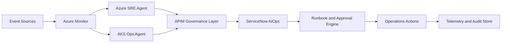
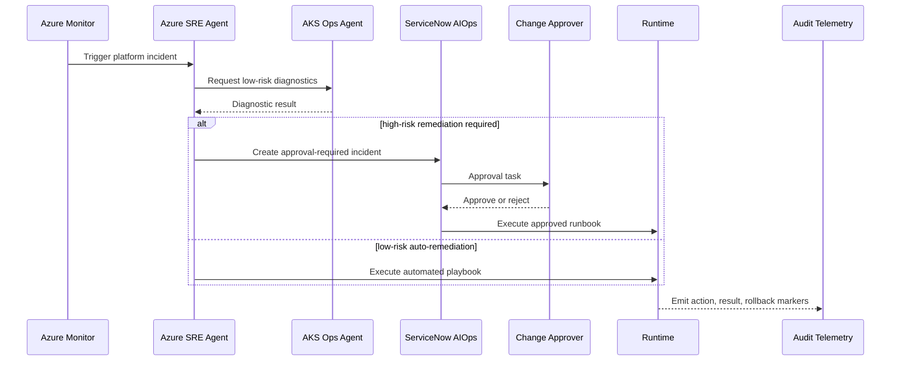

# Round 1128 · Cycle 2533
## Azure SRE Agent vs Custom AKS Ops Agent vs ServiceNow AIOps: Enterprise Incident Response Selection FAQ

## 1) Executive summary for platform and operations councils
- This round focuses on enterprise operations architecture, incident response workflow, ITSM integration, and TCO.
- We compare three mainstream patterns: Azure-native SRE Agent, custom AKS operations agent, and ServiceNow AIOps response workflow.
- Recommended layering: Azure-native capabilities for resource-health baselines, custom AKS automation for deep cluster actions, ServiceNow AIOps for cross-team governance and approvals.
- Core principle: approval gates, rollback safety, and auditability must precede autonomous remediation depth.
- Typical anti-pattern: allowing high-risk production changes without approval and rollback verification.

## 2) Topic-aligned capability radar (official references, fetched 2026-11-18 UTC)
- Azure Monitor: https://learn.microsoft.com/azure/azure-monitor/
- Azure Service Health: https://learn.microsoft.com/azure/service-health/
- Azure Resource Health: https://learn.microsoft.com/azure/service-health/resource-health-overview
- Azure Automation: https://learn.microsoft.com/azure/automation/
- Azure Functions: https://learn.microsoft.com/azure/azure-functions/
- AKS best practices: https://learn.microsoft.com/azure/aks/best-practices
- KEDA for AKS: https://learn.microsoft.com/azure/aks/keda-about
- ServiceNow AIOps overview: https://www.servicenow.com/products/aiops.html
- APIM policy reference: https://learn.microsoft.com/azure/api-management/api-management-policies
- Entra OBO flow: https://learn.microsoft.com/entra/identity-platform/v2-oauth2-on-behalf-of-flow
- Azure Policy: https://learn.microsoft.com/azure/governance/policy/
- Azure RBAC overview: https://learn.microsoft.com/azure/role-based-access-control/overview
- Azure PIM: https://learn.microsoft.com/azure/active-directory/privileged-identity-management/pim-configure
- Azure Chaos Studio: https://learn.microsoft.com/azure/chaos-studio/

## 3) Three operational intelligence options
- **Option A — Azure SRE Agent (Azure-native)** for resource health baselines, monitor-driven diagnostics, and lightweight remediation.
- **Option B — Custom AKS Ops Agent** for cluster-deep automation, bespoke runbooks, and platform-specific controls.
- **Option C — ServiceNow AIOps Incident Response** for ITSM-first workflow, approval governance, and enterprise audit consistency.
- **Option D — GitOps Code and IaC Remediation Agent** for PR-based rollback/hotfix flows and no ad-hoc production mutation.
- Composite strategy: A for cloud-plane baseline, B for cluster-depth execution, C for governance escalation, D for code-mediated remediation closure.
- Decision order: define severity and approval policy first, then choose automation depth and execution plane.

## 4) 12-dimension head-to-head matrix (including When NOT to choose)
| Dimension | A Azure SRE Agent | B Custom AKS Ops Agent | C ServiceNow AIOps | D GitOps Remediation Agent |
|---|---|---|---|---|
| 1. Primary scope | Azure PaaS and AKS correlation | Deep AKS triage and action | ITSM and CMDB workflow | Code/IaC rollback and hotfix |
| 2. Write-action safety | Scoped controlled | Depends on implementation | Human approval strongest | PR review strongest |
| 3. Telemetry ecosystem | Azure Monitor/AppLens/ARG | Prometheus/Grafana/Datadog | CMDB plus ITSM events | GitHub/Azure DevOps + IaC |
| 4. MTTD/MTTR impact | Fast platform detection | Fast cluster action | Strong coordination closure | Fast rollback and patching |
| 5. GitOps drift prevention | Medium | Medium | Low-medium | Highest |
| 6. CAB compliance fit | Medium-high | Medium | Highest | High |
| 7. Engineering effort | Low-medium | High | Medium-high | Medium |
| 8. Multi-agent composability | High | High | Medium-high | High |
| 9. Cost model | Azure-native ops cost | Engineering-heavy cost | ITSM license-heavy cost | Platform + review cost |
| 10. Hallucinated remediation control | Medium | Medium | High process guard | High review guard |
| 11. Best-fit scenario | Azure resource incident closure | Large AKS operations fleets | Regulated enterprise ITSM | Progressive release rollback loops |
| 12. When NOT to choose | Cross-cloud deep-action primary need | No platform SRE depth | Lightweight orgs with low process maturity | No code-review discipline |

## 5) Decision ladder and anti-patterns
- Step A: classify incidents by platform, cluster, and business workflow impact.
- Step B: classify actions by risk (read-only diagnostics, low-risk remediation, high-risk changes).
- Step C: route high-risk actions through approval workflows with rollback hooks.
- Step D: unify MTTA, MTTR, false-alert rate, and automation success metrics.
- Anti-pattern 1: autonomous high-risk remediation without approvals.
- Anti-pattern 2: no alert-noise suppression, leading to ticket floods.
- Anti-pattern 3: non-idempotent runbooks causing secondary incidents.
- Anti-pattern 4: optimizing automation coverage while ignoring failure blast radius.

## 6) Five efficiency and FinOps Q&As
### Q1: How to quantify automation labor value?
- `labor_saving = avoided_incidents * avg_manual_hours * hourly_cost`.
- `net_value = labor_saving - tooling_cost - false_remediation_cost`.
- Higher automation volume is valid only when net value remains positive under risk controls.

### Q2: How to tune alert-noise suppression?
- `noise_ratio = noisy_alerts / total_alerts`.
- If `noise_ratio > 0.35`, prioritize aggregation/suppression tuning before adding more automation.
- Balance noise reduction against missed-critical-event risk.

### Q3: How to convert MTTR improvement into business value?
- `mttr_gain = (baseline_mttr - current_mttr) * incidents`.
- `business_value = mttr_gain * impact_cost_per_hour`.
- Compute by severity tiers, not global averages.

### Q4: When is custom AKS Ops Agent maintenance cost acceptable?
- `ops_cost = platform_engineering_hours * hourly_cost + oncall_overhead`.
- Accept when `ops_cost < license_or_outsource_gap` and reliability gains are material.
- Otherwise prefer managed-native capabilities first.

### Q5: When does ServiceNow AIOps justify investment?
- `workflow_value = reduced_handoffs + reduced_reopen_rate + audit_pass_gain`.
- `sn_total_cost = license + integration + run_cost`.
- Prioritize C when workflow value exceeds total cost and compliance pressure is high.

## 7) Industry architecture #1: national healthcare group 24x7 HIS/EMR response
### Goals (Healthcare ITSM)
- Critical hospital systems require auditable and accountable incident handling.
- Target: reduce P1 MTTR by 35% within nine months while preserving compliance controls.

### End-to-end flow (Healthcare)
1. Azure SRE Agent monitors resource-health, capacity, and base-service availability.
2. It correlates AKS pod health, APIM latency, and DB throttling evidence in under 90 seconds.
3. Teams war room receives evidence-backed adaptive approval cards with Entra PIM elevation controls.
4. ServiceNow major-incident timeline records approval, execution, and rollback events.
5. Low-risk actions run via AKS Ops Agent while high-risk fixes flow through GitOps PR controls.

### SLA and mitigations (Healthcare)
- P1 MTTA < 5 minutes; P1 MTTR < 45 minutes.
- Failure A: alert flood -> suppression policy and threshold-window hardening.
- Failure B: remediation failure -> automatic rollback and human handoff.
- Failure C: approval bottleneck -> emergency approval pool and dual-sign lane.

## 8) Industry architecture #2: global SaaS peak-season multi-region response
### Goals (SaaS Peak)
- Handle cross-region demand spikes with deterministic escalation and recovery.
- Target: reduce major-incident recovery time by 30% without adding on-call headcount.

### End-to-end flow (SaaS)
1. Azure SRE Agent verifies progressive-canary health against baseline metrics.
2. GitHub Copilot Agent correlates incident windows with commit-diff and config drift signals.
3. Rollback/hotfix changes are produced as signed GitOps PRs, not ad-hoc kubectl mutations.
4. ServiceNow AIOps manages CAB approvals, communications, and escalation routing.
5. Custom AKS Ops Agent executes approved cluster actions and writes audit markers.

### SLA and mitigations (SaaS)
- Major-incident recovery P95 < 60 minutes; peak-season availability >= 99.95%.
- Failure A: regional cascading fault -> geo-reroute and config freeze mode.
- Failure B: automation chain misfire -> global kill-switch and manual-control transition.
- Failure C: delayed escalation -> automated duty-manager and SRE commander trigger.

## 9) Mermaid topology flowchart


## 10) Mermaid incident-response sequence


## 11) Bicep IaC (least privilege + Action Group webhook)
```bicep
param location string = 'eastus2'
param apimName string
param appInsightsName string
param actionGroupName string
param sreAgentPrincipalId string
resource appi 'Microsoft.Insights/components@2022-06-15' = {
  name: appInsightsName
  location: location
  kind: 'web'
  properties: { Application_Type: 'web' }
}
resource apim 'Microsoft.ApiManagement/service@2023-05-01-preview' = {
  name: apimName
  location: location
  sku: { name: 'Premium' capacity: 2 }
  properties: { publisherEmail: 'platform@contoso.com' publisherName: 'Contoso Platform' }
}
resource ag 'Microsoft.Insights/actionGroups@2023-01-01' = {
  name: actionGroupName
  location: location
  properties: {
    groupShortName: 'sreops'
    webhookReceivers: [
      {
        name: 'sre-agent-webhook'
        serviceUri: 'https://sre-agent.contoso.net/webhook/alerts'
      }
    ]
  }
}

resource raReader 'Microsoft.Authorization/roleAssignments@2022-04-01' = {
  name: guid(apim.id, sreAgentPrincipalId, 'reader')
  scope: apim
  properties: {
    roleDefinitionId: subscriptionResourceId('Microsoft.Authorization/roleDefinitions', 'acdd72a7-3385-48ef-bd42-f606fba81ae7')
    principalId: sreAgentPrincipalId
    principalType: 'ServicePrincipal'
  }
}

resource raScopedAction 'Microsoft.Authorization/roleAssignments@2022-04-01' = {
  name: guid(apim.id, sreAgentPrincipalId, 'scoped-action')
  scope: apim
  properties: {
    roleDefinitionId: subscriptionResourceId('Microsoft.Authorization/roleDefinitions', 'b24988ac-6180-42a0-ab88-20f7382dd24c')
    principalId: sreAgentPrincipalId
    principalType: 'ServicePrincipal'
  }
}
```

## 12) RBAC and remediation safety policy snippet
```json
{
  "policyVersion": "r1128",
  "severityActionMatrix": {
    "sev1": { "mode": "human_approval_required", "allowedActions": ["traffic_shift", "feature_flag_off"], "forbiddenActions": ["data_delete", "schema_change"] },
    "sev2": { "mode": "guarded_auto", "allowedActions": ["pod_restart", "hpa_scale"], "requireRollbackPlan": true },
    "sev3": { "mode": "auto_readonly_plus_lowrisk", "allowedActions": ["diagnose", "cache_purge"] }
  },
  "rbac": {
    "defaultRole": "Reader",
    "elevatedRole": "ScopedOpsContributor",
    "elevationControl": "EntraPIM",
    "approvalChannel": "TeamsAdaptiveCard"
  },
  "safety": {
    "idempotencyRequired": true,
    "rollbackRequired": true,
    "killSwitchRequired": true
  }
}
```

## 13) Azure Monitor / ARG KQL for triage and ROI
```kql
let start=ago(7d);
union isfuzzy=true
(
    AzureActivity
    | where TimeGenerated >= start
    | where ActivityStatusValue in ("Failure","Succeeded")
    | project TimeGenerated, Source="AzureActivity", OperationNameValue, ActivityStatusValue, ResourceGroup
),
(
    AppTraces
    | where TimeGenerated >= start
    | where Message has_any ("incident_opened","incident_resolved","auto_remediation")
    | project TimeGenerated, Source="AppTraces", OperationNameValue=tostring(CustomDimensions["operation"]), ActivityStatusValue=tostring(CustomDimensions["status"]), ResourceGroup=tostring(CustomDimensions["resourceGroup"])
)
| summarize events=count() by Source, ActivityStatusValue, bin(TimeGenerated, 1h)
| order by TimeGenerated desc
```

```kql
let start=ago(30d);
customMetrics
| where timestamp >= start
| where name in ("mtta_minutes","mttr_minutes","manual_hours_saved","rollback_count")
| summarize mtta=avgif(value,name=="mtta_minutes"), mttr=avgif(value,name=="mttr_minutes"), saved=sumif(value,name=="manual_hours_saved"), rollback=sumif(value,name=="rollback_count")
  by service=tostring(customDimensions.service), bin(timestamp,1d)
| order by timestamp desc
```

## 14) Day-0 / Day-1 / Day-2 checklist
### Day-0 (design)
- D0-01 Define severity mapping, approval levels, and accountable roles.
- D0-02 Define low-risk action allowlist and high-risk deny-by-default policy.
- D0-03 Define idempotency, timeout, and rollback constraints for runbooks.
- D0-04 Define MTTA/MTTR/noise-rate and automation-success baseline metrics.
- D0-05 Define ITSM field mapping with telemetry and action logs.
- D0-06 Define cross-team escalation and duty communication paths.
- D0-07 Define policy release and rollback windows.
- D0-08 Define drill cadence and evidence retention requirements.

### Day-1 (go-live)
- D1-01 Enable low-risk auto-remediation by canary scope.
- D1-02 Enable approval routes and validate dual-sign controls.
- D1-03 Validate incident-to-ticket-to-action trace integrity.
- D1-04 Run alert-flood suppression drills.
- D1-05 Run remediation-failure rollback drills.
- D1-06 Run cross-region escalation drills.
- D1-07 Publish week-one ops metrics and improvement backlog.
- D1-08 Freeze rollback point and finalize launch review.

### Day-2 (optimize)
- D2-01 Weekly review MTTA/MTTR and alert-noise trends.
- D2-02 Weekly review remediation success and failure taxonomy.
- D2-03 Biweekly review approval latency and ticket reopen rate.
- D2-04 Monthly review runbook idempotency and maintainability.
- D2-05 Monthly reconcile savings and operating costs.
- D2-06 Monthly perform compliance replay sampling.
- D2-07 Quarterly refresh on-call and escalation templates.
- D2-08 Quarterly run Chaos validation and remediation closure review.

## 15) Extended Q&A, deliverables, and validation
### Five strategic Q&As
- QA-A When should Azure SRE Agent be primary? When incidents are mostly Azure resource-plane health and baseline recovery.
- QA-B When should custom AKS Ops Agent be primary? When deep cluster actions and bespoke controls are critical.
- QA-C When should ServiceNow AIOps be primary? When cross-team governance, approvals, and ITSM consistency dominate.
- QA-D How to prevent over-automation risk? Use severity-gated approvals, allowlists, and rollback guardrails.
- QA-E How to prove automation ROI? Track manual-hour savings, MTTR gains, and rollback/failure costs together.

### 12 operations-governance review checks
- OR-01 Severity-to-approval mapping is explicit and testable.
- OR-02 Remediation actions are idempotent and rollback-verified.
- OR-03 High-risk actions require human approval by default.
- OR-04 Alert suppression policies cover flood scenarios.
- OR-05 Ticket fields correlate to monitor and execution logs.
- OR-06 Escalation paths are drill-tested across teams.
- OR-07 Policy rollouts support blue/green and rapid rollback.
- OR-08 Global kill-switch exists for automation chain anomalies.
- OR-09 Savings and cost attribution are service-line traceable.
- OR-10 Audit replay covers input, decision, action, and outcome.
- OR-11 Shift-handover process is structured and observable.
- OR-12 Quarterly drill findings are tracked to closure.

### Deliverables this round
- Bilingual FAQ (sections 1..15, zero loop padding).
- 12-dimension matrix, 5 Q&As, 2 Mermaid diagrams, Bicep, APIM policy, KQL, Day-0/1/2 checklist.
- SVG: `assets/42-cycle-2533-daily-breakthroughs.svg`.
- H5: `workbench-cycle-2533.html` + selector `#2533`.
- 7-card outputs: `benchmark-cards.html` and `benchmark-cards.en.html`.
- Evidence: `evidence/cycle-2533-*.json/csv`.

### Run and validate
```bash
python workshops/azure-agent-infra/simulator/cycle_1128_pipeline.py --write
python workshops/azure-agent-infra/simulator/cycle_1128_pipeline.py --check
python workshops/azure-agent-infra/simulator/strict_suffix_gate.py workshops/azure-agent-infra/azure-sre-agent-vs-custom-aks-ops-agent-vs-servicenow-aiops-incident-response-selection-faq-r1128.md workshops/azure-agent-infra/azure-sre-agent-vs-custom-aks-ops-agent-vs-servicenow-aiops-incident-response-selection-faq-r1128.en.md docs/azure-agent-infra/azure-sre-agent-vs-custom-aks-ops-agent-vs-servicenow-aiops-incident-response-selection-faq-r1128.md docs/azure-agent-infra/azure-sre-agent-vs-custom-aks-ops-agent-vs-servicenow-aiops-incident-response-selection-faq-r1128.en.md
pytest workshops/azure-agent-infra/simulator -q
```
