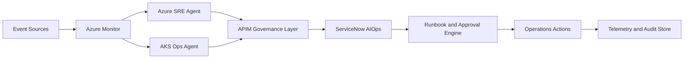
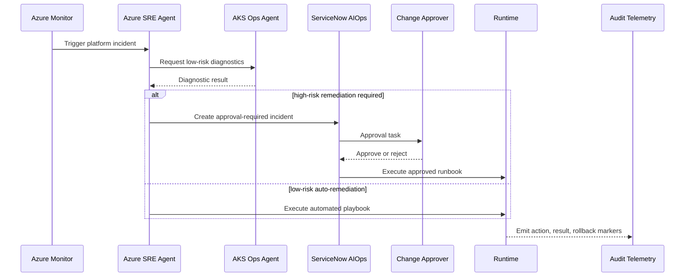

# Round 1128 · Cycle 2533
## Azure SRE Agent vs Custom AKS Ops Agent vs ServiceNow AIOps：企业智能运维与事件响应选型 FAQ

## 1) 执行摘要（平台与运维联席）
- 本轮聚焦企业运维应用架构、事件响应流程、ITSM 集成与 TCO，不涉及底层驱动或内核细节。
- 目标是比较三种主流模式：Azure 原生 SRE Agent、AKS 自定义运维 Agent、ServiceNow AIOps 驱动响应。
- 推荐分层：云资源健康与基线巡检优先 Azure 原生能力；复杂集群内操作自动化优先 AKS 自定义 Agent；跨组织工单治理与审批优先 ServiceNow AIOps。
- 关键原则：告警去噪、身份授权、变更审计、回滚策略必须先于“自动修复”。
- 典型反模式：让自动化 Agent 直接执行高风险修复而不经过审批栅栏与回滚验证。

## 2) Topic-aligned capability radar（官方来源，抓取时间 2026-11-18 UTC）
- Azure Monitor overview: https://learn.microsoft.com/azure/azure-monitor/
- Azure Service Health: https://learn.microsoft.com/azure/service-health/
- Azure Resource Health: https://learn.microsoft.com/azure/service-health/resource-health-overview
- Azure Automation: https://learn.microsoft.com/azure/automation/
- Azure Functions: https://learn.microsoft.com/azure/azure-functions/
- AKS operations best practices: https://learn.microsoft.com/azure/aks/best-practices
- Kubernetes event-driven autoscaling: https://learn.microsoft.com/azure/aks/keda-about
- ServiceNow AIOps overview: https://www.servicenow.com/products/aiops.html
- APIM policy reference: https://learn.microsoft.com/azure/api-management/api-management-policies
- Entra OBO flow: https://learn.microsoft.com/entra/identity-platform/v2-oauth2-on-behalf-of-flow
- Azure Policy and governance: https://learn.microsoft.com/azure/governance/policy/
- Azure RBAC overview: https://learn.microsoft.com/azure/role-based-access-control/overview
- Azure PIM for privileged access: https://learn.microsoft.com/azure/active-directory/privileged-identity-management/pim-configure
- Azure Chaos Studio: https://learn.microsoft.com/azure/chaos-studio/

## 3) 三类运维智能体方案定义
- **Option A — Azure SRE Agent（Azure-native）**：围绕 Azure Monitor/Resource Health/Automation 的原生巡检与修复编排。
- **Option B — Custom AKS Ops Agent**：在 AKS 内构建自定义诊断、扩缩容、配置漂移治理与 Runbook 自动化。
- **Option C — ServiceNow AIOps Incident Response**：以 ITSM/CMDB/变更审批为核心，统一跨团队事件处置与工单闭环。
- **Option D — GitOps Code & IaC Remediation Agent**：以 PR 驱动补丁/回滚，禁止 ad-hoc 生产变更。
- 组合策略：A 负责云面观测与轻修复，B 负责集群深度动作，C 负责跨组织治理与审批，D 负责代码化闭环修复。
- 决策顺序：先定义事件分级与审批权责，再决定自动化深度与执行平面。

## 4) 12 维度 head-to-head 选型矩阵（含 When NOT to choose）
| 维度 | A Azure SRE Agent | B Custom AKS Ops Agent | C ServiceNow AIOps | D GitOps Remediation Agent |
|---|---|---|---|---|
| 1. 主作用域 | Azure PaaS/AKS 相关性强 | AKS 深度 triage | ITSM/CMDB 流程强 | 代码/配置回滚强 |
| 2. 写动作安全 | 受控中等 | 取决实现 | 人审最强 | PR 审批最强 |
| 3. 遥测生态 | Azure Monitor/AppLens/ARG | Prometheus/Grafana/Datadog | CMDB+ITSM 事件域 | GitHub/Azure DevOps + IaC |
| 4. MTTD/MTTR 改善 | 快速平台定位 | 集群内问题快 | 协作闭环强 | 回滚修复快 |
| 5. GitOps 漂移防护 | 中 | 中 | 低中 | 最高 |
| 6. CAB 合规审计 | 中高 | 中 | 最高 | 高 |
| 7. 工程维护成本 | 低中 | 高 | 中高 | 中 |
| 8. 多 Agent 组合 | 高 | 高 | 中高 | 高 |
| 9. 许可与运维模型 | Azure 原生成本 | 工程人力成本 | ITSM 许可成本 | 代码平台+审查成本 |
| 10. 幻觉修复风险控制 | 中 | 中 | 高（流程） | 高（PR审查） |
| 11. Best-fit 场景 | Azure 资源故障闭环 | AKS 大规模运营 | 大型合规组织 | 渐进发布与快速回滚 |
| 12. When NOT to choose | 需跨云统一深度动作 | 缺工程值班能力 | 轻量组织流程薄弱 | 无代码审查文化 |

## 5) 决策树与反模式
- Step A：先分事件类型（平台事件、集群事件、业务事件）。
- Step B：再分动作风险级别（只读诊断、低风险修复、高风险变更）。
- Step C：高风险动作默认进入审批流，并绑定回滚脚本。
- Step D：统一指标口径（MTTA、MTTR、误告警率、自动化成功率）。
- 反模式 1：在无审批无回滚时自动执行高风险生产改动。
- 反模式 2：告警降噪缺失，导致 AIOps 工单风暴。
- 反模式 3：修复脚本缺少幂等性，造成二次事故。
- 反模式 4：只追求自动化覆盖率，忽略变更失败代价。

## 6) 5 个运维 FinOps 与效率 Q&A（含公式）
### Q1：自动化值守收益如何量化？
- `labor_saving = avoided_incidents * avg_manual_hours * hourly_cost`。
- `net_value = labor_saving - tooling_cost - false_remediation_cost`。
- 自动化不是越多越好，关键是净收益为正且风险可控。

### Q2：告警降噪阈值如何设？
- `noise_ratio = noisy_alerts / total_alerts`。
- 当 `noise_ratio > 0.35`，应优先优化聚合规则与抑制窗口。
- 降噪目标应与漏报风险联合评估，不可单指标优化。

### Q3：MTTR 改善如何折算业务价值？
- `mttr_gain = (baseline_mttr - current_mttr) * incidents`。
- `business_value = mttr_gain * impact_cost_per_hour`。
- 需按事件等级分别计算，避免平均值掩盖关键事故。

### Q4：AKS 自定义 Agent 的维护成本何时可接受？
- `ops_cost = platform_engineering_hours * hourly_cost + oncall_overhead`。
- 若 `ops_cost < outsourced_or_license_gap` 且带来显著可靠性提升，可接受。
- 否则优先选择托管能力并减少自定义面。

### Q5：ServiceNow AIOps 何时值得引入？
- `workflow_value = reduced_handoffs + reduced_reopen_rate + audit_pass_gain`。
- `sn_total_cost = license + integration + run_cost`。
- 当 `workflow_value > sn_total_cost` 且合规要求高时优先 C。

## 7) 行业架构一：全国连锁医疗集团 7x24 核心 HIS/EMR 运维响应
### 场景目标（Healthcare ITSM）
- 医院核心系统要求高可用，事件响应必须可审计、可回放、可追责。
- 目标：将 P1 事件 MTTR 在 9 个月内下降 35%，同时保持变更合规零红线。

### 架构流程（Healthcare）
1. Azure SRE Agent 监控资源健康、容量与基础服务可用性。
2. `<90s` 内关联 AKS Pod 健康、APIM 延迟、数据库节流证据并生成根因卡片。
3. Teams War Room 推送 Entra PIM 一键审批卡，高风险动作需人审通过。
4. ServiceNow Major Incident 时间线同步审批、执行、回滚事件。
5. AKS Ops Agent 执行低风险动作；高风险动作由 GitOps PR 触发。

### SLA 与缓解（Healthcare）
- P1 事件通知 MTTA < 5 分钟；P1 事件 MTTR < 45 分钟。
- 失效 A：误告警风暴 -> 启动抑制策略并提升阈值观察窗口。
- 失效 B：自动修复失败 -> 自动回滚并转人工值班接管。
- 失效 C：审批堵塞 -> 启用紧急审批池与双签通道。

## 8) 行业架构二：全球 SaaS 平台大促季跨区域故障响应
### 场景目标（SaaS Peak Season）
- 面对跨区域流量突增，需快速识别根因并分层处置。
- 目标：在不增加值班人力的前提下将重大事故恢复时间缩短 30%。

### 架构流程（SaaS）
1. Azure SRE Agent 负责灰度发布健康哨兵，实时对比 canary 与 baseline 指标。
2. 发现回归后由 GitHub Copilot Agent 关联最近提交差异与配置漂移证据。
3. 自动生成回滚/热修 PR，禁止 ad-hoc `kubectl` 直接变更生产集群。
4. ServiceNow AIOps 负责跨团队审批、沟通、升级和 CAB 记录。
5. Custom AKS Ops Agent 执行经审批的集群级动作并回写审计事件。

### SLA 与缓解（SaaS）
- 重大事故 P95 恢复时间 < 60 分钟；大促期可用性 >= 99.95%。
- 失效 A：区域连锁故障 -> 启动跨区流量切换与配置冻结。
- 失效 B：自动化连锁误操作 -> 触发全局 kill-switch 并进入人工模式。
- 失效 C：工单升级延迟 -> 自动触发值班经理与 SRE 指挥通道。

## 9) Mermaid 架构图（flowchart）


## 10) Mermaid 事件响应流程（sequenceDiagram）


## 11) Bicep IaC（Least-Privilege + Action Group Webhook）
```bicep
param location string = 'eastus2'
param apimName string
param appInsightsName string
param actionGroupName string
param sreAgentPrincipalId string

resource appi 'Microsoft.Insights/components@2022-06-15' = {
  name: appInsightsName
  location: location
  kind: 'web'
  properties: { Application_Type: 'web' }
}

resource apim 'Microsoft.ApiManagement/service@2023-05-01-preview' = {
  name: apimName
  location: location
  sku: { name: 'Premium' capacity: 2 }
  properties: { publisherEmail: 'platform@contoso.com' publisherName: 'Contoso Platform' }
}

resource ag 'Microsoft.Insights/actionGroups@2023-01-01' = {
  name: actionGroupName
  location: location
  properties: {
    groupShortName: 'sreops'
    webhookReceivers: [
      {
        name: 'sre-agent-webhook'
        serviceUri: 'https://sre-agent.contoso.net/webhook/alerts'
      }
    ]
  }
}

resource raReader 'Microsoft.Authorization/roleAssignments@2022-04-01' = {
  name: guid(apim.id, sreAgentPrincipalId, 'reader')
  scope: apim
  properties: {
    roleDefinitionId: subscriptionResourceId('Microsoft.Authorization/roleDefinitions', 'acdd72a7-3385-48ef-bd42-f606fba81ae7')
    principalId: sreAgentPrincipalId
    principalType: 'ServicePrincipal'
  }
}

resource raScopedAction 'Microsoft.Authorization/roleAssignments@2022-04-01' = {
  name: guid(apim.id, sreAgentPrincipalId, 'scoped-action')
  scope: apim
  properties: {
    roleDefinitionId: subscriptionResourceId('Microsoft.Authorization/roleDefinitions', 'b24988ac-6180-42a0-ab88-20f7382dd24c')
    principalId: sreAgentPrincipalId
    principalType: 'ServicePrincipal'
  }
}
```

## 12) RBAC / Remediation Safety Policy 片段
```json
{
  "policyVersion": "r1128",
  "severityActionMatrix": {
    "sev1": { "mode": "human_approval_required", "allowedActions": ["traffic_shift", "feature_flag_off"], "forbiddenActions": ["data_delete", "schema_change"] },
    "sev2": { "mode": "guarded_auto", "allowedActions": ["pod_restart", "hpa_scale"], "requireRollbackPlan": true },
    "sev3": { "mode": "auto_readonly_plus_lowrisk", "allowedActions": ["diagnose", "cache_purge"] }
  },
  "rbac": {
    "defaultRole": "Reader",
    "elevatedRole": "ScopedOpsContributor",
    "elevationControl": "EntraPIM",
    "approvalChannel": "TeamsAdaptiveCard"
  },
  "safety": {
    "idempotencyRequired": true,
    "rollbackRequired": true,
    "killSwitchRequired": true
  }
}
```

## 13) Azure Monitor / ARG KQL（Triage 与收益）
```kql
let start=ago(7d);
union isfuzzy=true
(
    AzureActivity
    | where TimeGenerated >= start
    | where ActivityStatusValue in ("Failure","Succeeded")
    | project TimeGenerated, Source="AzureActivity", OperationNameValue, ActivityStatusValue, ResourceGroup
),
(
    AppTraces
    | where TimeGenerated >= start
    | where Message has_any ("incident_opened","incident_resolved","auto_remediation")
    | project TimeGenerated, Source="AppTraces", OperationNameValue=tostring(CustomDimensions["operation"]), ActivityStatusValue=tostring(CustomDimensions["status"]), ResourceGroup=tostring(CustomDimensions["resourceGroup"])
)
| summarize events=count() by Source, ActivityStatusValue, bin(TimeGenerated, 1h)
| order by TimeGenerated desc
```

```kql
let start=ago(30d);
customMetrics
| where timestamp >= start
| where name in ("mtta_minutes","mttr_minutes","manual_hours_saved","rollback_count")
| summarize mtta=avgif(value,name=="mtta_minutes"), mttr=avgif(value,name=="mttr_minutes"), saved=sumif(value,name=="manual_hours_saved"), rollback=sumif(value,name=="rollback_count")
  by service=tostring(customDimensions.service), bin(timestamp,1d)
| order by timestamp desc
```

## 14) Day-0 / Day-1 / Day-2 清单
### Day-0（设计）
- D0-01：定义事件分级、审批级别与责任矩阵。
- D0-02：定义低风险自动动作白名单与高风险禁止清单。
- D0-03：定义回滚脚本、幂等规则与执行超时策略。
- D0-04：定义 MTTA/MTTR/误告警率与自动化成功率口径。
- D0-05：定义 ITSM 字段与审计字段映射标准。
- D0-06：定义跨团队升级路径与值班联络机制。
- D0-07：定义策略发布与回滚窗口。
- D0-08：定义演练计划与证据归档要求。

### Day-1（上线）
- D1-01：灰度启用低风险自动修复动作。
- D1-02：开启审批链路并验证双签流程。
- D1-03：验证工单字段与监控事件关联完整性。
- D1-04：执行误告警风暴演练与抑制策略验证。
- D1-05：执行自动修复失败回滚演练。
- D1-06：执行跨区故障升级演练。
- D1-07：发布首周值班复盘与改进项。
- D1-08：冻结版本并记录回滚点。

### Day-2（优化）
- D2-01：每周复盘 MTTA/MTTR 与误告警率趋势。
- D2-02：每周复盘自动化成功率与失败原因分布。
- D2-03：双周复盘审批时延与工单重开率。
- D2-04：每月复核 runbook 幂等性与可维护性。
- D2-05：每月复核成本与节省对账数据。
- D2-06：每月执行合规抽检与审计回放。
- D2-07：季度更新值班手册与沟通模板。
- D2-08：季度进行 Chaos 演练并跟踪整改闭环。

## 15) 扩展问答、交付清单与验收命令
### 五条扩展问答
- QA-A：何时优先 Azure SRE Agent？当问题主要集中在 Azure 资源面健康与基线修复时。
- QA-B：何时优先 Custom AKS Ops Agent？当集群内部动作复杂且需要深度自定义时。
- QA-C：何时优先 ServiceNow AIOps？当组织强调跨团队审批、工单和审计一致性时。
- QA-D：如何避免自动化“越权修复”？通过分级审批、动作白名单和回滚栅栏。
- QA-E：如何证明自动化 ROI？统一输出人工工时节省、MTTR 改善和失败回滚成本。

### 12 条运维治理评审项
- OR-01：事件分级是否与审批级别严格映射。
- OR-02：自动动作是否具备幂等与回滚验证。
- OR-03：高风险动作是否默认人工审批。
- OR-04：告警抑制策略是否覆盖风暴场景。
- OR-05：工单字段是否能关联监控与执行日志。
- OR-06：跨团队升级路径是否可执行可演练。
- OR-07：策略变更是否有蓝绿与快速回退。
- OR-08：自动化失败是否有 kill-switch。
- OR-09：成本与节省是否按服务线归因。
- OR-10：审计回放是否覆盖输入、决策、执行、结果。
- OR-11：值班交接是否结构化且可追踪。
- OR-12：季度演练整改项是否闭环完成。

### 本轮交付
- 双语 FAQ（sections 1..15，零循环填充）；
- 12 维度矩阵、5 个 Q&A、2 张 Mermaid、Bicep、APIM 策略、KQL、Day-0/1/2；
- SVG：`assets/42-cycle-2533-daily-breakthroughs.svg`；
- H5：`workbench-cycle-2533.html` + selector `#2533`；
- 7-card：`benchmark-cards.html` 与 `benchmark-cards.en.html`；
- Evidence：`evidence/cycle-2533-*.json/csv`。

### 运行与验收
```bash
python workshops/azure-agent-infra/simulator/cycle_1128_pipeline.py --write
python workshops/azure-agent-infra/simulator/cycle_1128_pipeline.py --check
python workshops/azure-agent-infra/simulator/strict_suffix_gate.py workshops/azure-agent-infra/azure-sre-agent-vs-custom-aks-ops-agent-vs-servicenow-aiops-incident-response-selection-faq-r1128.md workshops/azure-agent-infra/azure-sre-agent-vs-custom-aks-ops-agent-vs-servicenow-aiops-incident-response-selection-faq-r1128.en.md docs/azure-agent-infra/azure-sre-agent-vs-custom-aks-ops-agent-vs-servicenow-aiops-incident-response-selection-faq-r1128.md docs/azure-agent-infra/azure-sre-agent-vs-custom-aks-ops-agent-vs-servicenow-aiops-incident-response-selection-faq-r1128.en.md
pytest workshops/azure-agent-infra/simulator -q
```
