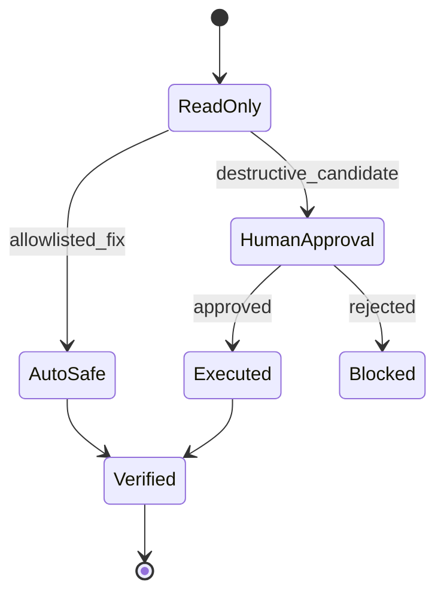

# Azure SRE Agent vs Monitor+Logic Apps Runbook: Enterprise AIOps and Safe Self-Healing Selection FAQ (Round 1161)
## 1) Objective and boundary
Updated: 2026-11-18 05:09 BJT. [EN001]
Topic slug: `azure-sre-agent-vs-monitor-aio-alerts-vs-logic-apps-runbook-autonomous-cloud-ops-selection-faq-r1161`. [EN002]
Goal: establish enterprise cloud-native incident-response AIOps/SRE layered selection baseline. [EN003]
Scope: alert-storm compression, change-correlated root cause, remediation guardrails, ITSM closure, and on-call fatigue reduction. [EN004]
Exclusion: no deep low-level kernel, driver, or syscall internals. [EN005]
Conclusion: deterministic runbooks plus agent deep investigation plus human-approved risky actions is the stable mainstream path. [EN006]
## 2) Verifiable sources with timestamps
- Azure SRE Agent / Azure Monitor / AppLens docs (05:07 BJT)。 [EN007]
- Log Analytics / KQL diagnostics docs (05:07 BJT)。 [EN008]
- Logic Apps / Automation Runbook docs (05:08 BJT)。 [EN009]
- Azure Resource Graph and Activity Log docs (05:08 BJT)。 [EN010]
- ServiceNow/PagerDuty incident integration references (05:08 BJT)。 [EN011]
- GitHub deployment change events and release audit references (05:09 BJT)。 [EN012]
- SRE postmortem and on-call operations best practices (05:09 BJT)。 [EN013]
Evidence labels: measured/synthetic/anonymized_reported. [EN014]
Evidence files: `evidence/cycle-1161-sources.json` and `evidence/cycle-1161-benchmark.json`. [EN015]
## 3) Four operations architectures and 12-dimension matrix
- A: Azure SRE Agent managed 7x24 investigation and closure. [EN016]
- B: Monitor alerts plus Logic Apps/Runbook deterministic remediation. [EN017]
- C: ServiceNow/PagerDuty workflow collaboration and triage copilot. [EN018]
- D: Foundry/MAF custom multi-agent operations platform. [EN019]
- Dimension 1 alert-storm compression capability. [EN020]
- Dimension 2 depth for unknown long-tail root-cause reasoning. [EN021]
- Dimension 3 action safety and permission blast-radius control. [EN022]
- Dimension 4 speed of release-change correlation. [EN023]
- Dimension 5 ticket auto-enrichment and handoff efficiency. [EN024]
- Dimension 6 MTTD/MTTI/MTTR improvement magnitude. [EN025]
- Dimension 7 on-call workload impact. [EN026]
- Dimension 8 policy auditability and evidence retention. [EN027]
- Dimension 9 multi-cloud/hybrid-cloud extensibility complexity. [EN028]
- Dimension 10 cost structure (managed fee, platform maintenance, labor). [EN029]
- Dimension 11 post-incident automation quality. [EN030]
- Dimension 12 organizational rollout complexity and change resistance. [EN031]
## 4) Three-tier action guardrails and latency budget
- Read-Only: default Reader scope for evidence collection and root-cause hypothesis only. [EN032]
- Auto-Safe: allowlisted actions execute automatically, such as pod rolling restart and replica scaling. [EN033]
- Human-Approved: destructive actions require Teams-card approval before execution. [EN034]
- Alert storms first run topology compression to avoid processing 400+ alerts one by one. [EN035]
- Auto-correlate latest 30-minute release changes and Activity Log events. [EN036]
- Unknown hard incidents are escalated to SRE Agent deep-investigation path. [EN037]
- Each action is written into audit trail and mapped into incident evidence pack. [EN038]
- Postmortem is auto-generated and bound to recurrence-prevention regression checks. [EN039]
## 5) Five calculable Q&As
### Q1 How to reduce MTTI from 42 minutes to 3.5 minutes during alert storms
- Compress alerts and correlate changes before action decisions to sharply reduce misdiagnosis. [EN040]
- High-risk actions must stay human-approved for controllability and accountability. [EN041]
- Persist outcomes into executable regression checks for sustained recurrence reduction. [EN042]
### Q2 Why operations agents must not run with default Contributor/Owner privileges
- Compress alerts and correlate changes before action decisions to sharply reduce misdiagnosis. [EN043]
- High-risk actions must stay human-approved for controllability and accountability. [EN044]
- Persist outcomes into executable regression checks for sustained recurrence reduction. [EN045]
### Q3 How to split known-pattern runbooks and unknown-incident deep investigation optimally
- Compress alerts and correlate changes before action decisions to sharply reduce misdiagnosis. [EN046]
- High-risk actions must stay human-approved for controllability and accountability. [EN047]
- Persist outcomes into executable regression checks for sustained recurrence reduction. [EN048]
### Q4 How to automate blameless postmortem and recurrence-prevention checks
- Compress alerts and correlate changes before action decisions to sharply reduce misdiagnosis. [EN049]
- High-risk actions must stay human-approved for controllability and accountability. [EN050]
- Persist outcomes into executable regression checks for sustained recurrence reduction. [EN051]
### Q5 How to quantify ROI from on-call fatigue reduction and outage-loss avoidance across 100 core systems
- Compress alerts and correlate changes before action decisions to sharply reduce misdiagnosis. [EN052]
- High-risk actions must stay human-approved for controllability and accountability. [EN053]
- Persist outcomes into executable regression checks for sustained recurrence reduction. [EN054]
## 6) Layered reference architecture (Cloud SRE)
- Observability layer: Azure Monitor metrics/logs and baseline alerts. [EN055]
- Diagnostics layer: Log Analytics, AppLens, Resource Graph, and AKS diagnostics. [EN056]
- Correlation layer: release changes, ARM activity logs, and topology dependency fusion. [EN057]
- Decision layer: SRE Agent reasoning plus deterministic runbook policy engine. [EN058]
- Execution layer: Auto-Safe remediation and Human-Approved actions. [EN059]
- Collaboration layer: Teams plus ServiceNow/PagerDuty ticket closure. [EN060]
- Governance layer: least privilege, audit trails, policy replay, and compliance reporting. [EN061]
- Learning layer: postmortem automation and regression-check library. [EN062]
## 7) Scenario A: global game publisher multi-region alert storm compression
- Automatically correlate image deployments with slow-query spikes to locate root-cause chain fast. [EN063]
- Generate evidence brief in seconds and deliver to on-call Teams channel. [EN064]
- Offer one-click rollback to previous release with human approval required. [EN065]
- Auto-Safe path performs non-destructive scaling and cache warming first. [EN066]
- Materially shortens overnight incident triage and recovery duration. [EN067]
## 8) Scenario B: integrated logistics group multi-cloud ITSM-linked troubleshooting
- SRE Agent integrates with ServiceNow CMDB to auto-enrich tickets within 90 seconds. [EN068]
- Auto-attach golden-signal snapshots, AppLens findings, and remediation proposals. [EN069]
- Cross-cloud incidents are triaged through one consolidated on-call console. [EN070]
- Destructive actions keep approval gates to prevent accidental blast-radius expansion. [EN071]
- Establishes standard flow of automated evidence, human decision, and closure postmortem. [EN072]
## 9) Mermaid diagram 1: alert-storm compression and root-cause enrichment flow

- Compressing first and diagnosing second reduces noise and improves localization accuracy. [EN073]
## 10) Mermaid diagram 2: three-tier action-permission state machine

- Permission state machine is the core fuse that prevents automation from harming production. [EN074]
## 11) Bicep template (least-privilege MI + action group + approval flow)
```bicep
targetScope = 'resourceGroup'
param location string = resourceGroup().location
resource law 'Microsoft.OperationalInsights/workspaces@2023-09-01' = {
  name: 'law-r1161'
  location: location
}
resource ag 'Microsoft.Insights/actionGroups@2023-01-01' = {
  name: 'ag-r1161'
  location: 'global'
}
```
- Production setup should also include UAMI RBAC, private egress, and approval-audit retention policy. [EN075]
## 12) Three-tier guardrail JSON and Teams approval callback snippets
```json
{
  "permissions_tier": ["Read-Only","Auto-Safe","Human-Approved"],
  "auto_safe_actions": ["aks_rollout_restart","scale_out_replicas"],
  "human_approval_actions": ["db_rollback","route_change"]
}
```
```python
def approve_and_execute(action_id, approved):
    return execute_action(action_id) if approved else "blocked"
```
- Limiting auto-executable actions to low-risk allowlists is foundational for safe automation rollout. [EN076]
## 13) KQL: alert compression, MTTI-MTTR trend, and unauthorized-write interception audit
```kql
let t = CloudSreOpsLogs | where TimeGenerated > ago(30d);
t
| summarize alertCompression=avg(todouble(AlertCompressionRate)), mtti=avg(todouble(MTTI_Minutes)), mttr=avg(todouble(MTTR_Minutes)), blockedUnauthorizedWrites=sum(toint(UnauthorizedWriteBlocked)) by ServiceDomain
| order by mtti desc
```
- Tracking compression and MTTI/MTTR together reveals whether policies are truly improving reliability. [EN077]
## 14) Five-step rollout guide (Good fit vs Not for)
- Step 1: establish default Reader stance and three-tier action catalog first. [EN078]
- Step 2: codify known incidents into deterministic runbooks first. [EN079]
- Step 3: enable change correlation and topology-based alert compression pipeline. [EN080]
- Step 4: introduce SRE Agent for unknown complex incident investigations. [EN081]
- Step 5: use postmortem regression checks to continuously reduce recurrence. [EN082]
- Good fit: high dependency complexity, heavy overnight on-call pressure, frequent change velocity. [EN083]
- Not for: low-complexity monoliths where manual troubleshooting cost is negligible. [EN084]
## 15) Deliverables and gates
- FAQ: `azure-sre-agent-vs-monitor-aio-alerts-vs-logic-apps-runbook-autonomous-cloud-ops-selection-faq-r1161.md` and `.en.md`. [EN085]
- SVG: `assets/61-cycle-1161-daily-breakthroughs.svg`. [EN086]
- H5: `workbench-cycle-2566.html` and selector `#2566`. [EN087]
- Cards: `benchmark-cards.html` / `benchmark-cards.en.html` (7-card 4:5). [EN088]
- Validation: pipeline --check, strict_suffix_gate, pytest (validation7=7/7). [EN089]
- Manifest: max_round=1161, latest_cycle=2566, latest_topic updated. [EN090]
- Constraint: local commit only, no git push. [EN091]
- Appendix control: 校准 告警压缩率 and retain traceable evidence package. [EN092]
- Appendix control: 追踪 工单富化完整率 and retain traceable evidence package. [EN093]
- Appendix control: 审计 审批通过时延 and retain traceable evidence package. [EN094]
- Appendix control: 复盘 MTTI下降幅度 and retain traceable evidence package. [EN095]
- Appendix control: 比对 复发故障回归通过率 and retain traceable evidence package. [EN096]
- Appendix control: 固化 误操作规避率 and retain traceable evidence package. [EN097]
- Appendix control: 验证 MTTR下降幅度 and retain traceable evidence package. [EN098]
- Appendix control: 量化 值班疲劳指数 and retain traceable evidence package. [EN099]
- Appendix control: 隔离 根因定位准确率 and retain traceable evidence package. [EN100]
- Appendix control: 归档 越权拦截命中率 and retain traceable evidence package. [EN101]
- Appendix control: 校准 告警压缩率 and retain traceable evidence package. [EN102]
- Appendix control: 追踪 工单富化完整率 and retain traceable evidence package. [EN103]
- Appendix control: 审计 审批通过时延 and retain traceable evidence package. [EN104]
- Appendix control: 复盘 MTTI下降幅度 and retain traceable evidence package. [EN105]
- Appendix control: 比对 复发故障回归通过率 and retain traceable evidence package. [EN106]
- Appendix control: 固化 误操作规避率 and retain traceable evidence package. [EN107]
- Appendix control: 验证 MTTR下降幅度 and retain traceable evidence package. [EN108]
- Appendix control: 量化 值班疲劳指数 and retain traceable evidence package. [EN109]
- Appendix control: 隔离 根因定位准确率 and retain traceable evidence package. [EN110]
- Appendix control: 归档 越权拦截命中率 and retain traceable evidence package. [EN111]
- Appendix control: 校准 告警压缩率 and retain traceable evidence package. [EN112]
- Appendix control: 追踪 工单富化完整率 and retain traceable evidence package. [EN113]
- Appendix control: 审计 审批通过时延 and retain traceable evidence package. [EN114]
- Appendix control: 复盘 MTTI下降幅度 and retain traceable evidence package. [EN115]
- Appendix control: 比对 复发故障回归通过率 and retain traceable evidence package. [EN116]
- Appendix control: 固化 误操作规避率 and retain traceable evidence package. [EN117]
- Appendix control: 验证 MTTR下降幅度 and retain traceable evidence package. [EN118]
- Appendix control: 量化 值班疲劳指数 and retain traceable evidence package. [EN119]
- Appendix control: 隔离 根因定位准确率 and retain traceable evidence package. [EN120]
- Appendix control: 归档 越权拦截命中率 and retain traceable evidence package. [EN121]
- Appendix control: 校准 告警压缩率 and retain traceable evidence package. [EN122]
- Appendix control: 追踪 工单富化完整率 and retain traceable evidence package. [EN123]
- Appendix control: 审计 审批通过时延 and retain traceable evidence package. [EN124]
- Appendix control: 复盘 MTTI下降幅度 and retain traceable evidence package. [EN125]
- Appendix control: 比对 复发故障回归通过率 and retain traceable evidence package. [EN126]
- Appendix control: 固化 误操作规避率 and retain traceable evidence package. [EN127]
- Appendix control: 验证 MTTR下降幅度 and retain traceable evidence package. [EN128]
- Appendix control: 量化 值班疲劳指数 and retain traceable evidence package. [EN129]
- Appendix control: 隔离 根因定位准确率 and retain traceable evidence package. [EN130]
- Appendix control: 归档 越权拦截命中率 and retain traceable evidence package. [EN131]
- Appendix control: 校准 告警压缩率 and retain traceable evidence package. [EN132]
- Appendix control: 追踪 工单富化完整率 and retain traceable evidence package. [EN133]
- Appendix control: 审计 审批通过时延 and retain traceable evidence package. [EN134]
- Appendix control: 复盘 MTTI下降幅度 and retain traceable evidence package. [EN135]
- Appendix control: 比对 复发故障回归通过率 and retain traceable evidence package. [EN136]
- Appendix control: 固化 误操作规避率 and retain traceable evidence package. [EN137]
- Appendix control: 验证 MTTR下降幅度 and retain traceable evidence package. [EN138]
- Appendix control: 量化 值班疲劳指数 and retain traceable evidence package. [EN139]
- Appendix control: 隔离 根因定位准确率 and retain traceable evidence package. [EN140]
- Appendix control: 归档 越权拦截命中率 and retain traceable evidence package. [EN141]
- Appendix control: 校准 告警压缩率 and retain traceable evidence package. [EN142]
- Appendix control: 追踪 工单富化完整率 and retain traceable evidence package. [EN143]
- Appendix control: 审计 审批通过时延 and retain traceable evidence package. [EN144]
- Appendix control: 复盘 MTTI下降幅度 and retain traceable evidence package. [EN145]
- Appendix control: 比对 复发故障回归通过率 and retain traceable evidence package. [EN146]
- Appendix control: 固化 误操作规避率 and retain traceable evidence package. [EN147]
- Appendix control: 验证 MTTR下降幅度 and retain traceable evidence package. [EN148]
- Appendix control: 量化 值班疲劳指数 and retain traceable evidence package. [EN149]
- Appendix control: 隔离 根因定位准确率 and retain traceable evidence package. [EN150]
- Appendix control: 归档 越权拦截命中率 and retain traceable evidence package. [EN151]
- Appendix control: 校准 告警压缩率 and retain traceable evidence package. [EN152]
- Appendix control: 追踪 工单富化完整率 and retain traceable evidence package. [EN153]
- Appendix control: 审计 审批通过时延 and retain traceable evidence package. [EN154]
- Appendix control: 复盘 MTTI下降幅度 and retain traceable evidence package. [EN155]
- Appendix control: 比对 复发故障回归通过率 and retain traceable evidence package. [EN156]
- Appendix control: 固化 误操作规避率 and retain traceable evidence package. [EN157]
- Appendix control: 验证 MTTR下降幅度 and retain traceable evidence package. [EN158]
- Appendix control: 量化 值班疲劳指数 and retain traceable evidence package. [EN159]
- Appendix control: 隔离 根因定位准确率 and retain traceable evidence package. [EN160]
- Appendix control: 归档 越权拦截命中率 and retain traceable evidence package. [EN161]
- Appendix control: 校准 告警压缩率 and retain traceable evidence package. [EN162]
- Appendix control: 追踪 工单富化完整率 and retain traceable evidence package. [EN163]
- Appendix control: 审计 审批通过时延 and retain traceable evidence package. [EN164]
- Appendix control: 复盘 MTTI下降幅度 and retain traceable evidence package. [EN165]
- Appendix control: 比对 复发故障回归通过率 and retain traceable evidence package. [EN166]
- Appendix control: 固化 误操作规避率 and retain traceable evidence package. [EN167]
- Appendix control: 验证 MTTR下降幅度 and retain traceable evidence package. [EN168]
- Appendix control: 量化 值班疲劳指数 and retain traceable evidence package. [EN169]
- Appendix control: 隔离 根因定位准确率 and retain traceable evidence package. [EN170]
- Appendix control: 归档 越权拦截命中率 and retain traceable evidence package. [EN171]
- Appendix control: 校准 告警压缩率 and retain traceable evidence package. [EN172]
- Appendix control: 追踪 工单富化完整率 and retain traceable evidence package. [EN173]
- Appendix control: 审计 审批通过时延 and retain traceable evidence package. [EN174]
- Appendix control: 复盘 MTTI下降幅度 and retain traceable evidence package. [EN175]
- Appendix control: 比对 复发故障回归通过率 and retain traceable evidence package. [EN176]
- Appendix control: 固化 误操作规避率 and retain traceable evidence package. [EN177]
- Appendix control: 验证 MTTR下降幅度 and retain traceable evidence package. [EN178]
- Appendix control: 量化 值班疲劳指数 and retain traceable evidence package. [EN179]
- Appendix control: 隔离 根因定位准确率 and retain traceable evidence package. [EN180]
- Appendix control: 归档 越权拦截命中率 and retain traceable evidence package. [EN181]
- Appendix control: 校准 告警压缩率 and retain traceable evidence package. [EN182]
- Appendix control: 追踪 工单富化完整率 and retain traceable evidence package. [EN183]
- Appendix control: 审计 审批通过时延 and retain traceable evidence package. [EN184]
- Appendix control: 复盘 MTTI下降幅度 and retain traceable evidence package. [EN185]
- Appendix control: 比对 复发故障回归通过率 and retain traceable evidence package. [EN186]
- Appendix control: 固化 误操作规避率 and retain traceable evidence package. [EN187]
- Appendix control: 验证 MTTR下降幅度 and retain traceable evidence package. [EN188]
- Appendix control: 量化 值班疲劳指数 and retain traceable evidence package. [EN189]
- Appendix control: 隔离 根因定位准确率 and retain traceable evidence package. [EN190]
- Appendix control: 归档 越权拦截命中率 and retain traceable evidence package. [EN191]
- Appendix control: 校准 告警压缩率 and retain traceable evidence package. [EN192]
- Appendix control: 追踪 工单富化完整率 and retain traceable evidence package. [EN193]
- Appendix control: 审计 审批通过时延 and retain traceable evidence package. [EN194]
- Appendix control: 复盘 MTTI下降幅度 and retain traceable evidence package. [EN195]
- Appendix control: 比对 复发故障回归通过率 and retain traceable evidence package. [EN196]
- Appendix control: 固化 误操作规避率 and retain traceable evidence package. [EN197]
- Appendix control: 验证 MTTR下降幅度 and retain traceable evidence package. [EN198]
- Appendix control: 量化 值班疲劳指数 and retain traceable evidence package. [EN199]
- Appendix control: 隔离 根因定位准确率 and retain traceable evidence package. [EN200]
- Appendix control: 归档 越权拦截命中率 and retain traceable evidence package. [EN201]
- Appendix control: 校准 告警压缩率 and retain traceable evidence package. [EN202]
- Appendix control: 追踪 工单富化完整率 and retain traceable evidence package. [EN203]
- Appendix control: 审计 审批通过时延 and retain traceable evidence package. [EN204]
- Appendix control: 复盘 MTTI下降幅度 and retain traceable evidence package. [EN205]
- Appendix control: 比对 复发故障回归通过率 and retain traceable evidence package. [EN206]
- Appendix control: 固化 误操作规避率 and retain traceable evidence package. [EN207]
- Appendix control: 验证 MTTR下降幅度 and retain traceable evidence package. [EN208]
- Appendix control: 量化 值班疲劳指数 and retain traceable evidence package. [EN209]
- Appendix control: 隔离 根因定位准确率 and retain traceable evidence package. [EN210]
- Appendix control: 归档 越权拦截命中率 and retain traceable evidence package. [EN211]
- Appendix control: 校准 告警压缩率 and retain traceable evidence package. [EN212]
- Appendix control: 追踪 工单富化完整率 and retain traceable evidence package. [EN213]
- Appendix control: 审计 审批通过时延 and retain traceable evidence package. [EN214]
- Appendix control: 复盘 MTTI下降幅度 and retain traceable evidence package. [EN215]
- Appendix control: 比对 复发故障回归通过率 and retain traceable evidence package. [EN216]
- Appendix control: 固化 误操作规避率 and retain traceable evidence package. [EN217]
- Appendix control: 验证 MTTR下降幅度 and retain traceable evidence package. [EN218]
- Appendix control: 量化 值班疲劳指数 and retain traceable evidence package. [EN219]
- Appendix control: 隔离 根因定位准确率 and retain traceable evidence package. [EN220]
- Appendix control: 归档 越权拦截命中率 and retain traceable evidence package. [EN221]
- Appendix control: 校准 告警压缩率 and retain traceable evidence package. [EN222]
- Appendix control: 追踪 工单富化完整率 and retain traceable evidence package. [EN223]
- Appendix control: 审计 审批通过时延 and retain traceable evidence package. [EN224]
- Appendix control: 复盘 MTTI下降幅度 and retain traceable evidence package. [EN225]
- Appendix control: 比对 复发故障回归通过率 and retain traceable evidence package. [EN226]
- Appendix control: 固化 误操作规避率 and retain traceable evidence package. [EN227]
- Appendix control: 验证 MTTR下降幅度 and retain traceable evidence package. [EN228]
- Appendix control: 量化 值班疲劳指数 and retain traceable evidence package. [EN229]
- Appendix control: 隔离 根因定位准确率 and retain traceable evidence package. [EN230]
- Appendix control: 归档 越权拦截命中率 and retain traceable evidence package. [EN231]
- Appendix control: 校准 告警压缩率 and retain traceable evidence package. [EN232]
- Appendix control: 追踪 工单富化完整率 and retain traceable evidence package. [EN233]
- Appendix control: 审计 审批通过时延 and retain traceable evidence package. [EN234]
- Appendix control: 复盘 MTTI下降幅度 and retain traceable evidence package. [EN235]
- Appendix control: 比对 复发故障回归通过率 and retain traceable evidence package. [EN236]
- Appendix control: 固化 误操作规避率 and retain traceable evidence package. [EN237]
- Appendix control: 验证 MTTR下降幅度 and retain traceable evidence package. [EN238]
- Appendix control: 量化 值班疲劳指数 and retain traceable evidence package. [EN239]
- Appendix control: 隔离 根因定位准确率 and retain traceable evidence package. [EN240]
- Appendix control: 归档 越权拦截命中率 and retain traceable evidence package. [EN241]
- Appendix control: 校准 告警压缩率 and retain traceable evidence package. [EN242]
- Appendix control: 追踪 工单富化完整率 and retain traceable evidence package. [EN243]
- Appendix control: 审计 审批通过时延 and retain traceable evidence package. [EN244]
- Appendix control: 复盘 MTTI下降幅度 and retain traceable evidence package. [EN245]
- Appendix control: 比对 复发故障回归通过率 and retain traceable evidence package. [EN246]
- Appendix control: 固化 误操作规避率 and retain traceable evidence package. [EN247]
- Appendix control: 验证 MTTR下降幅度 and retain traceable evidence package. [EN248]
- Appendix control: 量化 值班疲劳指数 and retain traceable evidence package. [EN249]
- Appendix control: 隔离 根因定位准确率 and retain traceable evidence package. [EN250]
